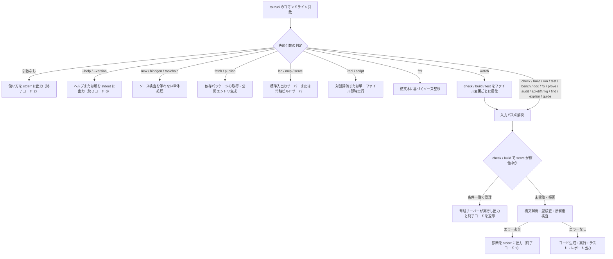

# CLI とサブコマンド

`tsuzuri` コマンドは、ソースファイル（`.tz`・`.tt`・`.tc`）の型検査、ネイティブ実行ファイルや WebAssembly の生成、テスト・ベンチマークの実行、パッケージ管理、知識グラフの照会、エディタ・AI エージェント連携までを一貫して担う統合ツールチェーンです。暗黙のディレクトリ探索や環境依存の挙動を排し、単一の入力指定から決定的な成果物と診断を得られるように設計されています。

本章では、配布アーカイブとソースからの導入方法、全 26 サブコマンドの仕様と使い方、入力解決規則、キャッシュ機構、および終了コードについて解説します。個々のコマンドラインフラグと環境変数の詳細は [コンパイラオプションと環境変数](./options.md) を参照してください。

## 要点

- 入力は常に単一のファイルまたはディレクトリ 1 つです。ディレクトリを渡すと直下の `Main.tz` がエントリーポイントになり、ファイルを渡すとその親ディレクトリがプロジェクトルートになります。
- 公式配布アーカイブを利用する際、macOS と Linux では `bin/` 全体ではなく `bin/tsuzuri` へのシンボリックリンクのみを `PATH` に配置します。ツールチェーンの解決状況は `tsuzuri toolchain info` で確認できます。
- 日常の開発サイクルは `tsuzuri check`（高速な静的検査）、`tsuzuri run`（ビルドと実行）、`tsuzuri test`（単体・プロパティ・ドキュメントテスト）、`tsuzuri [build]`（成果物の出力）を中心に回ります。
- パッケージ依存のネットワーク取得は `tsuzuri fetch` のみが行います。その他のサブコマンドは `Tsuzuri.lock` とローカルのパッケージストアだけを参照し、オフラインで決定的に動作します。
- `tsuzuri fix` は診断が持つ自動修正案の適用に加え、`--edition 2028 --from 2027` などによる安全なエディション移行を提供します。
- 終了コードは成功が `0`、コンパイルエラー・実行時トラップ・検査不合格が `1`、コマンドライン引数の指定誤りが `2` です。

## コマンド実行の全体像

`tsuzuri` は先頭の引数からサブコマンドを判定します。先頭が既知のサブコマンドでない場合（たとえば `tsuzuri Main.tz -o app`）は `tsuzuri build` の省略形として解釈されます。サブコマンドと同名のファイルやディレクトリ（`watch`・`serve`・`find`・`toolchain` など）をビルドしたい場合は、`tsuzuri build watch` または `tsuzuri ./watch` のように明示します。



### サブコマンド一覧

`tsuzuri --help` が提供する全 26 サブコマンドの役割は次のとおりです。

| コマンド | 主な用途 |
| --- | --- |
| `tsuzuri [build]` | ネイティブ実行ファイル、オブジェクト、共有ライブラリ、WebAssembly、GPU シェーダー、各言語バインディングを生成（`build` は省略可） |
| `tsuzuri check` | コード生成を行わず構文・型・所有権・公開 ABI・モジュール規則を高速に検査 |
| `tsuzuri run` | `Main.tz` をビルドして即座に実行（トラップ位置報告が既定で有効） |
| `tsuzuri test` | `test` 宣言または `///` 内のドキュメント例（`--doc`）を別プロセスで検証 |
| `tsuzuri bench` | `bench` 宣言を別プロセス・`-O3` で反復較正し実行時間や確保数を計測 |
| `tsuzuri fmt` | `.tz`・`.tt`・`.tc` ファイルを意味を変えずに整形（`--check` で差分検査） |
| `tsuzuri fix` | 診断の自動修正案を検証付きで適用、または `--edition` でエディションを移行 |
| `tsuzuri doc` | `///` ドキュメントコメントから公開 API の Markdown リファレンスを生成 |
| `tsuzuri new` | 空ディレクトリに Edition 2028 の新規プロジェクトと AI エージェント向け案内を生成 |
| `tsuzuri fetch` | `Tsuzuri.toml` の `git` 依存と `registry` 依存を取得し `Tsuzuri.lock` を更新 |
| `tsuzuri publish` | パッケージを検証し、レジストリインデックスに追加する JSON エントリを出力 |
| `tsuzuri api-diff` | 2 つのバージョンの公開 API を比較し破壊的変更・非破壊的変更を報告 |
| `tsuzuri audit` | パッケージごとの権限（capabilities）使用状況と `extern` の `@trusted` 状態を監査 |
| `tsuzuri prove` | `@requires`・`@ensures` 契約を SMT ソルバー（`z3` / `cvc5`）で形式検証 |
| `tsuzuri repl` | 宣言・束縛・式を 1 入力ずつ検査・実行する対話型評価環境 |
| `tsuzuri script` | 任意の単一ファイルを引数付きで実行（`#!` shebang 対応） |
| `tsuzuri watch` | 読み込んだソースやマニフェストの変更を監視し `check`・`build`・`test` を再実行 |
| `tsuzuri serve` | 単一プロジェクト向けの常駐ビルドサーバーを起動・状態確認・停止（macOS / Linux） |
| `tsuzuri kg` | プロジェクトの知識グラフ（`target/tz/kg`）の構築・検証・削除・出力・照会・影響分析・図表生成 |
| `tsuzuri find` | 型シグネチャから標準ライブラリやプロジェクトの関数・定数・構築子を検索 |
| `tsuzuri explain` | 診断の `kind` またはエラーコード（`E1012` など）の原因と修正例を表示 |
| `tsuzuri guide` | AI エージェント向けの言語ガイド・標準ライブラリ索引・`AGENTS.md` / `llms.txt` を出力 |
| `tsuzuri bindgen` | C ヘッダーファイルを解析し ABI 互換の `extern` モジュールを自動生成 |
| `tsuzuri lsp` | エディタ連携用の Language Server Protocol サーバーを標準入出力で起動 |
| `tsuzuri mcp` | AI エージェント連携用の読み取り専用 Model Context Protocol サーバーを起動 |
| `tsuzuri toolchain` | `tsuzuri toolchain info` でコンパイラが解決した外部ツールのパスと版を表示 |

## 導入と環境構築

### 配布アーカイブの利用

ローカル環境に LLVM / Clang を個別に導入せずに利用する場合は、プラットフォーム別の公式配布アーカイブを展開します。対象ホストは `darwin-arm64`（macOS Apple Silicon）、`linux-x64`、`linux-arm64`、`win32-x64`、`win32-arm64` の 5 環境です（詳細は [対応プラットフォームとクロスコンパイル](./platforms.md) を参照）。macOS と Linux は `.tar.gz`、Windows は `.zip` 形式で提供されます。

アーカイブを展開すると `tsuzuri-0.1.0-<host>/` ディレクトリが作られます。コンパイラは自身の実行ファイルから 2 階層上に `manifest.json` を検出すると配布物ルートと認識し、環境変数で上書きされていない外部ツールを同梱の `bin/` から優先的に解決します。

```text
tsuzuri-0.1.0-darwin-arm64/
  manifest.json
  bin/       tsuzuri  tsuzuri-clang  clang  wasm-ld  llvm-link  dsymutil
  lib/
  share/     lldb/tsuzuri_lldb.py  natvis/tsuzuri.natvis  runtime/
  zig/
  licenses/
```

macOS と Linux では、`bin/` ディレクトリ全体を `PATH` に追加すると同梱の `clang` や `wasm-ld` がシステム側の同名ツールを隠してしまうため、`tsuzuri` バイナリへのシンボリックリンクのみを `PATH` 内のディレクトリに作成します。

```sh
v=0.1.0
host=darwin-arm64
shasum -a 256 -c "tsuzuri-$v-$host.tar.gz.sha256"
mkdir -p "$HOME/.local/share/tsuzuri" "$HOME/.local/bin"
tar -xzf "tsuzuri-$v-$host.tar.gz" -C "$HOME/.local/share/tsuzuri"
ln -sf "$HOME/.local/share/tsuzuri/tsuzuri-$v-$host/bin/tsuzuri" "$HOME/.local/bin/tsuzuri"
tsuzuri toolchain info
```

Linux では `sha256sum -c` を使い、`host` を `linux-x64` または `linux-arm64` に読み替えます。macOS のブラウザ経由でダウンロードしたアーカイブに隔離属性が付与されている場合は、チェックサム検証後に展開先へ `xattr -dr com.apple.quarantine` を実行します。

Windows では `Get-FileHash -Algorithm SHA256` で `.sha256` と照合したのち、`%LOCALAPPDATA%\Tsuzuri\` へ展開してその `bin` フォルダーをユーザー環境変数 `PATH` に追加します。

### `tsuzuri toolchain` による構成確認

`tsuzuri toolchain info` は、コンパイラのバージョン、配布物ルート（ソースビルドでは `distribution: none`）、および各ツールが環境変数（`env`）・同梱バイナリ（`bundled`）・`PATH`（`path`）のどれで解決されたかを標準出力に表示し、終了コード `0` で終了します。

```text
tsuzuri 0.1.0
distribution: none
TSUZURI_CLANG: path /opt/homebrew/opt/llvm/bin/clang (Homebrew clang version 21.1.8)
TSUZURI_WASM_LD: path /opt/homebrew/opt/lld/bin/wasm-ld (LLD 21.1.8)
TSUZURI_LLVM_LINK: path /opt/homebrew/opt/llvm/bin/llvm-link (LLVM version 21.1.8)
TSUZURI_DSYMUTIL: path /usr/bin/dsymutil (Apple LLVM version 21.0.0)
TSUZURI_WASM_OPT: path wasm-opt (not found)
node: path /opt/homebrew/bin/node (v24.0.0)
```

### ソースからのビルド

Tsuzuri 本体リポジトリからコンパイラをビルドする場合は、対応する 5 環境のホスト上で以下のツールを用意します。

| 要件 | バージョン目安 | 用途 |
| --- | --- | --- |
| Rust | 1.85 以降 | コンパイラ本体のビルド（`Cargo.toml` の `rust-version`） |
| LLVM / Clang | 17 以降 | ネイティブコード生成・リンクおよび WebAssembly オブジェクト生成 |
| LLD (`wasm-ld`) | Clang と同世代 | WebAssembly モジュールのリンク |
| Node.js | 20 以降（`wasm64` テストは 24 以降） | WebAssembly テストの実行・ドキュメント検証 |

- **macOS（Apple Silicon Arm64）**: Rosetta 上の x64 環境ではなくネイティブの arm64 ツールチェーンを使用します。Apple 標準の `clang` には WebAssembly バックエンドが含まれないことがあるため、Homebrew の `llvm` と `lld` を `PATH` の先頭に配置して `cargo build --release` を実行します。
- **Linux（x64 / Arm64）**: ディストリビューションまたは `apt.llvm.org` の `clang` と `lld` を導入し、`cargo build --release` を実行します。
- **Windows（x64 / Arm64）**: LLVM の `clang.exe`、Windows SDK、Visual Studio Build Tools（MSVC C++ ツールセット）を導入し、Developer PowerShell 上で `cargo build --release` を実行します。Git Bash では Git 付属の `link` が MSVC の `link.exe` と競合する場合があるため PowerShell を使用し、リポジトリ取得時は `git clone -c core.autocrlf=false` で改行コードを LF に保ちます。

### VS Code 拡張機能

公式 VS Code 拡張機能（VS Code 1.103 以降、対応 5 環境）にはコンパイラ・LLVM・リンカー（Windows Arm64 以外は CodeLLDB デバッガーも）が同梱されており、追加のセットアップなしに構文ハイライト、`tsuzuri lsp` によるリアルタイム診断・補完・リファクタリング、テスト実行、ソースレベルデバッグを利用できます。コマンドパレットの **Tsuzuri: New Project** は内部で `tsuzuri new` を呼び出します。ワークスペースの信頼（Workspace Trust）が有効化されていないフォルダーでは、安全のためコンパイラやプログラムは起動されません。

## プロジェクト作成とパッケージ管理

### `tsuzuri new`

空のディレクトリに新規プロジェクトの雛形を生成します。

```sh
tsuzuri new demo --namespace Acme::Demo
```

既定では `Tsuzuri.toml`、`Main.tz`、`.gitignore` に加え、AI エージェントが言語仕様とプロジェクト構造を即座に把握するための `AGENTS.md` と `llms.txt`（英語）を生成します。`--no-agent-files` を指定すると後半の 2 ファイルを省略します。

生成される `Tsuzuri.toml` の既定エディションは最新の `"2028"` です（`--edition 2026|2027|2028` で明示指定も可能）。`--namespace` を省略した場合はディレクトリ名から PascalCase の名前空間を導出します。

```toml
[package]
name = "demo"
version = "0.1.0"
edition = "2028"
namespace = "Acme::Demo"
```

生成される `Main.tz` は標準出力へ挨拶を出力して終了コード `0` を返すエントリーポイントと、サンプルの単体テストを含みます。

```tsuzuri run=Hello%2C%20Tsuzuri%21
namespace Acme::Demo

def main :: unit -> i32 = \() ->
    do! IO.writeln "Hello, Tsuzuri!"
    0

test "adds numbers" = assert (1 + 2 == 3)
```

`.gitignore` はビルド中間物を置く `.tsuzuri/` と知識グラフ等を出力する `target/` を除外します。対象ディレクトリが空でない場合や名前空間の形式が不正な場合は終了コード `1`、コマンドライン引数の形式誤りは終了コード `2` となります。

### `tsuzuri fetch`

`Tsuzuri.toml` の `[dependencies]` に記述されたコミット固定の `git` 依存（`{ git = "https://...", rev = "<40桁のコミットハッシュ>" }`）および `[registry]` インデックスを用いた `registry` 依存（`{ version = "1.2.3" }`）を `git`（2.32 以降）で取得し、最小バージョン選択（MVS）の結果と各パッケージ内容の SHA-256 チェックサムを `Tsuzuri.lock` に記録します。

```sh
tsuzuri fetch demo
```

取得されたソースはビルドキャッシュ配下の `packages/git/<sha256>/` に格納されます。ネットワークや `git` コマンドにアクセスするのは `fetch` と `publish` のみであり、`check`・`build`・`run`・`test` などの他コマンドはすべて `Tsuzuri.lock` とローカルストアの検証だけで完結します。依存関係の記述方法とロックファイルの詳細は [パッケージ管理](../modules/packages.md) を参照してください。

### `tsuzuri publish`

パッケージをレジストリへ公開するための事前検証を行い、`index/<name>.json` に追記すべき JSON エントリを標準出力へ書き出します（インデックスリポジトリ自体の書き換えや `git push` は行いません）。

```sh
tsuzuri publish geometry-core --git https://example.org/geometry-core.git --rev 0123456789abcdef0123456789abcdef01234567
```

`check` と同等の型検査、公開可能なマニフェスト条件（`MAJOR.MINOR.PATCH` 形式の版番号、レジストリ版指定のみの依存、`[native]` セクションなし）の確認、および指定コミットの内容とローカルディレクトリの一致検証を実行します。前バージョンとの API 互換性は自動検査しないため、公開前に `tsuzuri api-diff` で確認してください。

## 検査・ビルド・実行

### `tsuzuri check`

LLVM IR の生成やリンクを行わず、構文解析、名前解決、型検査、所有権・借用検査、公開 ABI 検証、権限（capabilities）検査のみを実行します。エントリーポイント（`Main.tz` 内の `main` 等）の有無は問わないため、ライブラリ単体の検証にもそのまま使用できます。エラーがなければ標準出力には何も出さず終了コード `0` を返します（`--deny-warnings` 指定時は警告が 1 件でもあれば終了コード `1`）。

```sh
tsuzuri check demo
tsuzuri check demo --json --deny-warnings
```

`--report parallel` を指定すると、型検査通過後に標準出力へデータ並列化の静的解析レポートを出力します（`--json` 併用時はスキーマ `tz-report-parallel/1` の JSON Lines）。レポートには次の 2 種類の項目が含まれます。

- **`suggestion`（並列化の提案）**: `Array.map`・`Array.mapr`・`Array.fold_monoid`・整数配列の `Array.sum` の直接呼び出しのうち、コールバックが純粋で、要素・結果がスレッド間移動可能（`Send`）であり、かつ静的に要素数 4,096 未満と判明していない箇所に対し、結果を変えずに置き換えられる `Parallel.map`・`Parallel.map_ref`・`Parallel.fold`・`Parallel.sum` を提示します（自動書き換えは行いません）。
- **`site`（既存呼び出しの純粋性判定）**: 既存の `Parallel.*` 呼び出しごとに、コールバックや `Monoid` 演算が純粋と証明できるか（`parallel_safe: true` / `false` とその理由）を報告します。

### `tsuzuri [build]`

ソースコードをコンパイルして成果物ファイルを出力します。`build` サブコマンド名は省略可能です。`-o`（`--output`）を省略すると、入力パスの拡張子をターゲットに応じた拡張子（ネイティブ実行ファイルは Windows で `.exe`・他は拡張子なし、WebAssembly は `.wasm`、オブジェクトは `.o` / `.obj`、C ヘッダーは `.h` 等）に置き換えたパスへ出力します。

```sh
tsuzuri build demo -o demo/hello
tsuzuri demo/Main.tz -o demo/hello
tsuzuri build demo --target wasm32 -o demo/hello.wasm
```

既定のターゲットは `native`、既定の出力種別（`--emit`）はネイティブで `exe`、WebAssembly（`wasm32` / `wasm64`）で `wasm` です。ネイティブ実行ファイル（`--emit exe`）では、`main` またはトップレベル式、`export def`、および `Drop` 実装から到達可能な関数のみがコード生成・リンクされます。そのため、未使用の公開関数だけが参照する未定義の `extern` シンボルや C ランタイムが実行ファイルのリンクを妨げることはありません。一方、`--emit object`・`llvm`・`header`・`shared`・`wasm` ではすべての公開関数が出力されます。

開発中の `-O0` ビルド時間を短縮したい場合は `--backend fast`（`--features fast-backend` 付きでビルドされたコンパイラで利用可能）、実行時の分岐プロファイルに基づいて最適化したい場合は `--profile-generate DIR` と `--profile-use PATH`、バイナリサイズを抑えたい場合は `-Os` / `-Oz` や `--strip`・`--wasm-opt` を使用します（詳細は [コンパイラオプションと環境変数](./options.md) を参照）。

### `tsuzuri run`

`Main.tz` をビルドして一時実行ファイルを即座に起動します。

- `Main.tz` に `def main :: unit -> i32` または `def main :: Array<string> -> i32` を定義した場合、戻り値がプロセスの終了コードとなり、結果値の自動表示は行われません。`main` が `0` 以外を返した場合、`tsuzuri run` は実行失敗 `E2005` を報告して終了コード `1` を返します（コマンドライン引数を渡して実行したい場合は `tsuzuri script` または `tsuzuri build` で生成したバイナリを使用します）。
- `def main` を定義せずトップレベル式を置いた場合、結果の型が数値・`bool`・文字列・文字であれば標準出力に表示され、`unit` であれば何も表示されません。

`run` では既定で最適化 `-O3` とトラップ位置情報 `--trap-info` が有効になります。ゼロ除算や境界外アクセス等でトラップすると、発生箇所のソース位置と呼び出し履歴（macOS / Linux ネイティブ）を `E2005` として標準エラーに表示します。また、クロスコンパイルターゲット `--target TRIPLE` を指定した場合、ホスト機で直接実行できないバイナリは環境変数 `TSUZURI_RUNNER`（`qemu-aarch64` など）が設定されているときに限りそのランナー経由で実行されます。

### 整数オーバーフローの実行時報告（`--overflow-report`）

Tsuzuri の通常の整数演算（`+`・`-`・`*`・`**`・単項 `-`）は型のビット幅でモジュロ折り返し（ラップアラウンド）するのが言語仕様です。`build` や `run` に `--overflow-report` を付けた場合（および `tsuzuri test` の既定動作）では、コンパイラの範囲証明でオーバーフローしないと証明できなかったルートパッケージ内の整数演算に計装を挿入し、折り返しが発生した最初の時点で最大 100 箇所まで `warning: integer overflow wrapped at ./Main.tz:1:45 (i32u add)` を報告します。計算結果や終了コードは計装なしの場合と完全に同一です（`@checked` 内や `Int.wrapping_*` 等の明示関数は報告対象外です）。WebAssembly 出力では標準エラー出力の代わりに `tsuzuri_overflow_count`・`tsuzuri_overflow_hit` のエクスポートと `<output>.overflow.json` テーブルを生成します（[WebAssembly 出力](./webassembly.md) を参照）。

## テスト・ベンチマーク・契約証明

### `tsuzuri test`

プロジェクト内の `test "名前" = 式` 宣言を、テストケースごとに独立した子プロセスで並列実行します（最大並列度は論理 CPU 数と 32 の小さい方、1 テストの制限時間は 30 秒、既定の最適化レベルは `-O0`）。通常の `build` や `run` の成果物にテストコードが含まれることはありません。

```sh
tsuzuri test demo
tsuzuri test demo --filter "adds" -O3
tsuzuri test demo --coverage target/lcov.info
tsuzuri test demo --affected HEAD~1
```

- **絞り込みと一覧**: `--list` は実行せずに通し番号・モジュール・テスト名を列挙します。`--filter TEXT` は `モジュール.名前` に部分一致するテストのみを実行し、`--index N` は `--list` の番号を指定して実行します。
- **プロパティテストとシード**: `Gen.for_all` を使うプロパティテストは、既定で固定シード `11400714819323198485` を用いるため毎回同じ入力列を再現します。別の乱数列を試すには `--seed N` を指定します。
- **整数オーバーフロー検査**: `test` では既定で `--overflow-report` 相当の検査が有効になり、テスト中に暗黙の整数折り返しが発生するとそのテストを失敗として報告します。ハッシュ計算などで折り返しが意図通りである場合は `Int.wrapping_add` 等を使うか、`--allow-overflow` を指定して警告表示のみに留めます。
- **カバレッジと影響テスト抽出**: `--coverage PATH`（ネイティブ専用）は合格したテストが通過した行・関数カバレッジを LCOV 形式で書き出します。`--affected BASE` は知識グラフの差分解析を用いて、`BASE`（Git リビジョン・ディレクトリ・知識グラフ）からの変更が到達しうるテストのみを選別して実行します。
- **個別テストのデバッグビルド**: `tsuzuri test demo --index N -g -o PATH` を実行すると、テスト `N` 単体のデバッグ情報付きランナーバイナリを `PATH` に生成して停止します。生成されたバイナリに引数 `0` を渡して LLDB 等で起動できます（[デバッグ](./debugging.md) を参照）。
- **ドキュメントテスト（`--doc`）**: `tsuzuri test --doc demo`（または標準ライブラリ全体を検査する `tsuzuri test --doc std`）は、`///` ドキュメントコメント内の ```` ```tsuzuri ```` コードブロックを 1 件ずつ検証します。`run=...`（出力照合）、`test`（内部テスト実行）、`fails=E1003`（期待エラーコード照合）、無印（型検査通過）、`ignore`（スキップ）に対応し、フェンス記法の不備は実行前に `E2011`、例の失敗は `E2006` として報告します（詳細は [ドキュメントコメント](../modules/doc-comments.md) を参照）。

### `tsuzuri bench`

`bench "名前" = 本体` 宣言を 1 件ずつ独立したネイティブプロセスで計測します（既定は `-O3`）。1 標本あたり 10 ms 以上になるまで反復回数を倍々に較正し、ウォームアップ 1 標本を捨てたうえで、`--samples N`（既定 11、最大 1,000）標本における 1 反復あたりの中央値・最小値・最大値を出力します。速度に対する合否閾値は設けません。

```sh
tsuzuri bench benches/ --samples 21
tsuzuri bench benches/ --allocs --json
```

`--allocs` を指定すると、時間計測の後に別の counting アロケータ実行器で同じベンチマークを走らせ、1 反復あたりのアロケーション回数（`alloc_calls`）と要求バイト数（`alloc_bytes`）を併せて報告します（詳細は [Bench](../stdlib/testing/bench.md) を参照）。

### `tsuzuri prove`

関数の `@requires`（事前条件）および `@ensures`（事後条件）契約を外部の SMT ソルバー（環境変数 `TSUZURI_SMT`、未設定時は `PATH` 上の `z3` または `cvc5`）に渡し、すべての入力に対して契約が成り立つかを形式的に証明します。

```sh
tsuzuri prove . --function Main.clamp --prove-timeout 30
```

関数ごとに `proved`・`counterexample`・`unsupported`・`unknown`・`error` のいずれかを標準出力へ出し、反例が見つかった場合や証明不能な場合は `E1034` を標準エラーへ出力します。対象関数がすべて `proved` であれば終了コード `0`、それ以外は `1` です（詳細は [契約と属性](../expressions/contracts-and-attributes.md) を参照）。

## 整形・自動修正・ドキュメント生成

### `tsuzuri fmt`

ソースファイルを構文木に基づいて正規のスタイルへその場で整形します。プログラムの意味は一切変化しません。`--check` を付けるとファイルを書き換えずに未整形ファイルを列挙して終了コード `1` を返すため、CI でのフォーマット検査に適しています。

```sh
tsuzuri fmt demo
tsuzuri fmt --check demo
```

入力ディレクトリ（ファイル指定時はその親ディレクトリ）に `Tsuzuri.toml` があればその `edition` に従って字句解析を行い、マニフェストがなければ最新エディション（Edition 2028）として扱います。

### `tsuzuri fix`

`tsuzuri fix` には、診断に付与された自動修正案を適用するモードと、エディション間の移行を行うモードの 2 つがあります。

#### 診断の自動修正モード

```sh
tsuzuri fix app/ --dry-run
tsuzuri fix app/
tsuzuri fix app/ --applicability likely --json
```

プロジェクト全体を解析し、指定した確度（既定は意味を変えない機械的修正 `certain` のみ。`--applicability likely` で推奨修正も含め、`--applicability maybe` は `--dry-run` 併用時のみプレビュー可能）の修正案を最大 5 ラウンドまで反復適用します。各ラウンド後にメモリ上で再検査を行い、エラーが増加する場合や無エラーのプロジェクトで警告が増加する場合は、どのファイルも書き換えずに `E2008`（`fix_verification_failed`）で安全に停止します。書き換え対象はルートパッケージ自身のソースファイルのみで、依存パッケージや `Tsuzuri.toml` は変更しません。

#### エディション移行モード（`--edition`）

```sh
tsuzuri fix --edition 2027 --from 2026 --dry-run app/
tsuzuri fix --edition 2028 --from 2027 app/
tsuzuri fix --edition 2028 --from 2026 app/
```

既存のプログラムの意味と公開契約を維持したまま、指定したエディションへソースコードと `Tsuzuri.toml` の `edition` フィールドを一括移行します。

- **Edition 2026 → 2027 / 2028**: 非正準表記（短い数値接尾辞、`&x` / `*r` / `&T`、バックスラッシュなしラムダ等）を正準形へ書き換えたうえで、旧版で所有権を受け取っていた無印の関数引数に `own` を補い、所有コールバック版の `Array` / `List` 関数や消費型の `Vec.push` を `_owned` 入口へ明示化します。
- **Edition 2026 / 2027 → 2028**: Edition 2028 では終端付きの裸の `..` スライス（`ref xs[a..b]`・`ref xs[..b]`）が終端を含む閉区間に変わるため、旧版で半開区間を意味していた裸の `..` スライス（`W1013`）をすべて明示的な半開区間 `..<`（`ref xs[a..<b]`・`ref xs[..<b]`）へ書き換えます（2027 → 2028 の移行では引数規約はすでに共通のため `own` の追加は行いません）。

移行後のコード全体を対象エディションで再検査し、エラーが 0 件であることを確認してからアトミックにファイルを置換し、最後に `Tsuzuri.toml` を更新します。

### `tsuzuri doc`

公開宣言の `///` ドキュメントコメントからモジュール別の Markdown リファレンスと目次 `index.md` を出力ディレクトリに生成します（`-o` / `--output` が必須）。

```sh
tsuzuri doc demo -o target/doc
```

コード例中の `# ` で始まる行はドキュメント表示から隠され、`run=` 付きコードブロックにはデコード済みの期待出力が `Output:` として添えられます。

## 監査と公開 API 差分検査

### `tsuzuri audit`

プロジェクトを型検査したうえで、パッケージごとに「コードが標準ライブラリや `extern` を通じて実際に使用する権限（`env`・`ffi`・`fs`・`gpu`・`net`・`process`・`random`・`stdio`・`time` の 9 種）」「`Tsuzuri.toml` の `[capabilities]` が許可する権限」「各 `extern` 関数に `@trusted` が付与されているか」を集計して報告します。

```sh
tsuzuri audit app/
tsuzuri audit app/ --json --deny-warnings
```

標準出力には決定的な監査レポート（`--json` 指定時はスキーマ `tz-audit/1` の JSON Lines）を出力し、標準エラーには権限違反 `E1036` と未検証外部関数 `W1010` を出力します。権限違反がある場合、型エラーがある場合、または `--deny-warnings` 指定時に `W1010` がある場合は終了コード `1` となります。なお、権限検査はコンパイル時の静的解析であり、実行時の OS サンドボックスではありません（`ffi` を許可されたパッケージは任意の C 関数を呼び出せます）。

### `tsuzuri api-diff`

パッケージやプロジェクトの旧版と新版の 2 つの入力を比較し、公開 API の変更を `breaking`（破壊的変更）と `non-breaking`（互換変更）に分類して 1 行ずつ報告します。破壊的変更が 1 件でもあれば終了コード `1` になります。

```sh
tsuzuri api-diff ../geometry-1.2.0 .
tsuzuri api-diff ../geometry-1.2.0 . --effective --json
```

- **構文比較モード（既定）**: 型検査やロック済み依存の読み込みを行わず、公開宣言の構文上のシグネチャ（型変数名やリージョン名、匿名共用体の要素順を正規化した形）を比較します。
- **実効契約比較モード（`--effective`）**: 両バージョンをロック済み依存込みで完全に型検査し、型エイリアス展開後の型、エディション補完後の実効引数渡し規約（値渡し・共有借用・排他借用）、`pure` の呼び出し段階やジェネリック特殊化義務、推論・伝播された型クラス制約、リージョン対応まで厳密に比較します。解析エラーが発生した場合は構文比較へフォールバックせず終了コード `1` で停止します。

変更分類の詳細と互換性保証の範囲は [安定性と互換性ポリシー](./stability.md) を参照してください。

## 対話実行・スクリプト・常駐ツール

### `tsuzuri repl`

宣言、トップレベルの `let` 束縛、式を標準入力から順次受け取り、その場で型と評価結果を確認できる対話環境です。JIT は用いず、入力のたびにそれまで受理された宣言・束縛の末尾に新しい入力を連結した `Main.tz` を構成し、`run` と同じパイプライン（既定 `-O0`、1 評価あたりの制限時間 `--timeout` は既定 10 秒）でコンパイル・実行します。

```sh
tsuzuri repl
tsuzuri repl -O2 --timeout 30
```

- **入力と表示**: 宣言（`def`・`record`・`union` 等）は型検査のみ行いセッションに追加します。`let` 束縛は実行して `名前: 型` を表示し、式は 1 回だけ評価して `it: 型 = 値` を表示します（`IO<T>` アクションは `do!` 等で実行したときのみ標準出力をそのまま流します）。1 行で完結しない入力は空行で確定します。
- **セッション管理コマンド**: `:type <式>`（実行せず型のみ表示）、`:load <パス>`（`.tz` ファイルの読み込み）、`:list`（現在のセッション内容の表示）、`:reset`（セッションの初期化）、`:quit`（終了）を使用できます。同名の宣言や `let` を再入力すると元の位置で置換してセッション全体を再検査し、エラーやトラップが発生した入力はセッションに残りません。

### `tsuzuri script`

任意のファイル名を持つ単一のソースファイルを、他のモジュールや依存を持たない単独プロジェクトの `Main.tz` としてコンパイル・実行します。ファイル名より後ろに並べた引数はすべてそのまま `def main :: Array<string> -> i32` へ渡されます。

```sh
tsuzuri script greet.tz Alice Bob
```

Tsuzuri の字句解析器はファイル先頭行の `#!` をコメントとして読み飛ばすため、次のように shebang を付与して実行可能スクリプトとして直接起動できます。

```tsuzuri
#!/usr/bin/env -S tsuzuri script
def main :: Array<string> -> i32 = \args ->
    do! IO.writeln ("hi " + String.join " " args)
    0
```

ビルドキャッシュにはスクリプトのパスと内容が含まれるため、変更がなければ 2 回目以降は Clang を呼ばずにキャッシュ済みのバイナリを即座に実行します。

### `tsuzuri watch`

`check`・`build`・`test` のいずれかを初回実行したのち、そのコマンドが読み込んだソースファイル（`.tz`・`.tt`・`.tc`）、`Tsuzuri.toml`、`Tsuzuri.lock`、および `path` 依存パッケージの変更を監視して自動的に再実行します。

```sh
tsuzuri watch check demo
tsuzuri watch build demo -O0 -o demo/hello
tsuzuri watch test demo --filter parse
```

100 ms 間隔の `stat` ポーリング（新規・削除ファイルは 1 秒間隔のディレクトリ走査）で変更を検知し、ファイル内容が同一の保存や `touch` では再実行しません。Unix 環境では未変更ファイルの本文とキャッシュダイジェストをメモリ上に保持するため、大規模プロジェクトでの読み込み時間を短縮できます。各回の終了時には標準エラーへ `watch: run N finished with exit code C`（`--json` では `{"type":"watch","run":N,"exit":C}`）を出力し、稼働中にコンパイラバイナリ自体が更新された場合は古い結果を出し続けないよう自動停止します。

### `tsuzuri serve`

macOS と Linux において、1 つのプロジェクト専用の常駐ビルドサーバーをフォアグラウンドで起動します（Windows では未対応で `E2000`）。

```sh
tsuzuri serve demo &
tsuzuri check demo
tsuzuri build demo -O0 -o demo/hello
tsuzuri build demo -O0 -o demo/hello --no-server
tsuzuri serve --status demo
tsuzuri serve --stop demo
```

同じコンパイラバイナリ・作業ディレクトリ・関連環境変数（`PATH`、`TSUZURI_*`、SDK・ロケール変数等）で起動された `tsuzuri check` と `tsuzuri build` は、Unix ドメインソケット（既定は macOS で `$HOME/Library/Caches/tsuzuri/server`、Linux で `$XDG_RUNTIME_DIR/tsuzuri` 配下の権限 `0700` ディレクトリ。`TSUZURI_SERVER_DIR` で変更可）を通じてサーバーに実行を委譲します。サーバーは読み込んだソースとダイジェストをメモリに保持して起動・ロード負荷を省き、単独実行時とバイト単位で同一の出力・成果物・終了コードを返します。サーバーが起動していない場合や環境不一致で拒否された場合は、クライアントが警告を出さず透過的に自プロセスで実行します（`--no-server` で最初から自プロセス実行を強制できます）。`--idle-timeout SECONDS`（1〜86,400、既定 1,800 秒）の間リクエストがなければ自動終了します。

## 検索・診断解説・知識グラフ・外部連携コマンド

### `tsuzuri find`

型シグネチャを手がかりに、標準ライブラリ全体（および `--project DIR` 指定時は対象プロジェクト内）の関数・定数・`extern`・レコードフィールド読み出し・共用体ケース構築子を検索します。

```sh
tsuzuri find 'ref [i64] -> i64'
tsuzuri find --result bool --takes string --limit 10
tsuzuri find --project . --module Cart 'ref [Line] -> i64'
```

照合結果は一致度の高い順に `exact`（完全一致）、`borrow`（外側の `ref` / `ref mut` を除いて一致）、`partial`（引数の部分列が一致し残り引数数を `(+n)` で表示）の 3 段階で並びます。型変数 `'a` やワイルドカード `_`、匿名共用体 `(i64 | string)` もクエリに使用できます。

### `tsuzuri explain`

すべての診断が持つ原因識別子 `kind`（`use_after_move` など）または診断コード（`E1012` など、大文字指定）を受け取り、コンパイラ内蔵の解説（英語）を標準出力に表示します。ネットワークや外部ファイルは参照しません。

```sh
tsuzuri explain use_after_move
tsuzuri explain E1012 --json
tsuzuri explain --catalog
tsuzuri explain --catalog --json
```

`kind` 指定時は発生理由（`## Why`）・誤りのコード例（`## Bad`）・修正後のコード例（`## Good`）を表示し、コード指定時はそのコードに属する `kind` 一覧と対処方針を表示します。`--catalog` は全 `kind` の一覧を出力します（詳細は [診断メッセージとエラーコード](./diagnostics.md) を参照）。

### `tsuzuri guide`

AI エージェントやツール向けに、コンパイラ本体と完全に同期した簡潔な英語リファレンスを標準出力へ出力します。

```sh
tsuzuri guide
tsuzuri guide --level 1
tsuzuri guide --topic ownership --edition 2028
tsuzuri guide --list
tsuzuri guide std
tsuzuri guide std Array
tsuzuri guide --agents .
tsuzuri guide --llms-txt .
```

`--level 0`（既定、約 6,000 文字以内）は構文・数値・所有権・頻出の落とし穴・開発ワークフローを凝縮したカードを出力し、`--level 1` は全 4 章（`language`・`ownership`・`pitfalls`・`workflow`）を出力します。`guide std [MODULE]` は標準ライブラリの関数一覧をエディションの引数規約に合わせて出力し、`--agents` と `--llms-txt` は既存プロジェクトの `Tsuzuri.toml` から `AGENTS.md`・`llms.txt` 相当のテキストを標準出力へ生成します（ファイルは書き換えません）。

### `tsuzuri kg`

プロジェクト解析時に `target/tz/kg/` へ生成される知識グラフ（宣言ノード・呼び出しや型使用の辺・効果や所有権イベントの事実・メモリレイアウト・英語要約カード）を操作・照会します。

```sh
tsuzuri kg build
tsuzuri kg verify --json
tsuzuri kg show Cart.total
tsuzuri kg callers line_total --depth 2
tsuzuri kg path main line_total
tsuzuri kg impact --git HEAD
tsuzuri kg diagram module
```

`build`・`verify`・`clean`・`export` による管理、`brief`・`show`・`callers`・`callees`・`uses`・`tests-for`・`search`・`find`・`path` による高速照会、`impact` による変更影響と到達テストの特定、`diagram` による 7 種の図表生成（Mermaid / Graphviz DOT / Markdown）を備えています。詳細は [知識グラフ](./knowledge-graph.md)、[知識グラフのデータ形式](./knowledge-graph-format.md)、および [図表の自動生成](./diagrams.md) を参照してください。

### `tsuzuri bindgen`

C 言語のヘッダーファイルを Clang（`TSUZURI_CLANG`）で解析し、ホスト ABI と厳密に一致する関数・定数・整数 `#define`・構造体・不透明ポインタ・typedef を Tsuzuri の `extern` モジュールとして生成します（64-bit Linux および macOS Apple Silicon 対応）。

```sh
tsuzuri bindgen vendor/sample.h -o Sample.tz --include-dir vendor --buffer sample_sum:values:count
```

ポインタと長さの組をスライス `ref [T]` に束ねる `--buffer`、所有ハンドルの消費を表す `--consume`、非 Null を保証する `--nonnull` を指定できます。ABI 一致を静的に保証できない宣言は推測変換せず、`// skipped` コメントと警告 `W2002` で明示します。詳細は [ネイティブ連携と C ABI](./native-interop.md) を参照してください。

### `tsuzuri lsp` と `tsuzuri mcp`

- **`tsuzuri lsp`**: 標準入出力上で動作する公式 Language Server です。パスやビルドオプションは取りません。未保存バッファの増分反映、複数ルートワークスペースの診断管理、型・ドキュメント・診断解説のホバー表示、定義ジャンプ、参照検索、安全なリネーム、補完・シグネチャヘルプ、検証済みクイックフィックスおよび一括自動修正（`source.fixAll.tsuzuri`）を提供します。
- **`tsuzuri mcp`**: AI エージェント向けの読み取り専用 Model Context Protocol サーバーを標準入出力上で起動します（`tsuzuri mcp [--root DIR] [--kg-dir DIR]`）。ファイルの書き換えや子プロセス実行を一切行わず、型検査・ガイド取得・知識グラフ照会・修正計画・図表生成の 12 ツールを提供します。詳細は [MCP サーバー](./mcp.md) を参照してください。

## 入力の解決規則

コンパイラに渡す入力パスは常に 1 つです。ディレクトリを渡した場合はそのディレクトリ自体がプロジェクトルートとなり、ファイルを渡した場合はその親ディレクトリがプロジェクトルートになります。コンパイラはルート配下のすべての `.tz`・`.tt`・`.tc` ファイルを相対パスの辞書順で再帰的に読み込みます（シンボリックリンクのソースは `E1011` で拒否されます）。

| 拡張子 | 役割 |
| --- | --- |
| `.tz` | レコード、共用体、関数、定数、型クラスインスタンスの定義（`Main.tz` のみトップレベル実行式を記述可能） |
| `.tt` | 型クラス（`class`）シグネチャ宣言専用ファイル |
| `.tc` | コンピュテーション式ビルダー 1 つの定義ファイル（`@alias` を含む） |

各ソースファイルは大文字 ASCII で始まるファイル名を持ち、1 ファイルがそのまま 1 モジュールに対応します（同一ディレクトリ内で拡張子だけが異なる同名ファイルは共存できません）。ファイル先頭に `namespace Sample::Shapes` があればその名前空間に属し、省略時は `Tsuzuri.toml` の `namespace`（またはパッケージ名・ルートディレクトリ名）にサブディレクトリ階層を `::` で連結した名前空間になります。

同一プロジェクト内の複数モジュールは特別な設定なしに相互参照できます。

```tsuzuri project=shop file=Price.tz
export def unit_price :: i64 -> i64 = \qty -> qty * 120
```

```tsuzuri project=shop file=Main.tz run=360
Price.unit_price 3
```

マニフェスト `Tsuzuri.toml` に `edition` が明記されていればそのエディション、`edition` キーが省略された既存マニフェストは互換性維持のため Edition 2026、マニフェストを持たないディレクトリや単一ファイル・`script`・`repl` は最新の Edition 2028 で解析されます。

## ビルドキャッシュ機構

Tsuzuri は再ビルドと静的検査を高速化するため、`TSUZURI_CACHE_DIR`（未設定時は macOS で `~/Library/Caches/tsuzuri/build-cache`、Linux で `$XDG_CACHE_HOME/tsuzuri/build-cache` または `~/.cache/tsuzuri/build-cache`、Windows で `%LOCALAPPDATA%\Tsuzuri\Cache\build-cache`）配下に複数の決定的なキャッシュを保持します。

| サブディレクトリ | 対象コマンド | 内容と上限 |
| --- | --- | --- |
| ルート直下（whole-build） | `build` / `run` / `script` / `repl` | ソース・コンパイラ・オプション・ツール版・関連環境変数・PGO プロファイルの SHA-256 を鍵とする最終成果物キャッシュ（上限 2 GiB、未使用 30 日、1 エントリ最大 256 MiB） |
| `runtime/` | `build` / `run` / `script` | 数値・数学ランタイムおよび C ランタイム（tzroutine・OS・WASI・WASM スレッド等）のコンパイル済みオブジェクト（上限 2 GiB、未使用 30 日。配布アーカイブの `share/runtime/` に一致する事前ビルド済みオブジェクトがあればそれを優先使用） |
| `bundle/` | 同梱ツールチェーン使用時 | 配布アーカイブ全体の署名（`manifest.json` や `bin/`・`lib/`・`zig/` のメタデータ）に紐づくツールチェーン識別ハッシュの控え |
| `units/` | `-O0` で `TSUZURI_CODEGEN_UNITS=auto\|split` 指定時 | モジュール単位に分割した LLVM IR のオブジェクトキャッシュ（変更されたモジュールのみ Clang を再実行。上限 2 GiB、未使用 30 日） |
| `frontend/` | `check` / `build` / `run` / `script` / `test` / `bench` / `doc` | ソースバイト列・エディション・コンパイラ識別子を鍵とする構文解析結果キャッシュ（上限 1 GiB、未使用 30 日） |
| `packages/` | `fetch` が書き込み、全コマンドが参照 | 取得済み `git` / `registry` 依存パッケージのストア（容量・期限による自動削除の対象外） |
| `kg-std/` | `find` / `kg`（標準ライブラリ照会時） | 標準ライブラリの知識グラフキャッシュ（最新 3 世代を保持） |

`--no-cache` フラグ（`build`・`run`・`script`・`repl` で指定可能）を渡すとキャッシュの読み書きと事前ビルド済みランタイムオブジェクトの利用をすべて停止します。`check` や `test` などで構文解析キャッシュも含めて無効化したい場合は、環境変数 `TSUZURI_CACHE_DIR=""`（空文字列）を指定します。キャッシュの有無によって診断の順序・警告・生成コードの意味が変わることはありません。

## 終了コード

すべてのサブコマンドは以下の終了コード規約に従います。

| 終了コード | 条件 |
| --- | --- |
| `0` | 正常完了（`--deny-warnings` 未指定時の警告のみの場合、`find` の 0 件一致、`kg impact` で差分がある場合を含む） |
| `1` | コンパイルエラー、ファイル I/O・外部リンカーエラー、プログラムのトラップまたは非ゼロ終了（`E2005`）、テスト失敗（`E2006`）、`fmt --check` の未整形検出、`--deny-warnings` による警告拒否、`api-diff` の破壊的変更検出、`audit` の権限違反、`prove` の未証明、`fix` の検証中止（`E2008`）、`kg` / `mcp` / `serve` の実行時エラー |
| `2` | コマンドライン引数の不足・未知フラグ・併用不可オプション、引数なし起動、`explain` の不明な対象、`find` の不正な型クエリまたは未知モジュール指定、不正な環境変数値（`TSUZURI_THREADS=0` など） |

なお、`tsuzuri new --namespace 1bad` のようにサブコマンドの構文自体は正しく引数内容がドメイン規則に反する場合は `1`、必須引数の欠落や未知フラグのように呼び出し形式自体が誤っている場合は `2` が返ります。

## 関連項目

- [コンパイラオプションと環境変数](./options.md)
- [コンパイラディレクティブと条件分岐の代替](./directives.md)
- [対応プラットフォームとクロスコンパイル](./platforms.md)
- [診断メッセージとエラーコード](./diagnostics.md)
- [デバッグ](./debugging.md)
- [ネイティブ連携と C ABI](./native-interop.md)
- [WebAssembly 出力](./webassembly.md)
- [知識グラフ](./knowledge-graph.md)
- [MCP サーバー](./mcp.md)
- [安定性と互換性ポリシー](./stability.md)
- [パッケージ管理](../modules/packages.md)
