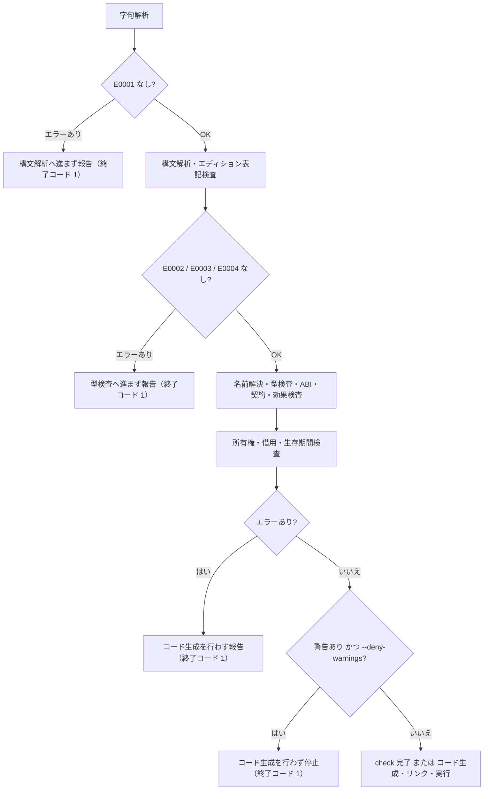

# 診断メッセージとエラーコード

Tsuzuri コンパイラは、1 回の実行で独立した複数のエラーを可能な限り網羅的に収集し、それぞれに安定した診断コード・原因識別子（`kind`）・正確なソース位置を付与して報告します。終了コードは正常完了が `0`、ソースエラー・外部ツール失敗・実行時トラップが `1`、CLI 引数の指定誤りが `2` です。既定では警告のみであれば終了コードは `0` のまま継続し、`--deny-warnings` 指定時のみ終了コード `1` でコード生成前に停止します。

本章では、人間向けテキスト出力と機械可読な `--json` 出力の形式、関連位置・修正案・`kind` の仕組み、LSP における診断連携、およびコンパイラが発行する全 73 個のエラー・警告コードと全 `kind` 一覧を定義します。

## 要点

- すべての診断は「大分類を表すコード（`E1012` や `W1001`）」と「具体的な規則を表す `kind`（`use_after_move` など）」の 2 階層で識別されます。`tsuzuri explain <kind|CODE>` でいつでも内蔵の解説と修正例を参照できます。
- ソース位置の行番号・列番号は 1 始まりで、列番号は Unicode スカラー値単位、スパンの `start` / `end` は UTF-8 バイトオフセット（`end` は排他的終端）です。
- `--json` を指定すると、標準出力を汚さず標準エラー出力（stderr）に 1 行 1 オブジェクトの JSON Lines 形式で診断が出力されます。
- 表示件数は最大 50 件、内部収集上限は重複を除いて最大 1,000 件です。字句エラーがある場合は構文解析へ進まず、構文エラーがある場合は型検査へ進まないことで連鎖的な二次エラーを抑止します。
- コード体系は `E0xxx`（字句・構文）、`E1xxx`（型・名前解決・所有権・言語規則）、`E2xxx`（CLI・I/O・ツール・実行時・パッケージ・知識グラフ）、`W1xxx`（ソース警告）、`W2xxx`（ツール警告）に分かれています。

## テキスト出力の形式と補助情報

人間向けの標準テキスト形式では、各診断は `パス:行:列: 重要度[コード]: メッセージ` の見出し行に続き、該当行のソース引用（エラー列の前後最大 120 文字）とキャレット（`^`）が表示されます。複数の診断の間には空行が入ります。

たとえば `i64` と `bool` を加算した際の診断出力は次のとおりです（終了コード `1`）。

```text
./Main.tz:1:35: error[E1003]: expected i64, found bool
  1 | def add :: i64 -> i64 = \n -> n + true
    |                                   ^
```

コマンドライン引数の誤りなど、特定のソースファイルを持たない診断ではパスが `<command line>`、行・列が `1:1` となります。

```text
<command line>:1:1: error[E2000]: missing .tz, .tt, or .tc input or project directory; use --help
```

### 関連位置（`note`）・対処法（`help`）・自動修正案（`fix`）

所有権違反、借用競合、型の不一致、未解決名、網羅性不足、重複定義などの診断には、主位置の引用に続けて原因箇所や解決手順が付与されます。たとえば所有権をムーブした後の変数を再利用した場合、次のようにムーブ元の位置と対処法が示されます。

```text
./Main.tz:6:21: error[E1012]: use of moved or partially moved value 'text'
  6 |     let b = consume text
    |                     ^
  note: value moved here
    --> ./Main.tz:5:21
  5 |     let a = consume text
    |                     ^
  help: borrow the value with 'ref text' or move it last
```

- **`note:` と `--> パス:行:列`**: 原因となった宣言や先行ムーブ・先行借用の位置（1 診断あたり最大 16 件。別モジュールの位置も正確なファイルパスで表示）。
- **`help:`**: 問題を解消するための具体的な書き換え方針。他言語の慣習による頻出の誤記（`pair.0`、`=>` のマッチアーム、`println!`、`Option`、`float`、`str`、`True` 等 40 パターン）には、前後の字句に応じた専用ヒントが表示されます。
- **`fix (<certain|likely|maybe>): <説明>`**: `tsuzuri fix` やエディタのクイックフィックスで適用できる機械的修正案（最大 8 件）。`certain` は意味を変えない確実な書き換え、`likely` は高い確度で妥当な書き換え、`maybe` は人間の確認を前提とする骨格提案（`E1021` で不足アームに `unreachable ()` を補う提案や、編集距離に基づく未知識別子の候補置換など）を表します。

## JSON Lines 出力（`--json`）

`--json` を指定すると、診断は標準エラー出力へ 1 行につき 1 つの独立した JSON オブジェクトとして出力されます。既存のキー名と出現順序は互換性ポリシーにより固定されており、将来キーが追加されることはあっても削除・改名されることはありません（詳細は [安定性と互換性ポリシー](./stability.md) を参照）。

```text
{"severity":"error","code":"E1003","message":"expected i64, found bool","path":"./Main.tz","span":{"start":34,"end":38,"line":1,"column":35,"end_line":1,"end_column":39},"kind":"type_mismatch","expected":"i64","found":"bool"}
```

### 基本フィールドと拡張フィールド

すべての診断オブジェクトは先頭の 5 キー（省略件数通知の `note` では `code`・`path`・`span` を除く）と `kind` を持ち、補助情報が存在する場合のみ後続キーが以下の順序で付加されます。

| フィールド名 | 型・構造 | 説明 |
| --- | --- | --- |
| `severity` | `"error"` \| `"warning"` \| `"note"` | 診断の重要度（50 件超過時の省略件数通知のみ `"note"`） |
| `code` | 文字列 | `"E1003"` や `"W1001"` などの診断コード |
| `message` | 文字列 | テキスト表示と同一の診断メッセージ本文 |
| `path` | 文字列 | 入力ルートからの相対ファイルパス（CLI 引数エラーは `"<command line>"`） |
| `span` | オブジェクト | `start`・`end`（UTF-8 バイトオフセット、`end` 排他）、`line`・`column`・`end_line`・`end_column`（1 始まり Unicode スカラー列）。`fmt --check --json` やスパンを持たない `W2001` では省略される場合がある |
| `kind` | 文字列 | 原因規則を一意に表す識別子（例: `"use_after_move"`、`"type_mismatch"`） |
| `related` | 配列 | 関連位置の配列。各要素は `role`（`"moved_here"`・`"borrowed_here"`・`"borrow_used_here"`・`"declared_here"`・`"expected_because"`・`"first_defined_here"`・`"via_call"`・`"required_by"`・`"note"`）・`message`・`path`・`span` を持つ |
| `help` | 文字列 | 1 行の修正ガイド |
| `expected` / `found` | 文字列 | 型不一致（`E1003`）や型つき穴（`E1030` の `expected`）における期待型と実際型 |
| `candidates` | 配列 | 型つき穴（`E1030`）や未解決名で提示される候補（`name`・`signature`・`how`） |
| `scope` | 配列 | その位置から参照可能なローカル変数一覧（内側のスコープから最大 32 件の `name`・`type`） |
| `fixes` | 配列 | 自動修正案。各要素は `title`・`applicability`（`"certain"` \| `"likely"` \| `"maybe"`）・`edits`（`path`・`span`・置換文字列 `text` の配列） |
| `trap` | オブジェクト | `run`・`script`・`repl` で実行時トラップした `E2005` に付与される詳細情報（`kind`・`site`・呼び出し履歴 `frames`・打ち切り有無 `truncated`） |

## 二次エラー抑止と段階的ゲート

壊れた構文木や未解決の型から大量の無意味な連鎖エラーが発生するのを防ぐため、コンパイラは次の段階的ゲートを設けています。



- 同一ファイル・同一スパン・同一コード・同一メッセージの重複診断は自動的に 1 件へ集約されます。
- 画面および `--json` に詳細出力するのは最初の **50 件**までで、内部では最大 **1,000 件**まで収集します。超過分は末尾に `error: N more errors not shown`（収集上限到達時は `at least ...`）として通知されます。
- 関数のシグネチャ自体にエラーがある場合、その関数を呼び出す側での二次エラーは抑制され、他の独立した関数の検査が継続されます。

## LSP（エディタ連携）での診断表示

`tsuzuri lsp` はコンパイラと同一の診断エンジンを用い、`textDocument/publishDiagnostics` でエディタへ診断を配信します。

- CLI の `--json` が「1 始まり・Unicode スカラー値列」を使うのに対し、LSP プロトコル上の `range` は仕様に従い「0 始まり・UTF-16 コード単位オフセット」に変換されます。
- ルートパッケージ内の関連位置は `relatedInformation` に格納され、`data.kind` と `data.fixes` に原因識別子と修正案メタデータが格納されます。診断箇所にカーソルを合わせると、ホバー表示にコード・`kind`・メッセージおよび `tsuzuri explain <kind>` の案内が表示されます。
- クイックフィックス（`textDocument/codeAction`）およびファイル単位の一括自動修正（`source.fixAll.tsuzuri`）は、適用後のバッファを内部で再解析し、対象コードのエラーが減少し新たなエラーが一切増えないことを確認できた修正案のみを提示します。

## エラーコード一覧（全 58 コード）

コンパイラが発行する全エラーコードの意味と主な発生条件は次のとおりです。

| コード | 分類と報告内容 |
| --- | --- |
| `E0001` | 字句解析エラー。閉じられていない文字列リテラルやブロックコメント、不正なエスケープシーケンス、不正な数値リテラル・桁区切り、文字列補間の構文不備・書式指定子エラー、ASCII 外のバイトリテラルなど |
| `E0002` | 構文解析エラー。式・型・パターンの構文不備、AST ネスト上限超過、`Tsuzuri.toml` の未知キー・セクション順序違反・非対応 `edition`、配置場所を誤った属性（`@c_layout`・`@checked`・`@cpu`・`@count`・`@json`）、匿名共用体の `\|\|` 誤記、Edition 2028 未満での拡張範囲構文使用、行頭の `#if` など |
| `E0003` | ソースファイルサイズの上限超過（1 ファイルあたり最大 4 MiB） |
| `E0004` | Edition 2027 以降で廃止された非正準表記の使用。短い数値接尾辞（`86uy` → `86i8u`）、記号による借用・参照外し・参照型（`&x` / `&mut x` / `*r` / `&T` → `ref x` / `ref mut x` / `deref r` / `ref T`）、バックスラッシュなしラムダ（`x -> e` → `\x -> e`）、および Edition 2027 における `for` の裸の `..` 範囲（Edition 2028 では `for` の `..` は正準形として受理） |
| `E1001` | 同一スコープ・モジュール・グループ内での識別子名の重複（関数シグネチャや定義の重複、公開 `export` シンボル名の衝突、重複する `extern` 宣言、`deriving` クラスの重複など） |
| `E1002` | 未定義の値・関数・モジュールメンバー・共用体ケース・型クラスメソッド・固定長配列の長さ定数の参照（編集距離の近い候補やモジュール修飾候補があれば `help` と `maybe` 修正案を付与） |
| `E1003` | 型の不一致（`expected ..., found ...`）。固定長配列リテラルの要素数不一致、添字の型不備、文字列補間書式と型の不整合、匿名共用体の要素外の型や部分集合でない匿名共用体の受け渡しを含む |
| `E1004` | 曖昧な識別子・パターン名・ビルダー別名、未知の型名、型引数の個数不一致、`dyn` への非型クラス指定、型注釈のない空リストリテラル、型と長さパラメーターの混同 |
| `E1005` | 関数・演算子・添字・反復の適用不備。非関数値の呼び出し、型クラスインスタンスの不在、満たせない制約、関数値に捕捉できない値（排他借用・`Rc`・同期プリミティブ・非 `Send` 値・`local` ハンドル）の捕捉、固定長配列へのスライスや `new`、不正な `own` / `mut` 引数指定、`ZString.literal` への非リテラルまたは内部 NUL 指定、`use` への非 `Drop` 型指定など |
| `E1006` | 関数定義と型シグネチャの仮引数個数の不一致、過剰な引数適用、インスタンスメソッドやアクティブパターン・`Owned.function` の引数個数不整合 |
| `E1007` | レコード以外の値に対するフィールド参照、レコード構築時の必須フィールド欠落、存在しないフィールド名の指定 |
| `E1008` | 公開 C / WebAssembly ABI および `extern` の制約違反。ABI 非対応型の `export` / `extern`、予約シンボル名の使用、不一致な重複 `extern` 宣言、`@c_layout` レコードの規則違反（`bool` フィールド、空レコード、ジェネリック、`Drop` 実装、所有ハンドル保持など）、`@count` の位置誤り、静的コールバックや `FnPtr`・`extern view` のシグネチャ違反、WebAssembly でのネイティブ専用 ABI（`Maybe<Handle>`・`ref mut` 等）への到達、Objective-C の型の位置・セレクターの形と `:` の数・メッセージで渡せない型・関数値にしたメンバーや `ObjC.*`、Apple でないターゲットでの Objective-C や `@weak` への到達（`abi_apple_only`）、`@c_layout` レコードの値渡しに対応しないターゲット |
| `E1009` | 整数・2 進浮動小数点・10 進浮動小数点・任意精度整数（`bigint`）リテラルの表現範囲超過または対象型との不整合 |
| `E1010` | 型のメモリレイアウト制限違反。基底ケースを持たない無限サイズ再帰型、固定長配列長や値サイズの上限超過、レイアウト入れ子上限超過 |
| `E1011` | モジュール・名前空間・パッケージ構成の不備。英大文字で始まらないモジュール名、モジュール名衝突、予約名前空間 `std` や標準モジュール名の使用、パッケージ循環依存、依存取得元の競合、非互換バージョンの要求、シンボリックリンク入力の拒否など |
| `E1012` | ムーブ済みまたは部分ムーブ済み値の再利用、不変束縛への再代入、共有参照やコレクション要素・`Drop` 型・`let rec` / `Owned.function` 捕捉環境からの不正なムーブ、`Drop.drop` 内での自己置換 |
| `E1013` | 借用の生存期間・リージョン・スレッド境界の違反。所有者より長生きする借用の返却や束縛、一時値からの長期借用、リージョン注釈の不整合、`tzroutine` / `Routine.scope` / `Parallel.*` / `DataChannel` への借用や非 `Send`・非 `Sync` 値（`Rc` など）の受け渡し、`Mutex.with_lock` や `Anchor` コールバックからの借用流出、`extern type local` に触れる `pinned` 関数の別スレッド起動や一般関数値化、借用型を含む匿名共用体 |
| `E1014` | 借用の競合および不変値への排他アクセス。生存中の共有借用・排他借用と衝突する読み書きやムーブ、不変 `let` 変数や共有参照越しの変更、アクティブパターン内での入力変更 |
| `E1015` | 型推論の未確定・多相性エラー。一意に定まらない多相型変数、無限型（occurs check）、カインド不一致、高階型エイリアス、多相エントリーポイント、`dyn` 変換時の型情報不足 |
| `E1016` | 型クラスとインスタンスの定義違反。メソッドを持たないクラス、オーファン規則違反（外部クラスに対する外部型のインスタンス定義）、重複・競合するインスタンス、組み込みインスタンスの上書き、標準ライブラリ型へのユーザー `Drop` 実装、`Drop.drop` の直接呼び出し |
| `E1017` | コンパイラ内部の解析・展開資源上限の超過。多相再帰・特殊化・インスタンス解決・型エイリアス展開・網羅性探索・ループ所有権固定点反復・匿名共用体要素数（32 超）・`fix` 候補数・オーバーフロー計装箇所数・ドキュメント例数などの上限到達 |
| `E1018` | ファイル拡張子ごとの宣言規則違反および専用構文制約。`.tt` 以外での `class` 宣言、`.tt` 内での値定義、`.tc` 以外での `@alias`、コンピュテーション式ビルダーの未定義・必須操作欠落、GPU カーネル内で使用できない型・演算・副作用、`bench` 外からの `Bench.now` 到達 |
| `E1019` | 再帰定義マーカーの不整合。`rec` を付けない自己・相互再帰関数、シグネチャと実装での `rec` 不一致、再帰グループ外の単独 `and` |
| `E1020` | パターン構文・分解の不備。共用体ケースのペイロード有無・形状不一致、OR パターン両辺での束縛変数不一致、固定長配列に対する可変長配列パターン、アクティブパターンのケース数・引数違反 |
| `E1021` | パターンマッチの網羅性不足。`match` 式、関数ガード、単一パターン `let` 束縛、および Edition 2027 以降のラムダ引数・`for ... in`・計算式束縛における反駁可能パターンの不足ケース検出 |
| `E1022` | 可視性とカプセル化の違反。他モジュールの `private` 宣言の参照、公開シグネチャへの `private` 型の露出、`private export`、不透明な標準ライブラリ型（`Map`・`Arena`・`Mutex` 等）の直接構築・フィールド参照、標準ライブラリ内部専用プリミティブ（`__*`）の呼び出し |
| `E1023` | ループ外または関数・`tzroutine`・ビルダー境界・`finally` 節を跨ぐ不正な `break` / `continue` |
| `E1024` | 型宣言のパラメーター・命名規則違反。型名や共用体ケース名の小文字始まり、重複・未使用・未宣言の型パラメーターや定数長パラメーター、循環する型エイリアス |
| `E1025` | `deriving` 自動導出の違反。導出非対応クラスや非対応フィールド型、停止しない再帰 `Default`、`Encode` / `Decode` を持たない型への `@json`、重複 `@json` 名、JSON トークン種別が衝突する匿名共用体の `Decode` |
| `E1026` | コンパイル時定数（`const` / `const def`）の評価エラー。定数評価中のトラップ（ゼロ除算等）、循環参照、評価ステップ数または呼び出し深さ上限超過、`const def` で許可されない借用・関数値・副作用式、4 MiB を超える静的定数データ |
| `E1027` | 型クラスのスーパークラス循環、インスタンス文脈での未宣言制約や具体型制約の不備 |
| `E1028` | 動的ディスパッチ型 `dyn` として使用できないオブジェクト非互換な型クラスの指定 |
| `E1029` | 純粋性（`pure def` / `pure (T -> U)`）契約の違反。副作用を持つ処理や未証明コールバックへの到達、参照やカスタム `Drop`・共有状態を含む `own` 引数の使用、宣言段階と実装ラムダ引数段階の不一致 |
| `E1030` | 型つき穴（`?` / `?name`）の検出。期待される型、スコープ内のローカル変数、型が一致する候補一覧を提示してコード生成を抑止 |
| `E1031` | 効果表明属性（`@no_alloc`・`@no_copy`・`@no_trap`・`@terminates`）に対する推論効果の違反（未検証 `extern` や不透明呼び出しを含む） |
| `E1032` | 効果表明属性の配置誤り（トップレベル `def` 以外への付与、重複指定、`extern` への付与など） |
| `E1033` | 契約属性（`@requires`・`@ensures`・`@old`）の記述違反。配置誤り、`bool` 以外の条件式、不純な条件式や書き込み、参照を返す関数への `@ensures`、`const def` への付与、`@old` の非 Copy 型適用や入れ子 |
| `E1034` | `tsuzuri prove` / `--contracts prove` における契約証明の失敗（反例検出、SMT 非対応構文、タイムアウト、ソルバー未導入または実行エラー） |
| `E1036` | パッケージの `[capabilities]` ポリシーで許可されていない権限（`fs`・`net`・`ffi` 等）の使用 |
| `E1037` | `@trusted` 属性の記述違反（`extern` 以外への付与、未知または重複した効果性質名、`extern type` への効果性質指定、`extern view` への不正な性質指定） |
| `E1038` | 純粋トラップ隔離領域 `Domain.run` の使用条件違反（間接呼び出し、不純な本体、平たいデータでない捕捉値または戻り値、非対応ターゲットでの使用） |
| `E1039` | 結合律を満たさない浮動小数点型を含む型に対する `Monoid` 制約の解決（`Parallel.fold` と逐次畳み込みの結果不一致を防止） |
| `E1040` | 廃止または改名された旧標準 API・構文の使用（旧 `Channel.bounded` → `DataChannel.bounded`、旧 `IO.write_line` 等 8 関数 → `IO.writeln` 等、廃止された `Task` / `Async` / `Net.*_async`）。一意に置換可能な改名には `certain` 修正案を付与 |
| `E1041` | 匿名共用体 `(A \| B)` および型テストパターン `:?` の規則違反。型変数要素、重複・識別不能要素、リテラルや配列リテラルの注入先曖昧性、匿名共用体に対する `instance` 定義、借用値やガード付きアームでの非 Copy 部分匿名共用体への絞り込みなど |
| `E1042` | ベース値を借用するビューを返す添字式（スライス、`MatrixView`、`Tensor.View` 等）における `ref` の欠落（`index_view_requires_ref`、`certain` 修正案付き）、または読み取り専用ビューを返す `Index` に対する `ref mut` 指定（`index_view_not_writable`） |
| `E1043` | `Index`・`IndexMut` または拡張演算子のインスタンス解決において、型引数とリテラル制約を満たす候補が複数残り一意に定まらない曖昧性（`ambiguous_instance_candidates`） |
| `E2000` | CLI 引数・フラグ組み合わせ・環境変数値・ターゲット指定の誤り、ターゲット非対応機能への到達（既定 `wasm32` での OS API や `Net` ソケット、`--freestanding` でのランタイム使用等）、`fmt --check` の未整形検出、`kg` や `diagram` の未知・曖昧 ID および不正オプション、`find` や `explain` や `guide` の不正クエリ |
| `E2001` | ファイル・ディレクトリの読み書き失敗、エントリーポイント `Main.tz` の不在、`TSUZURI_RUNNER` の起動失敗、`tsuzuri serve` のソケット権限違反・多重起動・停止待機通知 |
| `E2002` | 外部ツールチェーン（Clang・LLD・`llvm-link`・`llvm-profdata`・`wasm-opt`）の起動失敗またはリンク・アセンブルエラー、`--backend fast` 非対応 IR 構造、`bindgen` の非対応ターゲットまたはヘッダー解析エラー、Windows COFF の C ランタイム埋め込みオブジェクト拒否 |
| `E2003` | 出力先ファイル保護による書き込み拒否（手書きソースや入力ファイル自身の上書き防止、管理マーカーのない既存 `doc` / `bindgen` 出力先、整形中の外部変更検出） |
| `E2004` | エントリーポイントおよび公開シンボルの要件違反。`Main.tz` に実行コードも `def main` もない実行ファイルビルド、両方書いた重複、`def main` の不正シグネチャ、`Main.tz` 以外のトップレベル実行コード、`export def` を持たない共有ライブラリ・バインディング出力、エクスポート数が 1 でない GPU シェーダー出力 |
| `E2005` | プログラムまたはベンチマークの実行時異常終了。ゼロ除算・境界外アクセス・`assert`・契約違反（`contract_requires` / `contract_ensures`）・スタック枯渇・メモリ確保失敗などのトラップ、`def main` の非ゼロ終了コード、REPL やベンチマークの制限時間超過 |
| `E2006` | `tsuzuri test` の単体・プロパティテスト失敗（`tests_failed`）、または `tsuzuri test --doc` のドキュメントコード例失敗（`doc_test_failed`） |
| `E2007` | パッケージ依存の取得・ロック検証エラー。`Tsuzuri.lock` の欠落・不整合・チェックサム不一致、未取得パッケージ、`git` コマンド失敗・バージョン不足、危険なパスやシンボリックリンクを含むリポジトリ、レジストリインデックスの不整合、`publish` 時のローカル内容とコミットの不一致 |
| `E2008` | `tsuzuri fix` の自動修正中止（適用により診断が増加する `fix_verification_failed`、実行中の競合変更、書き込み失敗）および `tsuzuri fix --edition` によるエディション移行失敗（`--from` 不一致、逆方向移行など） |
| `E2009` | 知識グラフ（`tsuzuri kg`）の参照・管理エラー。未生成（`kg_missing`）、ソース更新による陳腐化（`kg_stale`）、破損・ハッシュ不一致（`kg_broken`）、マーカー不在またはソース混在ディレクトリ（`kg_not_ours`）、型エラーにより未完成のグラフ（`kg_incomplete`） |
| `E2010` | `tsuzuri mcp` サーバーの致命的エラー（プロジェクトルートがディレクトリでない、標準入出力の切断・失敗、ワーカースレッド起動失敗） |
| `E2011` | `tsuzuri test --doc` におけるドキュメントコメント内 ```` ```tsuzuri ```` コードフェンスの属性記法エラー（未知・重複属性、不正な URL エンコード、インデントされたフェンス、閉じ忘れ、空ブロック） |

## 警告コード一覧（全 15 コード）

| コード | 発生条件と解消方法 |
| --- | --- |
| `W1001` | 未使用のローカル変数・関数引数・パターン束縛・内部再帰関数。識別子を `_` または `_name` で始めることで解消（`tsuzuri fix` が `certain` 修正案で自動付与可能） |
| `W1002` | 公開 API・エントリーポイント・インスタンスから到達しない未使用の `private` 関数・レコード・共用体・型エイリアス。不要な宣言を削除するか公開する |
| `W1003` | 先行するガードなしアームによって完全に覆われ、決して到達しない `match` アーム。重複アームを削除するか先行パターンを絞り込む |
| `W1004` | 同一字句スコープ内でのローカル変数シャドーイング（コンパイラ内部検査モード専用で、通常の CLI 実行では発行されない） |
| `W1005` | 他パッケージや標準ライブラリで `/// @deprecated ...` が付与された `def`・`record`・`union` の使用（同一パッケージ内の参照では発行されない）。案内文が同一シグネチャの代替関数を明示している場合は `likely` 修正案が付与される |
| `W1006` | `--warn implicit-copy` 指定時に検出される、配列・リスト・`dyn` 値の暗黙ディープコピー。`ref` で借用するか `Array.copy` / `List.copy` で明示する |
| `W1007` | `--warn canonical` 指定時に Edition 2026 ソースで検出される旧表記（`E0004` と同じ 6 種）。正準形への書き換え修正案が付与される |
| `W1008` | 具体化インスタンスが 1 つもないジェネリック関数上の効果属性（`effect_attribute_unchecked_generic`）、または実行時本体のみ検査される `const def` 上の効果属性（`effect_attribute_on_const_def`） |
| `W1009` | 常に真となる自明な契約条件（`contract_always_true`）、`@ensures` で未使用の結果束縛名（`\_ -> ...` で解消）、または `--contracts test` で自動テスト生成をスキップした関数 |
| `W1010` | `--warn untrusted-extern` 指定時または `tsuzuri audit` 実行時に検出される、`@trusted` 未付与の `extern` 関数・`extern class`・`extern category` の使用。契約を確認したうえで `@trusted` を宣言する |
| `W1012` | Edition 2026 ソースにおけるラムダ引数・`for ... in`・計算式束縛での反駁可能パターンやガードの使用（Edition 2027 以降ではエラー `E1021`） |
| `W1013` | Edition 2026 / 2027 のルートパッケージにおける終端付き裸 `..` スライス（`legacy_bare_slice_range`、`..<` への `certain` 修正案付き）、またはマニフェストなし・`--edition` 未指定の Edition 2028 入力における終端付き裸 `..` スライス（`bare_slice_range_meaning_changed`）。半開区間 `..<` または閉区間 `..=` を明記することで解消 |
| `W1014` | スライス境界・`^` オフセット（`negative_literal_range_bound`）、または組み込みコレクション・文字列添字やウィンドウ位置成分（`negative_literal_index`）に直接記述された非ゼロの負の整数リテラル。末尾からの位置指定には Edition 2028 の `^0`（末尾要素）・`^1` 等を使用する |
| `W2001` | ビルドキャッシュの無効化通知、知識グラフの更新スキップ、PGO プロファイル不一致、`run --overflow-report --json` における整数折り返し報告（`integer_overflow_wrapped`）などのツール警告 |
| `W2002` | `tsuzuri bindgen` が ABI 非互換などの理由で変換をスキップした C ヘッダー宣言・マクロの通知（出力ファイルの `// skipped` 行と対応） |

## コード別の全 `kind` 一覧

以下の表は `tsuzuri explain --catalog` が出力する全診断 `kind` の完全な一覧です（`scripts/gen-docs.mjs` によりコンパイラの診断カタログから自動生成されます）。

<!-- generated:diagnostic-kinds -->
| コード | kind |
| --- | --- |
| `E0001` | `bigint_suffix_with_fraction`, `byte_literal_not_ascii`, `byte_suffix_on_interpolated_string`, `byte_suffix_on_unsupported_literal`, `char_literal_not_one_unit`, `comment_in_interpolation_hole`, `expected_digit`, `float_suffix_on_hex_or_binary_literal`, `format_field_out_of_range`, `format_precision_on_integer`, `format_type_needs_precision`, `interpolation_hole_spans_lines`, `invalid_format_spec`, `invalid_numeric_literal`, `invalid_string_escape`, `invalid_type_variable_start`, `invalid_unicode_scalar_escape`, `numeric_separator_misplaced`, `raw_newline_in_string`, `single_closing_brace_in_interpolation`, `unexpected_character`, `unterminated_block_comment`, `unterminated_interpolation_hole`, `unterminated_string_literal`, `utf8char_not_one_scalar` |
| `E0002` | `alias_name_on_same_line`, `angle_bracket_spacing`, `anonymous_union_double_bar`, `builder_alias_is_contextual_keyword`, `builder_alias_name_case`, `c_layout_argument`, `c_layout_repeated`, `checked_let_rec`, `class_needs_one_type_parameter`, `computation_match_without_arms`, `computation_nesting_too_deep`, `const_export_order`, `constraint_line_indentation`, `count_attribute_syntax`, `cpu_attribute_on_const_def`, `data_symbol_module_name`, `data_symbol_needs_link_name`, `definition_without_signature`, `do_bang_outside_task`, `duplicate_builder_alias`, `duplicate_capability`, `duplicate_cpu_target`, `duplicate_json_attribute`, `duplicate_manifest_key`, `dyn_with_type_arguments`, `empty_interpolation_hole`, `empty_region_list`, `expected_binding_end`, `expected_body_expression`, `expected_builder_alias`, `expected_computation_body`, `expected_cpu_target`, `expected_dyn_class`, `expected_expression`, `expected_expression_after_attribute`, `expected_identifier`, `expected_interpolation_close`, `expected_kind`, `expected_line_break`, `expected_link_name_string`, `expected_pattern`, `expected_single_type_argument`, `expected_token`, `expected_type_close`, `expected_union_case_name`, `expected_where_bindings`, `export_on_implementation`, `expression_nesting_too_deep`, `extern_category_syntax`, `extern_class_member_syntax`, `extern_class_syntax`, `extern_type_modifier_conflict`, `extern_type_with_body`, `extern_type_with_link_name`, `extern_view_link_name`, `for_loop_needs_identifier`, `from_end_in_expression`, `from_end_outside_index`, `from_end_step`, `header_path_on_same_line`, `header_path_spacing`, `integer_literal_too_large`, `invalid_capabilities`, `invalid_dependency_form`, `invalid_dependency_native_flag`, `invalid_dependency_path`, `invalid_fixed_array_length`, `invalid_git_dependency`, `invalid_json_attribute`, `invalid_link_name_text`, `invalid_macos_setting`, `invalid_native_framework_name`, `invalid_native_library_name`, `invalid_native_path`, `invalid_native_rpath`, `invalid_native_section`, `invalid_package_field`, `invalid_registry_dependency`, `invalid_registry_setting`, `invalid_wasm_size`, `invalid_windows_setting`, `lambda_without_parameters`, `last_error_arguments`, `length_parameter_type`, `let_function_needs_lambda`, `let_rec_needs_lambda`, `link_attribute_syntax`, `list_type_with_length`, `malformed_constraint_line`, `malformed_multi_case_active_pattern`, `malformed_new_collection`, `manifest_section_order`, `manifest_syntax_error`, `match_without_arms`, `misplaced_c_layout_attribute`, `misplaced_checked_attribute`, `misplaced_const_modifier`, `misplaced_count_attribute`, `misplaced_cpu_attribute`, `misplaced_doc_comment`, `misplaced_json_attribute`, `misplaced_last_error_attribute`, `misplaced_link_attribute`, `misplaced_namespace_declaration`, `misplaced_region_list`, `misplaced_returns_retained_attribute`, `misplaced_using_declaration`, `misplaced_weak_attribute`, `missing_capabilities_allow`, `missing_package_field`, `missing_registry_index`, `module_declaration_unsupported`, `mut_as_expression`, `mutable_let_rec`, `mutable_use_binding`, `negative_pattern_needs_number`, `objc_self_position`, `pattern_nesting_too_deep`, `prefix_keyword_operand`, `range_form_needs_edition_2028`, `range_takes_one_step`, `recursive_let_bang`, `recursive_where_binding`, `return_not_last_in_computation`, `return_outside_task_end`, `returns_retained_conflict`, `select_arm_expected`, `select_default_repeated`, `signature_uses_def`, `signature_uses_double_colon`, `signature_without_definition`, `slice_must_be_borrowed`, `slice_range_needs_end`, `slice_step_down_excludes_end`, `slice_without_bounds`, `start_open_range_needs_start`, `start_open_range_with_step`, `stray_and_member`, `syntax_nesting_too_deep`, `too_many_active_pattern_cases`, `too_many_anonymous_union_members`, `too_many_dyn_classes`, `too_many_extern_link_names`, `too_many_function_parameters`, `too_many_interpolation_holes`, `too_many_lambda_parameters`, `too_many_tuple_elements`, `too_many_type_arguments`, `type_parameters_need_angle_brackets`, `typed_and_needs_body`, `unknown_capability`, `unknown_cpu_target`, `unknown_manifest_key`, `unsupported_edition`, `use_bang_in_and_group`, `use_bang_outside_computation`, `weak_attribute_syntax`, `where_binding_indentation` |
| `E0003` | `source_too_large` |
| `E0004` | `bare_range_in_for_rejected`, `legacy_lambda_rejected`, `short_literal_suffix_rejected`, `symbolic_borrow_rejected`, `symbolic_deref_rejected`, `symbolic_reference_type_rejected` |
| `E1001` | `duplicate_and_binding`, `duplicate_derived_class`, `duplicate_export_name`, `duplicate_extern_declaration`, `duplicate_function_definition`, `duplicate_function_signature`, `duplicate_name`, `duplicate_objc_member` |
| `E1002` | `class_has_no_method`, `unknown_function`, `unknown_length_constant`, `unknown_module_member`, `unknown_union_case`, `unknown_value` |
| `E1003` | `active_recognizer_result`, `anonymous_union_not_member`, `anonymous_union_not_subset`, `fixed_array_literal_length`, `format_spec_type_mismatch`, `format_spec_type_unknown`, `index_component_type`, `index_not_integer`, `index_ref_on_value`, `objc_class_base_not_class`, `objc_literal_type`, `objc_not_superclass`, `type_mismatch` |
| `E1004` | `ambiguous_builder_alias`, `ambiguous_name`, `ambiguous_pattern_name`, `dyn_needs_type_class`, `empty_list_needs_annotation`, `expected_length`, `length_used_as_type`, `not_a_record_type`, `repeated_module_name`, `std_item_missing`, `type_argument_count`, `type_used_as_length`, `unknown_type_name` |
| `E1005` | `array_slice_with_step`, `atomic_element_type`, `builtin_index_one_component`, `call_non_function`, `capture_exclusive_in_reusable_function`, `capture_rc_in_function_value`, `capture_sync_primitive_in_function_value`, `capture_unsendable_in_function_value`, `collection_element_exclusive_borrow`, `compound_assign_unsupported_target`, `cpu_function_wide_vector_boundary`, `deref_non_reference`, `exclusive_slice_whole_array_parameter`, `fixed_array_init_annotation`, `fixed_slice_source`, `for_over_fixed_array`, `for_source_not_iterable`, `from_end_needs_length`, `function_constraint_unresolvable`, `function_constraint_unsatisfied`, `index_non_indexable`, `invalid_length_constant`, `misplaced_mut_convention`, `misplaced_own_convention`, `mut_parameter_needs_edition_2027`, `new_on_fixed_array`, `no_instance`, `no_instance_for_operator`, `no_wider_integer`, `objc_literal_argument`, `objc_target_not_class`, `range_as_value`, `rec_function_captures_generic`, `record_update_non_record`, `shared_container_exclusive_borrow`, `simd_lane_count_mismatch`, `simd_operation_vector_type`, `slice_non_array`, `slice_of_fixed_array`, `std_representation_mismatch`, `unsized_slice_type_position`, `use_requires_drop`, `zstring_literal_argument`, `zstring_literal_interior_nul`, `zutf8string_literal_argument`, `zutf8string_literal_interior_nul` |
| `E1006` | `active_pattern_argument_count`, `active_recognizer_parameters`, `definition_parameter_count_mismatch`, `instance_method_parameter_count`, `owned_function_parameter_count`, `too_many_arguments_applied` |
| `E1007` | `field_access_non_record`, `missing_record_fields`, `record_has_no_field`, `unknown_field` |
| `E1008` | `abi_apple_only`, `abi_native_only`, `abi_nullable_payload`, `abi_record_by_value_target`, `c_layout_bool_field`, `c_layout_drop`, `c_layout_empty`, `c_layout_field_type`, `c_layout_generic`, `c_layout_in_plain_record`, `c_layout_input_only`, `c_layout_nested_record`, `c_layout_owned_handle_field`, `conflicting_extern_declaration`, `count_not_buffer`, `count_position_out_of_range`, `count_repeated`, `data_symbol_signature`, `data_symbol_target`, `export_active_recognizer`, `export_on_extern_declaration`, `extern_callback_argument`, `extern_callback_call_form`, `extern_declaration_constraints`, `extern_view_call_form`, `extern_view_record`, `extern_view_signature`, `fnptr_argument`, `fnptr_call_form`, `fnptr_from_host`, `fnptr_signature`, `invalid_extern_symbol`, `invalid_objc_class_name`, `invalid_wasm_import_module`, `last_error_helper_conflict`, `last_error_repeated`, `last_error_result_shape`, `link_invalid_name`, `link_needs_symbol`, `link_repeated`, `objc_builtin_not_called`, `objc_class_base_cycle`, `objc_class_main_base`, `objc_class_sync_base`, `objc_invalid_selector`, `objc_member_type`, `objc_method_not_called`, `objc_object_position`, `objc_owned_object_argument`, `objc_returns_retained_not_object`, `objc_selector_arity`, `objc_selector_not_constant`, `objc_variadic_method`, `reserved_extern_symbol`, `unsupported_export_signature`, `unsupported_extern_signature`, `weak_data_symbol_result`, `weak_needs_symbol` |
| `E1009` | `decimal_literal_out_of_range`, `float_literal_out_of_range`, `float_literal_type`, `integer_literal_out_of_range`, `integer_literal_type`, `invalid_bigint_digit`, `invalid_float_literal` |
| `E1010` | `fixed_array_too_long`, `infinite_recursive_layout`, `layout_nesting_limit`, `recursive_union_without_base_case`, `value_layout_too_large` |
| `E1011` | `ambiguous_package_root`, `conflicting_dependency_source`, `cyclic_package_dependency`, `dependency_kind_not_allowed`, `dependency_name_mismatch`, `dependency_path_not_relative`, `duplicate_dependency`, `duplicate_module`, `incompatible_dependency_versions`, `invalid_module_filename`, `invalid_module_name`, `invalid_package_name`, `invalid_package_namespace`, `invalid_publish_version`, `invalid_source_path`, `invalid_std_path`, `invalid_using_declaration`, `manifest_not_regular_file`, `module_namespace_collision`, `module_source_not_regular_file`, `publish_non_registry_dependency`, `reserved_package_namespace`, `reserved_std_namespace`, `source_filename_case_mismatch`, `source_outside_package_root`, `source_without_filename`, `symlink_not_followed` |
| `E1012` | `assign_to_immutable_place`, `drop_pass_exclusive_value`, `drop_replace_whole_value`, `move_out_of_collection_element`, `move_out_of_drop_type`, `move_out_of_owned_function`, `move_out_of_rec_function`, `move_out_of_reference_binding`, `update_drop_type_value`, `use_after_move` |
| `E1013` | `anchor_result_retains_borrow`, `anchor_value_retains_borrow`, `anonymous_union_borrowed_member`, `assignment_extends_borrow`, `borrow_across_async_boundary`, `borrow_field_without_region`, `borrow_of_temporary`, `borrow_outlives_binding`, `borrow_outlives_block`, `borrowed_union_payload`, `callback_contract_unsatisfied`, `channel_item_holds_borrow`, `const_temporary_borrow_escapes`, `dyn_holds_borrow_without_region`, `dyn_holds_exclusive_borrow`, `exclusive_borrow_behind_region`, `exclusive_borrow_field_shape`, `exclusive_field_regions_missing`, `exclusive_field_without_region`, `exclusive_region_reused`, `field_mixes_regions`, `invalid_region_names`, `main_thread_code_spawned`, `main_thread_function_value`, `misplaced_region_quantifier`, `multiple_regions_on_value`, `must_apply_directly`, `mutable_record_field`, `mutable_region_quantified_parameter`, `mutex_result_retains_borrow`, `named_region_in_function_type`, `named_region_in_local`, `nested_borrow_unsupported`, `owned_function_captures_reference`, `parallel_callback_borrows_environment`, `parallel_input_borrows_environment`, `parallel_result_retains_borrow`, `pinned_code_spawned`, `pinned_function_value`, `reference_region_count`, `reference_without_owner`, `region_already_declared`, `region_belongs_to_function`, `region_callback_stores_exclusive_input`, `region_count_mismatch`, `region_on_non_borrow`, `region_quantifier_target`, `result_region_mismatch`, `result_region_missing`, `result_region_without_input`, `self_referential_store`, `store_local_borrow_through_reference`, `store_region_mismatch`, `store_region_unnamed`, `task_capture_retains_borrow`, `task_requires_owned_value`, `task_requires_send`, `task_requires_sync`, `task_result_is_reference`, `task_result_retains_borrow`, `task_scope_shares_borrowed_environment`, `undeclared_region`, `union_payload_exclusive_borrow`, `unused_region` |
| `E1014` | `active_pattern_mutates_input`, `borrow_conflict`, `exclusive_slice_source`, `move_reborrowed_exclusive_reference`, `mutate_immutable_value`, `mutate_through_shared_reference`, `replace_exclusive_slice` |
| `E1015` | `ambiguous_polymorphic_use`, `concrete_integer_required`, `concrete_type_required`, `constructor_kind_mismatch`, `constructor_variable_kind_annotation`, `dyn_dispatch_result_type`, `dyn_of_arity`, `dyn_of_needs_expected_type`, `expected_type_constructor`, `extern_signature_not_concrete`, `extern_type_as_constructor`, `fixed_array_length_unknown`, `higher_kinded_alias`, `higher_order_kind_argument`, `infinite_inferred_type`, `instance_head_not_constructor`, `internal_compact_string_runtime`, `internal_rec_binding_not_lambda`, `internal_rec_group_unbound`, `internal_rec_not_bound_by_block`, `internal_unlowerable_ir`, `missing_type_arguments`, `polymorphic_entry_point`, `ref_operand_inferred_late`, `scalar_as_type_constructor`, `simd_vector_type_unknown`, `superclass_kind_mismatch`, `type_constructor_not_applied`, `type_variable_absent_from_signature`, `type_variable_kind_conflict` |
| `E1016` | `builtin_instance_override`, `class_constraint_arity`, `class_method_constraint`, `class_method_type_variable`, `class_without_methods`, `default_body_unknown_method`, `drop_instance_constraint`, `drop_instance_generic`, `drop_instance_target`, `explicit_drop_call`, `field_type_constraint`, `format_instance_target`, `instance_missing_method`, `instance_unknown_method`, `internal_effective_api_unavailable`, `missing_explicit_constraint`, `operator_instance_form`, `orphan_instance`, `overlapping_instance`, `unknown_type_class` |
| `E1017` | `and_group_too_large`, `anonymous_union_member_limit`, `capability_analysis_limit`, `class_constraint_limit`, `contract_line_limit`, `deriving_expression_limit`, `deriving_instance_limit`, `doc_example_limit`, `effect_summary_limit`, `exhaustiveness_search_limit`, `fix_candidate_limit`, `function_constraint_limit`, `git_dependency_too_large`, `gpu_effect_analysis_limit`, `gpu_kernel_limit`, `header_path_too_long`, `instance_overlap_limit`, `instance_resolution_cycle`, `instance_resolution_limit`, `lockfile_too_large`, `loop_ownership_limit`, `manifest_too_large`, `module_discovery_limit`, `module_path_limit`, `namespace_path_too_long`, `objc_class_limit`, `or_pattern_alternatives_limit`, `package_graph_limit`, `pattern_alternatives_limit`, `polymorphic_constraint_limit`, `polymorphic_recursion_growth`, `polymorphic_type_expansion_limit`, `prove_limit`, `pure_callback_proof_limit`, `pure_definition_reach_limit`, `pure_value_validation_limit`, `qualified_name_too_long`, `recursive_type_changes_arguments`, `recursive_type_expansion_limit`, `registry_index_too_large`, `registry_resolution_limit`, `select_arm_limit`, `sequence_loop_depth_limit`, `specialization_limit`, `superclass_resolution_limit`, `too_many_dependencies`, `too_many_loop_exits`, `too_many_overflow_sites`, `too_many_raise_points`, `too_many_record_regions`, `too_many_region_parameters`, `too_many_trap_locations`, `type_alias_expansion_limit` |
| `E1018` | `alias_outside_builder_file`, `bench_clock_outside_bench`, `builder_missing_operation`, `builder_without_operations`, `cannot_infer_builder`, `class_outside_class_file`, `computation_without_builder`, `declaration_in_class_file`, `gpu_buffer_element_type`, `gpu_callback_not_known`, `gpu_kernel_effect`, `gpu_kernel_missing`, `gpu_kernel_recursion`, `gpu_kernel_signature`, `gpu_operation_not_direct`, `gpu_unsupported_construct`, `gpu_unsupported_operator`, `gpu_unsupported_type`, `implicit_task_needs_builder`, `no_builder_for_value`, `std_declares_test`, `std_exports_function`, `unknown_computation_builder` |
| `E1019` | `and_without_recursive_group`, `mismatched_recursive_group`, `missing_rec_marker` |
| `E1020` | `active_argument_not_value`, `active_pattern_case_count`, `active_pattern_case_name`, `array_pattern_on_fixed_array`, `case_pattern_missing_payload`, `case_pattern_payload_shape`, `case_pattern_unexpected_payload`, `duplicate_active_pattern_case`, `expression_in_pattern`, `multi_case_active_pattern_result_type`, `null_pattern`, `or_pattern_binding_mismatch`, `partial_active_pattern_case_count`, `qualified_pattern_binding`, `record_pattern_unknown_type`, `reserved_active_result_variable`, `unknown_case_or_active_pattern` |
| `E1021` | `non_exhaustive_match`, `refutable_binding_pattern` |
| `E1022` | `opaque_type_representation`, `private_builder_operation`, `private_export`, `private_name_access`, `private_on_unsupported_declaration`, `private_std_primitive`, `private_type_in_public_api` |
| `E1023` | `jump_outside_loop` |
| `E1024` | `alias_argument_count`, `cyclic_type_alias`, `duplicate_type_parameter`, `duplicate_union_case`, `invalid_type_parameter_name`, `type_name_case`, `undeclared_length_parameter`, `undeclared_type_variable`, `union_case_name_case`, `unused_type_parameter` |
| `E1025` | `anonymous_union_decode_overlap`, `default_derive_recursive`, `derived_instance_invalid`, `deriving_unavailable`, `duplicate_json_name`, `json_name_without_deriving`, `underivable_class` |
| `E1026` | `const_aggregate_operator`, `const_assignment_target`, `const_borrow_not_allowed`, `const_call_depth_limit`, `const_callee_not_const`, `const_checked_operation`, `const_condition_not_bool`, `const_cycle`, `const_evaluation_trapped`, `const_expression_not_allowed`, `const_fnptr`, `const_for_loop_form`, `const_function_value`, `const_limit_exceeded`, `const_new_collection_form`, `const_operation_not_allowed`, `const_partial_application`, `const_pipe_not_allowed`, `const_signature_invalid`, `const_static_data_too_large`, `const_unbuildable_type`, `const_unsupported_operation`, `constant_type_not_concrete` |
| `E1027` | `class_context_not_a_class`, `instance_check_failed`, `instance_context_variable`, `instance_missing_superclass`, `superclass_cycle`, `superclass_type_variable`, `undeclared_default_constraint`, `undeclared_instance_constraint`, `unknown_class_in_context` |
| `E1028` | `dyn_incompatible_class` |
| `E1029` | `impure_builtin_for_pure_contract`, `impure_callback_for_pure_contract`, `impure_operation_in_pure_def`, `impure_pure_function_value`, `pure_function_type_parameter_not_allowed`, `pure_implementation_partial_parameters`, `pure_method_mutable_reference`, `pure_on_non_function_type`, `pure_parameter_not_allowed`, `pure_returned_function_contract`, `pure_specialization_own_parameter`, `pure_value_captures_unknown_callback`, `pure_value_unprovable` |
| `E1030` | `typed_hole` |
| `E1031` | `effect_alloc_in_no_alloc`, `effect_copy_in_no_copy`, `effect_diverge_in_terminates`, `effect_extern_in_attribute`, `effect_trap_in_no_trap`, `effect_unknown_callee` |
| `E1032` | `effect_attribute_duplicate`, `effect_attribute_misplaced`, `effect_attribute_on_extern`, `effect_attribute_unavailable` |
| `E1033` | `contract_ensures_reference_result`, `contract_impure`, `contract_misplaced`, `contract_not_bool`, `contract_old_misplaced`, `contract_old_nested`, `contract_old_not_copy`, `contract_old_operand`, `contract_on_const`, `contract_result_lambda`, `contract_writes` |
| `E1034` | `prove_counterexample`, `prove_solver_error`, `prove_solver_missing`, `prove_unknown`, `prove_unsupported` |
| `E1036` | `capability_denied` |
| `E1037` | `trusted_duplicate_property`, `trusted_no_trap_weak`, `trusted_pure_last_error`, `trusted_repeated`, `trusted_type_property`, `trusted_unknown_property`, `trusted_view_property`, `trusted_wrong_target` |
| `E1038` | `domain_argument_not_closure`, `domain_body_not_pure`, `domain_capture_not_plain`, `domain_not_called_directly`, `domain_result_not_plain`, `domain_target_unsupported` |
| `E1039` | `monoid_float_instance` |
| `E1040` | `removed_async`, `removed_net_async`, `removed_task_api`, `removed_task_expression`, `removed_task_type`, `renamed_io_function`, `renamed_to_data_channel` |
| `E1041` | `anonymous_union_ambiguous_literal`, `anonymous_union_ambiguous_member`, `anonymous_union_duplicate_member`, `anonymous_union_indistinct_members`, `anonymous_union_instance`, `anonymous_union_type_variable`, `type_test_narrow_borrowed`, `type_test_not_anonymous_union`, `type_test_not_member`, `type_test_union`, `type_test_unknown_scrutinee` |
| `E1042` | `index_view_not_writable`, `index_view_requires_ref` |
| `E1043` | `ambiguous_instance_candidates` |
| `E2000` | `alloc_needs_counting_allocator`, `audit_usage`, `bindgen_annotation_error`, `bindgen_argument_error`, `cannot_derive_namespace`, `debug_info_without_source_map`, `diagram_bad_option`, `diagram_format_unsupported`, `diagram_needs_id`, `diagram_too_large`, `diagram_unavailable`, `diagram_unknown_id`, `diagram_unknown_kind`, `diagram_usage`, `diagram_wrong_id_kind`, `duplicate_link_input`, `duplicate_option`, `edition_option_with_manifest`, `environment_setting_invalid`, `fast_backend_unavailable`, `fast_backend_unsupported_option`, `file_not_formatted`, `find_bad_arguments`, `find_unknown_module`, `fix_bad_arguments`, `fix_edition_unsupported`, `fix_edition_with_applicability`, `fix_maybe_needs_dry_run`, `foreign_target_not_runnable`, `formatter_changed_semantics`, `formatter_invalid_output`, `guide_bad_arguments`, `guide_edition_unsupported`, `guide_manifest_missing`, `guide_unknown_std_module`, `guide_unknown_topic`, `index_out_of_range`, `input_count_invalid`, `input_extension_invalid`, `invalid_framework_name`, `invalid_library_name`, `invalid_macos_deployment_target`, `invalid_namespace_argument`, `invalid_publish_git_rev`, `invalid_publish_git_url`, `invalid_range_flag_setting`, `invalid_rpath`, `invalid_thread_setting`, `invalid_trap_source_map`, `kg_ambiguous_id`, `kg_unknown_id`, `link_attribute_wasm`, `link_framework_target`, `link_input_limit`, `macos_bundle_conflict`, `macos_bundle_id_missing`, `mcp_bad_arguments`, `missing_input`, `native_link_setting_not_allowed`, `net_async_needs_block_on`, `new_project_folder_not_empty`, `new_project_io_failure`, `no_sources_found`, `option_conflict`, `option_invalid_for_command`, `option_invalid_value`, `option_missing_value`, `option_requires_build`, `option_requires_option`, `option_unsupported_platform`, `output_extension_invalid`, `project_manifest_missing`, `prove_unknown_function`, `repl_command_usage`, `repl_declaration_not_allowed`, `repl_unknown_command`, `script_wrong_file_kind`, `trap_info_without_source_map`, `unknown_explain_target`, `unknown_git_revision`, `unknown_option`, `unknown_target`, `usage_error`, `wasm_main_thread_unsupported`, `wasm_net_needs_opt_in`, `wasm_os_api_needs_opt_in`, `wasm_test_runner_async` |
| `E2001` | `build_server_control_failed`, `build_server_start_failed`, `foreign_runner_not_startable`, `input_not_regular_file`, `input_not_utf8`, `input_path_not_utf8`, `input_too_large`, `io_failure`, `link_input_unreadable`, `macos_bundle_input_invalid`, `repl_stream_failure`, `temp_directory_failed` |
| `E2002` | `bindgen_unreadable_ast`, `bindgen_unsupported_target`, `bitcode_symbol_not_kept`, `external_tool_failed`, `external_tool_not_runnable`, `external_tool_output_too_large`, `external_tool_read_failed`, `external_tool_wait_failed`, `fast_backend_unsupported_construct`, `invalid_coverage_counters`, `macos_sdk_not_found`, `platform_unsupported_api`, `target_attributes_not_applicable`, `target_attributes_unreadable`, `toolchain_missing_feature` |
| `E2003` | `app_output_not_owned`, `bindgen_output_not_generated`, `doc_filename_collision`, `doc_output_changed`, `doc_output_contains_sources`, `doc_output_invalid`, `doc_output_not_owned`, `doc_publication_failed`, `format_target_not_regular_file`, `output_has_source_extension`, `output_not_regular_file`, `output_overwrites_input`, `output_overwrites_link_input`, `output_publication_failed`, `source_changed_during_formatting` |
| `E2004` | `ambiguous_entry_point`, `builder_file_toplevel_code`, `entry_point_missing`, `entry_point_result_type`, `invalid_main_signature`, `spirv_kernel_count`, `toplevel_code_outside_main` |
| `E2005` | `benchmark_failed`, `contract_ensures`, `contract_requires`, `program_exited_nonzero`, `program_terminated`, `program_time_limit_exceeded` |
| `E2006` | `doc_test_failed`, `tests_failed` |
| `E2007` | `file_url_after_https`, `git_case_collision`, `git_command_failed`, `git_missing_manifest`, `git_non_regular_entry`, `git_source_not_utf8`, `git_tree_unreadable`, `git_unsafe_path`, `git_version_unsupported`, `invalid_lockfile`, `lockfile_checksum_mismatch`, `lockfile_entry_missing`, `lockfile_missing`, `lockfile_not_regular_file`, `lockfile_version_mismatch`, `package_files_unreadable`, `package_not_downloaded`, `package_store_unavailable`, `package_store_unusable`, `published_package_mismatch`, `registry_checksum_mismatch`, `registry_dependency_not_selected`, `registry_entry_mismatch`, `registry_index_invalid`, `registry_index_missing`, `registry_package_missing`, `registry_version_missing` |
| `E2008` | `fix_source_changed`, `fix_verification_failed`, `fix_write_failed`, `migration_edition_backwards`, `migration_edition_mismatch`, `migration_invalid_edit`, `migration_manifest_update_failed`, `migration_source_too_large`, `migration_write_failed` |
| `E2009` | `kg_broken`, `kg_incomplete`, `kg_missing`, `kg_not_ours`, `kg_stale` |
| `E2010` | `mcp_io_failed`, `mcp_root_unusable`, `mcp_worker_failed` |
| `E2011` | `doc_example_invalid` |
| `W1001` | `unused_local` |
| `W1002` | `unused_private_function`, `unused_private_type` |
| `W1003` | `unreachable_match_arm` |
| `W1004` | `shadowed_local` |
| `W1005` | `deprecated_use` |
| `W1006` | `implicit_copy_of_large_value` |
| `W1007` | `bare_range_in_for`, `legacy_lambda`, `short_literal_suffix`, `symbolic_borrow`, `symbolic_deref`, `symbolic_reference_type` |
| `W1008` | `effect_attribute_on_const_def`, `effect_attribute_unchecked_generic` |
| `W1009` | `contract_always_true`, `contract_result_unused`, `contract_test_skipped` |
| `W1010` | `untrusted_extern` |
| `W1011` | `unchecked_unwrap` |
| `W1012` | `refutable_binding_pattern_warning` |
| `W1013` | `bare_slice_range_meaning_changed`, `legacy_bare_slice_range` |
| `W1014` | `negative_literal_index`, `negative_literal_range_bound` |
| `W2001` | `integer_overflow_wrapped`, `tool_notice` |
| `W2002` | `bindgen_skipped_declaration` |
<!-- /generated:diagnostic-kinds -->

## 関連項目

- [CLI とサブコマンド](./cli.md)
- [コンパイラオプションと環境変数](./options.md)
- [コンパイラディレクティブと条件分岐の代替](./directives.md)
- [対応プラットフォームとクロスコンパイル](./platforms.md)
- [デバッグ](./debugging.md)
- [安定性と互換性ポリシー](./stability.md)
- [所有権とムーブ](../ownership/ownership-and-move.md)
- [借用と参照](../ownership/borrowing.md)
