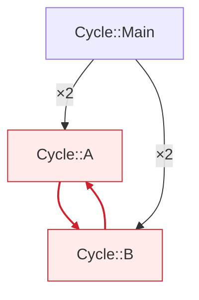
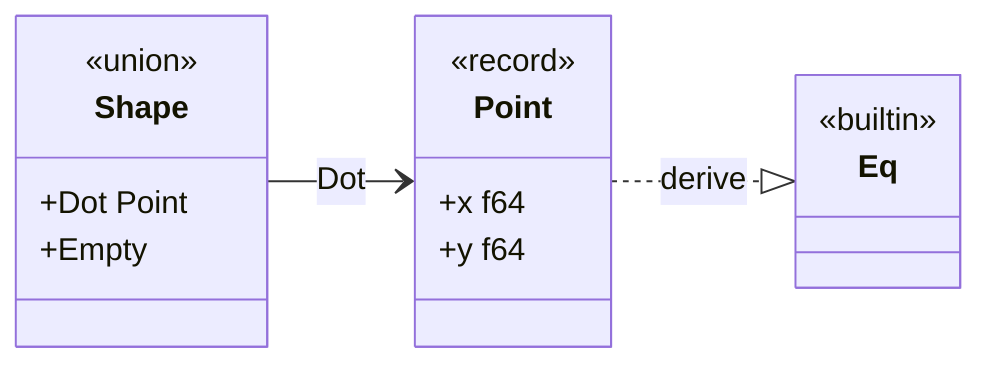
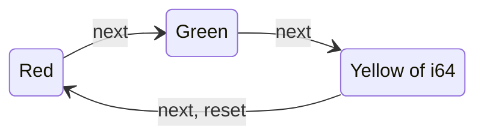

# 図表の自動生成

`tsuzuri kg diagram` は、プロジェクトの[知識グラフ](./knowledge-graph.md)からモジュール依存・型階層・関数コールグラフ・所有権状態遷移・並行通信構造・メモリレイアウト・共用体ケース遷移の **7 種類の図表**を決定的に生成するコマンドです。出力形式は GitHub や VS Code の Markdown プレビューでそのまま描画できる **Mermaid**、Graphviz で SVG / PNG へ変換できる **DOT**、および構造化テーブルを含む **Markdown** に対応しています。

## 要点

- `tsuzuri kg diagram KIND [ID]` で 7 種の図表（`module`・`types`・`calls`・`ownership`・`concurrency`・`layout`・`transitions`）を出力します。同じ知識グラフと引数からは 1 バイトの揺れもない決定的なテキストが生成されます。
- `transitions` を除く 6 種は知識グラフの JSON Lines のみから高速に構築され、ソースファイルの再解析を行いません。
- 生成される Mermaid コードはノード識別子を連番（`n1`・`s1` 等）に正規化し、表示ラベル内の特殊文字（`<`・`>`・`"`・`:`・`(`・`)` 等）をすべてエンティティコードへエスケープするため、ジェネリック型名や予約語で描画が崩れることはありません。
- 知識グラフ構築時（`check`・`build`・`kg build` 等）には、起点 ID を必要としない 3 種の全体図が `target/tz/kg/views/` 配下に自動保存されます。

## コマンド書式とオプション

```sh
tsuzuri kg diagram KIND [ID] \
  [--path PATH] [--kg-dir DIR] \
  [--format mermaid|dot] [--max-nodes N] [--depth N] \
  [--no-refresh] [--json]
```

| 引数・オプション | 既定値 | 説明 |
| --- | --- | --- |
| `KIND` | （必須） | 図の種類（下表の 7 種のいずれか） |
| `ID` | 種別による | 起点となるモジュール・関数・型の ID（`kg show` と同じく短縮名で指定可能） |
| `--path PATH` | `.` | 対象プロジェクトのパス |
| `--kg-dir DIR` | `<ルート>/target/tz/kg` | 知識グラフディレクトリ |
| `--format mermaid\|dot` | `mermaid` | 出力フォーマット（`ownership` と `layout` は Markdown 固定で `dot` 不可） |
| `--max-nodes N` | `60` | 図に含める最大ノード数（5〜200）。超過時はモジュール単位に集約 |
| `--depth N` | `2` | `calls` 図における呼び出し探索の最大深さ（1〜6） |
| `--no-refresh` | 自動更新 | 既存の知識グラフをそのまま使用（未生成・陳腐化時は `E2009`） |
| `--json` | オフ | `{"kind","format","text","nodes","folded"}` の 1 行 JSON として標準出力へ返却 |

### 7 種の図表一覧

| `KIND` | 起点 `ID` | 既定出力 | `--format dot` | 生成される図の内容 |
| --- | --- | --- | --- | --- |
| `module` | 任意（モジュール指定時は隣接のみ） | Mermaid (`flowchart TD`) | 対応 | モジュール間の実依存と `using` 依存、および循環依存の強調表示 |
| `types` | 任意（モジュール指定時は内部のみ） | Mermaid (`classDiagram`) | 対応 | レコード・共用体・型クラス・インスタンスの構造と実装・合成関係 |
| `calls` | 必須（関数・メソッド・テスト） | Mermaid (`flowchart TD`) | 対応 | 起点からの呼び出しツリー、引数渡し規約ラベル、効果別カラーリング |
| `ownership` | 必須（関数） | Markdown + Mermaid | 非対応 | 変数ごとの所有権ライフサイクル状態図とイベント一覧表 |
| `concurrency` | 任意（モジュール） | Mermaid (`flowchart LR`) | 対応 | 並行スコープ・起動関数と共有チャネル・ロックセルの関係図（静的近似） |
| `layout` | 必須（`record` / `union`） | Markdown 表 | 非対応 | 64-bit ネイティブ環境でのバイトサイズ・アライメント・スロット・ニッチ表 |
| `transitions` | 必須（`union`） | Mermaid (`stateDiagram-v2`) | 対応 | `U -> U` 関数の `match` アームから抽出したケース間の状態遷移図（静的近似） |

## 各図表の表現と出力例

### 1. `module`（モジュール依存関係図）

モジュール間の呼び出し・型参照・型クラス実装・インスタンス定義を集計して実線矢印（複数箇所なら `×n` ラベル付き）で結び、`using` のみの参照は破線で描きます。相互依存サイクル（強連結成分）に含まれるモジュールとエッジは赤色で強調され、外部依存パッケージのモジュールは灰色で区別されます。



### 2. `types`（型・型クラス関係図）

`record`・`union`・`class`・`instance` をクラスボックスとして描画し、各メンバーを最大 12 個まで表示します。フィールドやペイロードによる型の保持は実線合成（`-->`）、`deriving` や `instance` による型クラス実装は破線実現（`..|>`）で表します。



### 3. `calls`（関数コールグラフ）

指定した関数・メソッド・テストを起点（太枠）とし、`--depth` 段まで幅優先で呼び出し先を展開します。エッジには実引数の渡し方（`ref`・`copy`・`own`）が添えられ、ノードは推論された効果に応じて色分けされます（I/O・並行起動は青、確保・暗黙コピーは黄、トラップ候補ありは赤、副作用なしと判明した純粋関数は緑、標準ライブラリや組み込み関数は灰色の角丸ノード）。

### 4. `ownership`（所有権ライフサイクル図）

対象関数内のローカル変数ごとに、`Owned`・`Borrowed`・`Moved` / `Dropped` の状態遷移図（Mermaid `stateDiagram-v2`）とイベント番号・行番号・イベント種別・診断ロール（`moved_here` / `borrowed_here` と対応）の Markdown 表を出力します。

### 5. `concurrency`（並行構造図）

関数の型シグネチャに現れるチャネル・同期型（`Channel<T>`・`DataChannel`・`Mutex<T>`・`RwMutex<T>`・`Atomic<T>`・`OnceValue<T>`・`SyncMap`）と、並行実行・セル生成 API（`Routine.scope`・`Routine.go`・`WaitGroup.go`・`ErrGroup.go`・`Parallel.*`・`Channel.make` 等）の呼び出し関係から、並行実行領域（二重枠）と共有セル（紫）の接続関係を近似描画します（動的データフローは追跡しないため、図中に `approximate: from signatures and call sites` の注記ノードが付与されます）。

### 6. `layout`（メモリレイアウト表）

指定した `record` または `union`（ジェネリック型は具体化実体ごと）の 64-bit ネイティブ環境におけるバイトサイズ、アライメント、フィールドスロットまたは共用体表現方式（`enum` / `niche` / `general` / `node`）・タグ幅・生存フラグ有無を Markdown テーブルとして出力します。

### 7. `transitions`（共用体の状態遷移図）

対象共用体 `U` について第 1 引数が `U`（または `ref U`）かつ戻り値も `U` である関数を走査し、その引数を直接 `match` しているアームの入力ケースから返却ケースへの遷移を `stateDiagram-v2` として描画します。この種別のみ最新のソースファイルを読み取り、知識グラフ構築時のハッシュと異なる場合は `E2009`（`kg_stale`）を報告します。



## 自動保存ビュー（`views/*.mmd`）とサイズ上限・エラー

知識グラフが更新される際、以下の条件を満たす全体図が `target/tz/kg/views/` に自動出力され、`manifest.json` のハッシュ検証対象に含まれます。

- `views/modules.mmd`: モジュールが 2 つ以上存在する場合
- `views/types.mmd`: ユーザー定義型が 1 つ以上存在する場合
- `views/concurrency.mmd`: 並行プリミティブまたは並行起動が存在する場合

また、Mermaid レンダラの制限を超えないよう以下の上限と縮約規則が設けられています。

- **ノード上限（`--max-nodes`、既定 60）**: 超過時はモジュール単位のグループノードへ自動的に折りたたみ、`folded: true` を設定します。
- **エッジ上限（400 本）**: ソート順で先頭 400 本を残し、末尾に省略件数コメントを付記します。
- **文字数上限（45,000 文字）**: 超過時はラベル切り詰め長を半分に短縮して再生成し、それでも収まらない場合は `E2000`（`diagram_too_large`）で停止します。

未知の `KIND`、必須 `ID` の欠落、対象の型・関数種別の不一致（例: `calls` にレコード型 ID を渡した場合 `diagram_wrong_id_kind`）、または該当する事実データが存在しない場合（`diagram_unavailable`）は `E2000`（終了コード `2`）となります。

## 関連項目

- [知識グラフ](./knowledge-graph.md)
- [知識グラフのデータ形式](./knowledge-graph-format.md)
- [MCP サーバー](./mcp.md)
- [CLI とサブコマンド](./cli.md)
