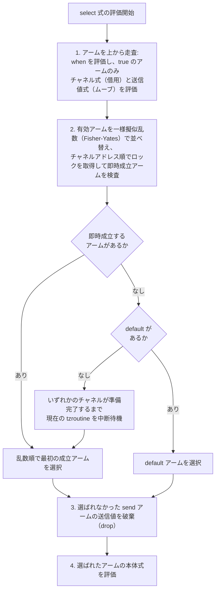

# select 式によるチャネル多重待機

`select` 式は、複数の [`Channel`](../stdlib/sync/channel.md)（および方向付きハンドル `ReceiveOnly` / `SendOnly`）に対する送受信を同時に待ち受け、最初に実行可能になった1つのアーム（分岐）を選択して評価する並行制御構文です。`match` 式と統一感のあるパイプ `|` 構文を持ち、ガード条件による動的なアーム制御、非ブロッキング試行、一様擬似乱数による公平選択、およびタイムアウトやキャンセル監視をサポートします。

## 要点

- アームの種類は受信 `| recv x from ch -> ...`、送信 `| send val to ch -> ...`、非ブロッキング分岐 `| default -> ...` の3種類である。
- 受信アームの束縛変数 `x` の型は `Maybe<T>` であり、値を受信した場合は `Maybe.Some v`、チャネルが閉鎖済みかつ空になった場合は `Maybe.None` が渡される（閉鎖検出）。
- `when 条件` ガードが `false` に評価されたアームはその回の `select` から完全に除外され、チャネル式も送信値式も評価されない。
- 複数のアームが同時に即実行可能な場合は、擬似乱数によって等確率で1つが公平に選択される。
- 送信アームに渡した値は `select` 式へムーブされ、別のアームが選択された場合は自動的に1回破棄（drop）される。

## 構文と各アームの仕様

```text
select
| recv パターン変数 from チャネル式 [when 条件式] -> 本体式
| send 送信値式 to チャネル式 [when 条件式] -> 本体式
| default -> 本体式
```

`select` は直後に `|` と `recv` / `send` / `default` が続く位置でのみキーワードとして認識される文脈キーワードであり、他の文脈では通常の変数名として使用できます。すべてのアームの本体式は同じ型を持つ必要があり、それが `select` 式全体の評価結果の型になります（不一致は `E1003`）。

| アームの形式 | 選択される条件 | 束縛・動作の詳細 |
| --- | --- | --- |
| `\| recv x from ch -> body` | `ch` に受信可能な要素がある、送信側が待機中、または `ch` が閉鎖済みのとき | `x` は `Maybe<T>` として束縛される（通常受信は `Maybe.Some v`、閉鎖済みで空なら `Maybe.None`）。`ch` には `Channel<T>` または `ReceiveOnly<T>`（およびその参照）を指定可能 |
| `\| recv _ from ch -> body` | 同上 | 受信した値（存在する場合）を `body` 実行前にその場で破棄する。完了通知やキャンセル監視に最適 |
| `\| send val to ch -> body` | `ch` のバッファに空きがある、受信側が待機中、または `ch` が閉鎖済みのとき | `val` を `ch` へ送信して `body` を評価する。選択された `ch` が閉鎖済みだった場合は `Channel.send` と同様に `send on closed Channel` トラップとなる。`ch` には `Channel<T>` または `SendOnly<T>` を指定可能 |
| `\| default -> body` | 有効な送受信アームがいずれも即座に成立しないとき | ブロックせず即座に `body` を評価する。`default` は最大1つまで記述でき（2つ以上は `E0002`）、`when` ガードは付与できない |

### 基本例とチャネル閉鎖の検出

Go の `v, ok := <-ch` に相当する閉鎖検出は、Tsuzuri では `Maybe<T>` 型のパターンマッチによって型安全に表現されます。

```tsuzuri run=10%2C20%2Cclosed
let data: Channel<i64> = Channel.make 2
let tx = Channel.share data
tzroutine {
    Channel.send tx 10
    Channel.send tx 20
    Channel.close tx
}

let mut log = ""
let mut open = true
while open do
    select
    | recv item from data ->
        match item with
        | Maybe.Some v -> log = $"{log}{v},"
        | Maybe.None ->
            log = $"{log}closed"
            open = false
log
```

なお、アームのチャネル位置にはローカル変数やフィールドなどの場所（または参照）を渡す必要があり、`Channel.make 0` のような一時値を直接書くことはできません（`E1013: bind the channel to a name first`）。

## `when` ガードによる動的なアーム有効化

各 `recv` / `send` アームには `when 条件式`（`bool` 型）を添えることができます。`when` が `false` となったアームはその回の `select` で無効化され、**チャネル式も送信値の式も一切評価されません**（Go でチャネル変数に `nil` を代入してケースを無効化するイディオムを、null を導入せず明快に記述できます）。

```tsuzuri run=sent%3D3%20total%3D60
let inbox: Channel<i64> = Channel.make 0
let outbox: Channel<i64> = Channel.make 0
let worker_in = Channel.share inbox
let worker_out = Channel.share outbox

tzroutine {
    for x in worker_in do
        Channel.send worker_out (x * 10)
    Channel.close worker_out
}

let mut sent = 0i64
let mut received = 0i64
let mut total = 0i64

while received < 3 do
    select
    | send (sent + 1) to inbox when sent < 3 ->
        sent = sent + 1
        if sent == 3 then Channel.close inbox else ()
    | recv msg from outbox ->
        match msg with
        | Maybe.Some v ->
            total = total + v
            received = received + 1
        | Maybe.None -> received = 3

$"sent={sent} total={total}"
```

もしすべてのアームの `when` 条件が `false` になり、かつ `default` アームも存在しない場合、その `select` は永久に待機します（他のすべての tzroutine も眠っていればデッドロックとして検出されます）。

## 非ブロッキング試行（`default`）

待機せずに現在のチャネル状態だけをポーリングしたい場合は `default` アームを追加します（単一チャネルのみであれば `Channel.try_recv` / `Channel.try_send` も利用できます）。

```tsuzuri run=empty
let ch: Channel<string> = Channel.make 1
select
| recv msg from ch -> Maybe.default_value "closed" msg
| default -> "empty"
```

## 評価順序・所有権・公平選択の規則



1. **上から順の事前評価**: アームを記述順に調べ、`when` がある場合はまず条件式を評価します。条件が真（または `when` なし）のアームについてのみ、チャネル式を共有借用し、`send` アームであれば送信値式を評価して `select` の一時領域へムーブします。
2. **所有権と借用の制約**:
   - 有効化され得る `send` アームの送信値は `select` にムーブされるため、`select` の後続コードでは使用できません（`E1012`）。送信されなかった場合の値の破棄を避けたいときは `Channel.try_send` を用います。
   - 送信値は他 tzroutine へ渡るため借用を含められません（`E1013`）。また、前のアームで借用されたチャネルを後ろのアームの評価式内でムーブすることはできません（`E1014`）。
3. **擬似乱数による公平選択**: 複数のアームが同時に準備完了している場合、特定のアームばかりが優先されて他方が飢餓状態になるのを防ぐため、Fisher–Yates シャッフルによる一様擬似乱数で等確率に1つを選択します。内部ロックはチャネルのメモリアドレス順に整列して重複なく獲得されるため、同一チャネルを複数アームに並べたり複数 tzroutine が逆順で `select` したりしてもデッドロックは起きません。
4. **スタック配置と計算量**: アーム数 $n$ に対する選択処理は $O(n \log n)$、待機キュー登録は $O(n)$ です。アーム数が **64 個以下**の `select` は関数フレーム上の固定スタック領域のみで動作するためヒープ確保を行わず、`@no_alloc` 関数内でも使用できます（65 個以上、最大 65,535 個まではヒープ確保を伴います。上限超過は `E1017`）。

## タイムアウトとキャンセルの実装パターン

### `Time.after` / `Timer` によるタイムアウト

[`Time.after`](../stdlib/sys/time.md)（単発待機）や [`Timer`](../stdlib/sync/timer.md)（再利用・停止可能なタイマー）のチャネルを受信アームに加えることで、一定時間で待機を打ち切るタイムアウト処理を簡潔に記述できます。ループ内で繰り返しタイムアウトを設ける場合は、不要になったタイマーを `Timer.stop` で確実に解除できる `Timer.create` の使用が適しています。

```tsuzuri run=timed%20out
let response: Channel<string> = Channel.make 1
let timer = Timer.create (15 * Time.millisecond())
let timeout_ch = Timer.channel timer

let result = select
    | recv msg from response ->
        let _stopped = Timer.stop timer
        Maybe.default_value "closed" msg
    | recv _ from timeout_ch -> "timed out"
result
```

### `Context` 連携によるキャンセルとデッドライン伝播

リクエストスコープ全体の期限管理や複数ワーカーの一括停止には [`Context`](../stdlib/sync/context.md)（`Context.with_cancel` / `Context.with_timeout`）を使用します。キャンセルまたは期限到来時に `Context.done ctx` のチャネルがクローズされ、それを待つすべての `select` の `recv _ from done` アームが一斉に起床します。`Context.done` は呼び出しごとにハンドルを生成するため、ループの外側で1回取得してから反復内で参照します。

```tsuzuri run=stopped%3A%203
let ctx = Context.with_timeout (Context.background ()) (50 * Time.millisecond())
let done = Context.done ctx
let jobs: Channel<i64> = Channel.make 4
Channel.send jobs 10
Channel.send jobs 20
Channel.send jobs 30

let mut count = 0i64
let mut active = true
while active do
    select
    | recv _ from done -> active = false
    | recv item from jobs ->
        match item with
        | Maybe.Some _ ->
            count = count + 1
            if count == 3 then Context.cancel ctx else ()
        | Maybe.None -> active = false

$"stopped: {count}"
```

## 関連項目

- [tzroutine（軽量並行実行単位）](tzroutine.md)
- [遅延評価とメモ化（OnceValue / サンク / Seq）](lazy.md)
- [Channel](../stdlib/sync/channel.md)
- [Context](../stdlib/sync/context.md)
- [Timer と Ticker](../stdlib/sync/timer.md)
- [Time](../stdlib/sys/time.md)
- [パターンマッチと match 式](../expressions/pattern-matching.md)
