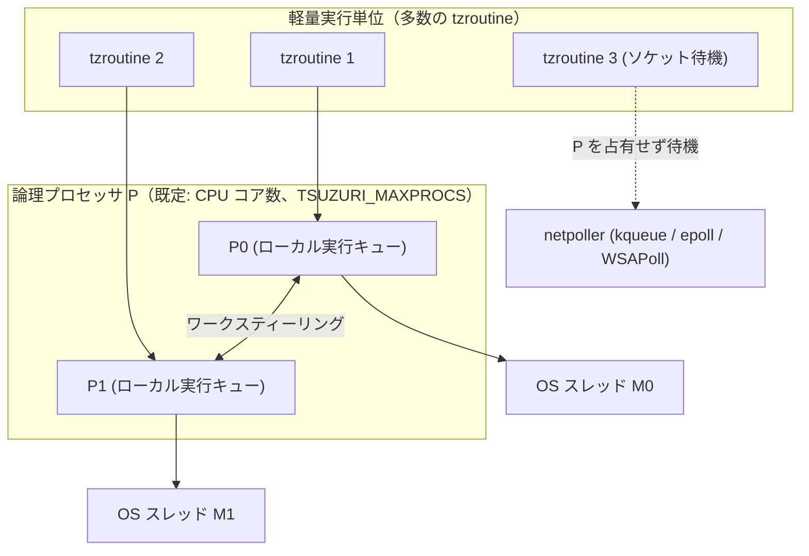

# tzroutine（軽量並行実行単位）

`tzroutine { ... }` は、独立した専用スタックを持つ軽量な並行実行単位（**tzroutine**）を起動し、本体の完了を待たずに即座に `()` を返す式です。起動された tzroutine は M:N ワークスティーリングスケジューラによって少数の OS スレッドへ多重化され、プリエンプションおよび非ブロッキングソケット I/O と連携して並列・並行に実行されます。

## 要点

- `tzroutine { ... }` の本体は `unit` 型を返す通常のブロックであり、`let!` / `do!` による IO アクションも直接実行できる。
- `main`・`export def` の各呼び出し・`test`・`bench` の実行境界は、その内部で起動されたすべての tzroutine（孫以降を含む）が完了するまで終了しない（構造化境界待機）。
- 外側の変数を捕捉する際、非 `Copy` 値はムーブされ、`Copy` 値は複製される。捕捉するすべての型は `Send` 境界を満たす所有値でなければならず、`Rc<T>` や借用（`ref T`）の捕捉は `E1013` で拒否される。
- ネイティブでは約 10 ms ごとの協調検査点とシグナル（macOS / Linux 実行ファイル）によるプリエンプション、および netpoller（kqueue / epoll / WSAPoll）による非ブロッキングソケット待機が行われる。
- WebAssembly では `--target wasm32 --wasm-feature jspi` 指定時に JSPI（JavaScript Promise Integration）上で協調マルチタスクとして動作する。
- 旧バージョンの `Task`（`task { ... }`）および `Async`（`Async { ... }` / `Net.*_async`）は廃止されており（`E1040`）、tzroutine と同期・通信プリミティブへ統合されている。

## 基本構文と構造化境界待機

`tzroutine` の直後に同じ行で `{` を続けて本体ブロックを記述します（`tzroutine` は直後に同一行の `{` が続く位置でのみ認識される文脈キーワードです）。関数値として持ち運んでから起動したい場合は [`Routine.go`](../stdlib/sync/routine.md) に `Owned.Function<unit, unit>` を渡します。

```tsuzuri run=sum%3D4950
let wg = WaitGroup.create ()
let total = Arc.new (Atomic.create 0i64)

for i in 0 ..< 100 do
    WaitGroup.add (ref wg) 1
    let done = WaitGroup.share (ref wg)
    let acc = Arc.share (ref total)
    tzroutine {
        let _prev = Atomic.fetch_add (Arc.get (ref acc)) (i as i64)
        WaitGroup.done (ref done)
    }

WaitGroup.wait (ref wg)
$"sum={Atomic.load (Arc.get (ref total))}"
```

### 実行境界での完了待機ルール

Go の goroutine（`main` が戻ると残りの goroutine を待たずにプロセスが終了する）とは異なり、Tsuzuri では [`Drop`](../ownership/drop.md) によるクリーンアップとメモリ解放を取りこぼさないよう、次の各**境界**が配下の全 tzroutine の終了を自動的に待機します。

| 実行境界 | 子 tzroutine の待機タイミング |
| --- | --- |
| `Main.tz`（`def main` またはトップレベル式） | `main` 関数または末尾式の評価が完了した**直後**（トップレベル式の値表示やプロセス終了の直前） |
| `export def` の呼び出し | 関数本体の評価が完了した直後、ホストへ制御を返す前（WASM JSPI では返却 `Promise` の解決前） |
| `test` 1件 / `bench` 1回の計測 | 各テストケース・計測イテレーションの本体が完了した直後 |

注意すべき点として、境界の戻り値や末尾式は自動待機の**前**に評価されます。したがって、子 tzroutine の計算結果を親側で読み取る場合は、`Channel.recv` や `WaitGroup.wait`、`ErrGroup.wait`、`Routine.scope` を用いて明示的に同期してから結果を参照します。また、すべての tzroutine が待機状態に入り外部からの起床要因（OS I/O やタイマー）も存在しない状態になると、ランタイムはデッドロック（`all tzroutines are asleep - deadlock!`）を報告して停止します。

## M:N スケジューラ・スタック管理・非ブロッキング I/O



### スケジューラとスタック管理

- **論理プロセッサ数（P）**: 同時に Tsuzuri コードを実行する OS スレッド数の上限は既定でオンライン論理 CPU 数（最大 256）であり、起動時の環境変数 `TSUZURI_MAXPROCS`（`1`〜`256`）で制御できます。実行中は `Routine.max_procs ()` で参照できます。
- **スタック確保とプローブ**: ネイティブの各 tzroutine は既定で 1 MiB の仮想アドレス空間を予約し（物理メモリは触れたページのみ割り当て）、下端 128 KiB のガードページとコンパイラが挿入するスタックプローブによってスタックオーバーフローを確実に検出します。深い再帰を行う場合は環境変数 `TSUZURI_TZROUTINE_STACK_KIB`（`64`〜`1048576` KiB）で予約サイズを変更できます。
- **プリエンプション（横取り）**: 待機操作を行わずに計算を続ける tzroutine が他の tzroutine を飢餓状態にしないよう、監視スレッド（sysmon）が約 10 ms ごとに譲渡を要求します。再帰呼び出し入口および重い呼び出しを含むループの後方分岐には軽量な検査点が挿入されるほか、macOS と Linux のネイティブ実行ファイルでは `SIGURG` シグナルによって密なループも安全に横取りされます（SIMD ベクトル化を阻害しないよう、純粋な数値ループ内にポーリング分岐は挿入されません）。Windows や共有ライブラリ・テストランナー・WASM JSPI の密な計算ループでは、適宜 `Routine.yield ()` を呼び出して実行権を譲ります。

### OS ブロッキング呼び出しとソケット非同期 I/O の統合

- **ソケット I/O（netpoller）**: tzroutine の内部で [`Net`](../stdlib/sys/net.md) モジュールの同期関数（`Net.accept`・`Net.connect`・`Net.read`・`Net.write` 等）を呼び出すと、ランタイム内部の netpoller（macOS は `kqueue`、Linux は `epoll`、Windows は `WSAPoll`）がその tzroutine のみを中断させ、OS スレッド（P）は即座に他の tzroutine の実行へ回されます。コールバックや `async`/`await` の色分けなしに、自然な直列コードで高並行サーバーを記述できます。
- **ファイル・FFI 等の OS 待機**: `extern` 関数、`File` / `Dir`、`Process.run`、標準入出力などの OS 呼び出しが約 20 µs 以上ブロックした場合、監視スレッドがそのスレッドから P を切り離して別の OS スレッドへ引き継ぐため、残りの tzroutine の実行は停止しません。

### WebAssembly（JSPI）での動作

WebAssembly で tzroutine を使用する場合は、`--target wasm32 --wasm-feature jspi` を指定して `.wasm` と JS バインディング（`--emit bindings-js`）を生成します。単一スレッド上で `Channel`・`select`・`Time.sleep` などの待機点に到達した tzroutine の線形メモリスタック（固定 64 KiB）のみを JSPI で中断・再開し、ホストのイベントループをブロックせずに複数の tzroutine を交互に進行させます。なお `--wasm-feature threads`、`--freestanding`、`--trap-mode return` と tzroutine の併用はできません（`E2000`）。

## 捕捉変数の所有権移動と `Send` 型境界（`E1013`）

tzroutine は元のスコープとは独立に別スレッド上で走り得るため、本体が外側の変数を捕捉する際には厳格な所有権・スレッド安全規則が適用されます。

| 捕捉対象の種類 | コンパイラの扱い | 理由・診断コード |
| --- | --- | --- |
| `Send` を満たす非 `Copy` 所有値（`string`, `Vec`, `Arc<T>`, `Channel<T>` 等） | **所有権が tzroutine へムーブ**される | 起動後に外側で再利用すると [`E1012`](../ownership/ownership-and-move.md) |
| `Send` を満たす `Copy` 値（`i64`, `bool`, タプル等） | 値が**複製**されて持ち込まれる | 外側の変数も引き続き利用可能 |
| 参照・借用を含む型（`ref T`, `ref mut T`, 借用フィールドを持つレコード、借用を捕捉した関数値） | **捕捉不可** | 親スタックフレームの寿命や排他性を跨げないため **`E1013`** |
| スレッド非安全な参照カウント（`Rc<T>`, `Rc.Weak<T>`）や `Send` なしの `dyn C` | **捕捉不可** | 非アトミックな参照カウント競合等を防ぐため **`E1013`**（`Arc<T>` や `dyn (C, Send)` を使用） |
| 外側の `let mut` 変数への直接代入 | **代入不可** | 捕捉束縛は不変となるため **`E1014`** |

> 補足: 親スコープのデータを借用のまま複数の子 tzroutine から並列に読み書きしたい場合（構造化スコープ並行）は、`tzroutine { ... }` の代わりに子の完了をその場で待機する [`Routine.scope`](../stdlib/sync/routine.md)（`Sync` 境界を検証）を使用します。

## トラップ時の挙動

tzroutine 本体の中で発生した未捕捉の例外やトラップ（`assert` 失敗、境界外添字、ゼロ除算など）は、通常のトラップと同様に**プロセス全体の即時終了**となります（`--trap-info` 有効時は該当 tzroutine の失敗箇所が出力されます。WASM JSPI ではエクスポートの `Promise` が `TsuzuriTrap` で reject されます）。純粋計算のトラップを局所的に捕捉したい場合は [`Domain.run`](../stdlib/core/domain.md) を併用します。

## 結果受け渡しと協調キャンセルのパターン

### `Channel` による結果収集

[`Channel<T>`](../stdlib/sync/channel.md) は値を受け取ること自体が完了待機を兼ねるため、`WaitGroup` なしで安全に結果を回収できます。

```tsuzuri run=30
let ch: Channel<i64> = Channel.make 4
for i in 1 ..= 4 do
    let tx = Channel.share ch
    tzroutine {
        Channel.send tx ((i as i64) * 3)
    }

let mut sum = 0i64
for _ in 0 ..< 4 do
    sum = sum + Maybe.default_value 0 (Channel.recv ch)
sum
```

### `ErrGroup` と `Context` によるエラー伝播・キャンセル

複数の並行ジョブのうち1つでも `Result.Error` を返した時点で残りのジョブへキャンセルを通知し、最初のエラーを受け取るには [`ErrGroup`](../stdlib/sync/errgroup.md) と [`Context`](../stdlib/sync/context.md) を組み合わせます。

```tsuzuri run=failed%3A%20job%202
def run_job :: ref Context -> i64 -> Result<unit, string> = \ctx id ->
    if id == 2 then
        Result.Error "job 2"
    else
        let done = Context.done ctx
        let timer = Time.after (5 * Time.millisecond())
        select
        | recv _ from done -> Result.Ok ()
        | recv _ from timer -> Result.Ok ()

let eg: ErrGroup<string> = ErrGroup.create ()
for id in 1 ..= 3 do
    let ctx = ErrGroup.context eg
    ErrGroup.go eg (Owned.function (\() -> run_job (ref ctx) (id as i64)))

match ErrGroup.wait eg with
| Result.Ok () -> "all ok"
| Result.Error msg -> $"failed: {msg}"
```

ランタイムは実行中の tzroutine を外部から強制終了しないため、長時間ループや待機を行うワーカーは `Context.done` チャネルを [`select`](select.md) で監視して自律的に終了する設計にします。

## 旧 `Task` および `Async` からの移行ガイド

旧バージョンに存在した `task { ... }` / `Task` モジュールおよび `Async { ... }` / `Net.*_async` 関数群は言語仕様から削除されており、使用すると移行先を示す診断 `E1040` が報告されます（ユーザー自身が定義した `Task` や `Async` モジュール・型はそのまま使用可能です）。

| 廃止された構文・API（`E1040`） | 現在の推奨書き換えパターン |
| --- | --- |
| `Task.run (task { ... })` / `Async.run` / `Async.block_on` | ラッパーを外して通常の関数・式として直接実行する（後から評価したい遅延計算は `\() -> ...` サンクにする） |
| `Task.parallel`（添字ごとのデータ並列） | [`Parallel.init`](../stdlib/sync/parallel.md) または `Parallel.map`（待機操作を伴う独立ジョブは `tzroutine` + `WaitGroup`） |
| `Task.scope` | 同一シグネチャの [`Routine.scope`](../stdlib/sync/routine.md)（`tsuzuri fix` で自動置換可能） |
| `Task.parallel_results` / `Async.all_results` | [`ErrGroup.go`](../stdlib/sync/errgroup.md) + `ErrGroup.wait`（入力添字順のエラーが必要な場合は `Parallel.init` で `Result` 配列を生成して走査） |
| `Async.all` | ジョブごとに `tzroutine` を起動し、`WaitGroup` + `Arc<Mutex<[T]>>` または `Channel<T>` で回収 |
| `Async.sleep ms` / `Async.now ()` / `Async.yield ()` | `Time.sleep (ms * Time.millisecond())`（ナノ秒単位に注意） / `Time.monotonic_ns ()` / `Routine.yield ()` |
| `Net.connect_async`・`Net.read_async` 等の 12 関数 | `tzroutine` 内で通常の `Net.connect`・`Net.read` 等を `let!` で呼び出す（netpoller により他 tzroutine を止めずに待機） |
| タイムアウト付きの `Async` 競合待機 | 対象チャネルと `Time.after`（または `Context.with_timeout` の `Context.done`）を [`select`](select.md) で多重待機 |

## 関連項目

- [select 式によるチャネル多重待機](select.md)
- [遅延評価とメモ化（OnceValue / サンク / Seq）](lazy.md)
- [所有権とムーブ](../ownership/ownership-and-move.md)
- [Routine](../stdlib/sync/routine.md)
- [Channel](../stdlib/sync/channel.md)
- [WaitGroup](../stdlib/sync/waitgroup.md)
- [Context](../stdlib/sync/context.md)
- [ErrGroup](../stdlib/sync/errgroup.md)
- [Parallel](../stdlib/sync/parallel.md)
- [Net](../stdlib/sys/net.md)
