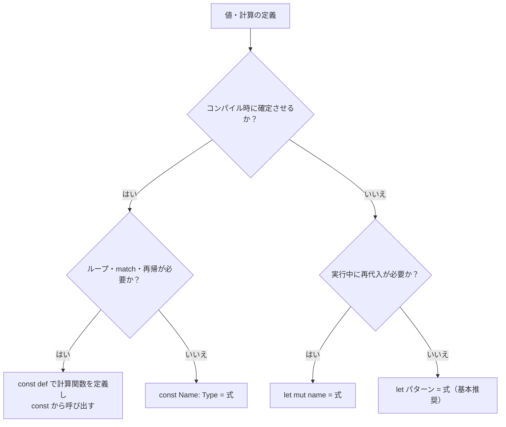

# 束縛と値

Tsuzuri は式指向の静的型付け言語であり、ブロックや制御構造を含むあらゆる計算が「値」を生成します。値への名前付けには不変束縛 `let`、ローカル状態の更新には可変束縛 `let mut`、コンパイル時に確定する定数には `const`（およびコンパイル時評価関数 `const def`）を使用します。

## 要点

- 変数束縛は既定で不変（`let`）であり、再代入が必要なローカル変数にのみ `let mut` を明示します。
- 再代入には `=`、等値比較には `==` を用います。代入式そのものの評価値は `unit`（`()`）です。
- `let` の左辺にはタプルやレコードなどの反駁不可能な分解パターンを記述できます（反駁可能なパターンは `E1021`）。
- 同一スコープ内でのシャドーイング（同名での再束縛）が可能であり、異なる型への束縛し直しも許されます。
- `const` は明示的な具体型注釈を伴うコンパイル時定数です。ループや分岐・再帰を伴う定数生成には `const def` を併用でき、平たいデータの定数は実行ファイル内の読み取り専用静的データを直接参照します。
- 未完成の式の位置には型ホール `?`（または `?name`）を置くことができ、期待される型とスコープ内の候補を診断 `E1030` で対話的に確認できます。

## 宣言構文の選び方

値が確定するタイミングと、実行中の再代入の要否によって宣言構文を選択します。

| 構文 | 確定時期 | 再代入 | 型注釈 | 主な用途 |
| --- | --- | --- | --- | --- |
| `let pat = expr` | 実行時 | 不可 | 省略可（型推論） | 通常のローカル値束縛、タプル・レコードの分解 |
| `let mut x = expr` | 実行時 | 可（`=`） | 省略可（型推論） | ループ内の集計変数、ローカルな状態更新 |
| `const Name: T = expr` | コンパイル時 | 不可 | 必須（具体型） | プログラム定数、設定値、静的ルックアップ表 |
| `const def f :: ...` | コンパイル時 / 実行時 | — | 必須（具体型） | `const` の初期化式で使う表生成・ハッシュ・数列計算 |



## 不変束縛（let）と分解束縛

ローカルな値への名前付けには `let` を使います。一度束縛した不変変数へ後から別の値を再代入しようとすると、コンパイルエラー `E1014` になります。

```text
let パターン [: 型] = 式
```

型注釈を省略すると、右辺の式や後続の使用箇所から双方向型推論によって型が決定されます。型を明示する場合はパターンの後ろに `: 型` を記述します。

```tsuzuri run=1320
let price: i64 = 1200
let tax_rate = 10
let tax = price * tax_rate / 100
let total = price + tax

total
```

`let` は「束縛先を後から差し替えられない」ことを表すものであり、右辺がコンパイル時定数である必要はありません。関数呼び出しの戻り値やヒープ上に確保したコレクションなど、任意の実行時計算の結果を束縛できます。

### パターンによる分解束縛

不変の `let` の左辺には、単一の識別子だけでなく、タプル・レコード・1 ケースのみの共用体・ワイルドカード `_` といった**反駁不可能なパターン**（どの値に対しても必ず一致するパターン）を記述して値を分解できます。

```tsuzuri run=42
record Point { x: i64, y: i64 }

let (base, scale) = (10, 3)
let Point { x = dx, y = dy } = Point { x: 8, y: 4 }

base * scale + dx + dy
```

一方、`let Some x = maybe_val` や定数リテラルを含むパターンのように、実行時の値によっては一致しない可能性がある**反駁可能なパターン**を `let` に書くことはできず、コンパイルエラー `E1021` で拒否されます。失敗しうる値の分岐と取り出しには [`match` 式](./pattern-matching.md)を使用します。

### ローカルな再帰関数の束縛（let rec）

通常の `let` では、右辺の式の中から左辺の名前を参照できません（未定義の識別子 `E1002`）。関数本体やブロックの内部で自分自身を呼び出す補助関数を定義する場合は、`let rec`（相互再帰は `and`）を使用します。

```tsuzuri run=55
let rec sum_to = \n acc ->
    if n <= 0 then acc else sum_to (n - 1) (acc + n)

sum_to 10 0
```

`let rec` の右辺はラムダ式に限られます。環境捕捉や末尾再帰最適化の詳細については、[関数](./functions.md)を参照してください。

## 可変束縛（let mut）と再代入

ループ内での累積計算や状態の段階的更新など、ローカル変数の値を置き換える必要がある場合は `let mut` を使用します。

```tsuzuri run=60
let mut sum: i64 = 0
for x in [10, 20, 30] do
    sum = sum + x

sum
```

再代入には `=` を使い、等値比較には `==` を使います（F# の `<-` ではありません）。代入式 `sum = sum + x` 自体の評価結果は `unit`（`()`）であり、代入によって変数の型を別の型へ変更することはできません（型不一致は `E1003`）。

また、可変の所有者（`let mut` で束縛したレコードや配列、`Vec` など）に対しては、フィールドや要素の直接更新も記述できます（文字列は不変であるため要素代入はできません）。

```tsuzuri run=35
record Score { points: i64, bonus: i64 }

let mut current = Score { points: 20, bonus: 5 }
current.points = current.points + 10
current.points + current.bonus
```

関数越しに呼び出し元の値を書き換える場合は、`mut T` 引数または排他借用 `ref mut` を使用します。なお、外側の `let mut` 変数をラムダ式（クロージャ）が捕捉した場合、クロージャ内部では捕捉時点の値のスナップショットとして不変に保持され、外側の変数へ再代入することはできません（`E1014`）。

## シャドーイング

Tsuzuri では、同一スコープ内または内側のスコープで、既存の変数と同じ名前の新しい `let` 束縛を宣言できます。これを**シャドーイング**と呼びます。

```tsuzuri run=25
let count = 10
let doubled = count * 2
let count = doubled + 5

count
```

右辺の式は新しい束縛が導入される前に評価されるため、2 つ目の `let count = doubled + 5` の右辺では前の束縛から計算された値が正しく参照されます。その行以降では新しい `count` が前の `count` を隠します。

再代入（`=`）とは異なり、シャドーイングは新しい変数束縛を導入するため、以前の変数とは異なる型で束縛し直すことも可能です。

```tsuzuri run=5
let raw_input = "hello"
let raw_input: i64 = raw_input.length

raw_input
```

シャドーイングは既存のメモリ領域を破壊的に上書きする操作ではありません。なお、意図しない名前の隠蔽を検査したい場合は、コンパイラの警告オプションでシャドーイング警告 `W1004`（`shadowed_local`）を有効にできます。

## コンパイル時定数（const と const def）

コンパイル時に値が確定する定数は `const` で宣言します。型推論は行われないため、コロン `:` に続けて具体型を明示する必要があります（省略すると `E0002`）。

```text
[private] const 名前: 型 = 定数式
```

```tsuzuri run=42
const Answer: i64 = Base + 2
const Base: i64 = 40

Answer
```

`const` 宣言には次の規則が適用されます。

- **前方参照とモジュール間参照**: 同一ファイル内で後から宣言される定数を参照できます。既定で公開され、他モジュールからは `Module.Name` で参照します（非公開にする場合は `private const`）。
- **常時検査**: どこからも参照されない定数であっても、コンパイル時に型検査と定数評価が行われます。
- **名前空間と配置可能ファイル**: 関数と同じ値の名前空間に属し、同名の関数や定数との重複は `E1001` です。`.tz` および `.tc` ファイルのトップレベルに配置でき、型クラス定義ファイル `.tt` に置くと `E1018` になります。
- **`@literal` 形式**: `@literal def PI :: f64 = 3.141592653589793` のように `@literal` 属性を付けた `def` でも、`const` とまったく同じコンパイル時定数を宣言できます（[契約と属性](./contracts-and-attributes.md)を参照）。

```tsuzuri project=ConstConfig file=Config.tz
const MaxRetries: i64 = 3
const TimeoutMs: i64 = 1500
```

```tsuzuri run=4500 project=ConstConfig file=Main.tz
Config.MaxRetries * Config.TimeoutMs
```

### 定数式で使える構文と数値規則

`const` の右辺に直接記述できる式と記述できない式は次のとおりです。

| 分類 | `const` 右辺で直接使えるもの | 直接使えないもの（`const def` を使うか対象外） |
| --- | --- | --- |
| 値・データ | 数値、真偽値、文字、文字列、配列、タプル、レコード、共用体構築、他の定数 | 連結リスト `[\|...\|]`、`new` による確保、外部ハンドル |
| 演算 | 算術、比較、論理（`&&`・`\|\|`）、ビット演算、`**`、`as`、定数のフィールド参照 | 添字アクセス、再代入、結果に借用を残す式 |
| 制御・呼び出し | `if ... then ... else`、`const def` の完全適用 | ループ（`for`・`while`）、`match`、`try`、通常の関数呼び出し、部分適用、ラムダ式、型クラスメソッド |

定数評価における数値の意味論は実行時と完全に一致します。

- 整数の加減乗・べき乗・単項負符号は型のビット幅で折り返し、シフト量はビット幅でマスクされます。ゼロ除算、符号付き最小値の `-1` による除算、負の整数指数はコンパイルエラー `E1026` になります。
- 2 進浮動小数点（`f16`・`f32`・`f64`・`f128`）は IEEE 754 の最近接偶数丸めで評価され、`NaN`・無限大・符号付きゼロ・非正規化数を保持します。浮動小数点から整数への `as` キャストは実行時と同じくゼロ方向切り捨てと範囲飽和を行います。
- 10 進浮動小数点（`d32`・`d64`・`d128`）の定数式で許可されるのはリテラル、単項負符号、同一型への `as` のみであり、四則演算や比較は `E1026` になります。

### 平たいデータの静的データ配置と借用

定数の値が**平たいデータ**のみで構成されている場合、コンパイラは実行ファイル内に読み取り専用の単一実体（静的データ）を配置します。

- **平たいデータに該当する型**: 整数、浮動小数点（decimal を含む）、`bool`、`char`、`utf8char`、`unit`、それらのみで構成されるタプル・レコード・固定長配列 `[T; N]`、およびペイロードを持たないか全ケースが同一ペイロード型を持つ共用体です。さらに、定数トップレベルが配列 `[T]` である場合に限り、その要素が平たいデータであれば静的データになります。
- **平たいデータに該当しない型**: `string`、`utf8string`、連結リスト、`Vec`、または利用者定義の `Drop` を持つ型を含む定数は、値として使用されるたびに複製が展開されます。

```tsuzuri run=42
const Primes: [i64] = [2, 3, 5, 7, 11, 13]

def primes_table :: unit -> ref [i64] = \() -> ref Primes

def slice_window :: i64 -> i64 -> ref [i64] = \from until -> ref Primes[from..<until]

Primes[0] + (primes_table ())[5] + Array.sum (slice_window 1 4) + Primes.length * 2
```

平たいデータの定数に対する `ref C`、`C[i]`、`C.length`、`C.field`、`ref C[a..<b]`、`for x in C` は、配列や構造体を複製せずバイナリ内の静的データを直接読み取ります。この共有借用はプログラムの実行全体にわたって有効なため、関数の戻り値として返したり、参照フィールドを持つレコードに格納したりしてもライフタイムエラー（`E1013`）になりません（ただし書き込みや `ref mut C` は `E1013` で拒否されます）。一方、`let copy = Primes` のように所有値として束縛した場合は独立した複製が作られます。

### コンパイル時評価関数（const def）

ループ、`match`、配列の添字、動的初期化 `new [T](n, f)`、再帰を伴う定数計算は、シグネチャに `const` を付けた **`const def`** として記述します。`const` の初期化式から呼び出されるとコンパイラがコンパイル時に評価し、実行時のコードから呼び出されると通常の関数として動作します。

```tsuzuri run=3421780262
const def crc_entry :: i32u -> i32u = \index ->
    let mut value = index
    for _ in 1 ..= 8 do
        value = if (value &&& 1i32u) == 1i32u then (value >>> 1i32u) ^^^ 0xEDB88320i32u else value >>> 1i32u
    value

const def build_crc_table :: [i32u] =
    new [i32u](256, \i -> crc_entry (i as i32u))

const CrcTable: [i32u] = build_crc_table()

def crc32 :: string -> i32u = \text ->
    let mut crc = ~~~0i32u
    for unit in text do
        let byte = (unit as i32u) &&& 0xFFi32u
        crc = CrcTable[((crc ^^^ byte) &&& 0xFFi32u) as i64] ^^^ (crc >>> 8i32u)
    ~~~crc

crc32 "123456789"
```

`const def` には以下の制約と上限があります。

- **シグネチャの型**: 引数と戻り値はすべて具体型の値型（数値、`bool`、`unit`、`char`、`utf8char`、`string`、`utf8string`、`[T]`、`[T; N]`、およびそれらからなるタプル・レコード・共用体）に限られます。型変数、参照 `ref`、関数型、連結リスト、`Vec`、`Drop` 型は指定できません（`E1026`）。また `pure def` や `@cpu` との併用はできません。
- **本体で使える構文**: `let`、`let mut` と変数への再代入、`if`、`match`（ガードを含む）、`while`、範囲・配列・文字列の `for`、`break`、`continue`、`xs[i]`（末尾相対 `^k` は不可）、`new [T](n, f)`、および他の `const def` の完全適用が使用できます。借用・スライス・文字列補間・パイプライン `|>`・`@checked`・標準ライブラリ関数の呼び出し・フィールドや要素への部分代入は `E1026` です。
- **コンパイル時の評価上限**: 実行時にトラップする操作（ゼロ除算、範囲外添字、負の配列長、刻み 0 の範囲など）はすべてコンパイル時に `E1026` として検出されます。定数の依存深さおよび `const def` の呼び出し深さ・データ入れ子深さは最大 128、探索定数数は 1,024、プログラム全体の定数評価予算は 1,048,576 ステップ、静的データの合計サイズは 4 MiB（4,194,304 バイト）に制限され、超過時は `E1026` が報告されます。

## 式としてのブロックとトップレベル規則

Tsuzuri ではインデントブロックも波括弧ブロック `{ ... }` も値を返す式です。ブロック内の最後の式の評価結果がブロック全体の値になり、末尾の式にセミコロン `;` を付けるか空ブロック `{}` とした場合は `unit`（`()`）になります。

```tsuzuri run=42
let result = {
    let a = 20;
    let b = 22;
    a + b
}

result
```

値の受け渡しは型ごとに **Copy**（整数・浮動小数点・`bool`・`char`・共有参照 `ref T` などの自動複製）または **ムーブ**（`string`・`Vec` などの所有権移動、移動後の再使用は `E1012`）に従います。詳細は[所有権とムーブ](../ownership/ownership-and-move.md)を参照してください。

また、トップレベルに実行式や通常のローカル `let` 束縛を直接記述できるのはエントリポイントである `Main.tz` のみです（`Main.tz` 内で `def main` とトップレベル実行式を混在させると `E2004`）。それ以外のモジュールファイルのトップレベルには型宣言・`const`・関数宣言（`def` / `fn`、および先行する `def` に対する関数実装 `let name = \x -> ...`）のみを配置でき、実行式を置くと `E2004` になります。

## 型ホール（? と ?name）による対話的型確認

実装途中の式の位置に `?` または空白を挟まない `?name` を記述すると、コンパイラはその位置を**型ホール（型つき穴）**として扱います。型ホールを含むコードは実行ファイルを生成せず、ホールごとに 1 件の診断エラー `E1030`（kind `typed_hole`）を出力して、その位置に求められる型と利用可能な候補を提示します。

> [!NOTE]
> Tsuzuri の `?` は型ホールであり、Rust のようなエラー伝播演算子ではありません。`Maybe` や `Result` の短絡伝播には[コンピュテーション式](./computation-expressions.md)の `let!` を使用します。

```text
def add_offset :: i64 -> i64 = \n -> n + ?delta
```

上記のコードに対して `tsuzuri check` を実行した際の診断出力は次のとおりです（終了コード `1`）。

```text
./Main.tz:1:42: error[E1030]: typed hole '?delta' of type 'i64'; replace it with an expression of that type
  1 | def add_offset :: i64 -> i64 = \n -> n + ?delta
    |                                          ^^^^^^
  help: fill the hole with a value of type 'i64'
  fix (maybe): Replace '?delta' with 'n'
```

`tsuzuri check --json` を用いると、エディタ連携や自動支援ツール向けに構造化された情報を取得できます。

| フィールド / 記法 | 仕様 |
| --- | --- |
| `?` / `?name` | 式を書ける任意の位置に配置可能（`f ?a ?` は 2 つの引数ホール）。パターン・型・宣言位置の `?` は構文エラー `E0002` |
| `expected` | 双方向型推論から定まった期待型（未確定部分は `_`）。注釈付き `let`、関数末尾、引数、二項演算の右辺、`if` / `match` の分岐、レコードフィールドなどで確定 |
| `scope` | ホール位置から見えるローカル束縛の一覧（最大 32 件、期待型に合致するものを優先表示） |
| `candidates` | 期待型の値を構成できる式候補（1 関数内の先頭 16 ホールまで、各最大 10 件）。ローカル変数、レコードフィールド、ローカル値で引数を埋められる関数呼び出し、定数・共用体ケースの順に提示 |
| `fixes` | スコープ内に期待型と一致するローカル変数がちょうど 1 つある場合、置換候補（applicability `maybe`）を提示 |

## 関連項目

- [演算子と式](./operators.md)
- [関数](./functions.md)
- [契約と属性](./contracts-and-attributes.md)
- [パターンマッチング](./pattern-matching.md)
- [型推論](../types/type-inference.md)
- [所有権とムーブ](../ownership/ownership-and-move.md)
- [借用と参照](../ownership/borrowing.md)
- [名前空間とモジュール](../modules/namespaces-and-modules.md)
