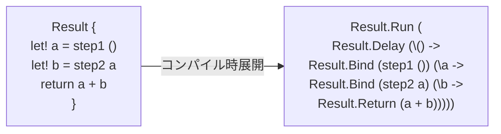

# コンピュテーション式

コンピュテーション式は、失敗の短絡伝播（`Maybe`・`Result`）、遅延された入出力アクションの合成（`IO`）、要素の逐次生成（`yield`）などを、通常の直列的な手続きコードと同じ見た目で記述できる構文です。F# のコンピュテーション式に似ていますが、Tsuzuri の `Builder { ... }` は実行時のビルダーオブジェクトではなく **`.tc` モジュールへのコンパイル時の静的展開**として動作します。

## 要点

- `.tc` 拡張子のファイルが「1 ファイル = 1 ビルダー」を定義します（通常の `.tz` ファイルに関数を定義しただけではビルダーになりません）。
- `.tc` ファイルのトップレベルに `@alias 小文字名` を宣言すると、`Builder { ... }` に加えて `小文字名 { ... }` でも同じビルダーを呼び出せます。
- 標準ライブラリが提供する `.tc` ビルダーは `Maybe`・`Result`・`IO` の 3 つです（`Seq` や `Gen` は `.tz` のコンビネータモジュールです）。
- `let!`・`and!`・`do!`・`match!`・`use!`・`return`・`return!`・`yield`・`yield!`・`for`・`while` は、それぞれ対応するビルダー関数（`Bind`・`Return` など）へ静的に脱糖されます。
- 関数本体・式ブロック・`Main.tz` トップレベルでは、期待される戻り値型などから一意に定まる場合に `Builder { ... }` の囲みを省略できます。
- 継続クロージャが外へ逃げない連鎖はコンパイラによって直接呼び出しへ特殊化され、ヒープ確保なしで実行されます。

## 構文と脱糖（展開）規則

解決されたビルダーモジュールを `B`、後続の計算列を `C` とします。`delay(C)` は `B.Delay` が定義されていれば `B.Delay (\() -> C)`、未定義であれば `C` そのものを表します。コンピュテーション式全体は `delay(本体)` で包まれ、さらに `B.Run` が定義されていれば `B.Run (delay(本体))` へ展開されます。

| コンピュテーション式内の構文 | コンパイル時の展開形 | 仕様と注意点 |
| --- | --- | --- |
| `let x = expr; C` | 通常のローカル束縛の後に `C` | ビルダー操作は呼ばない（`let rec ... and ...` も記述可） |
| `let! pat = src; C` | `B.Bind src (\pat -> C)` | 単一の `let!` 直後に `return e` があり `BindReturn` があれば `B.BindReturn` を優先 |
| `let! a = s1` + `and! b = s2; C` | `B.Bind2` または `B.MergeSources` | 左から右へ 1 回ずつ正格評価してから結合（スレッド並列ではない） |
| `do! src; C` | `B.Bind src (\() -> C)` | `unit` を生成する計算の実行と短絡（通常の `do expr` とは異なる） |
| `match! src with ...` | `B.Bind src (\v -> match v with ...)` | 網羅性検査（`E1021`）とガード規則は通常の `match` と同じ |
| `use x = expr; C` | 通常の `use` 束縛の後に `C` | スコープ終了時に言語の `Drop` を実行（`B.Using` は呼ばない） |
| `use! x = src; C` | `B.Bind src (\v -> { use x = v; C })` | 取り出した型に `Drop` が必須（`E1005`）。`and!` との併用不可（`E0002`） |
| `return expr` | `B.Return expr` | 分岐・ブロック末尾で値を包む構文（命令型言語の早期脱出ではない） |
| `return! src` | `B.ReturnFrom src` | 既存のビルダー計算値を二重に包まずそのまま返す |
| `yield expr` | `B.Yield expr` | 要素を 1 つ生成する（複数並べる場合は `Combine` が必要） |
| `yield! src` | `B.YieldFrom src` | 既存の列をそのまま取り込む |
| 空ブロック `{}` / 末尾の `unit` 式 | `B.Zero()` | `Zero` は引数なし関数 `def Zero :: ...` として定義する |
| `if cond { C1 } else { C2 }` | 通常の条件分岐 | `else` 省略時は `else { B.Zero() }` を補完 |
| `C1; C2` | `B.Combine C1 (delay(C2))` | `Delay` が未定義の場合は第 2 引数も先に正格評価される |
| `for pat in xs do C` | `B.For xs (\pat -> C)` | 走査可能な列の型は `B.For` の第 1 引数型が決める |
| `while cond do C` | `B.While (\() -> cond) (B.Delay (\() -> C))` | `While` と `Delay` の**両方**の定義が必須（不足時は `E1018`） |

- **未定義操作の厳格な検出**: 使用した構文に対応する操作が `.tc` に定義されていない場合、恒等関数で暗黙補完することはせずコンパイルエラー `E1018` を報告します。操作名は大文字・小文字を区別します。
- **`try ... with ... finally` との組み合わせ**: `try` はビルダーのメソッド（F# の `TryWith` / `TryFinally`）には変換されず、`@checked` 算術の `OverflowException` を `Result<'T, 'E>`（`'E : Err`）へ変換する Tsuzuri 固有の式としてそのまま機能します。`Result { ... }` の内部では `let! v = try @checked (a * b) with | e -> e` のようにそのまま短絡結合できます。



---

## 標準ビルダーと関連モジュール

### 標準の .tc ビルダー（Maybe・Result・IO）

| ビルダー | 定義ファイル | 役割 | 短絡・実行の振る舞い |
| --- | --- | --- | --- |
| `Maybe` | `std/Maybe.tc` | 値の有無を伴う計算の連鎖 | `None` が返った時点で後続の継続をスキップし `None` を返す |
| `Result` | `std/Result.tc` | エラー情報を伴う計算の連鎖 | `Error e` が返った時点で後続をスキップする（ブロック内でエラー型は単一） |
| `IO` | `std/IO.tc` | 入出力副作用の純粋な記述と合成 | 構築時点では副作用を起こさず、`main` や実行境界で評価される |

```tsuzuri run=42%20%2F%20overflow
union CalcErr = InvalidQty | Overflow

instance Err<CalcErr> {
    fn msg err =
        match err with
        | InvalidQty -> "qty must be positive"
        | Overflow -> "overflow"
}

def checked_total :: i32 -> i32 -> i32 -> Result<i32, CalcErr> = \price qty fee ->
    Result {
        if qty <= 0i32 then
            return! Result.Error InvalidQty
        else
            let! subtotal =
                try
                    @checked (price * qty)
                with
                | _ is OverflowException -> Overflow
            let! total =
                try
                    @checked (subtotal + fee)
                with
                | _ is OverflowException -> Overflow
            return total
    }

def show :: Result<i32, CalcErr> -> string = \r ->
    match r with
    | Result.Ok n -> to_string n
    | Result.Error err -> Err.msg err

$"{show (checked_total 12i32 3i32 6i32)} / {show (checked_total 1000000i32 5000i32 0i32)}"
```

なお、`Maybe` と `Result` の相互変換は自動では行われないため、`Maybe.to_result` または `Result.to_maybe` を明示します。また `IO.tc` は他ビルダーの計算を `IO` 内で走らせる `IO.Using` も定義しています。

### Seq・Gen モジュールとの関係

標準ライブラリの [`Seq`](../stdlib/collections/seq.md)（遅延シーケンス）および [`Gen`](../stdlib/testing/gen.md)（プロパティテスト用ランダム生成器）は `.tz` で実装された関数モジュールであり、標準では `.tc` ビルダーを持っていません（`Seq { ... }` や `Gen { ... }` と書くと `E1018` になります）。

- `Seq` の構築には `Seq.init`・`Seq.unfold`・`Seq.of_array`・`Seq.map`・`Seq.filter` を使用します。
- `Gen` の合成には `Gen.map`・`Gen.map2`・`Gen.bind`・`Gen.sized` を使用します。
- `yield` を用いたコレクション構築構文や独自の `Gen` 風 DSL が必要な場合は、次節のようにプロジェクト内で独自の `.tc` ビルダーを定義できます。

> [!NOTE]
> 旧バージョンに存在した `task { ... }` および `async { ... }` / `Async { ... }` は削除されており、同名の `@alias` ビルダーを定義していない限り `E1040` が報告されます。並行処理には [`tzroutine { ... }`](../concurrency/tzroutine.md) を使用してください。

---

## and! によるアプリカティブ結合と match!

### and!（独立した計算の結合）

互いに依存しない複数の計算を結合する場合は、`let!` に続けて `and!` を並べます。

```tsuzuri run=left%0Aright%0A42
def main :: unit -> i32 = \() ->
    let! total = IO {
        let! left = IO {
            do! IO.writeln "left"
            return 20
        }
        and! right = IO {
            do! IO.writeln "right"
            return 22
        }
        return left + right
    }
    do! IO.writeln (to_string total)
    0
```

- `and!` グループの各右辺は**左から右へ 1 回ずつすべて評価**されます（左が `None` や `Error` でも右辺の式自体は評価され、その後の継続呼び出しが短絡されます。`Result` で両方が `Error` の場合は左側の `Error` が優先されます）。
- 同じ `let! ... and!` グループ内で束縛した変数を、同じグループの別の右辺から参照することはできません（`E1002`）。前の結果に依存する計算は通常の連続した `let!` で記述します。
- `and!` はスレッド並列実行ではありません。CPU 並列処理には `Parallel.*` または `tzroutine` を使用します。

### match!（取り出しと同時のパターン照合）

`let! tmp = src` の直後に `match tmp with ...` を行う処理は、`match! src with ...` と 1 段で記述できます。

```tsuzuri run=42
let resolved = Maybe {
    match! Maybe.Some (true, 42) with
    | (true, n) -> return n
    | (false, _) -> return 0
}

Maybe.default_value (-1) resolved
```

---

## ビルダー名の省略形

関数の本体、波括弧ブロック、`Main.tz` のトップレベルでは、`Builder { ... }` で囲まずに直接 `let!`・`do!`・`return` 等を記述できます。コンパイラは次の優先順位でビルダーを静的に決定します。

1. 関数の戻り値型や変数注釈など、そのブロックに**期待される結果型**が単一の `.tc` ビルダーに対応していれば（例: `Maybe<i64>` なら `Maybe`、`Result<T, E>` なら `Result`）、そのビルダーを選択します。
2. 期待型が未確定であれば、最初の `let!` または `do!` の右辺の型から対応するビルダーを選択します（候補が複数または 0 個の場合は曖昧性エラー `E1018`）。
3. 期待される結果型がビルダー型でない場合（例: `def main :: unit -> i32` の本体など）は、`IO` アクションに対する `let!` / `do!` を遅延させず**その場で即時実行**します。

```tsuzuri run=42
def compute_bonus :: i64 -> Maybe<i64> = \base ->
    let! extra = if base > 0 then Maybe.Some 22 else Maybe.None
    return base + extra

Maybe.default_value 0 (compute_bonus 20)
```

---

## カスタムビルダー（.tc）の定義と @alias

プロジェクト内に `<BuilderName>.tc` ファイルを作成すると、ファイル名がそのままビルダー名として使えるようになります。さらに `.tc` ファイルのトップレベルに `@alias 小文字名` を記述すると、小文字の別名でも同じビルダーを呼び出せます。

以下は、`yield`・`yield!`・`for`・`if` を使って条件に合う要素を配列へ収集するカスタムビルダー `Bag.tc`（別名 `bag`）の例です。

```tsuzuri project=CustomBag file=Bag.tc
@alias bag

def Yield :: own 'a -> ['a] = \item -> [item]

def YieldFrom :: Copy<'a> => ['a] -> ['a] = \items -> Array.copy items

def Zero :: ['a] = []

def Delay :: own (unit -> ['a]) -> (unit -> ['a]) = \thunk -> thunk

def Combine :: Copy<'a> => ['a] -> own (unit -> ['a]) -> ['a] = \left right_thunk ->
    let right = right_thunk ()
    Array.append left (ref right)

def For :: (Copy<'a>, Copy<'b>) => ['a] -> own ('a -> ['b]) -> ['b] = \items body ->
    let mut acc: ['b] = []
    for x in items do
        let part = body x
        acc = Array.append (ref acc) (ref part)
    acc

def Run :: own (unit -> ['a]) -> ['a] = \thunk -> thunk ()
```

```tsuzuri run=1%2C10%2C2%2C20%2C99 project=CustomBag file=Main.tz
let collected = bag {
    for n in [1, 2] do
        yield n
        yield n * 10
    if true {
        yield! [99]
    }
}

let texts = Array.map (\n -> to_string n) collected
String.join "," texts
```

`@alias` とビルダー構文には次の規則があります。

- ビルダー名（または別名）と開き波括弧 `{` は**同じ行**に記述します（次行に `{` を送ると `E1002`）。
- `@alias` の名前は予約語でない小文字始まりの ASCII 識別子に限定され、`.tc` ファイルのトップレベルに 1 行で記述します（`.tz` や `.tt` に書くと `E1018`、構文違反は `E0002`）。
- 別名は `{` の直前でのみ使用でき、`bag.Yield` のような関数修飾には元のモジュール名 `Bag.Yield` を使います。複数のインポート元が同じ別名を宣言して衝突した場合は `E1004` になるため、元のモジュール名で明示します。

---

## 所有権・借用規則と継続特殊化

1. **継続クロージャの `Capture` 制約**: `let!` や `use!` の後続コードは継続関数（`\x -> ...`）へ展開されます。継続は再利用可能な関数値として検査されるため、`let!` をまたいで後続の継続の中へ `Drop` 型の値や排他借用 `ref mut`、`Rc` などを捕捉させることはできません（`E1005`）。
2. **可変変数のスコープ**: コンピュテーション式の外側にある `let mut` 変数は継続内部からは再代入できません（`E1014`）。継続の内部でローカルに値を更新したい場合は `let mut` または `let! mut acc = ...` を使います。
3. **継続の直接呼び出し特殊化**: `Bind` が継続をその場で呼び出し外部へ逃がさない標準的な連鎖（`Maybe` や `Result` の `let!` 連鎖など）では、コンパイラが最大 1,024 箇所まで継続クロージャのヒープ確保を除去して直接呼び出しへインライン特殊化します。上限を超えた箇所も意味論を変えることなく通常のクロージャ経路へフォールバックします。

## 関連項目

- [エラー処理と例外](./error-handling.md)
- [リソース管理とアサーション](./resources-and-assertions.md)
- [ラムダ式とクロージャ](./lambdas.md)
- [パターンマッチング](./pattern-matching.md)
- [契約と属性](./contracts-and-attributes.md)
- [Maybe](../stdlib/core/maybe.md)
- [Result](../stdlib/core/result.md)
- [IO](../stdlib/sys/io.md)
- [Seq](../stdlib/collections/seq.md)
- [Gen](../stdlib/testing/gen.md)
- [tzroutine](../concurrency/tzroutine.md)
