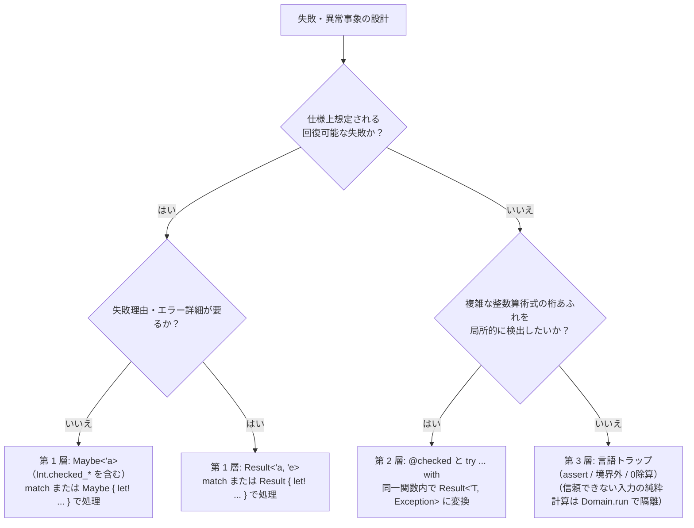

# エラー処理と例外

Tsuzuri はあらゆる失敗を単一の例外機構に押し込めるのではなく、失敗の性質と回復責任に応じて**値による失敗表現（`Maybe` / `Result`）**、**検査付き算術の字句的例外（`@checked` と `try ... with ... finally`）**、および**回復不能な言語トラップ（と純粋計算の `Domain.run` 隔離）**の 3 層に明確に分離しています。関数の境界を越えて暗黙に飛ぶ非局所例外は存在せず、制御フローとリソース解放の順序が常にコード上から静的に把握できます。

## 要点

- 入力検証エラーや I/O 失敗など、呼び出し元が回復しうる失敗はすべて **`Maybe<'a>`** または **`Result<'a, 'e>`** の戻り値として表し、コンピュテーション式の `let!` で短絡伝播します（Rust の `?` 演算子は存在せず、`?` は型ホール `E1030` です）。
- Tsuzuri には任意の例外を送出する `raise` / `throw` 構文や関数呼び出しをまたぐスタック巻き戻しはありません。構造化例外 `Exception` を送出するのは同一関数内の **`@checked` 整数算術のみ**であり、`try ... with ... finally` 式がそれを受け取って `Result` 値へ変換します。
- ゼロ除算、境界外アクセス、`assert` や `@requires` / `@ensures` の違反、`unreachable ()` は**言語トラップ**であり、`try` では捕捉できません。
- トラップはスタックを巻き戻さず未実行の `Drop` や `finally` も走らせずにプロセスを即時停止しますが、副作用を持たない平たいデータの計算に限り **`Domain.run`** でトラップを隔離して `Result.Error` として回収できます。

## Tsuzuri の 3 層失敗モデル

| 層 | 対象となる事象 | 表現・構文 | 関数境界の伝播 | `Drop` / `finally` の実行 |
| --- | --- | --- | --- | --- |
| **第 1 層: 値による失敗** | 値の不在、入力不正、パース失敗、ファイル・通信失敗、`Int.checked_*` | `Maybe<'a>`、`Result<'a, 'e>`、`match`、`let!` | 戻り値として明示的に伝播 | **保証される**（通常のスコープ退出） |
| **第 2 層: 字句的構造化例外** | `@checked` を付与した整数算術のオーバーフロー | `@checked` + `try ... with ... finally`（評価型は `Result`） | **越えない**（同一関数内の最内 `try` へ直接ジャンプ） | **保証される**（`try` 本体の `Drop` → ハンドラ → `finally`） |
| **第 3 層: 言語トラップ** | ゼロ除算、範囲外添字、`assert`・契約違反、`unreachable ()`、未捕捉の `@checked` | プロセス即時終了、または `Domain.run` による領域隔離 | 伝播せず即停止（`Domain.run` 内のみ `Result.Error` へ変換） | **実行されない**（`Domain.run` は領域アリーナを一括解放） |



---

## 第 1 層：Maybe と Result による回復可能な失敗

外部入力の検証、検索での未発見、システムコールやネットワークの失敗など、プログラムの契約違反ではない通常の失敗はすべて標準共用体 `Maybe<'a>`（`None | Some of 'a`）または `Result<'a, 'e>`（`Ok of 'a | Error of 'e`）で返します。

```tsuzuri run=360%20%2F%20invalid%20quantity
def validate_qty :: i64 -> Result<i64, string> = \qty ->
    if qty > 0 && qty <= 1000 then
        Result.Ok qty
    else
        Result.Error "invalid quantity"

def calc_order :: i64 -> i64 -> Result<i64, string> = \unit_price qty ->
    Result {
        let! valid_qty = validate_qty qty
        return unit_price * valid_qty
    }

def format_outcome :: own Result<i64, string> -> string = \res ->
    match res with
    | Result.Ok amount -> to_string amount
    | Result.Error err -> err

$"{format_outcome (calc_order 120 3)} / {format_outcome (calc_order 120 0)}"
```

また、ゼロ除算や `MIN / -1` も含めて整数演算の失敗をトラップさせずに値で受け取りたい場合は、`Int.checked_add`・`Int.checked_sub`・`Int.checked_mul`・`Int.checked_div`・`Int.checked_rem`・`Int.checked_neg`・`Int.checked_pow` を使用します。これらはすべて `Maybe<'a>` を返し、オーバーフローやゼロ除算時にはトラップせず `Maybe.None` になります。

> [!WARNING]
> `Maybe.get` や `Result.get` は、値が `None` または `Error` であった場合に言語トラップ（`non-exhaustive match`）を引き起こします。呼び出し元で回復すべき箇所では `match` または `Maybe.default_value` / `Result.default_value` / `let!` を使用してください。

---

## 第 2 層：構造化例外 Exception と try ... with ... finally

### 組み込み例外型と型フィルタ

`@checked` 属性が付与された式・文の中で組み込み整数演算（`+`、`-`、`*`、`**`、単項 `-`）がオーバーフローすると、標準ライブラリの `Exception` レコードが送出されます。

```text
union ExceptionKind = OverflowException
record Exception { kind: ExceptionKind, msg: string }
```

これを受け取るのが **`try ... with ... [finally ...]`** 式です。`try` 式全体の型は **`Result<'T, 'E>`** となり、本体が正常完了すれば `Result.Ok`、例外が捕捉されればハンドラが返した値を包んだ `Result.Error` になります。

```tsuzuri run=42%20%2F%20Arithmetic%20operation%20resulted%20in%20an%20overflow.
def safe_add :: i32 -> i32 -> Result<i32, Exception> = \x y ->
    try
        @checked (x + y)
    with
    | e is OverflowException -> e

def show_add :: i32 -> i32 -> string = \x y ->
    match safe_add x y with
    | Result.Ok v -> to_string v
    | Result.Error e -> clone_string (ref e.msg)

$"{show_add 40i32 2i32} / {show_add 2147483647i32 1i32}"
```

- **型フィルタ `| e is OverflowException ->`**: `e.kind` が `OverflowException` であることを判定し、例外レコード全体を `e` に束縛します。さらに `when` ガード（`| e is OverflowException when cond ->`）を添えることもでき、どのアームにも一致しなかった例外は同じ関数内の外側の `try` へ再送出されます（外側に `try` がなければ未処理例外トラップ `unhandled OverflowException` となります）。
- **ハンドラのエラー型制約（`Err` 型クラス）**: `with` ハンドラが返す型 `'E` は、エラー文字列を取り出す型クラス `Err`（`msg :: ref 'a -> string`）を実装している必要があります（標準では `Exception` が `Err` を実装しています。未実装の `i32` や `string` をそのまま返すと `E1005` になります）。独自のレコード型や共用体型に `instance Err<MyError>` を実装すれば、ドメイン固有のエラー型へその場で変換してハンドラから返すことも可能です。また、関数の戻り値型が `Result<'T, 'E>` で `'E` が他に出現しない場合、`'E` は自動的に `Exception` と推論されます。
- **`e.msg` の所有権に関する注意**: `Exception` の `msg` フィールドは非 Copy の `string` です。ハンドラ内で `let m = e.msg` とムーブしてしまうと、その後 `e` 全体を返せなくなります（`E1012`）。ログ出力しつつ `e` を返す場合は `$"{e.msg}"` で参照補間するか、`clone_string (ref e.msg)` を使用します。

### finally 節の実行順序と字句的境界

`finally` 節は省略可能であり、記述した場合は型が `unit` でなければなりません（`E1003`）。

```tsuzuri run=body-ok%0Afinally%0A40%0Ahandler%0Afinally%0Aoverflow
def doubled :: i8 -> string = \x ->
    let outcome =
        try
            let v = @checked (x * 2i8)
            do! IO.writeln "body-ok"
            v
        with
        | e is OverflowException ->
            do! IO.writeln "handler"
            e
        finally
            do! IO.writeln "finally"
    match outcome with
    | Result.Ok n -> to_string n
    | Result.Error _ -> "overflow"

def main :: unit -> i32 = \() ->
    do! IO.writeln (doubled 20i8)
    do! IO.writeln (doubled 100i8)
    0
```

- **クリーンアップの厳密な順序**: `try` 本体で束縛された `Drop` / `use` 値は `try` 本体を抜ける時点で先に解放され、捕捉時はハンドラが評価された後、結果（または不一致時の外側 `try` への再送出）が外へ出る直前に **`finally` が必ず実行されます**。
- **`finally` とループ脱出の禁止**: `finally` の実行保証を守るため、`finally` を持つ `try` の内部から外側のループへ `break` / `continue` することは `E1023` で禁止されます。
- **関数・ラムダ境界を越えない字句的スコープ**: `@checked` の例外送出は、**同じ関数本体内の最も内側の `try`** へのみジャンプします。別の関数 `boom x` の内部や無名ラムダ `\y -> @checked (y + 1)` の内部で発生した `OverflowException` を呼び出し元の `try` で捕捉することはできず、発生箇所でそのままトラップします。関数をまたいでオーバーフローを伝えたい場合は、呼び出し先の関数自身が `Result` または `Maybe` を返す設計にします。

---

## 第 3 層：回復不能な言語トラップと Domain 隔離

### 言語トラップの原因と報告

プログラムの不変条件や事前契約を破った以下の操作は、`try` では捕捉できない**言語トラップ**となります。

| トラップ要因 | 標準エラー出力される理由（代表例） |
| --- | --- |
| `assert false` | `assertion failed` |
| `@requires` / `@ensures` 違反（`check` モード） | `contract requires failed` / `contract ensures failed` |
| 整数のゼロ除算・剰余（`x / 0`、`x % 0`） | `integer division by zero` |
| 符号付き最小値の `-1` 除算（`MIN / -1`） | `integer division overflow` |
| 配列・スライス・リスト・`Vec`・文字列の境界外アクセス | `index out of bounds` |
| `for` 範囲のステップ `0` | `range step is zero` |
| `unreachable ()`、`Maybe.get None`、`Result.get (Error _)` | `non-exhaustive match` |
| `try` で捕捉されなかった `@checked` 算術 | `unhandled OverflowException: ...` |

`tsuzuri run` は既定でトラップ発生箇所のファイル名・行・列とバックトレースを標準エラーへ出力し、終了コード非 0（診断 `E2005`）で停止します。`tsuzuri build` でビルドした実行ファイルや WebAssembly モジュールに位置情報を付与したい場合は `--trap-info` オプションを指定します（`<output>.trap.json` サイドテーブルが出力されます）。

### スタック巻き戻しの不在と Domain.run による隔離

言語トラップが発生すると、プログラムの状態が壊れている可能性があるため**スタックの巻き戻し（unwinding）は行われません**。したがって、スコープ内に残っているローカル変数の `Drop` デストラクタや `try ... finally` の後処理は実行されず、そのままプロセスが終了します（トラップ前にフラッシュ済みの `IO.writeln` や完了済みの `File` 書き込みは残ります）。

ただし、外部副作用を持たない**純粋な計算**を実行する場面（複雑なインデックス計算や信頼できないデータに対する純粋パーサ・数値カーネルなど）に限り、macOS および Linux のネイティブ環境では標準ライブラリの **`Domain.run`** を用いてトラップを隔離領域内に封じ込められます。

```tsuzuri run=ok%3A25%20%2F%20trapped%3Akind%3D3
def read_at :: [i64] -> i64 -> i64 = \xs idx -> xs[idx]

def describe_domain :: Result<i64, Domain.Failure> -> string = \res ->
    match res with
    | Result.Ok v -> $"ok:{v}"
    | Result.Error f -> $"trapped:kind={f.kind}"

let table = [1, 4, 9, 16, 25]
let first = Domain.run (\() -> read_at table 4)
let second = Domain.run (\() -> read_at table 10)

$"{describe_domain first} / {describe_domain second}"
```

`Domain.run` に渡すクロージャは純粋であり、捕捉する値と戻り値がともに `Drop` や参照を含まない平たいデータであることがコンパイル時に強制されます（違反は `E1038`）。領域内でトラップが起きると、領域専用ヒープで確保されたメモリブロックが一括回収されたうえで `Result.Error (Domain.Failure { kind })` が返り、呼び出し元のプロセスは安全に処理を継続できます（なお、スタック枯渇や領域外のトラップは隔離対象外です）。

## 関連項目

- [コンピュテーション式](./computation-expressions.md)
- [リソース管理とアサーション](./resources-and-assertions.md)
- [契約と属性](./contracts-and-attributes.md)
- [演算子と式](./operators.md)
- [Maybe](../stdlib/core/maybe.md)
- [Result](../stdlib/core/result.md)
- [Exception](../stdlib/core/exception.md)
- [Domain](../stdlib/core/domain.md)
- [Int](../stdlib/numeric/int.md)
- [Drop と後始末](../ownership/drop.md)
- [デバッグとプロファイリング](../compiler/debugging.md)
