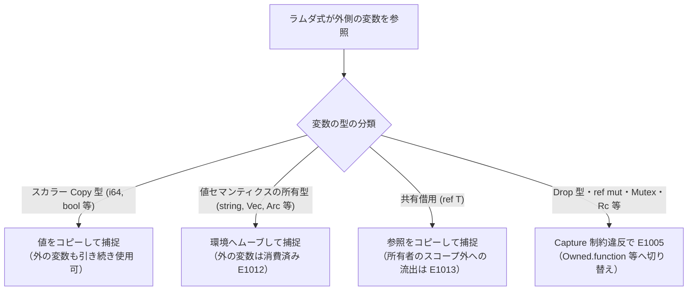

# ラムダ式とクロージャ

ラムダ式は名前を持たない無名関数（クロージャ）を生成する式です。高階関数へのコールバック渡し、パイプライン内でのデータ変換、および外側のスコープにある変数を捕捉（キャプチャ）した関数値の構築に用います。

## 要点

- 構文は `\引数1 引数2 -> 本体` であり、`\引数1 -> \引数2 -> 本体` と同じカリー化関数を生成します。
- 引数には変数名だけでなく、タプル分解 `\(a, b) ->`、`unit` パターン `\() ->`、型注釈付き引数 `\(x: i64) ->` などの反駁不可能なパターンを指定できます。
- 関数呼び出しの実引数として直接渡されたラムダ式は、他の実引数の型検査の後に検査されるため、多くの場合で引数の型注釈を省略できます。
- 通常の関数値（`A -> B`）は `Copy` 型であり、環境の複製が安全な型（`Capture` 制約を満たす型）のみを捕捉できます。
- `Drop` を実装したリソース型、排他借用 `ref mut`、`Mutex` / `Atomic`、`Rc` などを通常のラムダ式で捕捉すると `E1005` になります。リソースを所有する関数値が必要な場合は非 Copy の `Owned.function` を使い分けます。

## ラムダ式の構文とカリー化

バックスラッシュ `\` に続けて 1 つ以上の仮引数パターンを空白区切りで並べ、`->` の右辺に本体式を記述します。本体はラムダ式を作った時点ではなく、必要な引数が揃って呼び出された時点で評価されます。

```tsuzuri run=42
let add = \left right -> left + right
let add_twenty = add 20

add_twenty 22
```

`\x y z -> body` は `\x -> \y -> \z -> body` と同じカリー化関数です。複数行の本体を書く場合は、`->` の次行を深くインデントするか、波括弧ブロック `{ ... }` を使用します。

第 1 引数を受け取った時点で前処理を実行し、その結果を閉じ込めた関数を返したい場合は、外側で束縛を行ってから内側のラムダ式を返します。

```tsuzuri run=42
def make_adder :: i64 -> (i64 -> i64) = \factor ->
    let base = factor * 2
    \amount -> base + amount

let f = make_adder 10
f 22
```

> [!NOTE]
> Edition 2026 ではバックスラッシュを省いた旧記法 `x -> x + 1` も互換構文として受理されますが、Edition 2027 以降（既定の Edition 2028 を含む）では `E0004` となります。常に `\x -> ...` を使用してください。

## 引数パターンと型注釈

### 反駁不可能なパターンによる引数分解

仮引数の位置には、識別子・ワイルドカード `_`・`unit` パターン `()`・タプル・レコードなど、すべての値に必ず一致する**反駁不可能なパターン**を記述できます。

```tsuzuri run=50
let sum_pair = \(left, right) -> left + right
let lazy_two = \() -> 2

sum_pair (20, 28) + lazy_two ()
```

- **タプル引数と複数引数の違い**: `\(left, right) -> ...` は 2 要素タプルを 1 つ受け取る関数（型 `(A * B) -> R`）であり、カリー化された 2 引数関数 `\left right -> ...`（型 `A -> B -> R`）とは異なります。
- **`unit` パターン**: `\() -> 42` は `unit` 型の値を 1 つ受け取る関数であり、呼び出しは `f ()` です（引数 0 個の `def f :: i64` に対する `f()` とは異なります）。
- **可変引数束縛**: `\mut count -> { count = count + 1; count }` のように `mut` を付けると、受け取ったローカル引数束縛を本体内で再代入できます。
- **反駁可能パターンの禁止**: `Some x` や定数リテラルのような反駁可能パターン（および単一引数の `when` ガード）をラムダ引数に直接書くと、Edition 2027 以降では `E1021` で拒否されます（Edition 2026 では警告 `W1012` となり不一致時にトラップします）。条件分岐を伴うラムダには、[関数](./functions.md)で解説した関数ガード `\v -> | x when x > 0 -> x | _ -> 0` または本体の `match` を使用します。また、非 Copy 値や排他借用を `as` パターンで 2 つの名前へ同時に束縛すると `E1012` になります。

### 型注釈と双方向型推論

ラムダ引数の型を明示する場合は、`\(value: i64) -> value + 1` のように仮引数を括弧で囲みます。束縛側の変数に `let inc: i64 -> i64 = \v -> v + 1` と注釈することもできます。

Tsuzuri の型チェッカーは、関数呼び出しにおいて**ラムダ式以外の実引数を先に検査**します。そのため、パイプラインやコレクション操作では要素型が先に確定し、ラムダ引数の型注釈を書く必要がありません。

```tsuzuri run=10
let words = ["tz", "fast", "safe"]
let lengths = words |> Array.map (\w -> w.length)

Array.sum lengths
```

Edition 2027/2028 の `Array.map` や `Array.fold` などの読み取りコールバックでは、無注釈の `\w -> ...` は要素の読み取りビューを受け取ります。仮引数に `\(w: ref string) -> ...`（数値リテラル配列に対しても `\(x: ref i64) -> deref x * 2`）のように明示的な参照型を注釈した場合は、その参照型そのものとして束縛されます。

なお、関数内のローカル `let` に束縛したラムダ式は**単相（1 つの具体型）**として扱われます。型注釈も呼び出しも存在せず型変数が未確定のまま残った場合は `E1015` になります。複数の型に対して多相的に呼び出したい関数はトップレベルの `def` として宣言します。

## 環境捕捉と Capture 制約

ラムダ式の本体が外側のスコープにある変数を参照すると、その値はクロージャの環境へ捕捉されます。Tsuzuri では通常の関数値（`A -> B`）自体が **`Copy` 型**であるため、環境ごと安全に複製できるかどうかによって捕捉の可否と所有権の扱いが決まります。



### 1. Copy 型と値所有型の捕捉

整数や `bool` などのスカラー Copy 型は環境へコピーされ、外側の変数もそのまま使い続けられます。一方、`string` や `Vec<T>` のように利用者定義の `Drop` を持たない値所有型は、ラムダ作成時に所有権が環境へ**ムーブ**されます（元の変数を後から使うと `E1012`）。

```tsuzuri run=12
let prefix = "tz:"
let format_item: string -> string = \name -> prefix + name

let a = format_item "one"
let b = format_item "two"
a.length + b.length
```

`format_item` 自体は `Copy` の関数値であるため、複数回呼び出したり別の変数へコピーしたりできます（その際、環境内の `string` は独立したコピーとして扱われます）。なお、外側の `let mut` 変数を捕捉しても環境内では捕捉時点の不変スナップショットとなり、ラムダの中から外側の `let mut` を書き換えることはできません。

### 2. 共有借用（ref T）の捕捉とライフタイム

共有参照 `ref T` を捕捉したラムダ式は、参照元の所有者が生存しているスコープ内でのみ有効です。所有者のブロックスコープより外側へその関数値を返そうとすると、ライフタイム違反 `E1013` として拒否されます。

```tsuzuri run=7
let header = "Tsuzuri"
let header_ref = ref header
let check_len = \n -> header_ref.length + n

check_len 0
```

### 3. 通常のラムダで捕捉できない型（E1005）の理由

通常の関数値はいつでも複製（`Copy`）でき、かつ別の `tzroutine`（スレッド）へ渡せる（`Send`）設計になっています。そのため、**複製すると意味論や安全性が壊れる型**、および**スレッド間移動が安全でない型**は組み込みの `Capture` 制約を満たさず、通常のラムダ式で捕捉するとコンパイルエラー **`E1005`** になります。

| 通常のラムダで捕捉できない型（`E1005`） | 禁止される理由 | 代替手段 |
| --- | --- | --- |
| `Drop` を実装した型、`Channel` など | 関数値のコピーによって同じリソースが二重解放（double free）されるため | `Owned.function` で包むか、1 回実行の `tzroutine { ... }` へムーブする |
| 排他借用 `ref mut T` | 関数値のコピーによって排他参照が複数同時に存在してしまうため | 関数値に保存せず、その場で全引数を渡して完全適用する |
| `Atomic`、`Mutex`、`RwMutex` 等の同期セル | 値ごと複製すると別個のロックやカウンタに分裂してしまうため | `ref mutex` で共有借用するか、`Arc<Mutex<T>>` に入れて共有する |
| `Rc<T>`、`Rc.Weak<T>`、スレッド束縛ハンドル | 非アトミックな参照カウントであり `tzroutine` 間の移動が安全でないため | スレッド安全な `Arc<T>` を使うか、引数として渡す |
| `Owned.Function<'a, 'b>`、非 Copy の `dyn` | 所有権の一意性を要求し複製できないため | `Owned.function` 内へムーブするか、`ref` で借用呼び出しする |

```text
record Ticket { id: i64 }
instance Drop<Ticket> { fn drop _t = () }

let ticket = Ticket { id: 1 }
let bad = \x -> ticket.id + x
// error[E1005]: cannot capture Main.Ticket in a reusable function;
// fully apply exclusive borrows, or move the value into a tzroutine body, which runs once
```

### 4. Owned.function との使い分け

`Drop` 型のリソースや `Owned.Function` を保持したままコールバックとして持ち運びたい場合は、標準ライブラリの **`Owned.function`** を使用します。`Owned.Function<'a, 'b>` は**非 Copy** の所有関数値型であり、環境をただ 1 つだけ保持して破棄時に 1 回だけ `Drop` を実行します。呼び出しには共有借用を取る `Owned.call` を用います。

```tsuzuri run=drop%2040%0A85
record Ticket { id: i64 }

instance Drop<Ticket> {
    fn drop t = do! IO.writeln $"drop {t.id}"
}

def main :: unit -> i32 = \() ->
    let sum = {
        let ticket = Ticket { id: 40 };
        let calc = Owned.function (\extra -> ticket.id + extra);
        let first = Owned.call (ref calc) 2;
        let second = Owned.call (ref calc) 3;
        first + second
    }
    do! IO.writeln (to_string sum)
    0
```

`Owned.function` は呼び出し箇所に直接記述した **1 引数**のラムダ式（または借用を持たない関数値）を受け取り、捕捉値はすべて所有値でなければなりません（`ref` を含む値を捕捉すると `E1013`）。また、複数回 `Owned.call` できるようにするため、`Owned.function` の本体内では捕捉した値は共有借用として読み取られ、外へムーブすることはできません（`E1012`）。

用途ごとの無名関数・ローカル関数の選び方は次の表のとおりです。

| 手段 | 関数値の Copy | 非 Copy 変数の扱い | `Drop` 型の捕捉 | 主な用途 |
| --- | --- | --- | --- | --- |
| 通常のラムダ `\x -> ...` | 可（`Copy`） | 環境へムーブ（複製可の型のみ） | 不可（`E1005`） | `Array.map` 等の高階関数、汎用コールバック |
| ローカル `let rec f = \x -> ...` | スコープ内利用 | **共有借用**（ムーブしない） | 不可（`E1005`） | 外側の配列や文字列を参照する再帰ループ |
| `Owned.function (\x -> ...)` | 不可（所有値） | 環境が唯一所有（本体は借用参照） | **可**（`ref` 捕捉は不可） | リソースを保持するコールバック、`Routine.go` |
| `tzroutine { ... }` | タスクハンドル | タスクへ 1 回ムーブ | **可**（本体で消費も可） | 1 回限り並行実行する処理 |

## 高階関数・パイプラインでの実践例

パイプライン `|>` と無名ラムダを組み合わせることで、中間変数を増やさずにフィルタリング・変換・畳み込みを簡潔に表現できます。

```tsuzuri run=220
record Order { category: string, unit_price: i64, qty: i64 }

let orders = [
    Order { category: "book", unit_price: 30, qty: 2 },
    Order { category: "tool", unit_price: 80, qty: 1 },
    Order { category: "book", unit_price: 40, qty: 4 }
]

let book_revenue =
    orders
    |> Array.map (\o -> if o.category == "book" then o.unit_price * o.qty else 0)
    |> Array.filter (\v -> v > 0)
    |> Array.fold (\acc subtotal -> acc + subtotal) 0

book_revenue
```

`orders` の各要素 `Order` は `string` フィールドを持つ非 Copy レコードですが、Edition 2027/2028 の `Array.map` はコールバック引数を読み取りビューとして渡すため、非 Copy 要素から `i64` の小計配列を複製なしで抽出できます（`Array.filter` は一致した要素を新しい配列へコピーして並べるため要素型に `Copy` を要求します。そのため非 Copy 要素の配列では先に `Array.map` で Copy 型へ射影するか、`Array.fold` で直接集計します）。

## 関連項目

- [関数](./functions.md)
- [演算子と式](./operators.md)
- [束縛と値](./bindings-and-values.md)
- [型推論](../types/type-inference.md)
- [所有権とムーブ](../ownership/ownership-and-move.md)
- [借用と参照](../ownership/borrowing.md)
- [ライフタイムと領域](../ownership/lifetimes.md)
- [Drop と後始末](../ownership/drop.md)
- [Owned](../stdlib/memory/owned.md)
- [tzroutine](../concurrency/tzroutine.md)
