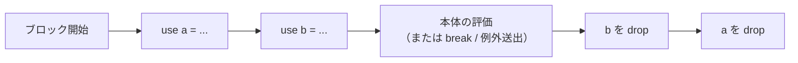

# リソース管理とアサーション

Tsuzuri は、スコープの終端で決定論的にデストラクタを実行する **`use` 束縛（およびコンピュテーション式内の `use!`）** と、最適化レベルによらず実行時の不変条件を検証する **`assert` および `unreachable`** を備えています。ガベージコレクションに頼らない確実なリソース解放と、バグの即時検出を支える機能群です。

## 要点

- `use 名前 = 式` は不変のローカル束縛であり、右辺の型が **`Drop` 型クラス**を実装していることをコンパイル時に強制します（未実装の型は `E1005`）。
- 同一スコープ内の複数の所有値・`use` 束縛は、ブロック末尾や `break` / `continue` / `return` / `try` 退出時に**宣言と逆順（LIFO）**で決定論的に 1 回だけ解放されます（スコープ終端より前に解放する場合は `Owned.drop` を呼びます）。
- コンピュテーション式の内部では、値をモナドから取り出して同時に `use` 束縛する `use!` を使用できます。
- `assert 条件`（型 `bool -> unit`）は `-O0` でも `-O3` でも削除されず、偽のときにソース位置付きで言語トラップを起こします。到達不能な分岐の表明には多相型の `unreachable ()`（型 `unit -> 'a`）を使用します。
- 単体テスト（`test "..." =`）における期待値比較には、値を消費せず意図が明確な `Test.equal`・`Test.not_equal`・`Test.is_true` を使い分けます。

---

## use 束縛による決定論的クリーンアップ

### Drop 型クラスの静的強制と let との違い

Tsuzuri では、`instance Drop<T>` を実装した型の値は通常の `let` で束縛してもスコープの終端で自動的に `drop` が呼ばれます。それに対して **`use` 束縛**は、「この変数はスコープ終端でのクリーンアップを伴うリソースである」という意図をコード上に明示し、**右辺の型が `Drop` を実装していなければコンパイルエラー `E1005` にする**静的安全装置です。

```text
use 識別子 [: 型] = 式
```

```tsuzuri run=work%3A30%0Adrop%2020%0Adrop%2010
record Guard { id: i64 }

instance Drop<Guard> {
    fn drop g = do! IO.writeln $"drop {g.id}"
}

def main :: unit -> i32 = \() ->
    use first = Guard { id: 10 }
    use second = Guard { id: 20 }
    do! IO.writeln $"work:{first.id + second.id}"
    0
```

- **不変束縛のみ**: `use` は不変の単一識別子束縛です。`use mut` や `use rec` は構文エラー `E0002` になります（再代入が必要な場合は `let mut` を使います）。
- **非 `Drop` 型の拒否**: `use count = 1` のように `Drop` を持たない型を渡すと、`error[E1005]: 'use' needs a value whose type implements Drop` としてコンパイル時に検出されます。
- **F# / C# の `Dispose` や `File` との違い**: F# の `IDisposable` のような別系統の `Dispose` 型クラスは Tsuzuri には存在せず、自動解放は `Drop` 型クラスに一本化されています。なお、標準ライブラリの `File.Handle` はクローズ時の I/O エラーを `Result` で扱えるようあえて `Drop` を実装していないため、`use` ではなくコールバック形式の `File.with_open` または明示的な `File.close` を使用します。
- **文脈キーワードとしての `use`**: `use 名前 = ...` や `use 名前 : ...` の位置でのみキーワードとして解釈されるため、既存の関数名や変数名として `use` を呼ぶ式（`use arg`）とは衝突しません。

### スコープ退出・例外発生時の解放順序と早期解放



- **逆順（LIFO）解放とムーブ追跡**: 同じブロック内の束縛は後に宣言されたものから順に解放されます。途中で別の関数や戻り値へムーブされた値については生存フラグにより二重解放が防止され、元のスコープ終端では `drop` は呼ばれません。
- **`try ... with ... finally` との順序**: `try` 本体の中で `use` 束縛した値は、正常完了時も `@checked` が `OverflowException` を送出してハンドラへ飛ぶ際も、**`try` 本体を抜ける時点（ハンドラおよび `finally` 節が走るより前）**で確実に解放されます。`finally` の中でもリソースを参照したい場合は `try` の外側で `use` します。
- **言語トラップ時の非実行**: [エラー処理と例外](./error-handling.md)で解説したとおり、ゼロ除算や `assert` 失敗などの言語トラップはスタックを巻き戻さないため、未実行の `Drop` は呼ばれません。
- **`Owned.drop` による早期解放**: スコープの終わりを待たずに任意のタイミングでリソースを即時解放したい場合は、`Owned.drop value` に所有権を渡します（`Drop.drop` メソッドをユーザーコードから直接呼び出すことはできません）。

```tsuzuri run=drop%207%0Aafter-release
record LockGuard { id: i64 }

instance Drop<LockGuard> {
    fn drop g = do! IO.writeln $"drop {g.id}"
}

def main :: unit -> i32 = \() ->
    use guard = LockGuard { id: 7 }
    Owned.drop guard
    do! IO.writeln "after-release"
    0
```

### コンピュテーション式内の use!

`Maybe`・`Result`・`IO` などの[コンピュテーション式](./computation-expressions.md)の内部では、`let!` と同様に計算から値を取り出し、その値を `use` 規則で束縛する **`use!`** を記述できます。右辺が `None` や `Error` で短絡した場合はリソース自体が生成されないため、`drop` も呼ばれません。

```tsuzuri run=using%3A4%0Adrop%204%0Aok%3A4%0Anone
record Session { id: i64 }

instance Drop<Session> {
    fn drop s = do! IO.writeln $"drop {s.id}"
}

def log_using :: i64 -> unit = \n ->
    do! IO.writeln $"using:{n}"

def open_session :: i64 -> Maybe<Session> = \id ->
    if id > 0 then Maybe.Some (Session { id: id }) else Maybe.None

def run_job :: i64 -> Maybe<i64> = \id ->
    Maybe {
        use! s = open_session id
        let _ = log_using s.id
        return s.id
    }

def show :: Maybe<i64> -> string = \m ->
    match m with
    | Maybe.Some v -> $"ok:{v}"
    | Maybe.None -> "none"

def main :: unit -> i32 = \() ->
    do! IO.writeln (show (run_job 4))
    do! IO.writeln (show (run_job 0))
    0
```

なお、コンピュテーション式において後続の `let!` や `use!` の後ろは再利用可能な継続クロージャへ展開されるため、`use` / `use!` で束縛した `Drop` 型の変数をさらに後ろの `let!` をまたいで参照しようとすると、`Drop` 型のクロージャ捕捉禁止規則により `E1005` になります。`Drop` 型を使う処理は単一の継続ステップ内で完結させるか、ヘルパー関数に切り出します。

---

## assert 式と unreachable ()

### assert による不変条件の表明

組み込み関数 `assert :: bool -> unit` は、その地点でプログラムの内部不変条件が必ず `true` であることを実行時に検査します。

```tsuzuri run=150
let price = 120
let tax = 30
assert (price >= 0 && tax >= 0)
price + tax
```

- **関数適用の優先順位**: `assert` は関数呼び出し（優先順位 16）であるため、`==` や `&&` よりも強く結合します。`assert a == b` と書くと `(assert a) == b` と解釈されて `E1003` になるため、比較式や論理式は必ず **`assert (a == b)`** のように括弧で囲みます。
- **最適化でも消えない実行時検査**: C の `assert` マクロや Rust の `debug_assert!` とは異なり、Tsuzuri の `assert` は `-O0` でも `-O3`（リリースビルド）でも無効化されません（定数畳み込みで常に `true` と証明された分岐のみが最適化されます）。したがって、外部ユーザーの不正入力のチェックに `assert` を使うべきではなく、入力検証には `Result` や `Maybe` を使用します。
- **トラップ位置の報告**: 条件が `false` になると、その場で `trap: assertion failed at File.tz:行:列` を出力して停止します（`tsuzuri run` では診断 `E2005` としてバックトレース付きで表示されます）。

### unreachable () による到達不能分岐の明示

組み込み関数 `unreachable :: unit -> 'a` は、型システム上はケースが残っているものの、前段の条件により論理的に絶対到達しない分岐を明示するための多相トラップ関数です。任意の期待型 `'a` に適合するため、`match` や `if` の他分岐の型を邪魔しません。万一実行が到達した場合は `non-exhaustive match` として位置情報付きでトラップします。

```tsuzuri run=42
def unwrap_positive :: i64 -> i64 = \n ->
    if n <= 0 then
        0
    else
        match Int.checked_div 84 n with
        | Maybe.Some q -> q
        | Maybe.None -> unreachable ()

unwrap_positive 2
```

### 単体テストにおける Test.* および契約との使い分け

ファイル内の `test "テスト名" = ...` 宣言の中では `assert` も使えますが、値の等値・非等値比較には標準ライブラリ [`Test`](../stdlib/testing/test.md) モジュールの関数を使う方が意図が明確になり、比較対象の所有権も消費しません。

| 手段 | シグネチャ / 記法 | 適した用途 |
| --- | --- | --- |
| `Test.equal` | `Eq<'a> => ref 'a -> ref 'a -> unit` | `test` ブロック内での期待値と実測値の等値検証（非 Copy 値も消費しない） |
| `Test.not_equal` | `Eq<'a> => ref 'a -> ref 'a -> unit` | `test` ブロック内での 2 値の非等値検証 |
| `Test.is_true` | `bool -> unit` | `test` ブロック内での真偽条件の検証 |
| `assert` | `bool -> unit` | アルゴリズム内部の途中ステップにおける不変条件の常時検査 |
| `unreachable ()` | `unit -> 'a` | 事前検査により到達しえない `match` / `if` 分岐の埋め草 |
| `@requires` / `@ensures` | 関数本体先頭の契約行 | 関数の入出力仕様の明示、`tsuzuri prove` による証明・自動テスト生成 |

```tsuzuri
test "subtotal calculation preserves non-copy label" =
    let label = "order-A"
    let total = 120 * 3
    Test.equal "order-A" label
    Test.equal (ref 360) (ref total)
    Test.not_equal "order-B" label
    Test.is_true (total > 0)
```

`Test.equal` と `Test.not_equal` は共有参照を受け取るため、文字列変数 `label` を渡してもムーブされず後続の行で再利用できます（型推論が未確定になりやすい裸の数値リテラルや算術式を直接渡す場合は `ref 360` のように `ref` を添えます）。

## 関連項目

- [エラー処理と例外](./error-handling.md)
- [コンピュテーション式](./computation-expressions.md)
- [契約と属性](./contracts-and-attributes.md)
- [束縛と値](./bindings-and-values.md)
- [Drop と後始末](../ownership/drop.md)
- [Owned](../stdlib/memory/owned.md)
- [File](../stdlib/sys/file.md)
- [Test](../stdlib/testing/test.md)
- [Debug](../stdlib/core/debug.md)
