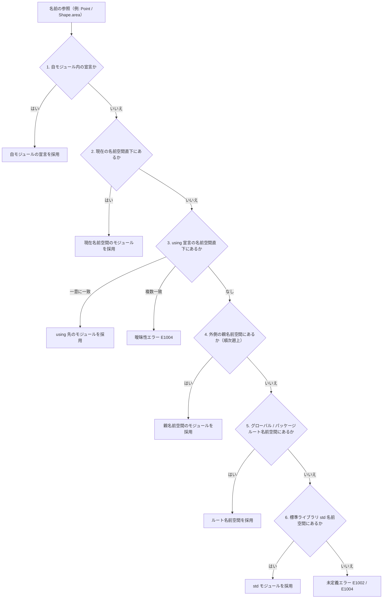

# 名前空間とモジュール

Tsuzuri は「**1ファイル = 1モジュール**」の原則を採用しています。1つのファイル内にインラインで `module` ブロックを宣言したり、1つのモジュールを複数ファイルへ分割したりする機能はありません。拡張子を除いたファイル名がそのままモジュール名となり、ディレクトリ階層または先頭の `namespace` 宣言によってモジュール群を論理的な名前空間へ編成します。

## 要点

- 1つのソースファイルが1つのモジュールを定義し、モジュール名（ファイル名）は英大文字で始まる ASCII 識別子とする（`point.tz` のような小文字始まりは `E1011`）。
- 拡張子によって記述できる宣言が明確に分離されている（`.tz` は通常コード・テスト、`.tt` は型クラス定義、`.tc` はコンピュテーション式ビルダー）。
- 名前空間やモジュールの経路結合には `::`（例: `Acme::Core::Point`）、モジュール内メンバーやフィールドの参照には `.`（例: `Point.origin`、`p.x`）を使用する。
- モジュールと同名の型（`Point.tz` 内の `record Point`）の完全修飾名はモジュール名そのもの（`Acme::Core::Point`）であり、`Point.Point` と重ねて書くと `E1004` となる。
- 名前解決は「自モジュール内の宣言 → 現在の名前空間 → `using` 宣言 → 外側の親名前空間 → ルート/パッケージ名前空間 → `std`」の優先順位で行われる。
- 実行可能プログラムのエントリーポイントは選択ルート直下の `Main.tz` のみであり、`def main`（`unit -> i32` または `Array<string> -> i32`）かトップレベル式のいずれか一方で記述する。

## 「1ファイル = 1モジュール」の原則と拡張子

コンパイラはプロジェクトルート配下のソースファイルを再帰的に走査し、正規化された相対パスのバイト順で自動的に読み込みます（`.` で始まる隠しファイル・隠しディレクトリは除外されます）。他ファイルを取り込むためのファイル単位の `import` 文は不要です。

### ファイル拡張子ごとの役割

Tsuzuri では、ファイルの役割に応じて3種類の拡張子を使い分けます。

| 拡張子 | モジュールの種類 | 記述できる宣言 | 記述できない宣言（違反時は `E1018`） |
| --- | --- | --- | --- |
| `.tz` | 通常モジュール | `record`、`union`、`type`、`const`、`def` / `fn`、`instance`、`extern`、`test`、`bench`（`Main.tz` のみトップレベル式も可） | `class` 宣言、`@alias` |
| `.tt` | 型クラス定義モジュール | 1つ以上の `class` 宣言およびデフォルトメソッド実装 | `record`、`union`、`type`、`const`、トップレベル `def`、`instance`、トップレベル式 |
| `.tc` | コンピュテーション式ビルダー | ファイル名と同名のビルダー操作（`Return`、`Bind` 等を1つ以上必須）、`@alias`、補助関数・型・定数・`instance` | `class` 宣言、トップレベル式 |

同一ディレクトリ内に拡張子だけが異なる同名ファイル（`Item.tz` と `Item.tt` など）を置くことはできません（`E1011`）。異なるディレクトリにあれば別モジュールとして扱われます。なお、旧拡張子 `.tzr` は `E2000` で拒否されます。

### ファイル名・ディレクトリ名とプロジェクト規模の上限

- **モジュール名**: 拡張子を除いたファイル名は英大文字で始まる ASCII 識別子でなければなりません（アンダースコア単独 `_` や小文字始まりは `E1011`）。
- **ディレクトリ名**: 英字またはアンダースコアで始まる ASCII 識別子を使用します（小文字始まりも可）。数字始まり（`2d`）、ハイフン入り（`my-tools`）、予約語（`match` 等）、およびシンボリックリンクは `E1011` で拒否されます。
- **規模上限**: 1ファイルの最大サイズは 4 MiB（超過は `E0003`）、パス階層は最大 16 要素、識別子長は最大 255 バイト、プロジェクト全体のソース数は最大 4,096 件、ディレクトリ数は最大 1,024 個です（超過は `E1017`）。

## `namespace` 宣言と階層構造

### 明示的な `namespace` 宣言

ファイルが属する名前空間を明示する場合は、ファイルの最初の宣言として1行で `namespace` を記述します（先行できるのは空行と `//` コメントのみです）。階層は空白を挟まずに `::` で連結します。

```tsuzuri project=ns-demo file=Core/Vec2.tz
namespace Acme::Core

record Vec2 { x: f64, y: f64 }

def dot :: Vec2 -> Vec2 -> f64 = \a b ->
    a.x * b.x + a.y * b.y
```

```tsuzuri project=ns-demo file=Main.tz run=11
let a = Acme::Core::Vec2 { x: 2.0, y: 3.0 }
let b = Acme::Core::Vec2 { x: 4.0, y: 1.0 }
(Acme::Core::Vec2.dot a b) as i64
```

`namespace` はファイル先頭でのみキーワードとして解釈される文脈キーワードであり、関数内のローカル変数名などには使用できます。ファイル途中に記述したり、同一ファイルに2回記述したり、`Acme.Core` のようにドットで区切ったりすると構文エラー `E0002` になります。また、名前空間の階層は最大 16 要素・255 バイトまでです（超過は `E1017`）。

### `namespace` 省略時の自動決定

`namespace` 宣言を省略したファイルの名前空間は、[パッケージマニフェスト `Tsuzuri.toml`](packages.md) の既定名前空間とルートからの相対ディレクトリパスを `::` で連結して自動決定されます。

- **`Tsuzuri.toml` がある場合**: `[package]` の `namespace` キーが既定名前空間になります。`namespace` キーも省略されている場合は、`name`（例: `"geometry-tools"`）を PascalCase に変換した名前（`GeometryTools`）が既定名前空間になります。
- **`Tsuzuri.toml` がない場合**: ルートディレクトリ名が kebab-case なら PascalCase へ変換し、有効な識別子ならそのまま既定名前空間とします（いずれでもなければプレフィックスなしのグローバル名前空間となります）。

たとえば既定名前空間が `App` のパッケージでは、各ファイルの所属名前空間とモジュール完全修飾名は次のようになります。

| ルートからの相対パス | 所属する名前空間 | モジュールの完全修飾名 |
| --- | --- | --- |
| `Main.tz` | `App` | `App::Main` |
| `Core/Vec2.tz` | `App::Core` | `App::Core::Vec2` |
| `Domain/Billing/Invoice.tz` | `App::Domain::Billing` | `App::Domain::Billing::Invoice` |

### `::` と `.` の使い分け

Tsuzuri では、名前空間・モジュールの階層区切りと、モジュール内メンバーや値フィールドへのアクセスで演算子を厳密に区別します。

| 記号 | 役割 | 記述例 |
| --- | --- | --- |
| `::` | 名前空間同士、または名前空間とモジュール名の結合 | `Acme::Core`、`Acme::Core::Vec2`、`std::Result` |
| `.` | モジュール名と関数・定数・共用体コンストラクタの結合 | `Vec2.dot`、`Acme::Core::Vec2.dot`、`Result.Ok` |
| `.` | レコードのフィールド参照・タプルの要素参照 | `vec.x`、`pair.0` |

名前空間の後ろに `.` を書いて `Acme.Vec2` のように記述すると、`.` の左辺が値またはモジュールとして解釈されるため `E1002`（`'Acme' is a namespace; write '::' between a namespace and the names in it`）となります。

## モジュールと同名の型の修飾規則

ファイル名（モジュール名）と同じ名前の型（`record`、`union`、`type`、`extern type`）を宣言した場合、その型の完全修飾名は**モジュールの完全修飾名そのもの**になります。冗長な二重修飾は禁止されています。

```tsuzuri project=same-name-type file=Geometry/Point.tz
namespace Geometry

record Point { x: i64, y: i64 }

def scale :: i64 -> Point -> Point = \k p ->
    Point { x: p.x * k, y: p.y * k }
```

```tsuzuri project=same-name-type file=Geometry/Shape.tz
namespace Geometry

union Shape =
    | Circle of i64
    | Square of i64

def perimeter_hint :: Shape -> i64 = \s ->
    match s with
    | Circle r -> r * 6
    | Square side -> side * 4
```

```tsuzuri project=same-name-type file=Main.tz run=36
let p = Geometry::Point { x: 2, y: 3 }
let p2 = Geometry::Point.scale 4 p
let s = Geometry::Shape.Square 4
p2.x + p2.y + Geometry::Shape.perimeter_hint s
```

- `Geometry/Point.tz` 内の `record Point` は、外部からは `Geometry::Point`（同一名前空間や `using Geometry` 下では単に `Point`）と記述します。`Geometry::Point.Point` や `Point.Point` と重ねて書くと `E1004` になります。
- `Geometry/Shape.tz` 内の `union Shape` のケースコンストラクタは `Geometry::Shape.Square`（または `Shape.Square`）と記述します（`Shape.Shape.Square` は `E1004`）。

## 名前解決の優先順位と予約モジュール名

### 探索順序

モジュール名や型名を参照した際、コンパイラは内側から外側へ向かって次の順序で名前を解決します。



式の中で `name.member` と書いた場合、スコープ内に `name` というローカル変数や仮引数が存在すると、モジュール参照よりも**ローカル変数のフィールドアクセスが優先**されます（シャドーイング）。その状態で同名のモジュールを参照したい場合は、完全修飾名 `App::Box.make` を用いるかローカル変数名を変更します。

また、自モジュール内で標準ライブラリと同名の型（例: `record Result`）を定義した場合もローカル宣言が優先されるため、標準ライブラリ側は `std::Result<i64, string>` や `std::Result.Ok` のように `std::` を付けて明示します。

### 標準ライブラリの予約モジュール名

`std` で始まる名前空間（`namespace std` や `namespace std::Util`）は標準ライブラリ専用であり、ユーザーコードで宣言すると `E1011` になります。また、以下の標準ライブラリモジュール名は予約されており、**ルート直下のファイル名**・**ディレクトリパスの先頭要素**・**名前空間の先頭要素**には使用できません（`E1011`）。サブディレクトリ配下のファイル名（`Domain/Result.tz`）や第2階層以降の名前空間（`namespace App::Result`）には使用できます。

```text
Alloc       Anchor      Arc         Arena       Array       Atomic
Bench       BigInt      Cbor        Channel     Char        Complex
Cond        Context     DataChannel Debug       Dir         Domain
Dyn         Env         ErrGroup    Exception   ExternAddr  Fft
File        FixedArray  FnPtr       Format      Gen         Gpu
HashMap     HashSet     IO          Int         Json        Linalg
List        MainThread  Map         Math        Matrix      MatrixView
Maybe       Monoid      Monoids     Mutex       Net         ObjC
Once        OnceValue   Os          Owned       Parallel    Path
Polynomial  Process     Random      RandomTensorRc          ReceiveOnly
Regex       RegexText   Result      Routine     RwMutex     Semaphore
SendOnly    Seq         Set         Simd        Slice       String
SyncMap     Tensor      TensorCodec TensorElementTensorIO    Test
Text        Ticker      Time        Timer       Unicode     Utf8Char
Utf8String  Vec         WaitGroup   ZString     ZUtf8String
```

`ObjC`（Objective-C 連携）・`Routine`・`FnPtr` などは、ソースファイルを持たない組み込みのモジュールです。

> 補足: 旧バージョンに存在した `Task` および `Async` は予約から外れており、ユーザー定義のモジュール名・型名・名前空間として自由に使用できます。

## エントリーポイント（`Main.tz`）

`tsuzuri run` および実行ファイル出力（`tsuzuri build` の既定 `--emit exe`）では、**選択したプロジェクトルート直下の `Main.tz`** だけがエントリーポイントになります（サブディレクトリ内の `Sub/Main.tz` は通常モジュールとして扱われます）。ライブラリ出力や `tsuzuri check`・`tsuzuri test`・`tsuzuri doc` では `Main.tz` は必須ではありません。

`Main.tz` のエントリーポイントは、次の **2形式のうちいずれか一方のみ** で記述します。両方を同じ `Main.tz` に混在させた場合や、`Main.tz` 以外のモジュールにトップレベル式を記述した場合は `E2004` となります。

### 1. `def main` シグネチャ形式

プロセス終了コード（`i32`）を明示的に返す形式です。受け付けられる型シグネチャは次の2通りのみであり、他の型（`unit -> i64` や `unit -> unit`、`def` なしの `fn main` など）は `E2004` / `E0002` となります。

```tsuzuri run=ready
def main :: unit -> i32 = \() ->
    do! IO.writeln "ready"
    0
```

コマンドライン引数を受け取る場合は `Array<string>`（`[string]` と同一）を引数に取ります。

```tsuzuri run=argc%3D0
def main :: Array<string> -> i32 = \args ->
    do! IO.writeln $"argc={args.length}"
    0
```

- `args` には実行ファイル名自身（`argv[0]`）は含まれず、渡された実引数のみが格納されます。
- `tsuzuri run` はプログラムへ追加引数を転送しないため、`args` は空配列になります。コマンドライン引数を渡して実行する場合は `tsuzuri build` で生成したバイナリを直接起動します。
- `main` が `0` 以外の終了コードを返した場合、`tsuzuri run` は診断 `E2005`（`program exited with code N`）を出力して終了コード `1` で終了します。

### 2. トップレベル式形式

小さなスクリプトや検証コード向けに、`Main.tz` 末尾に `let` 束縛や式を直接記述する形式です。

```tsuzuri run=42
let base = 20
let offset = 22
base + offset
```

- 末尾式の型が数値・`bool`・`string`・`utf8string`・`char`・`utf8char`、または `Display` インスタンスを持つ型であれば、評価結果が標準出力へ自動出力されます（`unit` の場合は何も出力しません）。
- 末尾式が `IO<T>` の場合はその IO アクションが1回実行されます（`IO<i32>` ならその値が終了コードとなり、それ以外の `IO<T>` は終了コード `0` となります）。

## 関連項目

- [インポート（using）と可視性](imports-and-visibility.md)
- [パッケージと Tsuzuri.toml](packages.md)
- [ドキュメントコメントと doctest](doc-comments.md)
- [CLI コマンドリファレンス](../compiler/cli.md)
- [コンピュテーション式](../expressions/computation-expressions.md)
- [型クラス](../types/type-classes.md)
