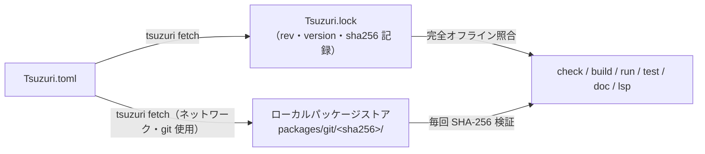

# パッケージと Tsuzuri.toml

Tsuzuri における**パッケージ**は、複数のモジュール・エディション設定・外部依存関係・ビルド設定・使用権限（capabilities）を束ねる管理単位です。プロジェクトルートにマニフェストファイル `Tsuzuri.toml` を配置して宣言し、ロックファイル `Tsuzuri.lock` によって完全オフラインかつビット単位で再現可能な依存解決と改ざん検知を実現します。

## 要点

- `tsuzuri new <dir>` で生成される新規パッケージおよびマニフェストなし単一実行の既定エディションは **`"2028"`** である（`"2026"`・`"2027"`・`"2028"` をサポート。後方互換性のため既存 `Tsuzuri.toml` で `edition` キー自体を省略した場合のみ `"2026"` として解釈される）。
- `[dependencies]` は **ローカル相対パス（`path`）**、**コミット固定の Git リポジトリ（`git` + `rev`）**、および **独自ホスト可能なカスタムレジストリ（`version` + `[registry]`）** の3形態に対応する。
- ネットワークと `git` にアクセスするのは `tsuzuri fetch` と `tsuzuri publish` のみであり、`check`・`build`・`run`・`test`・`bench`・`doc`・`lsp` はすべて `Tsuzuri.lock` とローカルストアの SHA-256 照合だけでオフライン動作する。
- `[capabilities]` と依存ごとの `capabilities = [...]` により、`fs`・`net`・`env`・`process`・`ffi` などの権限使用をコンパイル時に静的検査（違反は `E1036`）できる。
- `@trusted` 属性と `tsuzuri audit` / `--warn untrusted-extern`（`W1010`）を組み合わせることで、外部 C 関数（FFI）と依存パッケージのサプライチェーン監査を行える。

## `Tsuzuri.toml` の全セクション仕様

`Tsuzuri.toml` は決定論的に解析できる厳格な TOML サブセットを採用しています（最大 1 MiB、超過は `E1017`、シンボリックリンクは `E1011`）。最初に `[package]` セクションを置き、続けて `[dependencies]`・`[registry]`・`[capabilities]`・`[wasm]`・`[native]`・`[windows]`・`[macos]` の各セクションを任意の順序で最大1回ずつ記述できます。未知のセクション・未知のキー・複数行配列は原因の行・列を指す `E0002` となります。

```toml
[package]
name = "billing-service"
version = "0.2.0"
edition = "2028"
namespace = "Acme::Billing"

[dependencies]
core-types = { path = "../core-types", capabilities = [] }
audit-log = { git = "https://example.org/audit-log.git", rev = "0123456789abcdef0123456789abcdef01234567", capabilities = ["fs", "time"] }
decimal-tax = { version = "1.1.0", capabilities = [] }

[registry]
index = "https://example.org/tsuzuri-index.git"

[capabilities]
allow = ["env", "fs", "net", "stdio", "time"]

[wasm]
max-memory = "64MiB"
stack-size = "2MiB"

[native]
link = ["csrc/bridge.c"]
libraries = ["m"]
search = ["libs"]

[windows]
subsystem = "console"

[macos]
min_version = "13.0"
bundle_id = "org.example.billing"
name = "Billing"
version = "0.2.0"
build = "17"
icon = "assets/Billing.icns"
resources = ["assets/help"]
```

### `[package]` セクション

| キー | 必須 | 仕様と検証規則 |
| --- | --- | --- |
| `name` | 必須 | 英小文字始まりの ASCII kebab-case（例: `"my-app"`、`"http2-core"`）。最大 255 バイト。大文字やアンダースコアは `E1011` |
| `version` | 必須 | 空でない版文字列（例: `"0.1.0"`）。レジストリ公開時は先頭ゼロなしの `MAJOR.MINOR.PATCH` 形式が必須（`E1011`） |
| `edition` | 任意 | `"2028"`・`"2027"`・`"2026"` のいずれか（それ以外は `E0002`）。新規作成時は `"2028"` を記述する |
| `namespace` | 任意 | パッケージの既定名前空間（`::` 区切りの ASCII 識別子、最大 16 階層・255 バイト）。省略時は `name` を PascalCase 変換した名前（`"my-app"` → `"MyApp"`）。`std` や予約モジュール名の先頭使用は `E1011` |

#### エディション解決規則とパッケージ境界

エディションは**パッケージ単位**で独立に解決されます。たとえば Edition 2028 のルートパッケージから Edition 2026 の依存パッケージを呼び出す場合でも、各パッケージは自身の `Tsuzuri.toml` のエディションに従ってコンパイル・型付けされます。

| 入力の形態 | 適用されるエディション |
| --- | --- |
| `Tsuzuri.toml` に `edition = "..."` が明記されたパッケージ | 指定された値（`"2028"` / `"2027"` / `"2026"`） |
| `tsuzuri new <dir>` が生成する新規 `Tsuzuri.toml` | **`"2028"`**（`--edition 2026\|2027` で変更可能） |
| `Tsuzuri.toml` のないディレクトリ・単一ファイル・`script`・`repl`・標準ライブラリ | 最新の既定エディション **`"2028"`**（CLI の `--edition` で上書き可能） |
| 既存の `Tsuzuri.toml` で `edition` キーが省略されている場合 | **`"2026"`**（コンパイラ更新で既存マニフェストの意味が変わらないよう固定） |

旧エディションのパッケージは `tsuzuri fix --edition 2028 --from 2027 <dir>`（または `--from 2026`）によって、引数所有権（`own`）やスライス区間（`..<`）の意味を保ったまま自動移行できます。

### ターゲット別ビルド設定セクション（`[wasm]`・`[native]`・`[windows]`・`[macos]`）

- **`[wasm]`**: ルートパッケージの WebAssembly ビルド・テスト時の既定メモリ設定です。`max-memory`（既定 `"16MiB"`）と `stack-size`（既定 `"1MiB"`）をバイト数または `KiB` / `MiB` / `GiB` 単位の文字列で指定します（`"MB"` 等は `E0002`）。CLI フラグ `--wasm-max-memory` / `--wasm-stack-size` が優先されます。
- **`[native]`**: C ABI 連携用のリンク入力を1行配列で指定します。`link`（C ソースやオブジェクトの相対パス）、`libraries`（`lib` 接頭辞や拡張子を除いたシステムライブラリ名、例: `["m"]`）、`search`（ライブラリ探索ディレクトリの相対パス）を合計 256 個まで記述できます。依存パッケージが `[native]` を持つ場合、親側の依存エントリで明示的に `native = true` を指定しなければ `E2000` で拒否されます。
- **`[windows]`**: Windows 実行ファイル（`--emit exe`）の PE サブシステムとして `subsystem = "console"` または `"windows"` を指定します（非 Windows ターゲットやライブラリ出力では無視されます）。
- **`[macos]`**: macOS 向けビルドの設定です。`min_version`（`"12.0"` 以降の最低 OS 版。Mach-O のコンパイルとリンクに使われ、省略時は `12.0`）と、アプリケーションバンドル（`tsuzuri build --emit app`）のキー `bundle_id`・`name`・`version`・`build`・`icon`・`resources`・`embed`・`info_plist`・`category`・`ui_element` を指定します。バンドルのキーの形は常に検査され（誤りは `E0002`）、値は `--emit app` だけが使います。`bundle_id` は `--emit app` で必須で、省略したキーを `[package]` から補うことはありません。パスはパッケージルートからの相対パスです。読まれるのはルートパッケージの節だけです（[macOS のアプリケーションバンドル](../compiler/macos-app-bundle.md)）。

## 依存関係の3形態（`[dependencies]`）

Tsuzuri は用途に応じて3種類の依存ソースをサポートしています。依存グラフ全体で循環依存は `E1011` で禁止され、最大パッケージ数 1,024・最大深さ 128・最大ソース数 4,096 まで扱えます（超過は `E1017`）。また、同一パッケージ名を異なる Git URL / リビジョンや Git とレジストリで混在要求した場合は `E1011` となります。

### 1. ローカル `path` 依存

モノレポ内の共有ライブラリやローカル開発中のパッケージを相対パスで参照します。

```toml
[dependencies]
geometry-core = { path = "../geometry-core" }
c-wrapper = { path = "../c-wrapper", native = true, capabilities = ["ffi"] }
```

絶対パス（`/usr/...` や `C:\...`）は `E0002`、シンボリックリンク経由やキー名と依存先 `[package] name` の不一致は `E1011` です。依存パッケージ内のモジュールは、その依存先の既定名前空間（例: `GeometryCore::Point.make` または `using GeometryCore`）で参照します。

### 2. コミット固定 `git` 依存

任意の HTTPS Git ホスティング、社内ミラー、またはローカル bare リポジトリ（`file:///`）から、40文字の小文字16進コミット SHA（`rev`）を固定して取得します。

```toml
[dependencies]
crypto-hash = { git = "https://example.org/crypto-hash.git", rev = "89abcdef0123456789abcdef0123456789abcdef" }
```

- キー順序は `{ git = "...", rev = "..." }`（の後ろに任意の `, capabilities = [...]`）です。変動し得るブランチ名やタグ名、短縮ハッシュ、`ssh://` や資格情報埋め込み URL（`user@`）は再現性とセキュリティのため `E0002` で拒否されます。
- Git 依存パッケージは自身の内部にローカル `path` 依存や `[native]` セクションを持てません（`E1011` / `E2000`）。

### 3. カスタム `registry` 依存と `tsuzuri publish`

Tsuzuri は単一の中央集権レジストリに依存せず、任意の Git リポジトリをパッケージインデックスとしてホストできる分散設計を採用しています。ルートパッケージの `[registry]` でインデックスリポジトリを指定し、`[dependencies]` に要求バージョン `MAJOR.MINOR.PATCH` を記述します。

```toml
[dependencies]
shapes = { version = "1.1.0" }

[registry]
index = "https://example.org/tsuzuri-index.git"
rev = "fedcba9876543210fedcba9876543210fedcba98"
```

- **最小版選択（Minimal Version Selection: MVS）**: `version = "1.1.0"` は互換範囲（`1.0.0` 以降は同一 `MAJOR`、`0.y.z` は同一 `0.MINOR`）における最小要求版を意味します。`tsuzuri fetch` はグラフ内の全要求を走査し、互換範囲ごとに「要求された最小版のうち最も新しい版」を決定論的に選択します（ロックファイルがなくても同じインデックスからは常に同一バージョンが選ばれます。互換しないメジャー版同士の要求衝突は `E1011` です）。
- **インデックス構造と `tsuzuri publish`**: インデックスリポジトリの `index/<パッケージ名>.json` が各バージョンの `version`・`git`・`rev`・`sha256`・`dependencies` を保持します。パッケージを公開する際は、対象コミットをプッシュしたうえで以下を実行します。

```sh
# 1. 前バージョンとの公開 API 互換性を事前確認（破壊的変更があれば終了コード 1）
tsuzuri api-diff ../shapes-1.0.0 shapes

# 2. パッケージを型検査し、公開コミットの内容ハッシュを照合してインデックス項目 JSON を出力
tsuzuri publish shapes --git https://example.org/shapes.git --rev 0123456789abcdef0123456789abcdef01234567
```

`tsuzuri publish` はローカルファイルと指定コミットのツリー内容が完全一致することを検証したうえで、インデックスへ追記すべき JSON エントリを標準出力へ出力します。

## `tsuzuri fetch` と `Tsuzuri.lock` によるオフライン再現性

Git 依存またはレジストリ依存を追加・更新した際は、`tsuzuri fetch` を実行してパッケージを取得し、`Tsuzuri.lock` を生成します。

```sh
tsuzuri fetch .
```



- **安全なツリー展開**: `fetch` は作業ツリーを作らず一時 bare リポジトリに対して `ls-tree` / `cat-file` のみを実行するため、Git フック・フィルタ・サブモジュール・シンボリックリンクは一切実行されません。大文字小文字のみが異なる衝突パスや不正文字を含むパスも `E2007` で拒否されます。
- **`Tsuzuri.lock` の管理**: 展開された全ソースと `Tsuzuri.toml` から計算された SHA-256 ダイジェストが `Tsuzuri.lock`（Git のみなら `format: 1`、レジストリ依存を含む場合は `version` 付き `format: 2`）に正規形で記録されます。`Tsuzuri.lock` は必ず Git 等のバージョン管理に含めます。
- **完全オフライン検証（`E2007`）**: 通常のビルド・検査・テスト・LSP は一切ネットワークに触れません。`Tsuzuri.lock` の欠落、未取得パッケージ、ロックファイルやレジストリインデックスとの SHA-256 不一致（公開済み版の書き換えやストア改ざん）はすべて `E2007` で即座に停止します。

## パッケージ権限（`capabilities`）とサプライチェーン監査

サードパーティ依存パッケージが意図しないファイル操作・外部通信・任意ネイティブコード実行を行うリスクを防ぐため、Tsuzuri はパッケージ単位の**静的権限検査**と **FFI 監査機構**を提供しています。

### 9種類の権限（`capabilities`）

ルートマニフェストに `[capabilities]` セクションまたはいずれかの依存項目に `capabilities = [...]` を記述すると、権限検査が有効化されます（どちらも書かれていない場合は全権限が許可されます）。

| 権限名 | 対象となる操作・標準ライブラリ API |
| --- | --- |
| `env` | `Env.args`・`Env.var`・`Env.current_dir`、および引数付き `def main :: Array<string> -> i32` |
| `ffi` | すべての `extern` 関数呼び出し（`@trusted` の有無を問わない） |
| `fs` | `File` および `Dir` モジュールのファイルシステム操作 |
| `gpu` | `Gpu.request`・`Gpu.init`・`Gpu.map` などのデバイス操作 |
| `net` | `Net` モジュールのソケット接続・バインド・送受信・名前解決（純粋な `Net.parse_address` 等は不要） |
| `process` | `Process.run` による外部プロセス起動 |
| `random` | OS 乱数を使う `Random.bytes`・`Random.next_u64`、`HashMap.randomized`、`Array.random_*` 等・`Random.pcg64_from_os`（シード指定の `Random.pcg`・`Random.pcg64`、`pcg64_*` の分布、`RandomTensor` は不要） |
| `stdio` | `IO` の標準入出力、`Debug.print` / `Debug.trace`、および値を表示する `Main.tz` トップレベル式 |
| `time` | `Time` モジュールの時刻取得・スリープ、`Bench` の計測 |

- **権限の積集合ルール**: ルートパッケージは `[capabilities] allow = [...]` に列挙した権限のみを使用できます。依存パッケージは、そこへ至る**すべての親パッケージの「親の有効権限 ∩ 依存指定の `capabilities`」の積集合**のみを使用できます（依存指定で `capabilities` を省略した場合は空配列 `[]`＝権限なしとして扱われます）。
- **コンパイル時検査（`E1036`）**: 各パッケージ内の関数本体（未呼び出しの関数も含む。`test` / `bench` ブロックは除く）が許可されていない権限を要する API を参照すると、コード生成前に `E1036` で拒否されます。なお、これはコンパイル時の静的検査であり、実行時の OS サンドボックスではありません（特に `ffi` を許可したパッケージは任意の C 関数を呼び出せます）。

### `@trusted` と `tsuzuri audit` による監査

外部 C 関数（`extern`）を宣言する際は、ABI・所有権・メモリ安全性の契約を人間が監査済みであることを示す [`@trusted` 属性](../expressions/contracts-and-attributes.md)（および `pure`・`no_alloc`・`no_trap`・`terminates` の性質表明）を付与できます。

```sh
# 未監査の extern 使用を警告 W1010 として検出
tsuzuri check --warn untrusted-extern .

# パッケージグラフ全体の権限使用状況と @trusted 監査状況を一覧出力
tsuzuri audit .
```

`tsuzuri audit` を CI に組み込むことで、依存パッケージが要求している権限の妥当性と、未監査の `extern` バインディングの有無を機械的に検査できます。

## `tsuzuri new` によるパッケージ雛形の生成

新規パッケージを作成する際は `tsuzuri new` を実行します。

```sh
tsuzuri new my-app
```

これにより、`edition = "2028"` と PascalCase の既定名前空間 `MyApp` が設定された `Tsuzuri.toml`、エントリーポイントとサンプルテストを含む `Main.tz`、`.gitignore`、およびエージェント向けガイド（`--no-agent-files` で省略可）が一括生成されます。既定名前空間をカスタマイズしたい場合は `--namespace Acme::App` を指定します。

## 関連項目

- [名前空間とモジュール](namespaces-and-modules.md)
- [インポート（using）と可視性](imports-and-visibility.md)
- [ドキュメントコメントと doctest](doc-comments.md)
- [契約と属性](../expressions/contracts-and-attributes.md)
- [CLI コマンドリファレンス](../compiler/cli.md)
- [ネイティブ相互運用（C ABI）](../compiler/native-interop.md)
- [安定性と互換性](../compiler/stability.md)
