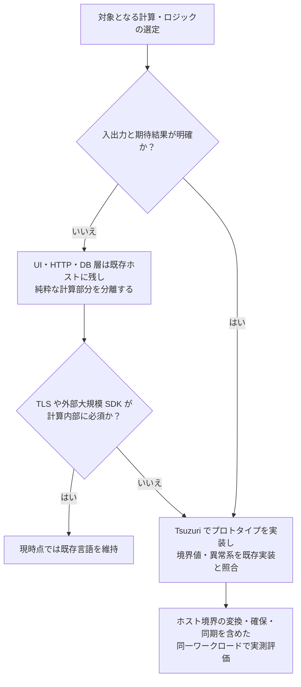

# 他言語との比較と適用領域

Tsuzuri の採用を検討する際は、既存のシステム全体を一括で置き換えるのではなく、入出力と期待値が明確な計算カーネルやドメインロジックを切り出して検証するアプローチが適しています。

本ページでは、Tsuzuri `0.1.0`（既定エディション `2028`）の技術的な強みとトレードオフを C/C++、Rust、C#/F#、TypeScript と比較し、適した用途・現在の制限・対応プラットフォームの評価基準を整理します。

## 要点

- **関数型合成とアフィン所有権の両立**: カリー化・パイプライン・判別共用体・コンピュテーション式による表現力と、GC を用いないコンパイル時メモリ管理を単一言語で提供します。
- **既存言語の単純な上位互換ではない**: C/C++ の低水準ポインタ制御、Rust の汎用ライフタイム表現と巨大エコシステム、.NET や TypeScript のフルスタック基盤をそのまま代替するものではありません。
- **計算モジュールの組み込みに最適**: C ABI（オブジェクト・共有ライブラリ・ThinLTO ビットコード）やスタンドアロン WebAssembly として、既存のネイティブアプリや Web ホストへ安全に組み込めます。
- **実用的な分散パッケージ管理**: ローカル `path` 依存に加え、コミット固定の `git` 依存、および組織や個人でホスト可能な `registry` インデックス（`Tsuzuri.lock` による SHA-256 検証付き）に対応しています。
- **5 つの検証済みプラットフォーム**: Windows（x64 / Arm64）、Linux（x64 / Arm64）、macOS（Arm64）の 5 環境を対象とし、ターゲットごとの検証範囲と制限を明示しています。

## 主要言語との技術比較

### C / C++ との比較

C/C++ は膨大なネイティブ資産、ハードウェアに近いメモリ制御、長年の運用実績を備えています。Tsuzuri は LLVM バックエンドによる同等の実行性能を目標としつつ、C/C++ ではプログラマが規約として手動で守らなければならない安全性契約をコンパイラ検査へ置き換えます。

- **Tsuzuri の強み**:
  - ムーブ後の再使用、ダングリング参照、共有借用と排他借用の競合をコード生成前に静的に拒否します。
  - C/C++ では未定義動作（UB）となる符号付き整数オーバーフローを、`-O0` でも `-O3` でも一貫して「型のビット幅での折り返し」と定義します。
  - `union` と網羅性検査付き `match`、`Maybe` / `Result` を言語の基本機能として備えています。
  - `--emit bitcode` を用いれば、C/C++ ホスト側の ThinLTO リンク時に小さな公開関数をホストのループ内へインライン展開できます。
- **トレードオフと制限**:
  - 任意の生ポインタ演算、カスタムメモリ配置、値単位のアロケータ指定はできません（プロセス全体のヒープを差し替える `--allocator host` や `small` は利用可能です）。
  - 既存の C++ ヘッダーを直接読み込む機能はありません。C ヘッダーについては `tsuzuri bindgen` が ABI 一致を検証できる関数・構造体・定数を自動変換します（64-bit Linux / macOS 対応）。
  - 数値計算向けに連続メモリの `Matrix`・`MatrixView`・`Tensor` を備えていますが、高度にチューニングされた商用・OSS の BLAS/LAPACK 実装や成熟した GPU 開発基盤を全面代替する段階にはありません。

| 観点 | Tsuzuri (Edition 2028) | C / C++ |
| --- | --- | --- |
| メモリ安全性 | 所有権・借用・境界検査でコンパイル時と実行時に保証 | 手動管理 / RAII（参照の生存期間や境界外アクセスは自動保証されない） |
| 整数オーバーフロー | 2 の補数による折り返しを厳密定義（UB なし） | 符号付き整数オーバーフローは未定義動作（UB） |
| エラー表現 | `Maybe`、`Result`、網羅的な `match` | 戻り値コード、`errno`、C++ 例外 |
| 低水準メモリ制御 | `@c_layout` レコード、`extern type`、`extern view def`、`--allocator` | 生ポインタ算術、`placement new`、任意のカスタムアロケータ |
| パッケージと連携 | `path`・commit 固定 `git`・独自 `registry`、C ABI / `bindgen` / ThinLTO | OS パッケージ・CMake・vcpkg・Conan、膨大な既存ネイティブ資産 |

### Rust との比較

GC に依存しない単一所有権、借用検査、LLVM によるネイティブ・WebAssembly 出力は Rust と共通する基盤です。両者の違いは、関数型プログラミングの記述性と、借用チェッカが許容する低水準表現の広さにあります。

- **Tsuzuri の強み**:
  - カリー化、部分適用、パイプライン `|>`、関数合成 `>>` が言語の標準的な関数適用モデルとして統合されています。
  - `.tc` ファイルで定義可能なコンピュテーション式により、`Maybe`・`Result`・`IO` や独自ドメインのモナディックな制御フローを統一的な `let!` / `return` 構文で記述できます。
  - Edition 2027 以降では通常の関数引数が既定で共有借用となり、所有権消費（`own T`）と可変借用（`mut T`）だけを明記する簡潔なシグネチャで記述できます。
- **トレードオフと制限**:
  - Edition 2028 では複数リージョンを持つレコード、レコードのフィールドパスに対する排他借用（`ref mut r.field`）、排他スライス（`ref mut xs[a..<b]`）、多次元添字・スライス窓（`m[i, j]`、`ref t[0..<2, .., ^0]`）をサポートしていますが、Rust のような任意のライフタイム包含関係（`'a: 'b` の outlives 制約）や配列の複数要素に対する同時排他借用は持ちません（配列の分割更新には `Array.split_at_mut` を使用します）。
  - Rust の `Copy` トレイトが純粋なビット単位の浅いコピー（`memcpy`）のみを表すのに対し、Tsuzuri では `Copy` 要素からなる配列 `[T]` や環境捕捉クロージャも `Copy` として扱われ、要素数に応じた複製コストを伴う場合があります（暗黙のコレクション複製は `--warn implicit-copy` で検出可能です）。
  - 中央集権的な公開レジストリ（crates.io 相当）や、Tokio のような汎用非同期 I/O エコシステムの規模では Rust に大きな優位があります。

| 観点 | Tsuzuri (Edition 2028) | Rust |
| --- | --- | --- |
| 関数適用と合成 | カリー化・部分適用・パイプライン `\|>` が基本 | 多引数呼び出しとメソッドチェーン、明示的クロージャ |
| モナディック合成 | 拡張可能なコンピュテーション式（`let!` / `do!` / `return`） | `?` 演算子、`async`/`await`、手続きマクロ |
| 借用と添字表現 | 複数 region、`ref mut r.field`、多次元スライス `ref t[0..<2, ..]`、`^k` | 任意のライフタイム境界（outlives）、生ポインタからの安全な分割抽象 |
| `Copy` の意味論 | スカラーに加え、`Copy` 要素配列や捕捉関数値も対象（`W1006` で検査可） | ビット単位の浅いコピー（`memcpy`）のみに厳格制限 |
| パッケージと並行基盤 | `path`・commit 固定 `git`・独自 `registry`、`tzroutine` + `Parallel` | Cargo + crates.io、`Send`/`Sync` + Tokio 等の広範なエコシステム |

### C# / F# との比較

F# のパイプライン、判別共用体、アクティブパターン、コンピュテーション式、および標準コレクションの関数設計は、Tsuzuri が強く影響を受けている領域です。Tsuzuri はその書き味を保ちながら、.NET ランタイム（CLR）やガベージコレクションへの依存を取り除くことを目指しています。

- **Tsuzuri の強み**:
  - 値の解放がスコープと所有権で静的に決まるため、GC ポーズを考慮せずにレイテンシやメモリ使用量を設計できます。
  - ランタイム VM を同梱せずに小さなネイティブバイナリや外部インポート不要のスタンドアロン WebAssembly を出力でき、他言語ホストへ軽量に組み込めます（C#・Python・C++・JavaScript 向けバインディング自動生成にも対応）。
- **トレードオフと制限**:
  - .NET の広大な標準ライブラリ（BCL）、NuGet パッケージ群、ASP.NET Core、Entity Framework、デスクトップ GUI フレームワークは利用できません。
  - GC 前提で自然に書ける共有オブジェクトグラフや循環参照は、`Rc` / `Arc` や世代付きハンドルの `Arena` を用いて所有権に沿った構造へ再設計する必要があります。
  - C# の `async` / `await` や F# の `async { }` は採用しておらず、並行処理は Go の goroutine に近いスタック付き軽量実行単位 `tzroutine { ... }` と `Channel`・`select` で記述します。
  - `tsuzuri repl` は `dotnet fsi` のようなインメモリ JIT を持たず、入力ごとにプログラムを再コンパイルして別プロセスで実行する方式です。

| 観点 | Tsuzuri (Edition 2028) | C# / F# |
| --- | --- | --- |
| 実行基盤 | LLVM 経由のネイティブ機械語 / スタンドアロン WebAssembly | .NET ランタイム（CLR / JIT）および Native AOT |
| メモリ管理 | アフィン所有権と借用（GC なし）。共有は `Rc`/`Arc`、循環は `Arena` | 世代別ガベージコレクション（GC） |
| 関数型表現 | カリー化、共用体、アクティブパターン、コンピュテーション式 | F# が同等の機能を完備、C# もレコード・パターンマッチをサポート |
| 並行・非同期モデル | `tzroutine`（M:N スケジューラ）、`Parallel`、`Channel`、`select` | `Task`、`async` / `await`、F# `async` ワークフロー |
| パッケージと標準 API | `path`・`git`・独自 `registry`、OS 基本機能・ソケット・JSON/CBOR/Regex | NuGet、Web・DB・暗号・GUI を網羅する大規模エコシステム |

### TypeScript との比較

TypeScript は JavaScript エコシステム上で段階的型付けを提供し、Web フロントエンドやサーバーサイド開発で圧倒的な生産性を持ちます。Tsuzuri は TypeScript を置き換えるのではなく、TypeScript ホストから呼び出す高速・厳密な WebAssembly 計算モジュールとして補完関係を築くことができます。

- **Tsuzuri の強み**:
  - コンパイル時にすべての型と所有権が確定し、エラーがあるコードからは一切バイナリを生成しません。
  - `i64` や `d128`（10 進浮動小数点）を含む豊富な数値型を暗黙変換なしで扱え、JavaScript の `Number`（倍精度浮動小数点）だけでは表現しにくい厳密な整数・金額・行列計算を実行できます。
  - `tsuzuri build --target wasm32 --emit bindings-js` により、型定義 `.d.mts` 付きで TypeScript から安全に呼び出せる WebAssembly モジュールを生成できます。
- **トレードオフと制限**:
  - ブラウザ DOM 操作、Web API、npm の膨大なライブラリ群を扱う UI・通信層には TypeScript が適しています。ホストと WebAssembly 間のデータ受け渡しには境界コピーが生じるため、粒度の細かすぎる呼び出しよりもまとまった計算単位の切り出しに向いています。

| 観点 | Tsuzuri (Edition 2028) | TypeScript |
| --- | --- | --- |
| 実行ターゲット | LLVM 経由のネイティブコードおよび WebAssembly | JavaScript へトランスパイルし JS エンジン上で実行 |
| 型システムの性質 | 健全な静的型付け・単相化（型エラー時はコード生成不可） | 構造的部分型・段階的型付け（実行時には型情報が消去される） |
| 数値とメモリ | `i8`〜`i128`・`f16`〜`f128`・`d32`〜`d128`・`bigint`、所有権管理 | `number`（IEEE 754 倍精度）と `bigint`、JS エンジンの GC |
| パッケージ管理 | `Tsuzuri.toml`（`path`・commit 固定 `git`・独自 `registry`） | `package.json`（npm / pnpm / yarn 等の中央レジストリ） |
| 主な担当領域 | 計算カーネル、検証重視のコアロジック、組み込みモジュール | UI / DOM 構築、フルスタック Web アプリケーション、I/O 統合 |

## 適している用途と現在の制限

### 適している用途

- **入出力が明確な計算カーネル・アルゴリズム**: 数値計算、シミュレーション、集計、データ変換、構文解析、JSON / CBOR の厳密な直列化・検証。
- **既存ホストへの安全な組み込み**: C/C++・C#・Python のネイティブアプリケーションや、ブラウザ / Node.js の TypeScript ホストから呼び出すコアロジック。
- **高い信頼性と再現性が求められるロジック**: 状態遷移の網羅性検査、ムーブによる二重使用防止、`@requires` / `@ensures` と SMT ソルバー（`tsuzuri prove`）による契約検証、ネイティブと WebAssembly 間でビット単位の結果一致が求められる処理。
- **AI エージェントを活用した開発**: 型検査・所有権検査・構造化診断・知識グラフ・MCP サーバーをガードレールとして、AI と協調して実装・保守するコードベース。

### 現時点では不向きな用途

- **GUI・Web サーバー・DB クライアント単体での完結**: 標準のネットワークモジュール `Net` は TCP / UDP ソケットと名前解決を提供しますが、TLS・HTTP・WebSocket・RDB ドライバは標準ライブラリに含まれません。
- **中央公開レジストリの外部パッケージを前提とする開発**: パッケージ機構自体は `path`・`git`・`registry` に対応していますが、公式が運営する中央公開レジストリは存在しません（チームや組織単位で Git ベースのレジストリインデックスを運用する形態になります）。
- **ファイル I/O を含む全面的な非同期ランタイム**: `tzroutine` が OS スレッドをブロックせずに待機できる I/O は `Net` のソケット操作（netpoller 連携）のみであり、ファイル I/O や外部 C 関数呼び出し中はスケジューラが論理プロセッサを別スレッドへ引き渡して実行します。
- **汎用 GPU コンピューティング基盤の全面代替**: `Gpu` モジュールによる WebGPU / Vulkan カーネル実行は実験段階であり、GPU 常駐バッファや任意の複合データ構造の自動オフロードはまだ備えていません。

## 対応プラットフォームと検証状況の読み方

Tsuzuri が公式にサポートし、配布パッケージおよび CI で継続検証しているホスト環境は以下の **5 環境**です（Intel Mac や 32-bit OS は対象外です）。

| プラットフォーム | ネイティブターゲット Triple | 主な検証範囲と特記事項 |
| --- | --- | --- |
| **macOS Arm64** | `aarch64-apple-darwin` | Apple Silicon 専用。全機能・LLDB フォーマッタ・ビルドサーバー（`serve`）・共有ライブラリ（`.dylib`）・ThinLTO ビットコードを検証済み（`IO` を含むプログラムでのブレークポイント停止には VS Code 拡張側の既知制限あり） |
| **Linux x64** | `x86_64-unknown-linux-gnu` / `musl` | 全機能・POSIX OS API・LLDB デバッグ・ビルドサーバー・共有ライブラリ（`.so`）・ThinLTO ビットコードを検証済み |
| **Linux Arm64** | `aarch64-unknown-linux-gnu` / `musl` | Linux x64 と同等の全機能および AArch64 `f16` ハードウェア命令経路を検証済み |
| **Windows x64** | `x86_64-pc-windows-msvc` / `gnu` | MSVC および同梱 MinGW での `-O0` / `-O3` 実行、Win32 OS API、Winsock ネットワーク、PDB + Natvis デバッグ、WebAssembly 出力を CI で検証済み。共有ライブラリ出力（`--emit shared`）、ThinLTO ビットコード、常駐サーバー（`serve`）は対象外（`E2000`） |
| **Windows Arm64** | `aarch64-pc-windows-msvc` / `gnu` | Windows x64 と同等のコンパイル・実行・OS API・WebAssembly 出力を実機ランナー CI で検証済み。VS Code 拡張でのソースレベルデバッグは未対応 |

クロスコンパイルについては、同梱ツールチェーンまたは `TSUZURI_SYSROOT` を用いることで 5 環境に対応する 9 種のネイティブ Triple と `wasm32` / `wasm64` を出力できます。詳細ティアは[対応プラットフォームとクロスコンパイル](../compiler/platforms.md)を参照してください。

## 段階的な導入と評価の手順

実プロジェクトへの適用を判断する際は、以下のフローで小さく検証することを推奨します。

マイクロベンチマークの断片やバックエンドの名称だけで判断せず、ホスト言語とのデータ受け渡しやメモリアロケーションを含めた実ワークロードで比較してください。

## 関連項目

- [Tsuzuri の概要](./introduction.md)
- [設計思想とアーキテクチャ原則](./design-philosophy.md)
- [所有権とムーブ](../ownership/ownership-and-move.md)
- [借用と参照](../ownership/borrowing.md)
- [パッケージ管理](../modules/packages.md)
- [ネイティブ連携と C ABI](../compiler/native-interop.md)
- [WebAssembly 出力](../compiler/webassembly.md)
- [対応プラットフォームとクロスコンパイル](../compiler/platforms.md)
- [安定性とエディション互換性](../compiler/stability.md)
