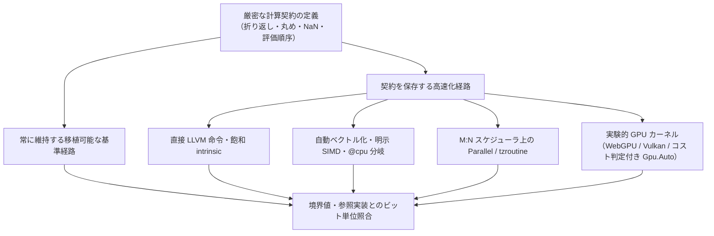

# 設計思想とアーキテクチャ原則

Tsuzuri の設計目標は、人間と AI エージェントの双方が、少ない暗黙ルールのもとで堅牢かつ実用性能の高いプログラムを記述できるようにすることです。高水準な表現力と引き換えに実行時コストを許容するのでも、ベンチマーク上の数値のために言語の意味論や安全性を犠牲にするのでもなく、両立をコンパイラとランタイムの設計課題として解決します。

本ページでは、Tsuzuri の言語仕様・最適化器・標準ライブラリ・開発ツール群を貫く設計原則を解説します。

## 要点

- **暗黙ルールの排除と局所的推論**: 関数シグネチャの明示、暗黙の数値型変換の禁止、正格評価、値としてのエラー表現により、コードの振る舞いを局所的に追跡できます。
- **未定義動作（UB）の排除と意味論の保持**: 整数加減乗算の折り返し、IEEE 754 浮動小数点の丸め・NaN・符号付きゼロ、境界検査の契約を `-O0` から `-O3` までネイティブ・WebAssembly 間で一致させます。
- **GC 非依存の決定論的メモリ管理**: アフィン所有権と借用検査によって解放時期を静的に決定し、共有や循環が必要な場面だけを `Rc` / `Arc` / `Arena` で明示します。
- **総コストに基づく実行バックエンド選択**: スカラー命令、SIMD、マルチコア並列、GPU の選択は、メモリ確保・転送・同期・起動を含めたエンドツーエンドの実効コストで判断します。
- **AI エージェント・開発ツールとの統合**: 決定論的な IR 出力、構造化 JSON 診断、知識グラフ（KG）、MCP サーバー、適合性テスト規則により、人間と自動化ツールが同一の検証基盤を共有します。

## 少ない暗黙ルールと予測可能性

読み手やツールがコード片を読んだとき、型・評価順序・所有権の移動・失敗経路をファイル外の大域的な文脈なしに追跡できることを最優先としています。コンパイラが気を利かせて暗黙の型変換や実行モデルの切り替えを行うと、人間とツールの間で解釈のずれが生じるためです。

- **明示的な関数契約と局所的型推論**: トップレベル関数の型シグネチャは必ず明記し、関数内部のローカル束縛は双方向型推論によって簡潔に記述します。
- **暗黙の型拡幅の禁止**: `i32` から `i64` や `f64` への暗黙変換は存在しません。すべての数値変換は `as` キャストまたは標準ライブラリの変換関数で明示します。
- **一貫した評価順序**: 関数適用、演算子、タプル・レコード構築、文字列補間の穴はすべて左から右へ一度ずつ正格評価されます。
- **失敗とトラップの峻別**: 回復可能なドメインエラーは `Maybe<T>` や `Result<T, E>` の値で表し、ゼロ除算や境界外アクセスのような不変条件違反は実行時トラップとして即座に停止させます。トラップを暗黙に失敗値へ握り潰すことはありません。
- **副作用と権限の可視化**: 入出力は `IO<T>` 型へ分離し、副作用を持たない関数は `pure def` や事前・事後条件（`@requires` / `@ensures`）、効果表明属性（`@no_alloc` / `@no_copy` / `@no_trap` / `@terminates`）として静的に検証できます。さらにパッケージ単位で `[capabilities]` を宣言すれば、`fs`・`net`・`ffi` など 9 種の権限外の呼び出しを `E1036` で拒否できます。

## 未定義動作の排除と意味論を保つ最適化

実用性能の最大化はコンパイラ・ランタイム・組み込み関数・標準ライブラリすべてに課された最重要要件の一つですが、高速化のために計算の意味論を変えることは一切行いません。

### 整数・浮動小数点・境界検査の不変条件

- **整数の折り返し保証**: 通常の整数加減乗算（`+`、`-`、`*`）は C/C++ の符号付き整数のような未定義動作（UB）を持たず、常に型のビット幅による 2 の補数折り返し（wrapping）として定義されます。LLVM IR の `nsw` / `nuw` フラグは、ループ境界や区間解析から溢れないことが静的に証明された演算に対してのみ、オプトイン環境変数 `TSUZURI_RANGE_FLAGS=proven` 指定時に付与されます（既定は `off`）。オーバーフローを検出したい箇所には `@checked` 属性または `Int` モジュールの検査付き・飽和演算 API を用います。
- **IEEE 754 浮動小数点の厳格保持**: `-O3` 最適化時であっても、`fast-math`、式の勝手な再結合（reassociation）、暗黙の FMA（融合積和）変換は有効化しません。最近接偶数丸め（ties-to-even）、NaN、符号付きゼロ（`-0.0`）が常に保たれます。行列積でも既定の `Matrix.mul` は加算順序と丸めを固定してネイティブ・WebAssembly 間でビット一致を保証し、FMA を使う高速経路は別名関数 `Matrix.mul_fma` として分離しています。
- **省略可能な証明付き境界検査**: 境界検査を無効化する危険なコンパイラフラグは提供しません。その代わり、ループ範囲（`0 ..< xs.length` など）や条件分岐からインデックスが確実に範囲内であるとコンパイラが証明できた箇所のみ、分岐命令を安全に除去します。
- **所有権・借用から導出するエイリアス情報**: 借用検査によって証明された不変性や非重複性は、内部関数のポインタ属性、スカラー値の `noundef`、スコープ付きエイリアスメタデータ、限定されたスカラー要素の TBAA として LLVM IR に反映されます。共有参照同士や内部可変性（`Atomic` / `Mutex`）が絡む箇所では保守的な経路を維持し、公開 C ABI は変更しません。

### 文字列表現の透過性

`string` 型の観測可能な仕様は常に「16 ビット UTF-16 コード単位の不変列」です。オプトインのコンパクト文字列モード（`TSUZURI_STRINGS=compact`）を有効にすると、全コード単位が `0xFF` 以下（ASCII / Latin-1）の文字列を内部的に 1 単位 1 バイトで保持してヒープ使用量を半減させますが、`.length`、添字、辞書順比較、ハッシュ値、およびホスト境界の UTF-16 ABI は既定モード（`utf16`）と完全に同一です。

## GC に依存しない決定論的メモリ管理

Tsuzuri はガベージコレクタやバックグラウンドのサイクルコレクタを持たず、今後も導入しない方針を採っています。

- **単一所有権とスタック優先配置**: `new` を伴わない配列・リスト・レコードのリテラルは関数フレーム上のスタック領域（上限 64 KiB）に直接配置され、関数の戻り値やクロージャ捕捉などでスコープ外へ脱出する時点で自動的にヒープへ昇格します。最初から関数外へ返すデータは `new [...]` で直接ヒープに確保できます。
- **最終使用解析とバッファ再利用**: 変数の最後の使用位置では暗黙の複製を省略してムーブへ変換し、ヒープ所有文字列の連結 `left + right` では左辺バッファを `realloc` で再利用します。
- **決定論的解放（RAII）**: スコープを抜ける際や再代入時に不要となったバッファは即座に解放されます。ファイルや外部ハンドルを包むレコード・共用体は `instance Drop<T>` と `use` 束縛によって確実にクローズできます。
- **明示的な共有と循環構造**: 複数の所有者による共有が必要な場合は `Rc<T>`（単一スレッド）または `Arc<T>`（マルチスレッド対応のアトミック参照カウント）を明示します。グラフや双方向リストのような循環構造は、世代付きハンドルで安全に要素を指す `Arena<T>`、または `Arc.Weak<T>` を用いて表現します。共有状態の書き換えは `Atomic<T>` と `Mutex<T>` のみに限定されます。

なお、GC による停止（ストップ・ザ・ワールド）が存在しないことは予測可能性を高めますが、コレクションの複製やヒープ昇格に伴うアロケーションコスト自体が消滅するわけではなく、それ単独でハードリアルタイム性を保証するものではありません。

## バックエンド選択と移植性の原則

Tsuzuri は連続メモリ配置、具体型への単相化、一時クロージャの特殊化消去によって最適化しやすい IR を生成したうえで、スカラー CPU 命令、SIMD、マルチコア CPU、GPU のいずれを使うかを**エンドツーエンドの総所要時間**で判断します。

各実行経路の設計原則は次のとおりです。

| 実行経路 | 設計原則と現在の扱い |
| --- | --- |
| **スカラー CPU** | `i8`〜`i64` / `i8u`〜`i64u` および `f32` / `f64` の演算・変換に型付き LLVM 命令と飽和 intrinsic を直接出力。`as` キャストと組み込み関数の性能経路を一致させる |
| **`f16` 半精度浮動小数点** | AArch64 では LLVM `half` 命令、x86-64 の `--cpu native` では F16C / AVX512-FP16 命令、WebAssembly 等ではソフトウェア実装を使用。いずれの経路でも NaN を含め同一ビット列を生成 |
| **SIMD と CPU ディスパッチ** | `-O3` の自動ベクトル化に加え、128-bit / 256-bit の明示的 SIMD ベクトル型（`Simd`）を提供。既定の `--cpu generic` はアーキテクチャの基準命令セットを守り、`@cpu ["avx2", "sve"]` 属性を付けた関数は実行時に CPU 機能を検査して最適版を選択 |
| **マルチコア並列処理** | ループの勝手な自動並列化は行わない。`Parallel.*`・`Routine.scope`・`tzroutine` によって明示的に M:N スケジューラ（論理プロセッサ上限 `TSUZURI_MAXPROCS`）へ投入する。`Parallel.fold` は結合的な `Monoid` を要求し、逐次実行とビット単位で同一の結果を返す |
| **GPU バックエンド（実験的）** | メモリ確保・コンパイル・転送・同期を含めた総コストで判断する。厳密な整数カーネル（WGSL / SPIR-V）と、緩和精度を名前で明示する `Gpu.map_relaxed`（`--emit wgsl-relaxed` / `spirv-relaxed`）を分離。Vulkan の厳密 `f32` はドライバ申告だけでなく実行時の適合プローブを通過したデバイスのみ許可。`Gpu.WebGpu` や `Gpu.Vulkan` を明示要求して利用不能な場合は暗黙フォールバックせず `Result.Error Gpu.Unavailable` を返し、`Gpu.Auto` のみがコスト規則に基づき CPU と Vulkan を自動選択 |
| **WebAssembly** | 既定では `bulk-memory` のみを前提とし、SIMD128・`threads`・`jspi`・`webgpu`・`net`・`tail-call`・`--wasm-host wasi` はすべて明示的なオプトインとした移植重視の設計 |

性能の検証には言語組み込みの `bench "名前" = ...` と `tsuzuri bench`（および確保回数を正確に計測する `--allocs` / `Alloc` モジュール）を用います。共有 CI ランナーにはノイズによる誤判定を避けるため実行時間の合否閾値を置かず、同一マシン・同一条件での前後比較と生成アセンブリの検査を根拠とします。

## 計算カーネルとホスト環境の分離

Tsuzuri が言語本体と標準ライブラリで直接担うのは、データ変換、ドメインロジック、構文解析、集計、数値計算です。GUI、ブラウザ DOM、TLS/HTTP を含む高水準プロトコル、イベントループはホスト環境側に委ねる設計を採っています。

- ネイティブ環境では `export def` による C ABI 公開、`extern` による C 関数呼び出し、`tsuzuri bindgen` による C ヘッダーからの安全なバインディング自動生成、`--emit shared` と `--emit bindings-cs` / `bindings-py` / `bindings-cpp` による多言語連携、`--emit bitcode` によるホスト C/C++ との言語間 ThinLTO インライン化を提供します。
- WebAssembly 環境では、入出力を持たない純粋計算モジュールは外部インポートを一切要求せず単体でインスタンス化でき、`--emit bindings-js` によって TypeScript 型定義付きの ES モジュールグルーを生成できます。

## AI エージェント・開発ツールとの親和性

AI エージェントが生成したコードも人間が記述したコードも、まったく同じコンパイラ検査を通過させることで品質を担保します。Tsuzuri は AI エージェントが少ないトークン消費と少ない試行回数で正確なコードへ収束できるよう、コンパイラ自体を構造化データの供給源として設計しています。

1. **構造化診断と自己完結した説明 (`--json`, `tsuzuri explain`, `tsuzuri fix`)**
   すべての診断は不変のエラーコード（`E1012` 等）と原因識別子 `kind`（`use_after_move` 等）を持ち、`--json` 指定時に位置スパン・関連箇所（`related`）・ヒント（`help`）・機械適用可能な修正案（`fixes`）を 1 行 1 JSON で出力します。`tsuzuri explain` はコンパイラ内蔵の正誤コード例付き解説を返し、`tsuzuri fix` は意味論を保つ `certain` 修正案を自動適用して再検証します。
2. **型つき穴と型シグネチャ検索 (`?`, `tsuzuri find`)**
   未完成の式に `?`（または `?name`）を置くと、コンパイラが期待型・スコープ内の変数・型が一致する関数候補を `E1030` で提示します。`tsuzuri find` は型シグネチャから標準ライブラリおよびプロジェクト内の関数を検索します。
3. **決定論的コンパイルと知識グラフ (`tsuzuri kg`)**
   同一ソースと同一オプションからはバイト単位で決定論的な LLVM IR と知識グラフ（`target/tz/kg/`）が出力されます。知識グラフは全宣言ノード、呼び出し辺、型依存、関数の効果・トラップ・所有権イベント、メモリレイアウト、および階層型要約カード（`brief`）を JSON Lines と Markdown で保持し、AI が全ソースを走査せずに影響範囲（`kg impact`）や状態遷移図・モジュール図（`kg diagram`）を取得できます。
4. **読み取り専用 MCP サーバーと検証済みガイド (`tsuzuri mcp`, `tsuzuri guide`)**
   `tsuzuri mcp` はファイル書き換えや外部通信を一切行わない安全な読み取り専用 Model Context Protocol サーバーとして動作し、12 種の型付きツールを AI クライアントへ公開します。`tsuzuri guide` は現在のコンパイラで全コード例が検証されたコンパクトな文法・API リファレンスを出力します。
5. **適合性規則による仕様と実装の同期 (`conformance`)**
   言語仕様の各規則には一意な規則 ID（`LEX-001`、`OWN-012` 等）が割り当てられ、`tests/conformance/` 内の実行可能テストと 1 対 1 で結び付けられています。

## 意図的に採用しない設計

他言語との表面的な機能比較を埋める目的であっても、以下の要素は設計原則と矛盾するため採用しません。

- **ランタイム GC およびサイクルコレクタ**: 解放タイミングの決定論性とホスト組み込み時の軽量性を損なうため。
- **スタック巻き戻し例外と暗黙伝播演算子 `?`**: 失敗経路を型とコンピュテーション式（`let!`）で明示する原則を崩すため。
- **暗黙の `fast-math`・演算再結合・無断の精度緩和**: 最適化レベルやターゲットによって計算結果が変化する不具合を防ぐため。緩和演算は常に `mul_fma` や `Gpu.map_relaxed` のように別名 API として分離します。
- **`unsafe` ブロックと生ポインタ算術**: 言語内のメモリ安全性を局所的に無効化する抜け道を作らないため。C ホストとの低水準データ交換は、不透明ハンドル（`extern type`）およびアライメント・NULL 検査付きの `extern view def` / `@c_layout` レコード複写によって型安全に行います。
- **境界検査を無効化するビルドオプション**: 未定義動作やメモリ破壊の温床となるため。検査コストはコンパイラの静的範囲証明によって削減します。
- **クラス継承および言語組み込みの大型 GUI / Web フレームワーク**: データ構造は代数的データ型と型クラスで構成し、UI や高水準通信はホスト環境と分担するため。macOS の [Objective-C 連携](../compiler/objective-c.md) の `extern class` は、ホストのクラスの階層を型の検査に写すだけで、Tsuzuri の型に継承は入りません（基底への変換は `ObjC.upcast` と明示します）。

## 関連項目

- [Tsuzuri の概要](./introduction.md)
- [他言語との比較と適用領域](./comparison.md)
- [所有権とムーブ](../ownership/ownership-and-move.md)
- [借用と参照](../ownership/borrowing.md)
- [診断メッセージとエラーコード](../compiler/diagnostics.md)
- [知識グラフの構築と照会](../compiler/knowledge-graph.md)
- [MCP サーバー連携](../compiler/mcp.md)
- [適合性テストと仕様規則](../compiler/conformance.md)
- [安定性とエディション互換性](../compiler/stability.md)
