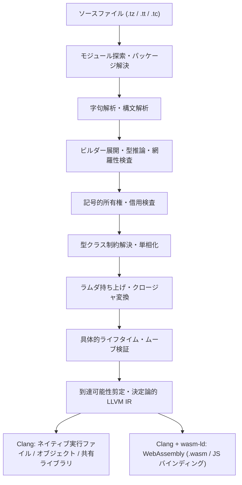

# Tsuzuri の概要

Tsuzuri は、ML 系言語に由来する関数型の式表現と、ガベージコレクション（GC）に依存しないアフィン所有権モデルを融合した静的型付きプログラミング言語です。Rust 製のフロントエンドが型・網羅性・所有権をコンパイル時に厳密に検査し、LLVM バックエンドを通じてネイティブ機械語および WebAssembly を生成します。

本ページでは、Tsuzuri `0.1.0`（既定エディション `2028`）の全体像と主要な言語機能を、実行可能なコード例とともに概観します。個々の構文や標準ライブラリの厳密な契約については、各章のリファレンスを参照してください。

## 要点

- **式指向の関数型表現**: すべての関数はカリー化されており、部分適用、パイプライン演算子 `|>`、関数合成 `>>` / `<<` を組み合わせてデータ変換を記述できます。
- **代数的データ型と網羅性検査**: 状態を `record` と `union`（判別共用体）で表現し、`match` 式が全ケースの網羅性をコンパイル時に検証します。
- **GC 非依存の所有権と借用**: 値の寿命は単一所有権と借用（`ref` / `ref mut`）によって静的に管理され、スコープ終了時に決定論的に解放されます。
- **値としての失敗と副作用の分離**: 回復可能な失敗は `Maybe` と `Result` で表し、コンピュテーション式（`let!` / `return`）で合成します。入出力は `IO<T>` 型に分離されます。
- **単一ソースからのマルチターゲット出力**: 同一のコードベースから、5 つの対応プラットフォーム向けネイティブコードとスタンドアロン WebAssembly を一貫した数値仕様で出力できます。

## 式とカリー化関数

Tsuzuri は式指向の言語であり、ブロックの最後に評価された式がそのブロック全体の値になります。関数は `def 名前 :: 型シグネチャ = \引数 -> 本体` の形式で宣言し、引数の一部だけを渡すと残りの引数を受け取る関数値（部分適用）が得られます。

```tsuzuri run=42
def add :: Add<'a> => own 'a -> own 'a -> 'a = \left right -> left + right

let add_twenty = add 20
22 |> add_twenty
```

`Add<'a>` は型変数 `'a` が加算演算子 `+` を備えることを要求する型クラス制約です。型サフィックスを持たない整数リテラル（`20` や `22`）は、周囲の文脈から型が定まらない場合に既定で `i32` へ推論されます。パイプライン演算子 `|>` は左辺の評価値を右辺の関数の引数として渡し、`>>`（順方向合成）および `<<`（逆方向合成）は関数同士を合成します。

評価戦略は正格評価（左から右への先行評価）です。ローカル束縛 `let` は既定で不変であり、再代入が必要な場合にのみ `let mut` を用います。異なる数値型間の暗黙変換は行われず、`x as i64` のように明示的にキャストします。

Edition 2027 以降（既定の Edition 2028 を含む）では、通常の `def` における無印の非 `Copy` 引数（`string` や非 `Copy` フィールドを持つレコードなど）は既定で共有借用渡しとして扱われます。所有権を呼び出し先へ移動させる場合は `own T`、排他的に更新する場合は `mut T` をシグネチャに明記します。詳細は[関数](../expressions/functions.md)および[演算子](../expressions/operators.md)を参照してください。

## レコード・共用体・パターンマッチ

関連するフィールドを束ねるには `record` を使用します。レコード更新構文 `{ base with field = value }` は元の値を書き換えず、指定したフィールドだけを差し替えた新しいレコードを生成します。

```tsuzuri run=42
record Position { horizontal: i64, vertical: i64 }

let origin = Position { horizontal: 20, vertical: 10 }
let moved = { origin with vertical = 22 }
moved.horizontal + moved.vertical
```

取り得る状態が複数に分かれるデータは `union`（判別共用体）で定義し、`match` 式で分解します。コンパイラはすべてのケースが網羅されているかを検査し、処理漏れがあれば不足パターンの具体例とともに `E1021` エラーを報告します。

```tsuzuri run=42
union Reading =
    | Missing
    | Value of i64

def unwrap_or_zero :: Reading -> i64 = \reading ->
    match reading with
    | Reading.Missing -> 0
    | Reading.Value amount -> amount

unwrap_or_zero (Reading.Value 42)
```

`0` や `-1` のような番兵値（センチネル）や `null` に頼らず、データの有効性を型として表現できます。また、事前宣言なしで複数の型を束ねる匿名共用体 `(i64 | string)` も利用できます。詳細は[レコード](../types/records.md)、[共用体](../types/unions.md)、[匿名共用体](../types/anonymous-unions.md)、[パターンマッチ](../expressions/pattern-matching.md)を参照してください。

## 所有権・借用と Edition 2028 の範囲構文

Tsuzuri はランタイム GC を持ちません。`string` や `Vec<T>` のようなヒープ資源を持つ値は単一の所有者を維持し、代入や `own` 引数への受け渡しによって所有権がムーブします。所有権を移さずに読み取る場合は共有借用 `ref`、書き換える場合は排他借用 `ref mut` を使います。

Edition 2028 では、配列の部分領域をコピーなしで参照するスライス構文と、末尾からの相対位置を表す `^k`（`^0` が末尾要素、`^1` が末尾から 2 番目の要素）が統合されています。

```tsuzuri run=last%3D21%20mid%3D26
let prices = [3, 5, 8, 13, 21]
let last = prices[^0]
let middle = ref prices[1 ..< ^0]
$"last={last} mid={Array.sum middle}"
```

`prices[^0]` は末尾要素 `21` を読み出し、`ref prices[1 ..< ^0]` はインデックス `1` から末尾要素の手前まで（`[5, 8, 13]`）を半開区間として共有借用します。終端を含む閉区間スライスは `ref prices[1 ..= 3]` と記述します。借用が有効な間は元の所有者を移動・破棄できないことが静的に保証されます。

複数の所有者で不変データを共有する場合は標準ライブラリの [`Rc` / `Arc`](../stdlib/memory/rc.md)、親子の双方向リンクやグラフ構造を表す場合は世代付きハンドルを用いる [`Arena`](../stdlib/memory/arena.md) を明示的に選択します。詳細は[所有権とムーブ](../ownership/ownership-and-move.md)および[借用と参照](../ownership/borrowing.md)を参照してください。

## 型クラスと静的単相化

共通の演算や振る舞いを複数の型に定義するには型クラスを使用します。型クラスの宣言は `.tt` ファイルに、具体型に対する実装（`instance`）は `.tz` ファイルに記述します。インスタンス解決はコンパイル時の単相化（モノモーフィゼーション）によって完結し、実行時の辞書渡しや仮想関数呼び出しのオーバーヘッドは発生しません。

```tsuzuri run=42
record Order { price: i64, tax: i64 }

instance Add<Order> {
    fn add left right =
        Order { price: left.price + right.price, tax: left.tax + right.tax }
}

let morning = Order { price: 20, tax: 2 }
let evening = Order { price: 18, tax: 2 }
let total = morning + evening
total.price + total.tax
```

レコードや共用体には `deriving (Eq, Ord, Hash, Display, Default, Encode, Decode)` を付与して標準的な型クラス実装を自動導出できます。異なる具体型を単一のコレクションへ格納する必要がある場面に限り、`dyn` 型と `Dyn.of` によって実行時の動的ディスパッチを明示できます。詳細は[型クラスと制約](../types/type-classes.md)を参照してください。

## 失敗の合成とコンピュテーション式

Tsuzuri にはスタック巻き戻しを伴う一般例外や暗黙のエラー伝播演算子はありません。値の欠落は `Maybe<T>`、理由を伴う失敗は `Result<T, E>` として表現し、コンピュテーション式の `let!` と `return` で連鎖させます。

```tsuzuri run=42
def parse_pair :: own Result<i64, string> -> own Result<i64, string> -> Result<i64, string> = \first second ->
    Result {
        let! a = first
        let! b = second
        return a + b
    }

match parse_pair (Result.Ok 20) (Result.Ok 22) with
| Result.Ok value -> value
| Result.Error _ -> 0
```

途中のステップが `Result.Error`（または `Maybe.None`）を返した時点で後続の計算は短絡され、その失敗値がブロック全体の結果になります。なお、`return` は関数からの早期脱出ではなく、コンピュテーション式のビルダー結果を構築する操作です。

ゼロ除算や配列の境界外アクセスはプログラムのバグを表す実行時トラップであり、自動的に `Result` へ変換されることはありません。整数演算のオーバーフローを値として捕捉したい場合は、`@checked` 属性と同一関数内の `try ... with` 式を組み合わせて `Result` に変換します。詳細は[コンピュテーション式](../expressions/computation-expressions.md)および[例外処理とチェック付き演算](../expressions/error-handling.md)を参照してください。

## 入出力とエントリーポイント

標準入出力やファイル操作などの副作用は、遅延アクションを表す `IO<T>` 型によって純粋な計算から分離されます。アプリケーションのエントリーポイント `def main` では、ビルダーブロックを省略して `do!` や `let!` で `IO` アクションを直接実行できます。

```tsuzuri run=order%2042
def main :: unit -> i32 = \() ->
    let id = 42
    do! IO.writeln $"order {id}"
    0
```

`def main` は `unit -> i32` またはコマンドライン引数を受け取る `Array<string> -> i32` のシグネチャを持ち、戻り値がプロセスの終了コードになります。既定の WebAssembly ターゲットでは OS API への到達がコンパイル時に `E2000` で拒否され、`--wasm-host wasi` を明示したときのみ WASI preview1 インポートへ接続されます。詳細は[`IO`](../stdlib/sys/io.md)を参照してください。

## 並行処理とデータ並列

配列要素に対する独立した計算は、`Parallel` モジュールを用いて複数コアへ安全に分散できます。`Parallel.init n f` はインデックスごとの計算をチャンクに分割して並列実行し、入力順序を保った配列を返します。

```tsuzuri run=42
let totals = Parallel.init 3 (\index -> (index + 1) * 7)
Array.sum totals
```

異なる処理単位を並行に進める場合は、`tzroutine { ... }` 式で軽量な実行単位を起動し、`Channel<T>` や `select` 式、`WaitGroup` などの同期プリミティブで協調させます。捕捉される環境は `Send` を満たす所有値または `Copy` 値に限定されるため、共有可変状態によるデータ競合はコンパイル時に排除されます。

```tsuzuri run=sum%3D42
let group = WaitGroup.create ()
let total = Arc.new (Atomic.create 0i64)
for index in 0 ..< 3 do
    WaitGroup.add (ref group) 1
    let done = WaitGroup.share (ref group)
    let shared = Arc.share (ref total)
    tzroutine {
        let _prev = Atomic.fetch_add (Arc.get (ref shared)) (((index + 1) * 7) as i64)
        WaitGroup.done (ref done)
    }
WaitGroup.wait (ref group)
$"sum={Atomic.load (Arc.get (ref total))}"
```

ネイティブ環境では `tzroutine` と `Parallel` が同一の M:N スケジューラ上で動作します。既定の WebAssembly では `Parallel` が同一の意味論のまま逐次実行へフォールバックし、`--wasm-feature threads` または `--wasm-feature jspi` を指定した際にマルチスレッドや協調中断が有効化されます。詳細は[`tzroutine` と軽量並行処理](../concurrency/tzroutine.md)および[`Parallel`](../stdlib/sync/parallel.md)を参照してください。

## モジュール・拡張子・パッケージ構成

Tsuzuri は「1 ファイル = 1 モジュール」の原則を採用しています。ファイル名がそのままモジュール名となり、先頭の `namespace` 宣言で所属する名前空間を指定します。名前空間パスは `::`、モジュール内のメンバー参照は `.` で区切ります。

| 拡張子 | 役割と記述可能な宣言 |
| --- | --- |
| `.tz` | レコード、共用体、型エイリアス、定数、関数、型クラスインスタンス、`test`、`bench`。トップレベル実行式は `Main.tz` のみ記述可能 |
| `.tt` | 型クラス（`class`）のシグネチャ宣言専用 |
| `.tc` | コンピュテーション式のビルダー定義、補助関数、`@alias` 宣言 |

```tsuzuri project=shop file=Quote.tz
namespace Shop

record Quote { unit_price: i64, count: i64 }

def amount :: Quote -> i64 = \quote -> quote.unit_price * quote.count
```

```tsuzuri project=shop file=Main.tz run=42
namespace Shop

using Shop

let quote = Quote { unit_price: 21, count: 2 }
Quote.amount quote
```

宣言は既定でモジュール外へ公開され、モジュール内部に隠蔽する場合は `private` を付与します。C ABI や WebAssembly ホストへシンボルを公開する関数には `export def` を指定します。プロジェクト全体のメタデータ、言語エディション（`2026` / `2027` / `2028`）、依存関係（ローカル `path`、コミット固定 `git`、独自インデックス `registry`）は `Tsuzuri.toml` で管理します。詳細は[名前空間とモジュール](../modules/namespaces-and-modules.md)および[パッケージ管理](../modules/packages.md)を参照してください。

## コンパイルパイプラインと開発ツール

コンパイラはソースファイルを解析・検証した後、決定論的な LLVM IR を出力します。最適化レベルの既定値は `-O3` ですが、高速化のために整数オーバーフローの折り返し規則や IEEE 754 浮動小数点の意味論を変更することはありません。



コンパイラバイナリ `tsuzuri` には、日常の開発・検証・AI エージェント連携に必要なサブコマンドが一通り統合されています。

| コマンド | 概要 |
| --- | --- |
| `tsuzuri new` | `Tsuzuri.toml`、`Main.tz`、AI 向けガイド（`AGENTS.md` / `llms.txt`）を備えた新規プロジェクトを生成 |
| `tsuzuri check` | コード生成を行わずに構文・型・網羅性・所有権・権限を高速検査 |
| `tsuzuri run` | エントリーポイント `Main.tz` をビルドしてネイティブ実行（既定 `-O3`） |
| `tsuzuri build` | ネイティブ実行ファイル、WebAssembly、オブジェクト、C ヘッダー、各種言語バインディング等を出力 |
| `tsuzuri test` / `bench` | ソース内の `test` 宣言（doc-test・カバレッジ対応）および `bench` 宣言を実行 |
| `tsuzuri fmt` / `fix` | AST 保持のコード整形、診断修正案の自動適用およびエディション移行 |
| `tsuzuri doc` | `///` ドキュメントコメントと公開シグネチャから Markdown API リファレンスを生成 |
| `tsuzuri lsp` / `mcp` | エディタ向け Language Server、および AI エージェント向け読み取り専用 MCP サーバーを起動 |
| `tsuzuri kg` / `guide` | プロジェクト知識グラフの構築・照会・図表出力、および検証済み言語ガイドの表示 |

すべての検査・ビルド系コマンドは `--json` フラグに対応しており、標準エラー出力へ 1 行 1 JSON オブジェクトの構造化診断を出力します。

## 関連項目

- [設計思想とアーキテクチャ原則](./design-philosophy.md)
- [他言語との比較と適用領域](./comparison.md)
- [字句構造とブロック構文](../syntax/lexical-structure.md)
- [所有権とムーブ](../ownership/ownership-and-move.md)
- [CLI コマンドリファレンス](../compiler/cli.md)
- [対応プラットフォームとクロスコンパイル](../compiler/platforms.md)
- [言語リファレンス目次](../index.md)
