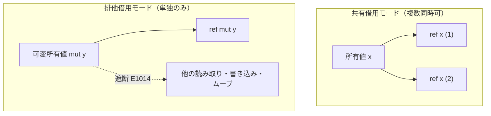

# 借用と参照

所有権をムーブせずに値を一時的に読み書きする仕組みが**借用**（borrowing）であり、借用によって作られるポインタを**参照**（reference）と呼びます。Tsuzuri の借用チェッカーは、参照の生存期間とエイリアシング排他規則をコンパイル時に静的検証し、実行時オーバーヘッドなしにダングリング参照やデータ競合を防止します。

## 要点

- 共有借用 `ref x`（型 `ref T`）は読み取り専用で同時に複数作成でき、`Copy` として複製できる。
- 排他借用 `ref mut x`（型 `ref mut T`）は `let mut` 変数または既存の排他参照から1つだけ作成でき、生存中は同じ対象への他の読み書きやムーブをすべて遮断する（競合は `E1014`）。
- 参照の正準構文はキーワード形式（`ref` / `ref mut` / `deref`）であり、旧記号形式（`&` / `&mut` / `*`）は Edition 2027 以降では `E0004` となる。
- 借用の有効期間はブロック終端ではなく参照の**最終使用位置**（NLL: Non-Lexical Lifetimes 相当）で終了する。
- Edition 2027 以降では、可変レコードの独立したフィールドパスに対する排他借用（`ref mut r.field`、`ref mut r.xs[0..]`）を同時に保持できる。
- 配列スライス（`ref xs[a..<b]` / `ref mut xs[a..<b]`）や `Tensor`・`Matrix` のビュー返却添字（`ref m[0..<2, ..]`）には `ref` の明示が必須であり、省略すると `E1042`（または範囲窓構文で `E0002`）となる。

## 共有借用（`ref`）と排他借用（`ref mut`）

### キーワード形式とエディション規則

Tsuzuri の参照操作は英語キーワードで記述します。Edition 2026 で許容されていた記号形式（`&x`、`&mut x`、`*r`、`&T`、`&mut T`）は Edition 2027 および既定の Edition 2028 では構文エラー `E0004` となります（`tsuzuri fix --edition 2028` で自動移行できます）。

| 操作・型 | 構文（正準形） | 意味と性質 |
| --- | --- | --- |
| 共有借用の作成 | `ref x` | 読み取り専用参照を作成（オペランドが参照なら1段の共有再借用） |
| 排他借用の作成 | `ref mut x` | 書き換え可能な排他参照を作成（オペランドが排他参照なら1段の排他再借用） |
| 参照外し（読み取り） | `deref r` | 参照先の `Copy` 値を読み出す |
| 参照先の上書き | `deref r = v` | 排他参照 `r` の参照先を新しい値 `v` で置換する（結果型は `unit`） |
| 共有参照型 | `ref T` | 共有借用の型（`Copy`） |
| 排他参照型 | `ref mut T` | 排他借用の型（非 `Copy`） |

### 共有借用と排他借用の基本動作

共有参照 `ref T` は対象の不変性を保証する代わりに、いくつでも同時に作成・複製できます。借用中も所有権は元の変数に留まるため、参照を使い終えたあとも元の変数をそのまま利用できます。

```tsuzuri run=17
def total_length :: ref string -> ref string -> i64 = \a b ->
    a.length + b.length

let first = "hello"
let second = "tsuzuri"
let sum = total_length (ref first) (ref second)
sum + first.length
```

排他参照 `ref mut T` は参照先の値をインプレースで更新するための参照です。元の変数は `let mut` で宣言されている必要があります（不変な `let` 束縛に対する `ref mut` や再代入は `E1014`）。

```tsuzuri run=42
def add_in_place :: i64 -> ref mut i64 -> unit = \delta target ->
    deref target = deref target + delta

let mut count = 30
add_in_place 12 (ref mut count)
count
```

### 再借用とクロージャ捕捉の制限

すでに参照型である変数 `r` に対して `ref r` や `ref mut r` を適用すると、多重ポインタ（`ref ref T`）ではなく参照先を1段貸し直す**再借用**（reborrow）になります。再借用先の参照が生きている間は元の参照 `r` への直接アクセスが一時停止し、再借用先の最終使用が終わると再び `r` を使えるようになります。なお、型推論の段階でオペランドが未確定の型変数 `'a` であった `ref x` が後から参照型と判明した場合は、意図の曖昧さを防ぐため `E1015` となります（仮引数に型注釈を付けて解決します）。

```tsuzuri run=25
def step_twice :: ref mut i64 -> unit = \r ->
    let inner = ref mut r
    deref inner = deref inner + 10
    deref r = deref r + 15

let mut n = 0
step_twice (ref mut n)
n
```

また、何度でも呼び出せる通常のクロージャ（`'a -> 'b`）は `Copy` であるため、その環境へ排他参照 `ref mut T` を捕捉することはできません（`E1005`）。排他参照は関数の引数として直接渡します。

## 関数呼び出し時の暗黙借用と一時値

関数適用の実引数では、仮引数の型シグネチャに合わせてコンパイラが借用・再借用・`Copy` 型の参照外しを自動補完します。Edition 2027 以降の通常の `def` で無印の読み取り引数（`string` 等）を受け取る場合も同じ規則が適用されるため、パイプライン演算子 `|>` とも自然に組み合わせられます。

| 仮引数の要求型 | 渡した実引数 | 自動補完される操作 |
| --- | --- | --- |
| `ref T`（または既定借用引数） | 所有値 `x: T` | `ref x`（共有借用） |
| `ref T`（または既定借用引数） | `r: ref T` または `ref mut T` | `ref r`（共有再借用） |
| `ref mut T`（または `mut T`） | 可変な所有値 `x: T` / 可変フィールドパス | `ref mut x` / `ref mut r.f`（排他借用） |
| `ref mut T`（または `mut T`） | `r: ref mut T` | `ref mut r`（排他再借用） |
| 値型 `T`（`Copy` 型のみ） | `r: ref T` または `ref mut T` | `deref r`（自動参照外し） |

```tsuzuri run=30
def twice_len :: ref string -> i64 = \s -> s.length * 2

let word = "hello"
let a = twice_len (ref word)
let b = twice_len word
let c = word |> twice_len
a + b + c
```

関数呼び出しの結果、算術・キャスト式、`if` / `match` / ブロック式の値といった名前のない**一時値**も、`ref T` や既定借用引数へ直接渡せます。一時値はその関数呼び出しの間だけ共有借用され、呼び出しが戻った直後に破棄されます。部分適用（`let f = use_ref (make_temp ())`）のように呼び出し完了後も借用が残り得る形は [`E1013`](lifetimes.md) で拒否されます。

## エイリアシング排他規則（`E1014`）と最終使用による借用終了

Tsuzuri の借用規則は、任意の時点で次のいずれか一方のみを許可します。

- **1つ以上の共有参照（`ref T`）**: 読み取りのみ可能。所有値のムーブ・上書き・排他借用は不可。
- **ただ1つの排他参照（`ref mut T`）**: 排他参照経由の読み書きのみ可能。他の共有借用・排他借用・所有値への直接アクセスやムーブはすべて不可。



借用の生存期間はブロックの終端まで引き延ばされるのではなく、**その参照が最後に使われる位置**（最終使用）で自動的に終了します。

```tsuzuri run=110
let mut score = 100
let r = ref mut score
deref r = deref r + 10
// ここで r の最終使用が完了するため、直後から共有借用や読み取りが可能
let view = ref score
deref view
```

反対に、参照 `r` の最終使用より前に元の変数へアクセスしたり別の借用を作ったりすると、`E1014` が報告されます。コンパイラは借用の発生箇所と、その借用を生かし続けている後続の使用箇所の両方を診断ノートで明示します。

```text
let mut score = 100
let r1 = ref mut score
let r2 = ref score
deref r1
```

このコードに対する診断出力は次のとおりです（終了コード `1`）。

```text
./Main.tz:3:10: error[E1014]: access conflicts with a live borrow; use the reference or end its last use before moving, replacing, or borrowing exclusively
  3 | let r2 = ref score
    |          ^
  note: value mutably borrowed here
    --> ./Main.tz:2:10
  2 | let r1 = ref mut score
    |          ^
  note: the borrow is used here, so it is still alive
    --> ./Main.tz:4:7
  4 | deref r1
    |       ^
  help: end the borrow before this access: stop using 'r1' first, or move this access after its last use
```

## レコードフィールドパスへの排他借用と要素代入（Edition 2027+）

Edition 2027 以降では、`let mut` で束縛された所有者または `ref mut` 参照を起点とし、途中の経路がすべてレコードのフィールドである場所に対して、直接のフィールド代入（`b.x = 10`）および**フィールド単位の排他借用**（`ref mut b.x` や可変スライス `ref mut b.xs[0..]`）を行えます。

異なるフィールドパス同士はメモリ領域が重ならないため、一方のフィールドを排他借用しながら別のフィールドを共有借用または排他借用できます。コンパイラはこれらの独立した参照に対して LLVM の `noalias` 属性を付与して最適化にも活用します。

```tsuzuri run=45
record State { total: i64, items: [i64] }
record Outer { state: State, factor: i64 }

def accumulate :: ref mut i64 -> ref [i64] -> i64 -> unit = \dst xs factor ->
    deref dst = deref dst + Array.sum xs * factor

let mut outer = Outer { state: State { total: 5, items: [1, 3] }, factor: 5 }
let slice = ref mut outer.state.items[0..]
let factor_ref = ref outer.factor
Array.write 0 (deref factor_ref) slice
// slice と factor_ref の使用が終わった後、state 内の独立した 2 フィールドを同時に借用
accumulate (ref mut outer.state.total) (ref outer.state.items) outer.factor
outer.state.total
```

フィールドパス借用に関する境界規則は次のとおりです。

- **所有者全体との排他性**: いずれかのフィールドへの借用が生きている間、所有者全体（`outer` や `outer.state`）をムーブ・上書き・全体借用すると `E1014` となります。
- **配列要素・共用体・タプル経由の排他借用禁止**: 配列やリストの要素、共用体のペイロード、タプル成分を途中に含む経路（`ref mut arr[0].total` など）は排他借用できません（`E1014`）。ただし、可変な配列・リスト・`Vec`・固定長配列に対する要素の上書き代入 `arr[i] = new_val` 自体は Edition 2027 以降でサポートされています（文字列の要素は不変）。
- **一時値と不透明型**: 一時値のフィールドへの借用 `ref mut (make ()).total` は `E1013`、標準ライブラリの不透明レコード（`Tensor` など）の内部フィールドへのアクセスは `E1022` となります。

## 配列スライスとビュー返却添字の借用

### 共有スライス（`ref [T]`）と可変スライス（`ref mut [T..]`）

配列 `[T]` の連続した部分範囲をコピーせずに参照するにはスライス構文を使用します。共有スライスの型は配列への共有参照と同じ `ref [T]` であり、要素をインプレースで書き換える可変スライスの型は `ref mut [T..]` です（配列全体の置換を許す `ref mut [T]` と区別されます）。

Edition 2028 では、スライスおよび `for` ループの範囲記法が統一されています。

| 範囲構文 | 区間の意味 | 対応エディション・備考 |
| --- | --- | --- |
| `a ..< b` | 半開区間 $[a, b)$（`b` を含まない） | 全エディション共通の推奨形式 |
| `a ..= b` | 閉区間 $[a, b]$（`b` を含む） | 全エディション対応 |
| `a .. b` | Edition 2028 では閉区間 $[a, b]$ | Edition 2026 / 2027 では半開区間（既定警告 `W1013`）。マニフェストなし入力でも意味変更の注意 `W1013` が出るため `..<` または `..=` の明示を推奨 |
| `a <.. b` / `a <..< b` | 左開区間 $(a, b]$ / 開区間 $(a, b)$ | Edition 2028 以降 |
| `a..` / `..<b` / `..=b` | 片側開放範囲 | `..` 単独は多次元添字の軸全体セレクタ |
| `^k` | 末尾相対位置 `len - 1 - k`（`^0` が末尾要素） | Edition 2028 以降。ブラケット添字・スライス境界専用（負リテラル添字は警告 `W1014`） |

```tsuzuri run=90
let values = [10, 20, 30, 40, 50]
let middle = ref values[1 ..< ^0]
middle[0] + middle[1] + middle[2]
```

可変スライス `ref mut [T..]` は要素単位の `ref mut xs[i]` を作らず、境界検査を備えた専用 API（または `xs[i] = v`）で安全に操作します。

| 関数 | シグネチャ | 説明 |
| --- | --- | --- |
| `Array.write` | `i64 -> 'a -> ref mut ['a..] -> unit` | 指定位置の要素を置換し、古い要素を破棄する（範囲外はトラップ） |
| `Array.swap_in` | `i64 -> i64 -> ref mut ['a..] -> unit` | 2箇所の要素をインプレースで交換する |
| `Array.sort_in_place` | `Ord<'a> => ref mut ['a..] -> unit` | 追加バッファなしで安定ソートする |
| `Array.split_at_mut` | `i64 -> ref mut ['a..] -> (ref mut ['a..] * ref mut ['a..])` | 重ならない前半・後半2つの可変スライスへ分割する |

```tsuzuri run=130
let mut data = [4, 1, 3, 2]
Array.sort_in_place (ref mut data[0..])
match Array.split_at_mut 2 (ref mut data) with
| (left, right) ->
    Array.write 0 100 left
    Array.write 1 30 right
data[0] + data[3]
```

[標準ライブラリの引数順序規約](../stdlib/conventions.md)により、`Array.write` のような書き込み関数は対象スライスを**最後の引数**に取ります。このため `Array.write 0 (part[1] * 10) part` のように前の引数で `part` を読み取ってから書き込む呼び出しは正当ですが、パイプライン `part |> Array.write 0 (part[1] * 10)` は先に `part` の排他借用が始まるため `E1014` になります。また、参照を含む値（借用を捕捉したクロージャや `ref string`）を可変スライスや `Mutex` 等へ書き込むと、その借用は書き込み先の所有者に引き継がれ、借用元より長く生き残ることはできません（`E1013` / `E1014`）。

### ビュー返却添字と `ref` 明示規則（`E1042` / `E1043`）

[`Tensor`](../stdlib/numeric/tensor.md)・[`Matrix`](../stdlib/numeric/matrix.md)・[`MatrixView`](../stdlib/numeric/matrix-view.md) や利用者定義の `Index` 型クラスでは、単一要素の読み出し（`m[1, 2]`）だけでなく、元のバッファを借用する部分ビュー（`Tensor.View<T>` や `MatrixView<T>`）を切り出す添字が提供されています。

結果の型が土台（コンテナ）を借用する添字式には、配列スライスと同様に**必ず先頭に `ref` を付けて借用であることを明示**します。`ref` は添字式に吸収され、式全体の型は `Tensor.View<T>` や `MatrixView<T>` になります。

```tsuzuri run=17
let m = Matrix.of_array 3 3 [1, 2, 3, 4, 5, 6, 7, 8, 9]
let sub = ref m[0..<2, 1..=2]
let corner = m[^0, ^0]
sub[0, 0] + sub[1, 1] + corner
```

添字と借用に関する診断規則は次のとおりです。

- **`ref` の欠落（`E1042` / `E0002`）**: `[Slice.range 0 2]` や利用者定義キーでビューを返す `Index` から `ref` を省くと `E1042`（`index_view_requires_ref`）になります。角括弧内に `..` 系の範囲や `..`（軸全体）を直接書いた窓構文で `ref` を省いた場合は構文エラー `E0002`（`slice_must_be_borrowed`）となります。
- **読み取り専用ビューへの `ref mut`（`E1042`）**: 共有ビューを返す `Index` 式に `ref mut` を付けると `E1042`（`index_view_not_writable`）になります。要素の書き換えには `Tensor.borrow_mut` や `MatrixView.of_array_mut` で作成した可変ビューに対する `mt[i, j] = v`（`IndexMut`）を使用します。
- **一時値の土台禁止（`E1013`）**: `ref (make_tensor ())[[Slice.range 0 2]]` のように一時値を土台としてビューを切り出すことはできません（先に `let` で束縛します。ただし `ref t[1..=2, ..][0, ..]` のような既存ビューからの連鎖切り出しは元の所有者 `t` の借用を引き継ぐため有効です）。
- **候補の曖昧さ（`E1043`）**: 型サフィックスのない数値リテラル等により複数の `Index` / `IndexMut` インスタンス候補が同時に適合する場合は、暗黙の優先選択を行わず `E1043` を報告します（`0i64` のように型を明示して解決します）。

## 検証済み借用契約と最適化

コンパイラは借用チェッカーが証明した不変条件を内部関数の LLVM IR 属性へ反映します。独立性が証明された排他参照には `noalias`、内部可変性（`Atomic`・`Mutex`・不透明標準レコード・参照カウント・捕捉環境など）に到達しない共有参照には `readonly`、スカラー参照やスカラースライスには型別 TBAA および scoped alias メタデータが付与されます。これらは境界検査・評価順序・トラップ条件を一切変えない純粋な最適化情報として機能します。

## 関連項目

- [所有権とムーブ](ownership-and-move.md)
- [ライフタイムとリージョン](lifetimes.md)
- [メモリレイアウトとアロケータ](memory-layout.md)
- [Drop とリソース解放](drop.md)
- [型クラス](../types/type-classes.md)
- [Array](../stdlib/collections/array.md)
- [Slice](../stdlib/numeric/slice.md)
- [Tensor](../stdlib/numeric/tensor.md)
