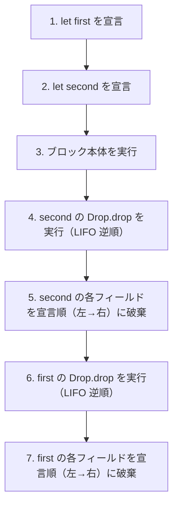

# Drop とリソース解放

Tsuzuri では、`string` や `Vec<T>` などの標準メモリ資源は所有者がスコープを抜けた時点でコンパイラが自動生成する解放コード（drop glue）によって回収されます。C ライブラリのハンドルや同期プリミティブなど、メモリ以外のカスタム解放処理を型に結び付けたい場合には、組み込み型クラス `Drop` のインスタンスを実装します。

## 要点

- 利用者定義の `record` または `union` に対して `instance Drop<T>`（メソッド `drop :: ref mut 'a -> unit`）を実装すると、値の破棄時にクリーンアップ処理がちょうど1回実行される。
- `Drop.drop` をコードから直接呼び出すことは `E1016` で禁止されており、早期解放には `Owned.drop` を使用する。
- `Drop` を実装した型は自動的に非 `Copy` となり、部分ムーブや `{ r with ... }` 更新は `E1012` で禁止される。
- ローカル変数は宣言の**逆順（LIFO）**で破棄され、レコードのフィールドは外側の `drop` 実行後に**宣言順**で破棄される。再代入時は古い値がその場で破棄され、ムーブ済みの値には `drop` は呼ばれない。
- `try ... with` で捕捉される例外脱出や `return` / `break` / `continue` では途中のスコープの `drop` が逆順に実行されるが、`assert` 失敗やゼロ除算などの**トラップ時**にはスタック巻き戻しは行われず未実行の `drop` は呼ばれない。
- `use x = expr` 束縛は、右辺の型が `Drop` を実装していることをコンパイル時に検査する不変束縛である。

## `Drop` 型クラスの宣言と制約

### 基本構文

自プログラムで宣言した `record` または `union` に対して `instance Drop<T>` を定義します。`drop` メソッドは破棄対象への排他参照 `ref mut T` を受け取り、`unit` を返します。

```tsuzuri run=work%3A%2010%2C%2020%0Arelease%2020%0Arelease%2010
record Guard { id: i64 }

instance Drop<Guard> {
    fn drop self = do! IO.writeln $"release {self.id}"
}

def main :: unit -> i32 = \() ->
    let first = Guard { id: 10 }
    let second = Guard { id: 20 }
    do! IO.writeln $"work: {first.id}, {second.id}"
    0
```

### `Drop` 実装と型上の制約

二重解放や不整合な状態の観測を防ぐため、`Drop` には厳格な規則が課されています。

| 項目 | 規則と違反時の診断 |
| --- | --- |
| 実装可能な対象型 | 自プログラム内で宣言した `record` または `union` のみ。プリミティブ型や標準ライブラリの型への実装、型パラメータを一部だけ具体化した実装は `E1016`、`deriving (Drop)` は `E1025` |
| 直接呼び出しの禁止 | `Drop.drop x` を直接呼ぶと `E1016`（早期に破棄したい場合は `Owned.drop x` を呼ぶ） |
| `Copy` との排他性 | 全フィールドが `Copy` であっても、`Drop` を実装した型は常に**非 `Copy`** となる |
| クロージャ捕捉の制限 | 再利用可能な通常のクロージャへ `Drop` 型を捕捉すると `E1005`（1回実行の `tzroutine { ... }` へのムーブや `Owned.function` での所有捕捉は可能） |
| 部分ムーブ・更新構文の禁止 | 非 `Copy` フィールドの個別ムーブや `{ value with ... }` 更新構文は、不完全な値に対する `drop` 実行を防ぐため `E1012` で禁止 |
| `drop` 本体内の制限 | `fn drop self` の内部で `deref self = ...` による全体置換、自己フィールド・要素への代入、および `self` 全体を他関数へ `ref mut` として渡す操作は無限再帰や再初期化を防ぐため `E1012` で禁止 |
| FFI / 純粋関数境界 | `export` / `extern` シグネチャへの `Drop` 型の露出は `E1008`、`pure def` での利用者定義 `Drop` 型の保持・破棄は `E1029` |

## 破棄のタイミングと解放順序

### 破棄が実行される6つの時点

1. **ブロックスコープの終端**: `let` / `let mut` / `use` で束縛された変数がブロックを抜けるとき。
2. **早期制御脱出・例外捕捉時**: `return`、`break`、`continue`、または `try ... with` で捕捉される例外によってスコープを抜けるとき。
3. **上書き再代入時**: `x = new_val` や `deref r = new_val`、フィールド代入 `r.f = new_val` において、右辺の評価が完了した直後に古い値が即座に破棄される。
4. **一時値の寿命終了時**: 変数に束縛されなかった一時値が式または呼び出しの直後で不要になったとき。
5. **親データ構造の解放時**: 配列・`Vec`・連結リスト・レコード・共用体・`Rc` / `Arc`（最後の強参照が消えた時点）が破棄されるとき。
6. **保証された相互末尾呼び出しの直前**: 同一 `def rec ... and ...` グループ内の他関数を末尾位置で呼び出す際、呼び出し元フレームの消滅に先立って引数の評価直後・呼び出し直前にローカル変数が逆順で破棄される。

### ムーブ済み値の破棄抑止

別の変数・関数・データ構造へ所有権がムーブされた元の束縛に対しては、スコープ終端で `drop` は実行されません。条件分岐の一方でのみムーブされる変数については、非再帰 `Drop` 型の末尾にある 1 バイトの生存フラグによって実行時に未移動経路でのみ正確に1回 `drop` が走ります。

```tsuzuri run=step1%0Adrop%201%0Astep2%0Adrop%207%0Astep3%0Adrop%2099
record Resource { id: i64 }

instance Drop<Resource> {
    fn drop self = do! IO.writeln $"drop {self.id}"
}

def main :: unit -> i32 = \() ->
    let early = Resource { id: 7 }
    let mut slot = Resource { id: 1 }
    do! IO.writeln "step1"
    slot = Resource { id: 99 }
    do! IO.writeln "step2"
    Owned.drop early
    do! IO.writeln "step3"
    0
```

上の例では、`slot = Resource { id: 99 }` の時点で古い `Resource { id: 1 }` が即座に破棄され、`Owned.drop early` で `Resource { id: 7 }` がその場で破棄されます。すでに破棄済みの `early` はスコープ終端では無視され、生き残っていた `Resource { id: 99 }` だけが最後に破棄されます。

### LIFO 逆順規則とフィールドの宣言順解放

破棄の順序はソースコード上の宣言から決定論的に定まります。



- **ブロックスコープ・`match` パターン・値仮引数**: 後から宣言されたリソースが先に宣言されたリソースを参照しているケースを安全に扱うため、**宣言の逆順（LIFO）**で破棄されます。関数の本体変数がすべて破棄された後、値渡しの仮引数が右から左へ破棄されます。
- **レコード・タプル・配列の内部要素**: 外側のレコード自身の `Drop.drop` が最初に実行された後、そのフィールドが**宣言順（左から右）**に破棄されます。タプルや配列の要素も先頭から順に破棄されます。
- **関数呼び出しが借用した一時値**: `f (ref (Guard { id: 1 })) (ref (Guard { id: 2 }))` のように呼び出し引数として借用された一時値は、呼び出しが正常に戻った直後に**生成順（1 → 2）**で破棄されます。もし後続引数の評価中に `break`・`continue`・捕捉例外で脱出した場合は、評価済みの一時値が**逆順**で破棄されてからスコープ変数が破棄されます。
- **破棄順序と借用検査（`E1013`）**: 借用を読み取り得る `Drop` 型（クロージャや参照を保持する `Drop` 型など）は、自分より先に破棄される値（後から宣言されたローカル変数や、自己レコード内で先に破棄される前方フィールド）の借用を保持できません。違反するとスコープ終端等で `E1013` となります。借用される側の変数は必ず保持する側より先に宣言します。

```tsuzuri run=body%20end%0Aouter%20drop%0Afield%20A%0Afield%20B
record Part { label: string }

instance Drop<Part> {
    fn drop self = do! IO.writeln $"field {self.label}"
}

record Whole { a: Part, b: Part }

instance Drop<Whole> {
    fn drop _self = do! IO.writeln "outer drop"
}

def main :: unit -> i32 = \() ->
    let _w = Whole { a: Part { label: "A" }, b: Part { label: "B" } }
    do! IO.writeln "body end"
    0
```

## 例外捕捉時とトラップ時の違い

Tsuzuri では、同一関数内の `try ... with ... finally` が捕捉する `@checked` 算術オーバーフロー例外（`OverflowException`）と、関数境界を越えた未処理例外や契約違反を表す**トラップ**（`assert` 失敗、配列の境界外アクセス、ゼロ除算、メモリ枯渇など）を明確に区別します（Tsuzuri の例外は関数境界を越えて自動伝播せず、関数間では `Result` を返して伝播します）。

| 異常終了の種類 | スコープ脱出時の動作 | スコープ内ローカル変数の `Drop.drop` |
| --- | --- | --- |
| 同一関数内の `try ... with` で捕捉される例外 | 外側の `try` ハンドラまで局所スコープを脱出（`finally` も実行） | **実行される**（抜ける各ブロックの変数・評価済み一時値を LIFO 逆順で確実に破棄） |
| トラップ（`assert`・境界外・`0` 除算・未捕捉 `@checked` 等） | スタック巻き戻しを行わず即時終了 | **実行されない**（`Domain.run` で純粋計算を隔離した場合も利用者定義 `Drop` 型は持ち込めない） |

```tsuzuri run=cleanup%201%0Acaught%20overflow
record ScopeGuard { id: i64 }

instance Drop<ScopeGuard> {
    fn drop self = do! IO.writeln $"cleanup {self.id}"
}

def checked_step :: i32 -> i32 -> Result<i32, Exception> = \a b ->
    try
        let _guard = ScopeGuard { id: 1 }
        @checked (a + b)
    with
    | e is OverflowException -> e

def main :: unit -> i32 = \() ->
    let msg = match checked_step 2147483647 1 with
        | Result.Ok _ -> "ok"
        | Result.Error _ -> "caught overflow"
    do! IO.writeln msg
    0
```

上の例では、`try` ブロック内部で `@checked (a + b)` が `OverflowException` を送出した際、`with` ハンドラへ移る前にブロック内の `_guard` の `Drop.drop` が確実に実行されます。一方、トラップ発生時にはスタック巻き戻しによる `drop` は走らないため、永続データの整合性をトラップ時のデストラクタ実行に依存させてはなりません。

## `use` 束縛と明示的クローズ（`File.with_open` 等）の使い分け

### `use` 束縛による `Drop` 実装の静的保証

[`use` 束縛](../expressions/resources-and-assertions.md)は、右辺の型が `Drop` を実装していることをコンパイル時に強制する不変束縛構文です（C# の `using var` や F# の `use` に相当しますが、`IDisposable` ではなく `Drop` 型クラスを検査します）。解放タイミングや LIFO 順序は通常の `let` と同一です。

```tsuzuri run=using%20session%0Aclose%20session
record Session { name: string }

instance Drop<Session> {
    fn drop self = do! IO.writeln $"close {self.name}"
}

def main :: unit -> i32 = \() ->
    use s = Session { name: "session" }
    do! IO.writeln $"using {s.name}"
    0
```

`Drop` を実装していない型（`i32` や `string` など）を `use` で束縛しようとすると `E1005`（`'use' needs a value whose type implements Drop`）となり、リソース解放の実装漏れや誤った型への変更をコンパイル時に検出できます。なお、`use mut` は構文エラー `E0002` です。

### I/O エラーを伴う外部ハンドルとの使い分け

`Drop.drop` の戻り値型は `unit` であるため、解放時の失敗を呼び出し元へ `Result` として返すことができません。そのため標準ライブラリの `File.Handle` や `Net.TcpStream` はあえて `Drop` を実装しておらず（`use` では束縛できません）、フラッシュ時のディスク満杯などの I/O エラーを取りこぼさないよう `File.close` やスコープヘルパー `File.with_open` で明示的に閉じる設計になっています。

- **失敗しない解放処理（メモリ・ロック・タイマー停止・チャネル閉鎖・C ハンドル破棄）**: `Drop` インスタンスを実装し、`let` または `use` で自動解放に任せる（早期解放は `Owned.drop`）。
- **クローズ時に検査すべき `Result` エラーを返す I/O ハンドル**: `File.with_open` や明示的な `close` 関数を用いて `IO<Result<..., Os.Error>>` を処理する。
- **複数所有者での共有・循環構造**: 共有所有には [`Rc` / `Arc`](../stdlib/memory/rc.md)（最後の所有者が破棄されたときに1回 `drop` を実行）、循環グラフには [`Arena`](../stdlib/memory/arena.md)（アリーナ破棄時に全要素を一括解放）を使用する。

## 関連項目

- [所有権とムーブ](ownership-and-move.md)
- [借用と参照](borrowing.md)
- [ライフタイムとリージョン](lifetimes.md)
- [メモリレイアウトとアロケータ](memory-layout.md)
- [リソース管理（use）とアサーション](../expressions/resources-and-assertions.md)
- [エラー処理と例外](../expressions/error-handling.md)
- [Owned](../stdlib/memory/owned.md)
- [Rc と Arc](../stdlib/memory/rc.md)
- [Arena](../stdlib/memory/arena.md)
