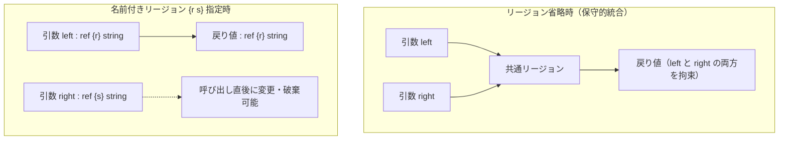

# ライフタイムとリージョン

参照を安全に扱うための根本原則は「参照は、その参照先の所有者よりも長く生存してはならない」という点にあります。Tsuzuri は関数内部の借用期間を自動で推論するため、通常のコードで明示的なライフタイム注釈を書く必要はありません。複数の参照を受け取って特定の入力に由来する参照だけを返す関数や、借用を保持するレコードを定義する場面に限って、波括弧で**リージョン**（region: `{r}`）を記述して入出力の依存関係を明示します。

## 要点

- 関数内部の借用期間や単一参照の入出力関係はコンパイラが自動推論し、注釈なしで検証される。
- ブロックや関数を抜ける時点で破棄されるローカル値への参照を外部へ持ち出すと、コンパイルエラー `E1013` となる。
- 複数の参照引数から一部のみを借用して返す関数では、`def f {r s} :: ref {r} T -> ref {s} U -> ref {r} T` のように名前付きリージョンを宣言して無関係な引数の拘束を解除できる。
- レコードは共有借用フィールド（`ref {r} T`）および排他借用フィールド（`ref mut {r} T`、リージョン指定必須）を保持でき、最大16個までの独立リージョンを持てる。
- Rust の `'static` に相当する特別なライフタイム記法はなく、平坦なデータの `const` 定数への共有借用のみがプログラム全体で有効な静的借用となる。

## リージョン推論モデルとスコープ脱出防止（`E1013`）

### ローカル値の参照脱出防止

Tsuzuri では変数が宣言されたブロックを抜けると所有値が破棄されます。破棄されるローカル変数への参照を関数の戻り値やブロック式の値として外へ持ち出そうとすると、コンパイラは `E1013` を報告してダングリングポインタの発生を阻止します。

```text
def dangling :: unit -> ref string = \() ->
    let local = "temporary"
    ref local
```

このコードに対する診断出力は次のとおりです（終了コード `1`）。所有者の宣言位置と破棄されるタイミングがノートで示されます。

```text
./Main.tz:3:5: error[E1013]: borrowed value does not live long enough to leave this block
  3 |     ref local
    |     ^
  note: 'local' is declared here and dropped at the end of this block
    --> ./Main.tz:2:9
  2 |     let local = "temporary"
    |         ^
  help: return the value itself instead of a reference to it, or declare it in an outer scope
```

同様に、外側のスコープにある可変変数 `let mut r` に対して内側のブロックで宣言した短命な変数の参照を代入し、ブロックの外で `r` を使用しようとした場合も `E1013` となります。

### 入出力リージョンの自動結び付け

リージョン注釈を書かない関数が参照（または借用を含むレコード等）を返す場合、コンパイラは関数のシグネチャから安全に入出力の生存期間を結び付けます。

- **参照引数が1つの場合**: 戻り値の借用はその唯一の参照引数に由来するものとして正確に追跡されます。
- **参照引数が複数ありリージョン注釈がない場合**: 戻り値の借用は「すべての参照引数の共通生存期間」に依存するものとして保守的に扱われます（ただし、関数本体が `Maybe.None` のように借用を一切返さないと静的に証明できる場合を除きます）。

```tsuzuri run=5
def non_empty_or :: ref string -> ref string = \text ->
    text

let greeting = "hello"
let picked = non_empty_or (ref greeting)
picked.length
```

`const` で宣言された平坦なデータ（数値・文字列リテラル・それらの配列やタプル・レコード）は実行ファイルの静的読み取り専用領域に配置されるため、`ref Table` のような借用はスコープに縛られずプログラム全体で有効です。

## 名前付きリージョン `{r}` による借用元の分離

2つ以上の参照を受け取り、そのうち特定の引数に由来する参照だけを返す関数では、名前付きリージョンを宣言することで無関係な引数を借用拘束から解放できます。



### 構文と検証規則

リージョン名は小文字 ASCII 識別子（`r`、`s`、`src` など）で、型変数（`'a`）とは独立した名前空間を持ちます。`def` の関数名（またはレコード名と型パラメータ）の直後に `{r s}`（またはカンマ区切り `{r, s}`）として宣言し、参照型に `ref {r} T` / `ref mut {r} T` と付与します。

- 宣言できるリージョン数の上限は、関数で最大 128 個、レコードで最大 16 個です（超過は `E1017`）。
- 未宣言のリージョン名の使用、大文字始まりのリージョン名、宣言したもののシグネチャやフィールドで一度も使われない未使用リージョンはすべて `E1013` です。
- リージョンは単なるドキュメントではなく検査対象の契約です。戻り値を `ref {r} string` と宣言した関数本体が `{s}` 側の参照を返すと、`E1013`（`returned borrow does not match the declared result region`）になります。また、リージョン注釈の有無で生成される LLVM IR は変わりません。

```tsuzuri run=5
def select_first {r s} :: ref {r} string -> ref {s} string -> ref {r} string = \left right ->
    assert (right.length > 0)
    left

let primary = "alpha"
let mut scratch = "temp"
let chosen = select_first (ref primary) (ref scratch)
// chosen は primary ({r}) のみを借用しているため、scratch ({s}) は即座に上書き可能
scratch = "overwritten"
chosen.length
```

もし `select_first` に `{r s}` を付けなかった場合、`chosen` が生きている間の `scratch = "overwritten"` は借用競合 [`E1014`](borrowing.md) となります。

### 高階関数のリージョン量化

高階関数の仮引数として「特定のリージョン契約を満たす関数」を要求する場合は、関数型の先頭に波括弧で局所リージョンを量化します。

```tsuzuri run=7
def apply_keep {r} :: ({s t} ref {s} string -> ref {t} string -> ref {s} string) -> ref {r} string -> ref string -> ref {r} string = \pick kept temp ->
    pick kept temp

def first {s t} :: ref {s} string -> ref {t} string -> ref {s} string = \a _b -> a

let outer = "tsuzuri"
let kept = {
    let short = "xy";
    apply_keep first (ref outer) (ref short)
}
kept.length
```

`({s t} ref {s} string -> ref {t} string -> ref {s} string)` は「第1引数の借用のみを返す関数」を表します。このため内側のブロックで短命な `short` が破棄されても、戻り値 `kept` は `outer` の借用のみを保持してブロックの外へ安全に返却できます。なお、リージョン量化された関数型は名前付き関数の仮引数型全体にのみ記述でき、その関数は直接呼び出し専用となります（関数値としての取り出しや部分適用は `E1013`）。

## 借用を保持するレコード

レコードのフィールドには共有借用と排他借用の双方を格納できます。単一の共有借用のみを持つレコードではリージョン宣言を省略できますが、複数の独立した借用元を区別する場合や排他借用フィールドを持つ場合はレコードにリージョンを宣言します。

### 複数リージョンを持つレコード

```tsuzuri run=7
record PairView<'a> {r s} { left: ref {r} 'a, right: ref {s} 'a }

def make_pair {r s} :: ref {r} string -> ref {s} string -> PairView<string> {r s} = \left right ->
    PairView { left: left, right: right }

def left_only {r s} :: PairView<string> {r s} -> ref {r} string = \pair ->
    pair.left

let long_lived = "abcdefg"
let extracted = {
    let short_lived = "xy";
    let pair = make_pair (ref long_lived) (ref short_lived);
    left_only pair
}
extracted.length
```

`PairView<string> {r s}` はフィールドごとに借用元を個別に追跡するため、`short_lived` が内側のブロックで破棄されても `{r}` 側の `pair.left` だけをブロック外へ取り出せます。レコード更新構文 `{ pair with right = ref other }` でも各フィールドのリージョンスロットが保たれます。

### 排他借用フィールド（`ref mut {r} T`）

作業バッファやカウンタへの排他参照を束ねるビュー型を作るには、フィールド型を `ref mut {r} T`（または可変スライス `ref mut {r} [T..]`）と宣言します。排他借用フィールドには**リージョン `{r}` の明記が必須**です（省略すると `E1013`）。配列・リスト・タプル・共用体・共有参照の内側に排他借用を格納することはできません（`E1013`）。

```tsuzuri run=31
record Acc {r} { target: ref mut {r} i64, step: i64 }

def advance {r} :: Acc {r} -> unit = \acc ->
    deref acc.target = deref acc.target + acc.step

let mut total = 1
let acc = Acc { target: ref mut total, step: 15 }
advance (Acc { target: ref mut acc.target, step: acc.step })
deref acc.target = deref acc.target + 15
total
```

排他借用フィールドを含むレコードは非 `Copy` です。`acc.target` を `ref mut` 仮引数へ渡す操作や `ref mut acc.target` は再借用となるため、`acc` 自体を `let mut` にする必要はありません（一方で `let moved = acc.target` のように変数へ取り出すと部分ムーブになります）。また、`ref Acc {r}` のような共有参照越しに内部の排他参照先を書き換えたり排他再借用したりすることは `E1014` で禁止されます。

### 参照自体のリージョンと参照先レコードのリージョンの分離

借用を持つレコードへの排他参照を通じてレコード全体を上書き置換する場合、「参照そのものの生存期間 `{r}`」と「参照先レコードが保持する借用の生存期間 `{s}`」を `ref mut {r} Note {s}` のように分けて記述します。

```tsuzuri run=65
record Note {s} { text: ref {s} string }

def replace_note {r s} :: ref mut {r} Note {s} -> ref {s} string -> ref {s} string = \slot next ->
    let previous = (deref slot).text
    deref slot = Note { text: next }
    previous

let first = "alpha"
let second = "beta!!"
let mut note = Note { text: ref first }
let old = replace_note (ref mut note) (ref second)
note.text.length * 10 + old.length
```

書き込む `next` が参照先レコードと同じリージョン `{s}` を持つことが型で保証されるため、呼び出し元の `note` より短命なローカル文字列を誤って格納してしまう事故が防がれます。

## 一時値の寿命規則と `E1013`

式の中で生成された一時値（関数呼び出しの戻り値、算術式、型キャスト、複合リテラルなど）を借用する場合の寿命規則は次のとおりです。

1. **関数呼び出しの実引数としての一時値借用**: `read_value (ref (x + 1))` や Edition 2027+ の既定借用引数 `inspect (make_record ())` では、一時値はその呼び出しが完了して戻る直前まで生存し、直後に破棄されます。
2. **呼び出し外への持ち出し禁止**: 一時値の借用を `let r = ref (make_string ())` のように変数へ束縛しようとしたり、部分適用 `let f = pair_with (n as i64)` や戻り値参照 `Text.trim (make_string ())` によって呼び出し後まで残そうとしたりすると `E1013` になります。先に `let value = make_string ()` と所有者を変数に束縛してから借用します。
3. **ビュー添字の土台**: `Tensor` や `Matrix` のスライス窓 `ref (make_tensor ())[0..<2]` のように一時値を土台とするビュー生成も `E1013`（`borrow_of_temporary`）となります。

## 保守的解析の境界条件

名前付きリージョンによる入力ごとの分離は、名前付き関数の直接の完全適用・不変 `let` 束縛・`if` / `match` の合流・レコード構築とフィールド読み出しで精密に機能します。一方、次のケースではコンパイラは健全性を優先して関係するすべてのリージョンを保守的に統合します。

| 構文・操作 | リージョン・借用解析の扱い |
| --- | --- |
| `let mut` への束縛、ループ合流、関数値化・部分適用、タプル・配列・共用体への格納 | 関係する全リージョンの借用をまとめて保持する |
| 型エイリアス `type`、共用体 `union`、`const`、ローカル変数の型注釈への `{r}` 指定 | 記述不可（`E1013`） |
| `ref mut` や共有セル（`Mutex`・`SyncMap` 等）への借用値の書き込み | 書き込んだ値の借用が書き込み先の所有者へ伝播する。関数内のローカル値の借用を呼び出し元の参照先へ書き込むと `E1013` |
| [`Drop`](drop.md) を持つ値への借用格納 | `Drop.drop` 実行時に参照先がすでに破棄されている順序（後から宣言した変数の借用を保持する場合や逆順フィールドの自己参照）を `E1013` で拒否 |
| 収束しないループ内借用伝播 | セルを所有するクロージャへ参照仮引数経由の借用を反復格納する等、借用集合が発散するループは上限判定により `E1017`（`loop_ownership_limit`）で停止 |

関数値として渡した途端に `E1013` や `E1014` が生じる場合は、名前付き関数を直接呼び出す形にするか、参照ではなく所有値を返す設計に切り替えます。

## 関連項目

- [所有権とムーブ](ownership-and-move.md)
- [借用と参照](borrowing.md)
- [メモリレイアウトとアロケータ](memory-layout.md)
- [Drop とリソース解放](drop.md)
- [レコード](../types/records.md)
- [ラムダ式](../expressions/lambdas.md)
