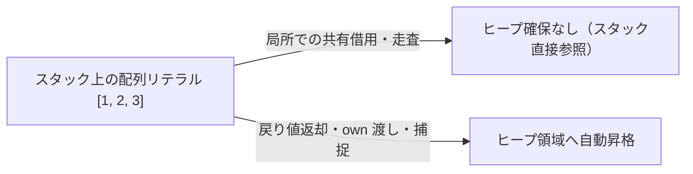

# メモリレイアウトとアロケータ

Tsuzuri では、値がスタックフレーム内にインライン配置されるかヒープ領域に確保されるかが、型の定義および `new` 式の有無によってソースコードから明確に読み取れます。さらに、ネイティブ環境向けのサイズ区分アロケータやホスト委譲アロケータ、WebAssembly の線形メモリアロケータ、コンパイラによる確保省略・バッファ再利用最適化を備えており、低レイテンシかつ予測可能なメモリ使用を実現します。

## 要点

- スカラー、タプル、レコード、固定長配列 `[T; N]` は値型としてインライン配置され、インラインレイアウトの上限は 64 KiB である（超過は `E1010`）。
- `new` を付けない配列・連結リストリテラル（`[1, 2, 3]`、`[|1, 2, 3|]`）は現在の関数のスタックフレーム（上限 64 KiB）に配置され、スコープ外へ脱出する際のみヒープへ自動昇格する。
- `new [...]`、`new [T](length, init)`、`Vec<T>`、動的に構築された `string`、再帰 `union` の子ノード、`Rc` / `Arc` ブロックはヒープ領域に確保される。
- `tsuzuri build --allocator` により、`system`（既定）・`small`（64ビットネイティブ用サイズ区分アロケータ）・`host`・`counting` を選択できる。
- 文字列リテラル畳み込み、短命な文字列連結バッファや小規模クロージャ環境のスタック配置、一意所有バッファの `realloc` 拡張などにより不要なヒープ確保が省略される。

## 値型のインライン配置と 64 KiB 上限

### スカラー・タプル・レコード・固定長配列

次の型は間接ポインタを介さず、変数スロットや親構造体の内部に**インライン（値そのもの）**として配置されます。

| 型分類 | メモリ上の配置と表現 |
| --- | --- |
| スカラー型 | `bool`（1B）、整数（`i8`〜`i128`）、浮動小数点・十進数（`f32`・`f64`・`f128`・`d128`）、文字（`char` 2B・`utf8char` 4B）、SIMD ベクトル。レジスタまたはスタックに直置き |
| タプル `(A * B * ...)` | 宣言順に標準アライメントでインライン配置 |
| レコード `record R { ... }` | パディング削減のため**アライメントの大きい順**にフィールドを並べ替えてインライン配置（サイズが減らない場合は宣言順を維持。`@c_layout` 指定時は C 構造体と同一の宣言順配置） |
| 固定長配列 `[T; N]` | `N` 個の要素を連続してインライン配置。ヒープ確保は発生せず、`new` は付与不可（`E1005`） |
| 非再帰 `union` | タグと最大ペイロード分のインライン領域（全ケースがペイロードなしなら整数タグのみ） |

レコードのフィールド並べ替えはメモリ上の格納順のみを対象とし、初期化式の評価順序、[Drop](drop.md) の解放順序、`deriving` による比較・ハッシュ・表示、デバッガ上の表示順、および `export def` の C 構造体境界はすべて宣言順のまま保たれます。また、利用者定義の `Drop` を実装した非再帰型は、ムーブ済みかどうかを追跡する 1 バイトの生存フラグを末尾に持ちます。

単一の値型のインラインレイアウト上限は **64 KiB** です。巨大な固定長配列や入れ子構造によって 64 KiB を超える型定義は `E1010` で拒否されます。また、ヒープポインタやコレクションを介さずにレコード同士が直接自己・相互再帰する定義も有限サイズを持たないため `E1010` となります。

```tsuzuri run=14
record Pair { flag: bool, count: i64, tag: i8 }

def sum_fixed :: [i64; 3] -> Pair -> i64 = \arr p ->
    arr[0] + arr[1] + arr[2] + p.count

let coords: [i64; 3] = [2, 4, 6]
sum_fixed coords (Pair { flag: true, count: 2, tag: 0i8 })
```

### リテラルのスタック配置と自動ヒープ昇格

`new` を付けずに記述した配列リテラル `[1, 2, 3]` や連結リストリテラル `[|1, 2, 3|]` は、ヒープアロケータを呼ばずに現在の関数のスタックフレーム上に確保されます。共有借用（`ref xs`）、添字読み取り `xs[i]`、`.length`、`for` ループ走査だけで完結する局所データは確保・解放ともにゼロコストで処理されます。

- **スタックフレームの 64 KiB 予算**: スタックに置ける単一リテラルの最大サイズは 64 KiB であり、1つの関数フレームに配置するスタック領域の累計上限も **64 KiB** です。関数先頭から順に加算して 64 KiB を超える後続リテラルは自動的にヒープ確保へ切り替わります。`-O1` 以上では `llvm.lifetime.end` によって寿命の重ならないスタック領域が再利用されます。
- **スコープ脱出時の自動昇格**: スタック上の配列・リストが関数の戻り値、`own` 実引数、`let mut` へのムーブ、クロージャや `tzroutine` への捕捉、他コレクションへの格納、または `ref mut` 借用によって外へ出る（あるいは置換可能になる）場合、コンパイラは自動的に要素をヒープ領域へコピーして昇格させます。無効なスタックアドレスが外部へ漏れることはありません。



## ヒープ所有データと `new` 式

長期間生存するコレクションや実行時に長さが決まるデータはヒープ領域で所有されます。スタック配置された `[i64]` と `new` でヒープ配置された `[i64]` の静的型は同一であり、同じ関数へ渡せます。

| データ・構文 | ヒープ上のレイアウトと特徴 |
| --- | --- |
| 文字列リテラル `"hello"` | 実行バイナリの静的読み取り専用領域を直接参照（実行時の確保・コピーなし） |
| 動的 `string` / `utf8string` | ポインタとコード単位長（UTF-16 / コンパクト Latin-1 または UTF-8 バイト列）の記述子 + ヒープバッファ |
| 空リテラル `[]` / `[ \|\| ]` / `""` / `new [ \|\| ]` | null ポインタ + 長さ 0（ヒープ確保なし。空配列 `[]` には型注釈が必要） |
| `new [e1, e2, ...]` / `new [\|e1, e2, ...\|]` | ヒープ領域に一括確保（連結リストも要素数分の単一チャンクに連続配置。`new []` のみ長さ 0 でも 1B 以上のヒープアドレスを確保） |
| `new [T](length, initializer)` | 実行時に `length` 個分の連続バッファをヒープに確保し、`\i -> ...` で各要素を初期化 |
| `Vec<T>` | ポインタ・現在長・予約容量を持つ伸長可能バッファ |
| 再帰 `union` | 子ノードをコンストラクタが自動的にヒープ確保（Rust の `Box` 明示は不要）。破棄時はコールスタックを消費しない反復ループで解放 |
| `Rc<T>` / `Arc<T>` | 強・弱参照カウンタと値 `T` を収めた単一ヒープブロック |

```tsuzuri run=19
union Tree =
    | Leaf
    | Node of Tree * i64 * Tree

def rec sum_tree :: Tree -> i64 = \tree ->
    match tree with
    | Leaf -> 0
    | Node (left, v, right) -> sum_tree left + v + sum_tree right

let squares = new [i64](4, \i -> i * i)
let tree = Node (Node (Leaf, squares[2], Leaf), squares[3], Node (Leaf, 6, Leaf))
sum_tree tree
```

関数の外へ返すことがあらかじめ決まっている配列・リストは、最初から `new [...]` で構築するとスタックからヒープへの昇格コピーを省けます。

## アロケータの選択（`--allocator`）

`tsuzuri build --allocator <mode>` でヒープ確保のバックエンドを切り替えられます（`run` と `test` は既定の `system` に加えて `counting` を指定可能です）。同一バイナリにリンクする複数オブジェクト間で異なるアロケータを混在させてはなりません。

| モード | 対応ターゲット | 動作と主な用途 |
| --- | --- | --- |
| `system`（既定） | 全ターゲット | ネイティブでは C 標準ライブラリの `malloc` / `realloc` / `free`。WebAssembly では組み込み線形メモリアロケータ |
| `small` | 64ビットネイティブ（`exe` / `object` / `llvm` / `header` / `shared`） | 512 バイト以下をスレッドローカル・サイズ区分アロケータで高速処理し、513 バイト以上を `system` へ委譲 |
| `host` | ネイティブ（`object` / `llvm` / `header`）・WASM（`threads` 除く） | ホスト提供の `tsuzuri_host_alloc` / `tsuzuri_host_free` / `tsuzuri_host_realloc` に委譲（`--freestanding` では必須） |
| `counting` | ネイティブ・WASM | `system` をラップし、確保・解放回数、現在使用バイト数、ピーク使用バイト数を計測（[`Alloc`](../stdlib/testing/alloc.md) モジュールおよび `tsuzuri_alloc_stats` で取得） |

いずれのアロケータでも、`--trap-mode return` や GPU カーネル出力（`wgsl` / `spirv`）と `small`・`host`・`counting` の併用はできません（`E2000`）。また、確保失敗（メモリ枯渇）時にはその場で `allocation failed` トラップとなります。

### ネイティブのサイズ区分アロケータ（`--allocator small`）

`--allocator small` は、小さなヒープブロックを大量に確保・解放する木構造処理やテキスト解析ワークロード向けの 64 ビットネイティブ専用アロケータです。

- **32 段階のサイズ区分とヘッダレス配置**: 0〜512 バイトの要求を 16 バイト刻みの 32 区分（16B, 32B, ..., 512B）に分類し、16 バイト境界でヘッダなしに返します。各区分は 1 MiB 境界に整列した 1 MiB リージョンから切り出されるため、解放時にアドレスから即座に区分を特定できます。
- **ロックフリーのスレッドキャッシュ**: 各スレッドが専用キャッシュを持ち、通常経路の確保・解放ではロックもアトミック命令も実行しません。キャッシュが空または満杯のときだけ 4 KiB 単位で中央スタックとやり取りし、try-lock が競合した場合は待機せず `malloc` フォールバックや次回解放への繰り越しを行います。別スレッドで確保したブロックの解放も安全に処理されます。
- **運用上の留意点**: ホスト側で受け取った所有バッファの解放には必ず `tsuzuri_free` を呼び出します（C の `free` を直接呼ぶと未定義動作になります）。確保した 1 MiB リージョンは OS へ返却されません。また Linux（glibc）で小ブロック確保のあとに巨大配列の確保・解放を繰り返す特定のワークロードでは `brk` による OS 返却・再取得が増える場合があるため、ワークロードに応じて計測のうえ選択してください。

### WebAssembly の線形メモリアロケータ

WebAssembly ターゲットの `system` アロケータは、モジュール内の `__heap_base` から始まり、64 KiB ページ単位で `memory.grow` を呼び出しながら `--wasm-max-memory`（既定 16 MiB）まで伸長する専用アロケータです。

- **16 バイト境界と小ブロック再利用**: 各ブロックは 16 バイトのヘッダを含めて 16 の倍数に切り上げられ（最小 32 バイト）、ペイロードも 16 バイト境界に整列します。528 バイト以下の解放済みブロックは LIFO フリーリストから $O(1)$ で即座に再利用され、必要に応じて隣接空きブロックと遅延結合されます。
- **インプレース伸長と大ブロック保護**: ヒープ末尾のブロックや隣接空き領域があるブロックに対する `realloc`（`Vec.push` 等）はコピーなしでその場で伸長します。また、64 KiB 以上の大きな空き領域を中規模の確保で細切れにして 16 MiB 上限に達する断片化を防ぐため、直近の最大要求サイズに応じた大ブロック温存ヒューリスティックを備えています。

## 確保省略と一意所有バッファの再利用最適化

Tsuzuri コンパイラは、言語の所有権契約と評価順序を一切変えない範囲で、ヒープ確保の省略および既存バッファのインプレース再利用を行います。

1. **リテラル連結の畳み込みと長さ計算の確保省略**: `"hello" + " world"` のようなリテラル同士の連結はコンパイル時に単一の静的リテラルへ畳み込まれます。また `(left + right).length` のように連結結果の長さだけを求める式では、両辺の評価・オーバーフロー検査・解放順序を保ったまま結果バッファのヒープ確保を省略します。
2. **非脱出バッファと小規模クロージャ環境のスタック配置**: 関数の外へ脱出しない文字列連結の結果は関数入口の 256 バイトのスタック領域（UTF-16 で 128 コード単位、コンパクト Latin-1 や `utf8string` で 256 バイト）を優先利用し、実行時に収まらない場合のみヒープへフォールバックします。非脱出の局所クロージャ環境（1 KiB 以下）も同様にスタックへ配置されます（再帰関数・`tzroutine` 本体・ネイティブ Windows を除く、関数あたり最大 4 KiB 予算）。
3. **一意所有バッファの `realloc` 再利用**: 文字列連結 `s + suffix` で消費される左辺 `s` がヒープ上の一意所有バッファである場合（静的リテラルやスタック領域でない場合）、新規確保と全コピーの代わりに `realloc` で既存バッファを伸長して再利用します。
4. **効果表明属性による静的保証**: ホットパスでスタック配置リテラルの脱出やヒープ確保が発生しないことを保証したい場合は、関数に [`@no_alloc` や `@no_copy`](../expressions/contracts-and-attributes.md) を付与してコンパイル時に検証できます（なお `@no_alloc` は言語レベルの規則で検査するため、コード生成で畳み込まれる場合であっても `+` による文字列連結自体は `alloc` 効果として扱います）。

```tsuzuri run=53
@no_alloc
def sum_stack_buffer :: i64 -> i64 = \bias ->
    let local = [10, 20, 12]
    local[0] + local[1] + local[2] + bias

let folded_len = ("hello" + " world").length
sum_stack_buffer folded_len
```

## 関連項目

- [所有権とムーブ](ownership-and-move.md)
- [借用と参照](borrowing.md)
- [ライフタイムとリージョン](lifetimes.md)
- [Drop とリソース解放](drop.md)
- [契約と属性](../expressions/contracts-and-attributes.md)
- [コンパイラオプション](../compiler/options.md)
- [ネイティブ相互運用（C ABI）](../compiler/native-interop.md)
- [WebAssembly](../compiler/webassembly.md)
- [Alloc](../stdlib/testing/alloc.md)
