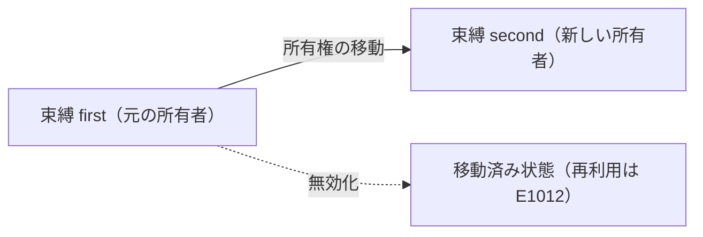

# 所有権とムーブ

Tsuzuri はガベージコレクタ（GC）や暗黙の参照カウントを持たず、コンパイル時のアフィン所有権（affine ownership）によってメモリの寿命を決定論的に管理します。すべての所有値は常にただ1つの束縛によって所有され、その所有者がスコープを抜けた瞬間にコンパイラが挿入した解放処理が実行されます。値を別の束縛や所有権を要求する引数へ渡すと所有権が移動（ムーブ）し、移動元の束縛を再び使用しようとするとコンパイルエラー `E1012` として静的に検出されます。

## 要点

- すべての所有値には単一の所有者があり、所有者がスコープを抜けると自動的に解放される（`free` や `delete` の手動呼び出しは不要）。
- `string` や `Vec<T>` などの非 `Copy` 型は、変数束縛・`own` 引数渡し・戻り値返却・データ構造への格納によって所有権がムーブし、元の変数は無効化される（再利用は `E1012`）。
- プリミティブ数値や共有参照 `ref T` などの `Copy` 型は代入時に自動複製される。`Copy` 要素からなる配列 `[T]` や連結リスト `[|T|]` の複製は要素全体のディープコピーを伴い、`--warn implicit-copy`（`W1006`）で検出できる。
- Edition 2027 以降（既定の Edition 2028 を含む）では、通常の `def` の無印引数は `pure def` と同様に既定で共有借用渡しとなり、所有権を受け取る引数には `own T`、排他借用には `mut T`（または `ref mut T`）を明記する。
- コンパイラの最終使用解析により、後続の読み取りがない `Copy` コレクションの再束縛や `match` 分解では暗黙コピーが省略されムーブに置き換わる。

## アフィン所有権の設計理由

メモリ安全性を実現する代表的な手法には、実行時に到達可能性を走査するガベージコレクション（GC）と、ポインタ操作のたびにカウンタを増減する自動参照カウント（ARC）があります。しかし GC は一時停止（ストップ・ザ・ワールド）やメモリオーバーヘッドを伴い、全面的な参照カウントはアトミック加算・減算のコストや循環参照によるリークを招きます。

Tsuzuri は「値を複製するか、唯一の所有者を移動するか」の二択で資源を扱うアフィン所有権を採用しています。

- **予測可能な解放タイミング**: ランタイムにコレクタは存在せず、値がどの行で破棄されるかはソースコードのレキシカルスコープから一意に定まります。
- **参照カウントの局所化**: 複数所有者による共有が必要な場面に限り、標準ライブラリの [`Rc` / `Arc`](../stdlib/memory/rc.md) を用いて `Rc.share` / `Arc.share` で明示的に所有者を増やします。共有中の値は不変であるため、`Rc` / `Arc` 単体で循環参照が生じることはありません。グラフなどの循環構造には世代付きハンドルで管理する [`Arena`](../stdlib/memory/arena.md) を使用します。
- **二重解放とダングリング参照の排除**: 所有権を手放した変数の再利用や解放済みメモリへのアクセスは、実行時ではなく型・所有権検査の段階で拒否されます。

## 所有者とスコープ終了時の自動解放

変数の束縛（`let` / `let mut` / `use`）は、束縛された値の所有者となります。所有者が別の場所へ値をムーブしないままブロックの終端に到達すると、その値が保持するヒープバッファや関連資源はその場で1回だけ解放されます。

```tsuzuri run=hello%2C%20tsuzuri
def make_greeting :: unit -> string = \() ->
    let prefix = "hello"
    let message = $"{prefix}, tsuzuri"
    message

make_greeting ()
```

この例では、`prefix` と `message` がそれぞれ文字列バッファを所有します。関数の末尾で `message` を返却すると、`message` の所有権は呼び出し元へムーブして生き続けます。一方、関数外へ出ない `prefix` は `make_greeting` のスコープを抜ける時点で即座に解放されます。

## ムーブの意味論とムーブ後使用エラー（`E1012`）

非 `Copy` 型の値を別の束縛へ渡すと所有権が移動し、元の束縛は未初期化（移動済み）状態になります。

```tsuzuri run=7
let first = "tsuzuri"
let second = first
second.length
```



所有権のムーブが発生する主な操作は次のとおりです。

1. **ローカル変数への束縛・再代入**: `let b = a` または `b = a`
2. **所有権を要求する仮引数への受け渡し**: `own T` 引数（および Edition 2026 における無印の非 `Copy` 引数）への適用
3. **関数・ブロックからの返却**: `return a` またはブロック末尾の結果式
4. **複合データや並行実行単位への格納**: レコード・タプル・共用体・配列リテラルの要素としての構築、および `tzroutine { ... }` や `Owned.function` への変数捕捉

なお、何度でも呼び出せる通常のラムダ式（関数値）は `Copy` 型であるため、非 `Copy` 値を環境へ捕捉しようとすると `E1005` となります。所有値を捕捉して1回または複数回呼び出す関数値が必要な場合は [`Owned.function`](../stdlib/memory/owned.md) を使用します。

### 基本的なムーブ後使用

ムーブ済みの束縛を後続の式で読み取ろうとすると、コンパイラは `E1012` を報告します。診断出力には、ムーブが発生した位置（`note: value moved here`）と対処方法（`help:`）が併記されます。

```text
let first = "data"
let second = first
first.length
```

このコードに対する診断出力は次のとおりです（終了コード `1`）。

```text
./Main.tz:3:1: error[E1012]: use of moved or partially moved value 'first'
  3 | first.length
    | ^
  note: value moved here
    --> ./Main.tz:2:14
  2 | let second = first
    |              ^
  help: borrow the value with 'ref first' or move it last
```

### 分岐合流とループ反復でのムーブ検査

所有権の状態は制御フローグラフに沿って静的に追跡されます。`if` や `match` の一部の分岐でのみ値をムーブした場合でも、合流地点以降では「ムーブ済みであり得る」と判定され、再代入しない限り使用できません。

```text
let label = "sample"
if false then
    let _taken = label
    ()
else
    ()
label.length
```

上記のコードは `else` 側を通る実行経路であっても、合流後の `label.length` で `E1012` となります。両方の分岐でムーブした場合はソース上で後方に位置するムーブ箇所がノートに示されます。

同様に、`while` や `for` ループの本体内でループ外の非 `Copy` 変数を再初期化なしにムーブすると、次の反復で再び同じ変数をムーブしようとした時点で `E1012`（`note: value moved here, in the previous iteration of the loop`）が報告されます。

```text
let token = "secret"
for _i in 0 ..< 2 do
    let _consumed = token
```

### 部分ムーブとレコードの消費更新

[`Drop`](drop.md) を実装していないレコードから非 `Copy` フィールドを個別に取り出すと、そのフィールドだけの所有権が移動します。これを**部分ムーブ**（partial move）と呼びます。

```tsuzuri run=order%3A%203
record Order { title: string, quantity: i64 }

let order = Order { title: "order", quantity: 3 }
let title = order.title
$"{title}: {order.quantity}"
```

`order.title` をムーブしたあとでも、残っている未移動フィールド（`order.quantity`）は引き続き読み取れます。しかし、一部でもムーブしたレコード全体 `order` を別の変数へ代入したり関数へ渡したりすると `E1012`（`note: part of the value moved here`）となります。また、部分ムーブ済みのフィールドに後から値を代入して再初期化することもできません。

レコード更新構文 `{ record with field = expr }` は新しいレコードを構築する式であり、元のレコードが非 `Copy` フィールドを含む場合は元のレコード全体を**消費（ムーブ）**します。

```tsuzuri run=Tokyo%202
record Location { city: string, floor: i64 }

let first = Location { city: "Tokyo", floor: 1 }
let second = { first with floor = 2 }
$"{second.city} {second.floor}"
```

非 `Copy` レコードの更新後に元の `first` を参照したり、更新式の内部（`{ first with floor = first.city.length }`）で元の束縛を重ねて参照したりすると `E1012` になります。全フィールドが `Copy` であるレコードでは元の束縛は消費されず、更新後も利用できます。

一方で、配列 `[T]`・連結リスト `[|T|]`・共有参照 `ref T` の背後から非 `Copy` 要素だけを抜き出してムーブすることはできません（`E1012: cannot move a non-Copy element out of an array or list; borrow the element instead`）。要素を参照したい場合は [`ref items[0]`](borrowing.md) のように借用します。

## `Copy` 型とディープコピー警告（`W1006`）

複製しても所有権の一意性や外部資源の整合性を損なわない型は、組み込み型クラス `Copy` のインスタンスになります。`Copy` 型の値は代入や引数渡しで所有権を失わず、自動的に複製されます。Rust の `#[derive(Copy)]` のような明示宣言は不要であり、型の構造からコンパイラが自動判定します。

### `Copy` 判定一覧

| 分類 | 対象となる型 | `Copy` 判定と複製の性質 |
| --- | --- | --- |
| スカラー・文字型 | `bool`、`unit`、全整数型（`i64` 等）、全浮動小数点・十進型（`f64`、`d128` 等）、SIMD ベクトル、`char`、`utf8char` | 常に `Copy`（レジスタまたはスタック上のビットコピー） |
| 共有参照・静的関数ポインタ | `ref T`、`FnPtr<...>` | 常に `Copy`（参照先ではなくポインタ・記述子自体を複製） |
| 通常の関数値 | `'a -> 'b`（ラムダ式・部分適用） | 常に `Copy`（捕捉環境がある場合は環境の複製を伴う） |
| 値集約型 | タプル、レコード、固定長配列 `[T; N]`、非再帰 `union` | すべての構成要素が `Copy` かつ利用者定義の `Drop` を持たない場合に限り `Copy`（`[T; N]` はインラインコピー） |
| 可変長列 | 配列 `[T]`、連結リスト `[|T|]` | 要素型 `T` が `Copy` の場合に限り `Copy`（**要素数 $O(n)$ のヒープ確保とディープコピーを伴う**） |
| 文字列型 | `string`、`utf8string` | 非 `Copy`（ムーブ対象。明示複製は `clone_string` 等を使用） |
| 標準コレクション・同期型 | `Vec<T>`、`Map<K, V>`、`Set<T>`、`HashMap<K, V>`、`HashSet<T>`、`Seq<T>`、`Channel<T>`、`Mutex<T>` 等 | 要素型にかかわらず常に非 `Copy` |
| 排他参照・可変スライス | `ref mut T`、`ref mut [T..]` | 一意性保証のため常に非 `Copy` |
| 再帰型・資源所有型 | 再帰 `union`、`Drop` 実装型、`Rc<T>` / `Arc<T>`、`Owned.Function` | 常に非 `Copy`（`Rc` / `Arc` は `.share` で明示共有） |

ジェネリック関数で型変数 `'a` の値を複数回複製する場合は、型クラス制約 `Copy<'a>` を付与します。

```tsuzuri run=14
def duplicate :: Copy<'a> => own 'a -> ('a * 'a) = \x -> (x, x)

match duplicate 7 with
| (a, b) -> a + b
```

### コレクションのディープコピーと `--warn implicit-copy`（`W1006`）

`[i64]` や `[|f64|]` のように要素が `Copy` の配列・連結リストは値セマンティクスを保つため `Copy` として振る舞いますが、元の変数が後続でも使われる箇所では新しいバッファを確保して全要素を複製するディープコピーが発生します。`dyn` 型値の暗黙複製も同様です。

意図しない $O(n)$ コピーを検出するには、コンパイラオプション `--warn implicit-copy` を指定します。

```sh
tsuzuri check --warn implicit-copy Main.tz
```

暗黙のディープコピーが発生する箇所に対して警告 `W1006` が出力されます。

```text
warning[W1006]: implicit copy of an array allocates and copies every element; borrow it with 'ref', or call 'Array.copy' to make the copy explicit
```

複製が本当に必要な箇所では `Array.copy` または `List.copy` を呼び出して意図を明示します。これにより `W1006` は抑止されます。また、関数定義に [`@no_copy` 属性](../expressions/contracts-and-attributes.md)を付与すると、その関数および呼び出し先で暗黙のディープコピーが一切発生しないことをコンパイルエラー（`E1031`）として強制できます。

```tsuzuri run=6
let original = [1, 2, 3]
let cloned = Array.copy (ref original)
original.length + cloned.length
```

## Edition 2027 / 2028 の関数引数規約

Edition 2027 以降（既定の Edition 2028 を含む）では、値を消費せずに読み取るだけの関数で毎回 `ref` を書かずに済むよう、通常の `def` の引数規約が [`pure def`](../expressions/functions.md) と統一されています。

| シグネチャの書き方 | Edition 2027 / 2028（`def`・`pure def`） | Edition 2026（通常の `def`） | 主な用途 |
| --- | --- | --- | --- |
| `T`（無印の非 `Copy` 型・裸の型変数 `'a`・関数型） | **共有借用渡し**（`ref T` 相当の読み取りビュー） | 所有権のムーブ（`pure def` のみ共有借用） | 値を消費せず読み取る標準の関数引数 |
| `T`（数値・`bool` 等の解放不要な `Copy` 型） | **値渡し**（複製） | 値渡し（複製） | 軽量なスカラー計算 |
| `own T` | **所有権のムーブ**（`Copy` なら必要に応じ複製） | 所有権のムーブ | 値を消費・変換・構造体へ格納する関数 |
| `mut T` | **排他借用渡し**（`ref mut T` ABI + 値ビュー、`pure def` では不可） | 非対応（`ref mut T` を使用） | 呼び出し元の可変変数をその場で更新する関数 |
| `ref T` / `ref mut T` | 明示どおりの共有参照 / 排他参照 | 明示どおりの共有参照 / 排他参照 | リージョン指定 `{r}`、コールバック型、戻り値型 |

```tsuzuri run=12
def combined_length :: string -> string -> i64 = \left right ->
    left.length + right.length

def into_tagged :: own string -> string = \text ->
    $"[{text}]"

def add_step :: i64 -> mut i64 -> unit = \step counter ->
    counter = counter + step

let a = "hello"
let b = "world!"
let mut total = combined_length a b
add_step (into_tagged a).length total
total - b.length
```

この例では、`combined_length a b` の呼び出しで `a` と `b` は共有借用されるため呼び出し後も生き続けます。続く `into_tagged a` は仮引数が `own string` であるため `a` の所有権をムーブして消費します。`add_step` の第2引数 `mut i64` は排他借用を受け取り、`deref` を書かずに通常の変数と同じ記法で呼び出し元の `total` を更新します。

なお、`mut T` はトップレベル `def` の仮引数全体に対してのみ記述でき、戻り値型やコールバック関数の引数型（`(ref mut T -> unit) -> unit` など）には明示的な `ref mut T` を使用します。また、`pure def` における `own T` は参照・`Rc`/`Arc`・外部ハンドル・関数値・利用者定義 `Drop` を含まない平坦なデータ型に限定されます（違反は `E1029`）。

## 最終使用と `match` 分解におけるコピー省略最適化

`Copy` 要素を持つ配列 `[T]` や連結リスト `[|T|]` であっても、コンパイラがその束縛に対する**最終使用**（後続のどの実行経路でも再び読み取られない位置）であることを静的に証明できる場合、ヒープ確保を伴うディープコピーを省略して所有バッファのムーブへと置き換えます。この位置では `--warn implicit-copy` の `W1006` も発生しません。

- **ループ内での関数的更新**: `xs = Array.update_at i v xs` のように右辺が `xs` の最終使用となる再束縛では、一意所有バッファのムーブとして処理されます。
- **分岐末尾での返却・受け渡し**: `if` や `match` の各アーム末尾でローカル配列を返す場合もコピーは発生しません。
- **`match` 分解でのムーブ取り出し**: `match` の対象式が一時値または以降使用されない所有ローカル変数である場合、パターン束縛された `Copy` 配列・リストもコピーせずムーブします（`when` ガードがある場合はガード成立後に取り出します）。

```tsuzuri run=19
@no_copy
def update_diagonal :: own [i64] -> [i64] = \mut xs ->
    for i in 0 ..< xs.length do
        xs = Array.update_at i (xs[i] + i * 5) xs
    xs

let result = update_diagonal [1, 2, 3, 4]
result[3]
```

`@no_copy` が通過していることからも分かるとおり、`xs = Array.update_at ... xs` では要素配列の暗黙コピーは一切行われません。ただし、既存の借用・スライスが残っている変数、`for ... in` で走査中のコレクション、`as` パターン等で束縛領域が重なる場合、参照やリストの tail を経由する射影、および利用者定義の `Drop` 型を経由する射影では、意味論と安全性を保つためコピーが維持されます。

## 関連項目

- [借用と参照](borrowing.md)
- [ライフタイムとリージョン](lifetimes.md)
- [メモリレイアウトとアロケータ](memory-layout.md)
- [Drop とリソース解放](drop.md)
- [関数](../expressions/functions.md)
- [契約と属性](../expressions/contracts-and-attributes.md)
- [レコード](../types/records.md)
- [Rc と Arc](../stdlib/memory/rc.md)
- [Arena](../stdlib/memory/arena.md)
- [Owned](../stdlib/memory/owned.md)
