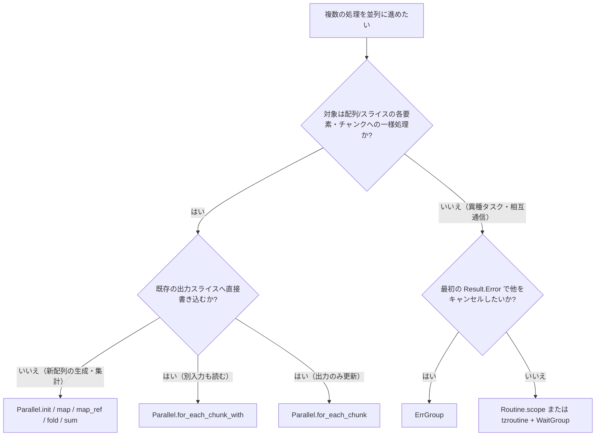

# Parallel

`Parallel` は、配列の初期化・要素変換・畳み込み・および排他スライスへのチャンク分割書き込みを、ハードウェア非依存の決定論的なチャンク境界で実行する同期データ並列モジュールです。呼び出し元へ制御が戻った時点ですべてのチャンクの計算が完了しており、出力配列の要素順は常に入力インデックス順に保たれます。

`Parallel` は常時利用可能な標準モジュールです。異種タスクの待ち合わせには [`Routine.scope`](./routine.md) や [`WaitGroup`](./waitgroup.md)、エラーによる早期中断を伴うタスク群には [`ErrGroup`](./errgroup.md) を使い分けます。

## 要点

- コンパイラ組み込みの並列プリミティブ（`init`・`map`・`map_ref`・`reduce`・`for_each_chunk`・`for_each_chunk_with`）は全引数をその場で渡す直接完全適用が必須であり、部分適用や関数値化は `E1013` となる。
- チャンク分割境界は論理 CPU 数や実行ターゲットに依存せず入力長のみで一意に定まるため、`reduce` を含むすべての演算がネイティブと WebAssembly で決定論的に再現される。
- 非 `Copy` 要素やコピーコストの大きい要素の変換には共有借用で渡す `Parallel.map_ref` を用いる。
- `Parallel.for_each_chunk_with` は読み取り専用の共有コンテキスト（複数配列の借用タプルや `Tensor.View`・`MatrixView` を含む）を追加のヒープ確保ゼロで全チャンクへ共有しながら、重複しない排他スライスへ直接書き込む。
- `Parallel.fold` は `Monoid` 法則（結合律・単位元）の下で逐次版 `Array.fold_monoid` とビット単位で一致する結果を返す（浮動小数点を含む型の `Monoid` は `E1039` で静的に除外される）。

## 生成・要素変換（`init` / `map` / `map_ref`）

`Parallel.init n f` は長さ `n` の配列をインデックス関数 `f` で並列生成します（`n < 0` はトラップ、`n == 0` なら `f` を呼ばずに空配列を返します）。

要素変換には値を複製してコールバックへ渡す `Parallel.map` と、要素を共有借用 `ref 'a` のまま渡す `Parallel.map_ref` があります。`string` やレコードなどの非 `Copy` 型、あるいは深いコピーを伴う要素配列には `Parallel.map_ref` を使用します。

```tsuzuri run=doubled_sum%3D570%20lengths_sum%3D17
let squares = Parallel.init 10 (\i -> i * i)
let doubled = Parallel.map (\x -> x * 2) (ref squares)
let words = ["parallel", "chunk", "simd"]
let lengths = Parallel.map_ref String.length (ref words)
$"doubled_sum={Parallel.sum (ref doubled)} lengths_sum={Array.sum (ref lengths)}"
```

## 排他スライスの分割更新（`for_each_chunk` / `for_each_chunk_with`）

既存の出力バッファをインプレースで並列更新したい場合は、配列（またはスライス）を先頭から `size` 要素ずつの互いに素な排他スライス `ref mut ['a..]` に分割する `for_each_chunk` 系 API を使用します（`size <= 0` はトラップ、末尾チャンクのみ端数長になります）。各コールバックには「そのチャンクの先頭インデックス `start`」と「チャンク自身の排他スライス `chunk`」が渡されるため、ロックなしで安全に `Array.write` 等を行えます。

### `Parallel.for_each_chunk`：単一バッファの分割書き込み

```tsuzuri run=56
def fill_scaled :: i64 -> ref mut [i64..] -> unit
fn fill_scaled start chunk =
    for i in 0i64 ..< chunk.length do
        Array.write i ((start + i) * 2) chunk

let mut buf = new [i64](8, \_i -> 0)
Parallel.for_each_chunk 3 fill_scaled (ref mut buf)
Array.sum (ref buf)
```

### `Parallel.for_each_chunk_with`：読み取り借用を伴うゼロコピー分割書き込み

`Parallel.for_each_chunk` のコールバックは外部の借用 `ref` を直接捕捉できないため（`E1013`）、1 つ以上の入力配列や [`MatrixView`](../numeric/matrix-view.md)・[`Tensor.View`](../numeric/tensor.md) を参照しながら出力スライスへ書き込むカーネル（行列積やテンソル演算など）には **`Parallel.for_each_chunk_with`** を使用します。

第2引数 `shared` に `ref 's` を渡すと、入力のコピーやクロージャスナップショットのヒープ確保を一切行わずに全チャンクから読み取れます。複数の入力を共有する場合は `let inputs = (ref a, ref b)` のようにローカル束縛へまとめてから `(ref inputs)` を渡します。

```tsuzuri run=fused_sum%3D188%20pure_ok%3Dtrue
pure def saxpy_parallel :: f64 -> ref [f64] -> ref [f64] -> [f64]
fn saxpy_parallel alpha x y =
    let n = x.length
    let mut out = new [f64](n, \_i -> 0.0)
    let inputs = (alpha, x, y)
    Parallel.for_each_chunk_with 4 (ref inputs) (\ctx start chunk ->
        match deref ctx with
        | (a, lx, ry) ->
            for i in 0i64 ..< chunk.length do
                let idx = start + i
                Array.write i (a * lx[idx] + ry[idx]) chunk) (ref mut out)
    out

let xs = [1.0, 2.0, 3.0, 4.0, 5.0, 6.0, 7.0, 8.0]
let ys = [10.0, 10.0, 10.0, 10.0, 10.0, 10.0, 10.0, 10.0]
let res = saxpy_parallel 3.0 (ref xs) (ref ys)
let total = Array.fold (\acc v -> acc + v) 0.0 (ref res)
$"fused_sum={total as i64} pure_ok={res[7] == 34.0}"
```

- **エイリアシングの静的排除**: `shared` に含まれる借用元と出力対象 `values` が同一の配列を指している場合（タプルや `Tensor.View` 経由を含む）、共有借用と排他借用の競合としてコンパイル時に `E1014` で拒否されます。
- **`pure def` 内での利用**: コールバックが純粋であれば、`Parallel.for_each_chunk_with`（および他の閉じたデータ並列操作）は `pure def` の内部でも使用できます（コールバックが副作用を持つ場合は `E1029`）。

## 決定論的チャンク境界とリダクション（`reduce` / `sum` / `fold`）

### チャンク分割の算術規則

`init`・`map`・`map_ref`・`reduce`・`sum`・`fold` におけるチャンク数 $k$ は、入力長 $n$（$n > 0$）に対してハードウェアに依存せず次式で決定されます（$n = 0$ のときは $k = 0$）。

$$k = \min\left(1024,\ \lceil n / 4096 \rceil\right)$$

チャンク番号 $c$（$0 \le c < k$）は半開区間 $[\lfloor(n \cdot c)/k\rfloor,\ \lfloor(n \cdot (c + 1))/k\rfloor)$ を担当します（実装は整数オーバーフローを起こさない $(n / k) \cdot c + ((n \bmod k) \cdot c) / k$ で計算します）。$n < 4096$ の配列は常に 1 チャンクとなり、単一タスク上で先頭から順に処理されます。また `for_each_chunk` / `for_each_chunk_with` でも並列ジョブ数は最大 1024 個に抑えられ、チャンク数が 1024 を超える場合は各ジョブが連続チャンクを順次処理します。

### `reduce`・`sum`・`fold` と逐次結果との一致条件

`Parallel.reduce zero combine values` は、各チャンク内で `zero` のコピーを初期値として昇順に畳み込み、最後に全チャンクの部分結果を再び `zero` からチャンク番号順に `combine` で結合します。

```tsuzuri run=int_same%3Dtrue%20monoid_val%3D55%20f64_differs%3Dtrue
let ints = new [i64](8193, \i -> (i * 7919 + 13) % 1009)
let int_same = Array.sum (ref ints) == Parallel.sum (ref ints)

let monoid_items = new [Monoids.Sum<i64>](10, \i -> Monoids.Sum { value: i + 1 })
let folded = Parallel.fold (ref monoid_items)

let floats = new [f64](8193, \i -> (((i * 7919 + 13) % 1009) as f64) / 10.0 + 0.1)
let f64_differs = Array.sum (ref floats) != Parallel.sum (ref floats)

$"int_same={int_same} monoid_val={folded.value} f64_differs={f64_differs}"
```

| 関数 | 逐次 API との一致保証 | 条件・注意点 |
| --- | --- | --- |
| `Parallel.fold` | `Array.fold_monoid` とビット単位で完全一致 | `Monoid` の結合律・単位元則および純粋性が成立すること（浮動小数点を含む型は `E1039` で禁止） |
| `Parallel.sum`（整数） | `Array.sum` と完全一致 | 2 の補数整数加算は結合律を満たすためチャンク境界に不変 |
| `Parallel.sum`（浮動小数点） | 実行ごとに決定的だが `Array.sum` とは異なりうる | IEEE 754 加算は非結合的（`fast-math` は不使用。高精度総和は `Math` / `Array.sum_pairwise` 等を参照） |
| `Parallel.reduce` | 実行ごとに決定的 | `zero` が単位元かつ `combine` が結合的なら `fold` と同一、非結合的ならチャンク木に依存 |
| `init` / `map` / `map_ref` / `for_each_chunk*` | 対応する逐次処理と完全一致 | コールバックが純粋であること |

なお、`tsuzuri check PATH --report parallel` を実行すると、コードベース内の `Array.map`・`Array.mapr`・`Array.fold_monoid`・整数 `Array.sum` のうち並列化可能な候補の検出と、既存 `Parallel.*` コールバックの純粋性検証レポートを確認できます。

## 他の並行プリミティブとの選択指針



- **コールバック内での相互待機に関する注意**: `Parallel` では同一チャンク内の要素が 1 つの実行フローで順次処理されるため、ある要素のコールバックが別要素のコールバックからのチャネル送信を待つような処理は完了しません。タスク間で相互通信を行う場合は子ごとに独立した `tzroutine` を持つ [`Routine.scope`](./routine.md) を使用します。
- **環境所有権の証明**: コールバック、入力配列内の関数要素、および `for_each_chunk_with` の `shared` 内に含まれる関数値は、外部の借用を持たない所有環境であることが静的に証明できなければなりません（未知の関数値や借用捕捉クロージャは `E1013`）。またコールバックへ `Atomic` や `Mutex` を値捕捉することは `E1005` になります。

## ランタイム実行モデルと WebAssembly 対応

- **ネイティブ環境**: `tzroutine` スケジューラ上で呼び出し元タスクと最大 $P$ 個（`P = Routine.max_procs ()`、`TSUZURI_MAXPROCS` で指定可能）のヘルパー `tzroutine` がチャンクを動的に取得して並列実行します。入れ子の `Parallel.*` 呼び出しでもワーカースレッド枯渇によるデッドロックは発生しません。なお、[`Domain.run`](../core/domain.md) のトラップ隔離領域内および `--trap-mode return` のエクスポート呼び出し内では、トラップを確実に境界へ回収するためヘルパーを起動せず呼び出しスレッド上でチャンク順に逐次実行します。
- **WebAssembly 環境**:
  - **既定の構成（単一スレッドおよび `--wasm-feature jspi`）**: ネイティブと同一のチャンク分割順を保つインモジュール逐次実行となり、追加のホスト import は不要です。
  - **マルチスレッド構成（`--wasm-feature threads`）**: `tsuzuri build --target wasm32 --emit wasm --wasm-feature threads` でビルドすると共有メモリ上のワーカープールでチャンクを並列実行します（`check` / `run` サブコマンドでは `E2000`）。

## 引数の順序

`Parallel` モジュールは [引数の順序](../conventions.md) の原則に従い、読み取りまたは更新の対象となる**配列・スライスを常に最後の引数**に取ります（`Parallel.map f (ref xs)`、`Parallel.for_each_chunk_with size (ref shared) body (ref mut out)`）。対象コレクションを持たない `Parallel.init` は長さと初期化関数の順に受け取ります。なお、コンパイラ組み込みの 6 関数は直接完全適用が必須ですが、`std/Parallel.tz` で定義された `Parallel.sum` と `Parallel.fold` は `xs |> Parallel.sum` のようにパイプラインでも渡せます。

## API リファレンス

`Parallel` モジュールの全 8 公開関数（コンパイラ組み込み関数 6 個＋標準ライブラリ定義関数 2 個）の一覧です。

### 生成・変換

| 関数 | 型シグネチャ | 説明 |
| --- | --- | --- |
| `Parallel.init` | `Send<'a> => i64 -> (i64 -> 'a) -> ['a]` | 長さとインデックス関数から新しい配列をチャンク並列に生成する（直接適用必須） |
| `Parallel.map` | `(Copy<'a>, Send<'a>, Send<'b>) => ('a -> 'b) -> ref ['a] -> ['b]` | 各要素を複製して関数へ渡し、変換結果の配列を生成する（直接適用必須） |
| `Parallel.map_ref` | `(Send<'a>, Send<'b>) => (ref 'a -> 'b) -> ref ['a] -> ['b]` | 各要素を共有借用のまま関数へ渡し、変換結果の配列を生成する（直接適用必須） |

### 集計・畳み込み

| 関数 | 型シグネチャ | 説明 |
| --- | --- | --- |
| `Parallel.reduce` | `(Copy<'a>, Send<'a>) => 'a -> ('a -> 'a -> 'a) -> ref ['a] -> 'a` | 単位元の複製から各チャンクを畳み込み、部分結果をチャンク順に結合する（直接適用必須） |
| `Parallel.sum` | `(Numeric<'a>, Add<'a>, Copy<'a>, Send<'a>) => ref ['a] -> 'a` | `0` を起点として `Parallel.reduce` で要素の総和を求める |
| `Parallel.fold` | `(Monoid<'m>, Copy<'m>, Send<'m>) => ref ['m] -> 'm` | `Monoid.empty ()` と `Monoid.combine` を用いてチャンク並列に畳み込む |

### 排他スライスのチャンク分割更新

| 関数 | 型シグネチャ | 説明 |
| --- | --- | --- |
| `Parallel.for_each_chunk` | `Send<'a> => i64 -> (i64 -> ref mut ['a..] -> unit) -> ref mut ['a..] -> unit` | 出力スライスを `size` 要素ずつの排他チャンクに分け、`(開始添字, チャンク)` で更新する（直接適用必須） |
| `Parallel.for_each_chunk_with` | `(Sync<'s>, Send<'a>) => i64 -> ref 's -> (ref 's -> i64 -> ref mut ['a..] -> unit) -> ref mut ['a..] -> unit` | 読み取り専用の共有借用 `ref 's` をコピーなしで全チャンクへ渡しながら排他チャンクを更新する（直接適用必須） |

## 関連項目

- [Routine](./routine.md)
- [ErrGroup](./errgroup.md)
- [Array](../collections/array.md)
- [Monoid](../core/monoid.md)
- [Domain](../core/domain.md)
- [Matrix](../numeric/matrix.md)
- [Tensor](../numeric/tensor.md)
- [Simd](../numeric/simd.md)
- [Math](../numeric/math.md)
- [引数の順序](../conventions.md)
- [CLI コマンドリファレンス](../../compiler/cli.md)
- [WebAssembly 出力](../../compiler/webassembly.md)
