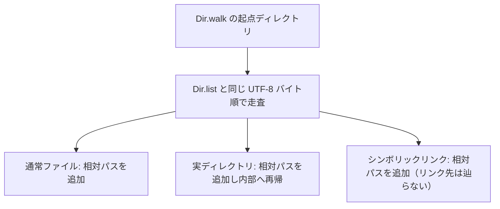

# Dir

`Dir` は、ディレクトリの作成・空ディレクトリの削除・エントリ列挙・再帰走査を提供する標準モジュールです。すべての操作は遅延アクション `IO<Result<'a, Os.Error>>` を返し、実行されるまでシステムコールを発行しません。OS を伴わない純粋なパス文字列操作は [`Path`](./path.md) モジュールが担います。

すべての関数にパッケージ権限 `fs` が必要です。権限の宣言と検査の詳細は [パッケージ管理](../../modules/packages.md) を参照してください。

## 要点

- `Dir.create` は 1 階層のみディレクトリを作成します（親ディレクトリが存在しない場合は `NotFound`）。
- `Dir.remove` は空のディレクトリのみを削除します（中身が残っている場合は `Other`）。
- `Dir.list` は `.` と `..` を除外し、ファイルシステムに依存しない決定論的な **UTF-8 バイト順**でエントリ名を返します。
- `Dir.walk` は起点からの `/` 区切りの相対パスを深さ優先の行きがけ順（ディレクトリ直後にその配下）で返します。
- シンボリックリンクは `list`・`walk` ともにエントリ名として列挙されますが、`walk` はリンク先へ再帰しないため循環リンクでも無限ループになりません。

## ディレクトリの作成・列挙・走査・削除

パスの `string` は所有権をムーブするため、同じ基準パスを繰り返し渡す際は `$"..."` 補間などで新しい文字列を作ります。また、返却された `[string]` 配列の要素は非 `Copy` であるため、表示や結合には `String.join` のような借用ベースの関数を使います。

```tsuzuri run=ok%0Aalready-exists%0AZ.txt,a,b.txt%0AZ.txt,a,a/x.txt,b.txt%0Aother%0Anot-found%0Aok
def format_names :: own Result<[string], Os.Error> -> string
fn format_names result =
    match result with
    | Result.Ok names -> String.join "," names
    | Result.Error error -> Os.message error

def format_status :: own Result<unit, Os.Error> -> string
fn format_status result =
    match result with
    | Result.Ok _ -> "ok"
    | Result.Error error ->
        match error.kind with
        | Os.AlreadyExists -> "already-exists"
        | Os.NotFound -> "not-found"
        | Os.Other -> "other"
        | _ -> Os.message error

def main :: unit -> i32 = \() ->
    let root = "_tsuzuri_ref_dir"
    let! _ = File.remove $"{root}/a/x.txt"
    let! _ = File.remove $"{root}/Z.txt"
    let! _ = File.remove $"{root}/b.txt"
    let! _ = Dir.remove $"{root}/a"
    let! _ = Dir.remove $"{root}"
    let! created = Dir.create $"{root}"
    do! IO.writeln (format_status created)
    let! duplicate = Dir.create $"{root}"
    do! IO.writeln (format_status duplicate)
    let! _ = Dir.create $"{root}/a"
    let! _ = File.write_text $"{root}/Z.txt" "z"
    let! _ = File.write_text $"{root}/a/x.txt" "x"
    let! _ = File.write_text $"{root}/b.txt" "b"
    let! listed = Dir.list $"{root}"
    do! IO.writeln (format_names listed)
    let! walked = Dir.walk $"{root}"
    do! IO.writeln (format_names walked)
    let! non_empty = Dir.remove $"{root}"
    do! IO.writeln (format_status non_empty)
    let! missing_parent = Dir.create "_tsuzuri_ref_dir_missing_parent/child"
    do! IO.writeln (format_status missing_parent)
    let! _ = File.remove $"{root}/a/x.txt"
    let! _ = File.remove $"{root}/Z.txt"
    let! _ = File.remove $"{root}/b.txt"
    let! _ = Dir.remove $"{root}/a"
    let! removed = Dir.remove $"{root}"
    do! IO.writeln (format_status removed)
    0
```

### 並び順と走査規則

- **UTF-8 バイト順ソート**: `Dir.list` は OS が返す生の順序やロケール規則を使わず、UTF-8 バイト列の辞書順に整列して返します（ASCII 大文字 `'Z'` = `0x5A` は小文字 `'a'` = `0x61` より先になります）。なお、`string` 型の標準比較（UTF-16 コード単位順）とはサロゲートペア領域と BMP 高位文字（`U+E000`〜`U+FFFF`）の前後関係が異なる点に注意してください。
- **`Dir.walk` の構造**: 各ディレクトリ内で `Dir.list` と同じ順序でエントリを辿り、エントリ自身を出力した直後に、それが実ディレクトリであれば再帰的に配下を列挙します。区切り文字は OS によらず常に `/` です。



## エラー分類とシンボリックリンクの扱い

| 失敗原因 | `Os.ErrorKind` |
| --- | --- |
| 対象ディレクトリが存在しない、`create` の親ディレクトリが存在しない | `NotFound` |
| 通常ファイルに対して `list` や `walk` を呼んだ（POSIX の `ENOTDIR`、Win32 の `ERROR_DIRECTORY` 相当） | `NotFound`（POSIX `ENOTDIR`）または `InvalidInput`（Win32 `ERROR_DIRECTORY`） |
| 読み取り・作成・削除の権限がない | `PermissionDenied` |
| 同名のファイルまたはディレクトリが既に存在する（`create`） | `AlreadyExists` |
| パスに NUL 文字を含む | `InvalidInput` |
| パスに孤立サロゲートを含む、またはディレクトリ内に不正な UTF-8 のエントリ名が 1 件でもある | `InvalidEncoding` |
| 空でないディレクトリに対して `remove` を呼んだ | `Other` |

- ディレクトリ内に妥当な UTF-8 でないファイル名が 1 つでも存在する場合、`list` / `walk` は部分的な配列を返さず呼び出し全体が `InvalidEncoding` となります。
- `walk` の途中で読み取り権限不足などのエラーが発生した場合も、そこまでの結果を捨ててその `Os.Error` を返します。
- シンボリックリンク自体を削除したい場合は `Dir.remove` ではなく [`File.remove`](./file.md) を使用します。

## 対応環境

- **ネイティブ（Linux・macOS・Windows）**: 5 環境すべてで動作します。Windows では Win32 API（UTF-16）で実装され、`Os.Error.code` には Win32 エラーコードが格納されます。
- **WebAssembly / WASI**: 既定の `wasm32` ターゲットでは `Dir` の関数に到達すると `E2000` でビルドが拒否されます。`--wasm-host wasi` 指定時は WASI preview1 の preopen ディレクトリを基準に動作します（[WebAssembly](../../compiler/webassembly.md)）。

## 引数の順序

`Dir` の公開関数はすべて単一引数（対象パス `path` のみ）を取るため、複数引数の順序選択はありません（[標準ライブラリの規約](../conventions.md)）。

## 公開 API

| 関数 | シグネチャ | 説明 |
| --- | --- | --- |
| `Dir.list` | `own string -> IO<Result<[string], Os.Error>>` | `.` と `..` を除く直下のエントリ名を UTF-8 バイト順で返す |
| `Dir.create` | `own string -> IO<Result<unit, Os.Error>>` | 単一階層のディレクトリを作成（親ディレクトリが必要） |
| `Dir.remove` | `own string -> IO<Result<unit, Os.Error>>` | 空のディレクトリを削除 |
| `Dir.walk` | `own string -> IO<Result<[string], Os.Error>>` | 配下の全エントリを `/` 区切りの相対パスで行きがけ順に返す |

## 関連項目

- [File](./file.md)
- [Path](./path.md)
- [Os](./os.md)
- [IO](./io.md)
- [標準ライブラリの規約](../conventions.md)
- [WebAssembly](../../compiler/webassembly.md)
