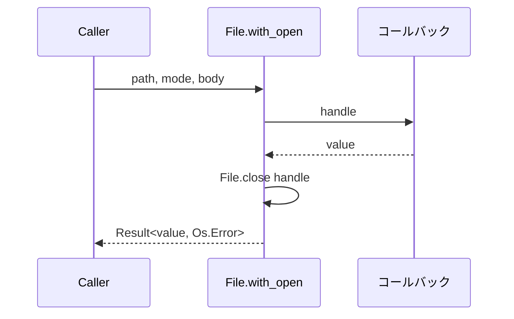

# File

`File` は、ファイルの読み書き・削除・メタデータ取得を提供する標準モジュールです。すべての操作は遅延アクション `IO<Result<'a, Os.Error>>` を返し、実行されるまでシステムコールを発行しません。失敗はトラップや例外ではなく [`Os.Error`](./os.md) の値として返されます。

すべての関数にパッケージ権限 `fs` が必要です。権限の宣言と検査の詳細は [パッケージ管理](../../modules/packages.md) を参照してください。

## 要点

- ファイル全体を一括で読み書きする関数（`read_text`・`write_bytes` など）と、`File.Handle` で部分的に読み書きする関数（`open`・`read`・`write` など）の 2 層で構成されます。
- オープンしたハンドルの確実なクローズには `File.with_open` を使用します（`File.Handle` は `Drop` を実装しないため、`use` 束縛では自動クローズされません）。
- `write_text` と `write_bytes` は既存ファイルを切り詰めてから書き込むため、原子的な置換ではありません。
- 事前チェック用の `exists` 関数は提供されません（TOCTOU 競合を避けるため、目的の操作を実行して `Result` で分岐します）。
- 既定の `wasm32` では到達時に `E2000` となり、`--wasm-host wasi` 指定時は WASI preview1 の preopen ディレクトリ経由で動作します。

## ファイル全体の一括読み書きと削除

相対パスは実行時点のカレントディレクトリを起点として OS が解決します。パスの `string` は `own string` として渡されるため、同じパス文字列を複数回使う場合は文字列補間 `$"..."` などで新しい所有文字列を渡します。

```tsuzuri run=hello%0Ahello%0Aworld%0Aremoved%0Anot-found
def show_text :: own Result<string, Os.Error> -> string
fn show_text result =
    match result with
    | Result.Ok text -> text
    | Result.Error error ->
        match error.kind with
        | Os.NotFound -> "not-found"
        | _ -> Os.message error

def main :: unit -> i32 = \() ->
    let path = "_tsuzuri_ref_file_note.txt"
    let! _ = File.remove $"{path}"
    let! _ = File.write_text $"{path}" "hello\n"
    let! first = File.read_text $"{path}"
    do! IO.write (show_text first)
    let! _ = File.append_text $"{path}" "world"
    let! both = File.read_text $"{path}"
    do! IO.writeln (show_text both)
    let! removed = File.remove $"{path}"
    do! IO.writeln (if Result.is_ok (ref removed) then "removed" else "failed")
    let! missing = File.read_text $"{path}"
    do! IO.writeln (show_text missing)
    0
```

- `File.write_text` / `File.write_bytes` はファイルが存在しなければ新規作成し、存在すれば長さ 0 に切り詰めてから書き込みます。書き込み途中で障害が発生した場合、部分的に書き込まれたファイルが残ります。
- `File.append_text` はファイルが存在しなければ作成し、存在すれば末尾へ UTF-8 バイト列を追記します。
- `File.remove` は通常ファイルまたはシンボリックリンク自身を削除します（リンク先のターゲットは削除しません）。ディレクトリの削除には [`Dir.remove`](./dir.md) を使用します。

## エンコーディング・BOM・メタデータ

`read_bytes` と `write_bytes` は任意のバイト列をそのまま扱います。一方、`read_text` はファイル全体を厳密な UTF-8 として検証し、不正なバイト列が 1 バイトでも含まれていれば部分文字列を返さず `InvalidEncoding` エラーを返します。先頭に UTF-8 BOM（`EF BB BF`、`U+FEFF`）がある場合は除去せず先頭文字として保持します。

`File.metadata` はシンボリックリンクを辿った先の情報を返し、`File.link_metadata` はリンク自身の情報を返します。

```text
union EntryKind = Regular | Directory | Symlink | Other
record Metadata { kind: EntryKind, size: i64, modified_ns: i64 }
```

- `EntryKind` の `Symlink` は `link_metadata` からのみ返されます（リンク切れのシンボリックリンクに対し、`metadata` は `NotFound`、`link_metadata` は `Symlink` を返します）。`Other` はデバイス・ソケット・名前付きパイプなどを表します。
- `size` はファイルのバイト数です（ディレクトリに対する値は OS 依存であり、配下ファイルの合計サイズではありません）。
- `modified_ns` は `1970-01-01T00:00:00Z` からの経過ナノ秒です。`i64` の範囲を超えるタイムスタンプは上下限に飽和丸めされます。

```tsuzuri run=true%202%0Ainvalid%20encoding%0A1%0Afile%201%0Aremoved
def main :: unit -> i32 = \() ->
    let path = "_tsuzuri_ref_file_bin.bin"
    let! _ = File.remove $"{path}"
    let! _ = File.write_bytes $"{path}" [239ubyte, 187ubyte, 191ubyte, 65ubyte]
    let! text = File.read_text $"{path}"
    do! IO.writeln (match text with
        | Result.Ok value -> $"{value[0] == 65279i16u} {value.length}"
        | Result.Error error -> Os.message error)
    let! _ = File.write_bytes $"{path}" [255ubyte]
    let! bad = File.read_text $"{path}"
    do! IO.writeln (match bad with
        | Result.Ok _ -> "unexpected"
        | Result.Error error -> Os.message error)
    let! raw = File.read_bytes $"{path}"
    do! IO.writeln (match raw with
        | Result.Ok data -> $"{data.length}"
        | Result.Error error -> Os.message error)
    let! meta = File.metadata $"{path}"
    do! IO.writeln (match meta with
        | Result.Ok info ->
            match info.kind with
            | File.Regular -> $"file {info.size}"
            | File.Directory -> "dir"
            | File.Symlink -> "link"
            | File.Other -> "other"
        | Result.Error error -> Os.message error)
    let! removed = File.remove $"{path}"
    do! IO.writeln (if Result.is_ok (ref removed) then "removed" else "failed")
    0
```

## ハンドル操作と自動クローズ

巨大なファイルをチャンク単位で処理する場合や、上書きを禁止して新規作成したい場合は、`File.Mode` を指定して `File.open` または `File.with_open` を使用します。

| モード | 動作 |
| --- | --- |
| `File.Read` | 既存ファイルを読み取り専用で開く（存在しなければ `NotFound`） |
| `File.Write` | ファイルを新規作成、または既存ファイルを切り詰めて書き込み用に開く |
| `File.Append` | ファイルを新規作成、または既存ファイルの末尾追記用に開く |
| `File.CreateNew` | ファイルが存在しない場合のみ新規作成して書き込み用に開く（存在すれば `AlreadyExists`） |

### `File.with_open` と `use` の違い

`File.Handle` は世代番号付きの不透明な `Copy` 値です。標準ライブラリの型は `Drop` 型クラスを実装せず（また `Drop` 実装型は `IO` の `let!` 継続をまたいで保持できないため）、**`use h = ...` 構文で `File.Handle` を束縛することはできません**（`E1005`）。ハンドルを放置したままスコープを抜けても自動では閉じられず、プロセス終了時まで OS ディスクリプタが保持されます。

スコープ終了時の確実なクローズには **`File.with_open`** を使用してください。`with_open` はファイルを開いてコールバックの `IO` アクションを実行し、コールバックの結果にかかわらず返却前に必ず `File.close` を実行します（クローズ自体が失敗した場合はその `Os.Error` が外側の `Error` として返されます）。

> **注意**: `with_open` のコールバック内部で手動の `File.close` を呼ばないでください。外側の自動クローズが二重クローズ（`InvalidInput`）となり、コールバックの戻り値が失われます。



```tsuzuri run=wrote%0Ahi%0Aalready-exists%0Aremoved
def main :: unit -> i32 = \() ->
    let path = "_tsuzuri_ref_file_stream.txt"
    let! _ = File.remove $"{path}"
    let! outcome = File.with_open $"{path}" File.Write (\handle ->
        File.write handle [104ubyte, 105ubyte])
    do! IO.writeln (match outcome with
        | Result.Ok (Result.Ok _) -> "wrote"
        | Result.Ok (Result.Error error) -> Os.message error
        | Result.Error error -> Os.message error)
    let! content = File.read_text $"{path}"
    do! IO.writeln (Result.default_value "?" content)
    let! exclusive = File.open $"{path}" File.CreateNew
    match exclusive with
    | Result.Ok handle ->
        let! _ = File.close handle
        do! IO.writeln "unexpected"
    | Result.Error error ->
        do! IO.writeln (match error.kind with
            | Os.AlreadyExists -> "already-exists"
            | _ -> Os.message error)
    let! removed = File.remove $"{path}"
    do! IO.writeln (if Result.is_ok (ref removed) then "removed" else "failed")
    0
```

### `read`・`write`・`flush`・`close` の契約

- `File.read handle count` は最大 `count` バイトを読み取ります。空配列 `[]` は EOF を表し、`count` 未満の非空配列は単発のシステムコールで得られた部分読み取り（EOF とは限らない）を表します。`count < 0` または `count > 2^30`（1 GiB 超）、および `Read` モード以外のハンドルは `InvalidInput` です。
- `File.write handle data` は `data` の全バイトを書き切るまでシステムコールを繰り返します。ランタイム内にユーザー空間バッファを持たないため、`write` が `Ok ()` を返した時点でデータは OS カーネルへ渡っています。`Read` モードのハンドルへの書き込みは `InvalidInput` です。
- `File.flush handle` はハンドルが有効なオープン状態であることを確認します（ランタイム側のバッファリングはありません）。
- `File.close handle` はハンドルを閉じます。OS がクローズ失敗を返した場合でもハンドルは無効化され、閉じたハンドルに対する再度の `read`・`write`・`flush`・`close` は他の新しいファイルと誤認されることなく確実に `InvalidInput` となります。

## エラー分類と対応環境

| 失敗原因 | `Os.ErrorKind` |
| --- | --- |
| ファイルまたは途中の親ディレクトリが存在しない | `NotFound` |
| アクセス権限不足、読み取り専用ファイルへの書き込み・削除、Windows の共有違反 | `PermissionDenied` |
| `CreateNew` 指定時に対象パスが既に存在する | `AlreadyExists` |
| ディレクトリをファイルとして開いた、パスに NUL を含む、閉じたハンドル、範囲外の `count` | `InvalidInput` |
| パスや書き込み文字列の孤立サロゲート、`read_text` での不正な UTF-8 | `InvalidEncoding` |
| ディスク容量不足や I/O 障害など上記以外の失敗 | `Other` |

- **Windows ネイティブ**: Win32 API（UTF-16）で動作し、`/` と `\` の両方を区切りとして受け付けます。UTF-16 で 248 コード単位以上のパスは自動的に絶対パス化と `\\?\` プレフィックス付与が行われるため、`MAX_PATH` を超える深い階層も扱えます。`Os.Error.code` には Win32 エラーコードが入ります。
- **WebAssembly / WASI**: 既定の `wasm32` ターゲット（ホストインポートなし）では `File` の関数に到達するビルドが `E2000` で拒否されます（`tsuzuri check` では報告されません）。`--wasm-host wasi` を指定すると WASI preview1 の preopen ディレクトリを基準に動作します（[WebAssembly](../../compiler/webassembly.md)）。

## 引数の順序

`File` モジュールは OS リソースを扱うモジュールとして引数順規則のリソースハンドル免除対象です（[標準ライブラリの規約](../conventions.md)）。一括操作では対象パス `path` が第1引数（`File.write_text path text`）、ハンドル操作では `File.Handle` が第1引数（`File.read handle count`、`File.write handle data`）に置かれます。

## 公開 API

### 型定義

```text
union Mode = Read | Write | Append | CreateNew
record Handle // 不透明（opaque）、Copy
union EntryKind = Regular | Directory | Symlink | Other
record Metadata { kind: EntryKind, size: i64, modified_ns: i64 }
```

### 一括ファイル操作・メタデータ（8 関数）

| 関数 | シグネチャ | 説明 |
| --- | --- | --- |
| `File.read_bytes` | `own string -> IO<Result<[ubyte], Os.Error>>` | ファイル全体をバイト配列として読み取る |
| `File.read_text` | `own string -> IO<Result<string, Os.Error>>` | ファイル全体を UTF-8 文字列として読み取る（BOM は保持） |
| `File.write_bytes` | `own string -> own [ubyte] -> IO<Result<unit, Os.Error>>` | ファイルを作成または切り詰めてバイト配列を書き込む |
| `File.write_text` | `own string -> own string -> IO<Result<unit, Os.Error>>` | ファイルを作成または切り詰めて UTF-8 文字列を書き込む |
| `File.append_text` | `own string -> own string -> IO<Result<unit, Os.Error>>` | ファイル末尾へ UTF-8 文字列を追記（未存在時は新規作成） |
| `File.remove` | `own string -> IO<Result<unit, Os.Error>>` | ファイルまたはシンボリックリンクを削除 |
| `File.metadata` | `own string -> IO<Result<File.Metadata, Os.Error>>` | シンボリックリンクを辿ってメタデータを取得 |
| `File.link_metadata` | `own string -> IO<Result<File.Metadata, Os.Error>>` | シンボリックリンクを辿らずにパス自身のメタデータを取得 |

### ハンドル操作（6 関数）

| 関数 | シグネチャ | 説明 |
| --- | --- | --- |
| `File.open` | `own string -> own File.Mode -> IO<Result<File.Handle, Os.Error>>` | 指定モードでファイルを開きハンドルを返す |
| `File.read` | `own File.Handle -> own i64 -> IO<Result<[ubyte], Os.Error>>` | 最大 `count` バイト読み取る（空配列は EOF） |
| `File.write` | `own File.Handle -> own [ubyte] -> IO<Result<unit, Os.Error>>` | バイト配列の全要素を書き込む |
| `File.flush` | `own File.Handle -> IO<Result<unit, Os.Error>>` | ハンドルの有効性を検査する |
| `File.close` | `own File.Handle -> IO<Result<unit, Os.Error>>` | ハンドルを閉じて無効化する |
| `File.with_open` | `Capture<'a> => own string -> own File.Mode -> own (File.Handle -> IO<'a>) -> IO<Result<'a, Os.Error>>` | ファイルを開いてコールバックを実行し、復帰前に必ず閉じる |

## 関連項目

- [IO](./io.md)
- [Dir](./dir.md)
- [Path](./path.md)
- [Os](./os.md)
- [Net](./net.md)
- [標準ライブラリの規約](../conventions.md)
- [リソース管理とアサーション](../../expressions/resources-and-assertions.md)
- [所有権とムーブ](../../ownership/ownership-and-move.md)
- [Drop とリソース解放](../../ownership/drop.md)
- [WebAssembly](../../compiler/webassembly.md)
