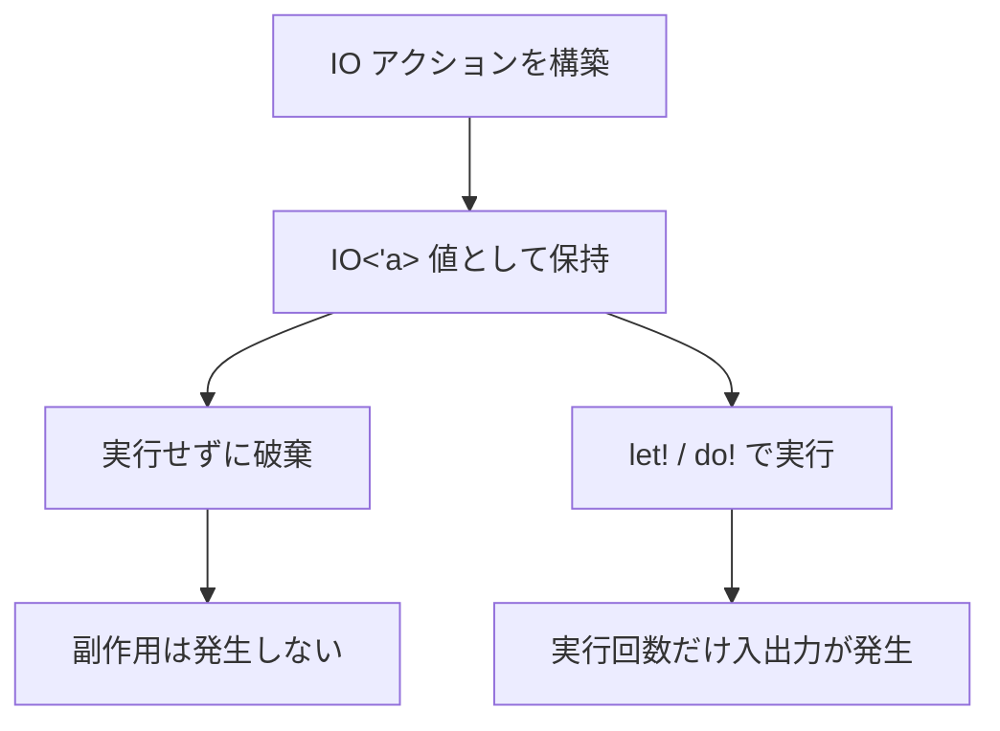

# IO

`IO<'a>` は、標準入出力やファイル・ネットワーク操作などの副作用を「実行されるまで評価しない遅延アクション」として表現する型です。アクションを構築したり破棄したりしただけでは外部環境への作用は一切発生せず、`let!` や `do!`、またはエントリーポイントを通じて実行された回数だけ処理が走ります。

標準入出力を読み書きする関数にはパッケージ権限 `stdio` が必要です。`IO.pure`・`IO.map`・`IO.bind` など、アクションを組み立てるだけの純粋な操作には権限は不要です。権限の宣言と検査の詳細は [パッケージ管理](../../modules/packages.md) を参照してください。

## 要点

- `IO<'a>` は不透明な遅延アクションであり、値を生成した時点では副作用を起こしません。
- `main` 関数の本体やトップレベルでは `let!` と `do!` がその場で実行され、`IO { ... }` コンピュテーション式を使うと実行を遅延したまま合成できます。
- 標準入出力関数は `write` / `writeln`（標準出力）、`write_err` / `write_errln`（標準エラー出力）、`readln`（標準入力）に統一されています。
- `try_` 接頭辞付きの関数は失敗を `Result<'a, IO.Error>` として返し、`try_` のない関数は失敗時にトラップします。
- `def main :: unit -> i32`（または `[string] -> i32`）の戻り値およびトップレベルの `IO<i32>` 結果値がプロセスの終了コードになります。

## 遅延アクションの評価モデル

`IO<'a>` の内部表現は `unit -> 'a` のクロージャですが、レコードのフィールドは不透明（opaque）であり、`action.work` のように直接参照すると `E1022` になります。ユーザーから直接呼び出せる `IO.run` も公開されていません。アクションを実行する手段は、ビルダーを持たない関数本体での `let!` / `do!`、およびトップレベルの `IO` 結果式に限定されています。



アクションを変数に束縛してそのまま捨てた場合、出力は行われません。逆に同じ `IO` 値を 2 回 `do!` で実行すれば、副作用も 2 回発生します。

```tsuzuri run=now%0Atick%0Atick
def main :: unit -> i32 = \() ->
    let _unused = IO.writeln "not yet"
    do! IO.writeln "now"
    let tick = IO.writeln "tick"
    do! tick
    do! tick
    0
```

`pure def` の内部でも、標準ライブラリの `IO` アクションを「実行せずに構築すること」は許可されています。コンパイラは構築時に評価される捕捉式と遅延コールバック本体を区別して純粋性を検査します（外部入出力を伴う値の事前計算や不透明サンクの実行は `pure def` 内では拒否されます）。

## コンピュテーション式と `main`

`def main :: unit -> i32` のように戻り値型にビルダーが付かない関数本体で `let!` や `do!` を書くと、各アクションがその場で順次実行されます。一方、`IO { ... }` ブロックを使うと、複数のステップを合成した新しい `IO<'a>` 値を実行せずに構築できます。

```tsuzuri run=1%0A2%0Ahello%20Tsuzuri%0A7%0A42
def greet :: string -> IO<i64>
fn greet name = IO {
    do! IO.writeln $"hello {name}"
    return name.length
}

def main :: unit -> i32 = \() ->
    do! IO {
        for n in [1, 2] do
            do! IO.writeln n
    }
    let title = "Tsuzuri"
    let! length = greet title
    do! IO.writeln length
    let! sum = IO {
        let! left = IO.pure 20
        and! right = IO.pure 22
        return left + right
    }
    do! IO.writeln sum
    0
```

- `IO { ... }` 内の `for` ループは `IO.For` に展開されます。要素型に `Copy<'a>` と `Capture<'a>` が要求されるため、`[i64]` のような `Copy` 配列を反復できます。
- `and!` は `IO.MergeSources` に展開され、左辺のアクションを実行してから右辺のアクションを実行します（並列実行ではありません）。
- ビルダー名を省略したコンピュテーション本体で `IO` と `Maybe`（または `Result`）を組み合わせて `let!` すると、`IO.Using` を介して `IO<Maybe<...>>` や `IO<Result<...>>` が合成されます。途中で `None` や `Error` になった場合は後続ステップをスキップし、エラー型を勝手に平坦化したり変換したりしません。

```tsuzuri
let! line = IO.readln ()
let! text = line
do! IO.writeln text
```

上記のトップレベル式は `IO<Maybe<unit>>` 型を持ちます。標準入力から 1 行読み取り、`Some` のときのみ標準出力へ書き出し、EOF（`None`）なら何も出力せずに終了します。

## 標準出力・標準エラー出力・標準入力

入出力関数は「出力先（標準出力 / `err`）」「改行の有無（なし / `ln`）」「失敗時の扱い（トラップ / `try_`）」の直交した組み合わせで構成されています。

| 関数（トラップ系） | 関数（`Result` 系） | 対象ストリーム | 改行の扱い |
| --- | --- | --- | --- |
| `IO.write` | `IO.try_write` | 標準出力（fd 1） | 付与しない |
| `IO.writeln` | `IO.try_writeln` | 標準出力（fd 1） | 末尾に LF（`\n`）を付与 |
| `IO.write_err` | `IO.try_write_err` | 標準エラー出力（fd 2） | 付与しない |
| `IO.write_errln` | `IO.try_write_errln` | 標準エラー出力（fd 2） | 末尾に LF（`\n`）を付与 |
| `IO.readln` | `IO.try_readln` | 標準入力（fd 0） | 末尾の LF または CRLF を除去 |

### 出力の仕様

- `Display<'a>` と `Capture<'a>` を満たす任意の型の値を受け取り、アクション実行時に文字列化して UTF-8 バイト列として出力します。文字列途中の NUL（`\u0000`）も切り捨てずにそのまま書き出します。
- ネイティブ環境では書き込みのたびにストリームをフラッシュします。書き込み途中で OS エラーが発生した場合、すでに送出されたバイトは巻き戻されません。
- `string` に孤立サロゲートが含まれる場合、OS への書き込みを行う前に `Result.Error IO.InvalidEncoding` となります。
- `tsuzuri run` は標準エラー出力をそのまま端末へ転送します（`--json` 指定時のみプロセス終了まで収集して診断に含めます）。

### 入力の仕様

`IO.try_readln ()` は `IO<Result<Maybe<string>, IO.Error>>` を返します（引数には `()` を渡します）。

- 1 行読み取れた場合は `Ok (Some line)` を返します。空行は `Ok (Some "")`、末尾に改行がない最終行も `Ok (Some line)` です。
- 行末の `\n`（LF）および `\r\n`（CRLF）は取り除かれますが、単独の `\r`（CR）は保持されます。
- 入力ストリームの終端（EOF）に達している場合は `Ok None` を返します。
- 入力バイト列が妥当な UTF-8 でない場合は置換文字（`U+FFFD`）に置き換えず、`Error IO.InvalidEncoding` を返します。

### `try_*` 系とトラップ系の違い

`IO.Error` は標準入出力専用の失敗を表す共用体です（ファイルやソケットが返す [`Os.Error`](./os.md) とは別の型です）。

```text
union Error = ReadFailed | WriteFailed | InvalidEncoding | Unavailable
```

| ケース | 発生条件 |
| --- | --- |
| `IO.ReadFailed` | 標準入力からの読み取り中に I/O エラーが発生した |
| `IO.WriteFailed` | 標準出力または標準エラー出力への書き込み・フラッシュに失敗した |
| `IO.InvalidEncoding` | 入力行が不正な UTF-8 であるか、出力文字列に孤立サロゲートが含まれる |
| `IO.Unavailable` | 標準ストリーム自体が存在しない（ハンドルなしで起動された Windows GUI プロセスや閉じられた記述子 0/1/2） |

`try_` が付かない `readln`・`write`・`writeln`・`write_err`・`write_errln` は、対応する `try_*` の結果を `Result.get` で取り出します。エラー発生時は回復不能なトラップとなるため（Windows GUI サブシステム等で標準エラー出力が存在しない場合、トラップ報告は `OutputDebugStringW` へ送られます）、パイプ切断や不正エンコーディングから回復したい処理では `try_*` 系を使用してください。

```tsuzuri run=encoding%0Aok%0Aaccepted%0Astdout
def main :: unit -> i32 = \() ->
    let! bad = IO.try_write "\uD800"
    do! IO.writeln (match bad with
        | Result.Error IO.InvalidEncoding -> "encoding"
        | Result.Error IO.WriteFailed -> "write-failed"
        | Result.Error IO.ReadFailed -> "read-failed"
        | Result.Error IO.Unavailable -> "unavailable"
        | Result.Ok _ -> "wrote")
    let! ok = IO.try_writeln "ok"
    do! IO.writeln (if Result.is_ok (ref ok) then "accepted" else "failed")
    do! IO.write_err "note: "
    do! IO.write_errln "stderr"
    do! IO.writeln "stdout"
    0
```

### 旧関数名からの移行（`E1040`）

旧来の長大な関数名は廃止され、以下の短い名前に統一されました。旧名を記述するとコンパイルエラー `E1040`（kind: `renamed_io_function`）が報告され、`tsuzuri fix` で安全に自動置換できます（`IO.write` と `IO.try_write` は変更ありません）。

| 廃止された旧名 | 現在の関数名 |
| --- | --- |
| `IO.read_line` / `IO.try_read_line` | `IO.readln` / `IO.try_readln` |
| `IO.write_line` / `IO.try_write_line` | `IO.writeln` / `IO.try_writeln` |
| `IO.write_error` / `IO.try_write_error` | `IO.write_err` / `IO.try_write_err` |
| `IO.write_error_line` / `IO.try_write_error_line` | `IO.write_errln` / `IO.try_write_errln` |

## 終了コードとトップレベル式の評価

`Main.tz` のエントリーポイントには次の 2 形式があり、両方を同じファイルに混在させると `E2004` になります。

1. **`def main :: unit -> i32` または `def main :: [string] -> i32`**: 返却した `i32` がそのまま終了コードになります。戻り値の自動出力は行われません。コマンドライン引数の詳細は [Env](./env.md) を参照してください。
2. **トップレベル式形式**: `main` を定義せずトップレベルに式を並べた場合、末尾の式が次の規則で扱われます。
   - 末尾の式が `IO<i32>` 型であれば、そのアクションを 1 回実行し、得られた `i32` を終了コードとします（値は自動表示されません）。
   - 末尾の式がそれ以外の `IO<'a>` 型であれば、アクションを 1 回実行して終了コード `0` で終了します。
   - 末尾の式が `IO` 以外であれば、`unit` は何も出さず、`Display` を持つ型やプリミティブ型は表示して終了コード `0` で終了します。

デストラクタ（`Drop`）をスキップしてプロセスを強制終了させない設計方針のため、`exit` に相当する関数は標準ライブラリに存在しません。異常終了コードを返したい場合は、`main` から非ゼロの `i32` を返却します。`tsuzuri run` は子プロセスが `0` 以外で終了すると `E2005` を報告します（POSIX では親プロセスから観測できる終了ステータスは下位 8 ビットです）。

## 所有権・並行実行・WebAssembly

- **所有権と借用**: `IO.write` などの出力関数は引数を `own 'a` として受け取るため、`string` のような非 `Copy` 値を渡すと所有権がアクション内部へムーブします。元の変数を後続でも使いたい場合は `$"hello {name}"` のように文字列補間で借用するか、参照を渡せる箇所で共有借用を利用します。また、排他借用（`ref mut`）や `Drop` 実装型の値を `IO` クロージャに捕捉させることはできません（`E1005`）。
- **`tzroutine` との統合**: `IO` アクションはメインスレッドだけでなく、`tzroutine { ... }` 本体や `Parallel.*` のコールバック内でも `let!` / `do!` で実行できます。tzroutine が OS 入出力で待機している間も、スケジューラは他の tzroutine の実行を継続します（[tzroutine](../../concurrency/tzroutine.md)）。
- **WebAssembly 対応**: 既定の `wasm32` ターゲットでは、プログラムから実際に到達した標準入出力操作のみを `tsuzuri_io.read_line` / `tsuzuri_io.write` としてホストからインポートします（`IO` 未使用のプログラムではインポートは増えません）。`--wasm-host wasi` を指定した場合は WASI preview1 の `fd_read` / `fd_write` にコンパイルされます（[WebAssembly](../../compiler/webassembly.md)）。

## 引数の順序

標準ライブラリ全体の設計規約（[標準ライブラリの規約](../conventions.md)）に従い、`IO.bind` と `IO.map` は対象となる `IO` アクションを**最後の引数**に取ります。これにより、パイプライン演算子 `|>` や関数合成 `>>` でアクションの変換を自然に連鎖できます。

```tsuzuri run=42
def main :: unit -> i32 = \() ->
    let pipeline = IO.bind (\n -> IO.pure (n * 2)) >> IO.map (\n -> n + 2)
    let! answer = IO.pure 20 |> pipeline
    do! IO.writeln answer
    0
```

一方、コンピュテーション式 `IO { ... }` の脱糖先である大文字始まりのビルダー操作（`IO.Bind`・`IO.Combine`・`IO.For` など）はコンパイラプロトコル免除の対象であり、コンピュテーション式の規則に沿った引数順（`Bind action next`）を持ちます。

## 公開 API

### 型定義

```text
record IO<'a> // 不透明（opaque）
union Error = ReadFailed | WriteFailed | InvalidEncoding | Unavailable
```

### アクション構築と合成（3 関数）

| 関数 | シグネチャ | 説明 |
| --- | --- | --- |
| `IO.pure` | `Capture<'a> => own 'a -> IO<'a>` | 副作用を起こさず指定した値を返すアクションを生成 |
| `IO.bind` | `own ('a -> IO<'b>) -> own IO<'a> -> IO<'b>` | アクションの結果を次のアクション生成関数へ渡して連結 |
| `IO.map` | `own ('a -> 'b) -> own IO<'a> -> IO<'b>` | アクションの結果に関数を適用して変換 |

### 標準入出力（10 関数）

| 関数 | シグネチャ | 説明 |
| --- | --- | --- |
| `IO.readln` | `own unit -> IO<Maybe<string>>` | 標準入力から 1 行読み取る（失敗時はトラップ） |
| `IO.try_readln` | `own unit -> IO<Result<Maybe<string>, IO.Error>>` | 標準入力から 1 行読み取る（失敗時は `Error`） |
| `IO.write` | `(Display<'a>, Capture<'a>) => own 'a -> IO<unit>` | 標準出力へ改行なしで書き出す（失敗時はトラップ） |
| `IO.writeln` | `(Display<'a>, Capture<'a>) => own 'a -> IO<unit>` | 標準出力へ書き出して LF を付与（失敗時はトラップ） |
| `IO.write_err` | `(Display<'a>, Capture<'a>) => own 'a -> IO<unit>` | 標準エラー出力へ改行なしで書き出す（失敗時はトラップ） |
| `IO.write_errln` | `(Display<'a>, Capture<'a>) => own 'a -> IO<unit>` | 標準エラー出力へ書き出して LF を付与（失敗時はトラップ） |
| `IO.try_write` | `(Display<'a>, Capture<'a>) => own 'a -> IO<Result<unit, IO.Error>>` | 標準出力へ改行なしで書き出す（失敗時は `Error`） |
| `IO.try_writeln` | `(Display<'a>, Capture<'a>) => own 'a -> IO<Result<unit, IO.Error>>` | 標準出力へ書き出して LF を付与（失敗時は `Error`） |
| `IO.try_write_err` | `(Display<'a>, Capture<'a>) => own 'a -> IO<Result<unit, IO.Error>>` | 標準エラー出力へ改行なしで書き出す（失敗時は `Error`） |
| `IO.try_write_errln` | `(Display<'a>, Capture<'a>) => own 'a -> IO<Result<unit, IO.Error>>` | 標準エラー出力へ書き出して LF を付与（失敗時は `Error`） |

### コンピュテーションビルダー操作（11 関数）

通常のアプリケーションコードから直接呼び出す必要はありませんが、`IO { ... }` 構文の展開先として公開されています。

| 関数 | シグネチャ | 対応する構文・役割 |
| --- | --- | --- |
| `IO.Return` | `Capture<'a> => own 'a -> IO<'a>` | `return expr` |
| `IO.ReturnFrom` | `own IO<'a> -> IO<'a>` | `return! action` |
| `IO.Bind` | `own IO<'a> -> own ('a -> IO<'b>) -> IO<'b>` | `let! x = action` / `do! action` |
| `IO.BindReturn` | `own IO<'a> -> own ('a -> 'b) -> IO<'b>` | 末尾の `let! ... return ...` 最適化形 |
| `IO.MergeSources` | `own IO<'a> -> own IO<'b> -> IO<('a * 'b)>` | `let! a = ... and! b = ...`（左から右へ順次実行） |
| `IO.Using` | `own (('a -> 'b) -> 'c) -> own ('a -> IO<'b>) -> IO<'c>` | `Maybe` や `Result` など他コンピュテーションとの合成 |
| `IO.Zero` | `IO<unit>` | `else` のない条件分岐や空ブロックの単位元 |
| `IO.Delay` | `own (unit -> IO<'a>) -> IO<'a>` | ブロック本体の評価遅延 |
| `IO.Combine` | `own IO<unit> -> own IO<'a> -> IO<'a>` | 副作用アクションと後続式の直列結合 |
| `IO.For` | `(Copy<'a>, Capture<'a>) => own ['a] -> own ('a -> IO<unit>) -> IO<unit>` | `IO { for x in xs do ... }` |
| `IO.While` | `own (unit -> bool) -> own IO<unit> -> IO<unit>` | `IO { while cond do ... }` |

## 関連項目

- [File](./file.md)
- [Os](./os.md)
- [Env](./env.md)
- [Result](../core/result.md)
- [Maybe](../core/maybe.md)
- [標準ライブラリの規約](../conventions.md)
- [コンピュテーション式](../../expressions/computation-expressions.md)
- [エラーハンドリング](../../expressions/error-handling.md)
- [tzroutine](../../concurrency/tzroutine.md)
- [WebAssembly](../../compiler/webassembly.md)
