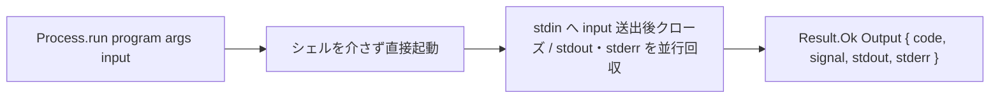

# Process

`Process` は、シェルを介さずに外部プログラムを子プロセスとして直接起動し、その標準出力・標準エラー出力および終了ステータスを回収する標準モジュールです。引数は空白や `$`・`;` などの記号を含んでいてもシェル展開されず、1 要素がそのまま 1 つの引数として渡されます。

`Process.run` の呼び出しにはパッケージ権限 `process` が必要です。権限の宣言と検査の詳細は [パッケージ管理](../../modules/packages.md) を参照してください。

## 要点

- `Process.run program args input` は遅延アクション `IO<Result<Process.Output, Os.Error>>` を返します。
- シェルを経由しないため、コマンドインジェクションを起こさずに任意の文字列を引数として安全に渡せます。
- 子プロセスは親プロセスの環境変数とカレントディレクトリを継承します。
- 子プロセスの標準入力へ `input` を書き切って閉じた後、標準出力と標準エラー出力を合計 $2^{30}$ バイト（1 GiB）まで並行回収します。
- 子プロセスが非ゼロの終了コードで終了した場合も `Result.Ok` が返り、`Output.code` で終了コードを判定します。

## 子プロセスの起動と出力取得



`Output` の `stdout` と `stderr` は生のバイト配列 `[ubyte]` です。テキストとして扱う場合は [`Os.decode`](./os.md) または [`Utf8String.from_bytes`](../text/utf8string.md) で変換します。

```tsuzuri run=code=0%20signal=0%0Aa%20b%20$HOME%0Anot-found%0Ainvalid%20input%0Ainvalid%20input
def main :: unit -> i32 = \() ->
    let! echoed = Process.run "/bin/echo" ["a b", "$HOME"] []
    do! IO.write (match echoed with
        | Result.Ok out ->
            match Os.decode out.stdout with
            | Result.Ok text -> $"code={out.code} signal={out.signal}\n{text}"
            | Result.Error error -> Os.message error
        | Result.Error error -> Os.message error)
    let! missing = Process.run "definitely-missing-tsuzuri-binary" [] []
    do! IO.writeln (match missing with
        | Result.Ok _ -> "unexpected"
        | Result.Error error ->
            match error.kind with
            | Os.NotFound -> "not-found"
            | _ -> Os.message error)
    let! empty_prog = Process.run "" [] []
    do! IO.writeln (match empty_prog with
        | Result.Ok _ -> "unexpected"
        | Result.Error error -> Os.message error)
    let! nul_arg = Process.run "/bin/echo" ["bad\u0000arg"] []
    do! IO.writeln (match nul_arg with
        | Result.Ok _ -> "unexpected"
        | Result.Error error -> Os.message error)
    0
```

## 仕様の詳細

### プログラム探索と引数の検証

- **POSIX（Linux・macOS）**: `program` に `/` が含まれない場合は環境変数 `PATH` から実行ファイルを探し、含まれる場合はそのパスを直接起動します。
- **Windows ネイティブ**: `CreateProcessW` で子プロセスを直接起動します。
  - `program` に `/`・`\`・`:` が含まれる場合はパスとして解決し、含まれない場合は `PATH` のディレクトリのみを検索します（カレントディレクトリや親実行ファイルのディレクトリは暗黙検索しません。拡張子がない場合は `.exe`・`.com` の順に補完します）。
  - **バッチファイル（`.bat`・`.cmd`）は `InvalidInput` として拒否します**。`cmd.exe` の独自パース規則による引数インジェクションを防ぐためです。意図してバッチを実行する場合は `Process.run "cmd.exe" ["/d", "/c", ...]` を明示します。
  - `program` に `"` が含まれる場合も `InvalidInput` です。
- **入力の検証**: 空の `program`、または `program` や `args` の要素内に NUL 文字（`\u0000`）が含まれる場合は起動前に `InvalidInput`（`code == 0`）となり、孤立サロゲートが含まれる場合は `InvalidEncoding`（`code == 0`）となります。`args` にはプログラム名自身（`argv[0]`）を含めず、第1引数以降のみを渡します。

### 入出力上限と終了状態

```text
record Output { code: i32, signal: i32, stdout: [ubyte], stderr: [ubyte] }
```

- **標準入力**: `input` の全バイトを書き込むか、子プロセス側が先に標準入力を閉じるまで書き込んだ後、パイプを閉じます（空配列 `[]` は即座に EOF を送ります）。
- **出力サイズ上限**: `stdout` と `stderr` の合計が $2^{30}$ バイト（1 GiB）を超えた場合、メモリ枯渇を防ぐため子プロセスを強制終了し、`Error { kind: Os.Other, ... }` を返します。
- **終了ステータス**:
  - POSIX で通常終了した場合は `code` に終了コード（0〜255）、`signal` に `0` が入ります。シグナルにより終了した場合は `code` が `-1`、`signal` にシグナル番号（`SIGKILL` なら `9` など）が入ります。
  - Windows では `signal` は常に `0` であり、`code` には `GetExitCodeProcess` の 32 ビット値が符号付き `i32` として格納されます。

### 並行実行と WebAssembly / WASI の制限

- **`tzroutine` との統合**: `tzroutine { ... }` 内で `let! out = Process.run ...` を実行した場合、子プロセスの完了を待つ間もワーカースレッドは他の tzroutine を実行し続けます（[tzroutine](../../concurrency/tzroutine.md)）。また、[`Net`](./net.md) のソケットなど標準ライブラリが開いたハンドルには非継承設定（POSIX `FD_CLOEXEC` / Windows 非継承ハンドル）が付くため、子プロセスへ漏洩しません。
- **WebAssembly / WASI での制限**:
  - 既定の `wasm32` ターゲットでは `Process.run` に到達するとビルド時に `E2000` で拒否されます。
  - `--wasm-host wasi` を指定した場合はコンパイル可能ですが、WASI preview1 にはプロセス生成システムコールが存在しないため、実行時に常に `Result.Error (Os.Error { kind: Os.Other, ... })` を返します（[WebAssembly](../../compiler/webassembly.md)）。

## 引数の順序

`Process` は外部プロセスリソースを扱うモジュールとして引数順規則の免除対象であり（[標準ライブラリの規約](../conventions.md)）、起動対象の `program`、引数列 `args`、標準入力バイト列 `input` の順（`Process.run program args input`）に受け取ります。

## 公開 API

### 型定義

```text
record Output { code: i32, signal: i32, stdout: [ubyte], stderr: [ubyte] }
```

### 関数（1 関数）

| 関数 | シグネチャ | 説明 |
| --- | --- | --- |
| `Process.run` | `own string -> own [string] -> own [ubyte] -> IO<Result<Process.Output, Os.Error>>` | シェルを介さず子プロセスを起動し、完了まで待機して出力と終了状態を返す |

## 関連項目

- [IO](./io.md)
- [Os](./os.md)
- [Env](./env.md)
- [File](./file.md)
- [標準ライブラリの規約](../conventions.md)
- [tzroutine](../../concurrency/tzroutine.md)
- [WebAssembly](../../compiler/webassembly.md)
