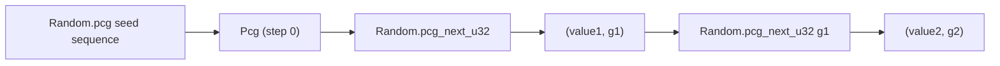
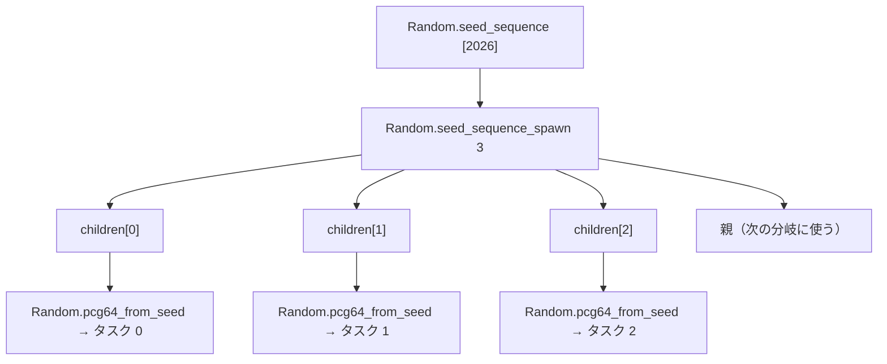

# Random

`Random` は、OS カーネルのエントロピー源から取得する暗号論的乱数（`IO` アクション）と、種から決定論的に乱数列を作る純粋な擬似乱数生成器を提供する標準モジュールです。純粋な生成器は 2 つあります。32 ビットずつ出力する `Random.Pcg`（PCG-XSH-RR 64/32）と、64 ビットずつ出力し、種の列 `Random.SeedSequence`・独立なストリームの分岐・15 の確率分布を備える `Random.Pcg64`（PCG-XSL-RR 128/64）です。暗黙のグローバル乱数状態は存在しません。

OS 乱数（`Random.bytes`・`Random.next_u64`・`Random.pcg64_from_os`）にはパッケージ権限 `random` が必要です。種を明示する関数（`Random.pcg`・`Random.pcg64`・`Random.seed_sequence` と、生成器を進める関数・分布のすべて）には権限は不要で、`pure def` の中や既定の `wasm32` でも使用できます。

乱数のテンソル、多変量分布、並べ替えは opt-in の [RandomTensor](../numeric/random-tensor.md) にあります。

## 要点

- 暗号鍵・トークン・予測不能な種の取得には OS エントロピー乱数 `Random.bytes` / `Random.next_u64` を使用します。
- シミュレーション・統計・機械学習の初期化には `Random.Pcg64` を使用します。`Random.pcg64 seed` で作り、`pcg64_*` の関数で進めます。
- 生成器は不変・不透明な `Copy` 値です。呼び出しのたびに「結果」と「次に使う生成器」の組が返るため、次の呼び出しには返ってきた生成器を渡します。同じ生成器をもう一度渡すと、同じ結果が返ります。
- 同じ種からは、ネイティブと WASM、`-O0` と `-O3` のどれでもビット単位に同じ値が出ます。
- 並列に走るタスクには、`Random.seed_sequence_spawn` で分けた子の種を 1 つずつ渡します。
- 不正な分布パラメータ（負の標準偏差、`[0, 1]` の外の確率、NaN など）は、乱数を引く前にトラップします。
- `Random.bytes` の要求バイト数が負または $2^{30}$（1 GiB）を超える場合は `Os.ErrorKind.InvalidInput` となります。

## OS エントロピー乱数

`Random.bytes count` は OS の暗号論的擬似乱数生成器（CSPRNG）から `count` バイトを取得します（`count == 0` は空配列 `Ok []` で成功します）。`Random.next_u64 ()` は 8 バイトを取得してリトルエンディアンの `i64u` に変換します。

```tsuzuri run=0%0A16%0Ainvalid%20input%0Aok
def main :: unit -> i32 = \() ->
    let! empty = Random.bytes 0
    do! IO.writeln (match empty with
        | Result.Ok data -> $"{data.length}"
        | Result.Error error -> Os.message error)
    let! key = Random.bytes 16
    do! IO.writeln (match key with
        | Result.Ok data -> $"{data.length}"
        | Result.Error error -> Os.message error)
    let! negative = Random.bytes (-1)
    do! IO.writeln (match negative with
        | Result.Ok _ -> "unexpected"
        | Result.Error error -> Os.message error)
    let! word = Random.next_u64 ()
    do! IO.writeln (if Result.is_ok (ref word) then "ok" else "failed")
    0
```

## 決定論的擬似乱数生成器 `Random.Pcg`

`Random.pcg seed sequence` はリファレンス実装 `pcg-c-basic` の `pcg32_srandom_r` とビット単位で互換な PCG-XSH-RR 64/32 生成器を初期化します。ストリーム番号 `sequence` は内部で `(sequence <<< 1) | 1` として奇数増分に変換されるため、どの `sequence` を渡しても完全周期が保証されます。内部フィールドは不透明（`E1022`）です。



同じ `Pcg` 値を再度渡すとまったく同じ値が得られます。ループ内で乱数列を進める場合は `let mut rng = ...` に返却された次の `Pcg` を再代入します。`pcg_next_u64` は `pcg_next_u32` を 2 回進め、1 回目を上位 32 ビット、2 回目を下位 32 ビットに結合します。

```tsuzuri run=2707161783%202068313097%0Atrue%0A11627171325034361865
pure def two_u32 :: i64u -> i64u -> (i32u * i32u)
fn two_u32 seed seq =
    let rng0 = Random.pcg seed seq
    let (first, rng1) = Random.pcg_next_u32 rng0
    let (second, _) = Random.pcg_next_u32 rng1
    (first, second)

def main :: unit -> i32 = \() ->
    let (a, b) = two_u32 42i64u 54i64u
    do! IO.writeln $"{a} {b}"
    let same = Random.pcg 42i64u 54i64u
    let (x, _) = Random.pcg_next_u32 same
    let (y, _) = Random.pcg_next_u32 same
    do! IO.writeln $"{x == y}"
    let (wide, _) = Random.pcg_next_u64 (Random.pcg 42i64u 54i64u)
    do! IO.writeln $"{wide}"
    0
```

> **補足**: `Random.Pcg` と `Random.Pcg64` は統計的品質と再現性を目的とした非暗号論的擬似乱数生成器です。セキュリティ用途には必ず `Random.bytes` または `Random.next_u64` を使用してください。

## 64 ビット生成器 `Random.Pcg64`

`Random.pcg64 seed` は PCG-XSL-RR 128/64（状態 128 ビット、1 回の出力 64 ビット、周期 $2^{128}$）の生成器を 1 つの種から作ります。進める関数は次の 3 つです。

- `Random.pcg64_next_u64` は 64 ビットの `i64u` を返します。
- `Random.pcg64_next_f64` は `[0.0, 1.0)` の `f64` を返します。1 回の出力の上位 53 ビットに $2^{-53}$ を掛けた値なので、結果は必ず $2^{-53}$ の倍数で、`1.0` は出ません。
- `Random.pcg64_next_i64_range low high` は半開区間 `[low, high)` の整数を、どの値も同じ確率で返します。積と棄却による Lemire の方法で、剰余の偏りがありません。`low >= high` はトラップします。幅は $2^{64} - 1$ まで取れます。

```tsuzuri run=14276969152011380360%208095878257575067585%0A0.7739560485559633%0A5
def main :: unit -> i32 = \() ->
    let rng = Random.pcg64 42i64u
    let (first, rng1) = Random.pcg64_next_u64 rng
    let (second, _) = Random.pcg64_next_u64 rng1
    do! IO.writeln $"{first} {second}"
    let (unit, _) = Random.pcg64_next_f64 rng
    do! IO.writeln $"{unit}"
    let (die, _) = Random.pcg64_next_i64_range 1 7 rng
    do! IO.writeln $"{die}"
    0
```

種の混ぜ方は NumPy の `SeedSequence`、生成器の初期化は NumPy の `PCG64` と同じ算法です。そのため、`pcg64_next_u64` の列は同じ種の `numpy.random.PCG64(seed).random_raw()` と、`pcg64_next_f64` の列は `numpy.random.Generator(PCG64(seed)).random()` と一致します（上の例の値は NumPy 2.5.1 の出力と同じです）。一致するのはこの生の列だけで、[確率分布](#確率分布)の標本は NumPy の `Generator` と一致しません。

`Random.pcg64_from_os ()` は OS の乱数 32 バイトを種にした生成器を `IO<Result<Random.Pcg64, Os.Error>>` で返します。再現する必要のない実行に使います（権限 `random`）。

```tsuzuri run=true
def main :: unit -> i32 = \() ->
    let! seeded = Random.pcg64_from_os ()
    do! IO.writeln (match seeded with
        | Result.Ok rng ->
            let (unit, _) = Random.pcg64_next_f64 rng
            $"{unit >= 0.0 && unit < 1.0}"
        | Result.Error error -> Os.message error)
    0
```

## 種の列 `Random.SeedSequence` と独立なストリーム

`Random.seed_sequence [a, b, ...]` は任意個の `i64u` から種の材料を作ります。同じ入力からは同じ列ができ、整数を 1 つも渡さない列は `[0i64u]` の列と同じです。`Random.pcg64_from_seed (ref sequence)` がそこから生成器を作り、`Random.pcg64 seed` は `Random.pcg64_from_seed (Random.seed_sequence [seed])` と同じです。

`Random.seed_sequence_spawn count sequence` は、`count` 個の子の列と、次に分岐するための親の組 `([SeedSequence] * SeedSequence)` を返します。子どうし、子と親、孫は互いに別のストリームになります。返ってきた親からもう一度分岐すると、前の子と重ならない新しい子ができます。負の `count` はトラップします。`SeedSequence` は配列を持つので `Copy` ではありません。



```tsuzuri run=12368030237656201616%0A7059406205449988773%2012379846323123809911%2010161282174720015102%0Atrue
def first_output :: ref Random.SeedSequence -> i64u
fn first_output sequence =
    let (value, _) = Random.pcg64_next_u64 (Random.pcg64_from_seed sequence)
    value

def main :: unit -> i32 = \() ->
    let combined = Random.seed_sequence [1i64u, 2i64u, 3i64u]
    do! IO.writeln $"{first_output (ref combined)}"
    let (children, parent) = Random.seed_sequence_spawn 3 (Random.seed_sequence [2026i64u])
    do! IO.writeln $"{first_output (ref children[0])} {first_output (ref children[1])} {first_output (ref children[2])}"
    let (later, _) = Random.seed_sequence_spawn 1 parent
    do! IO.writeln $"{first_output (ref later[0]) != first_output (ref children[0])}"
    0
```

## 確率分布

分布の関数は、パラメータ、最後に `own Random.Pcg64` を取り、標本と次に使う生成器の組を返します。連続分布は `f64`、`pcg64_bernoulli` は `bool`、ほかの離散分布は `i64` の標本を返します。

| 関数 | 分布 | 算法 |
| --- | --- | --- |
| `pcg64_uniform low high` | `[low, high)` の一様分布 | `low + (high - low) * u` |
| `pcg64_standard_normal` | 標準正規分布 | Leva の一様乱数の比（表を持たず、対数は標本 80 個に 1 回ほど） |
| `pcg64_normal loc scale` | 平均 `loc`、標準偏差 `scale` の正規分布 | `loc + scale * z` |
| `pcg64_exponential scale` | 平均 `scale` の指数分布 | 逆関数法 `-scale * log (1 - u)` |
| `pcg64_gamma shape scale` | 形状 `shape`、尺度 `scale` のガンマ分布（平均 `shape * scale`） | Marsaglia-Tsang の方法。`shape < 1` は `shape + 1` の標本に `u ** (1 / shape)` を掛ける |
| `pcg64_beta a b` | `[0, 1]` のベータ分布（平均 `a / (a + b)`） | `a`・`b` がともに 1 以下なら Jöhnk の方法、それ以外は 2 つのガンマの比 |
| `pcg64_chisquare df` | 自由度 `df` のカイ二乗分布 | 形状 `df / 2`、尺度 2 のガンマ |
| `pcg64_laplace loc scale` | ラプラス分布（分散 `2 * scale * scale`） | 逆関数法 |
| `pcg64_lognormal mean sigma` | 対数正規分布 | `exp (normal mean sigma)` |
| `pcg64_standard_t df` | 自由度 `df` のスチューデントの t 分布 | `sqrt (df / 2) * z / sqrt g`（`g` は形状 `df / 2` のガンマ） |
| `pcg64_f_dist dfnum dfden` | F 分布 | 自由度で割った 2 つのカイ二乗の比 |
| `pcg64_bernoulli p` | 確率 `p` で `true` | `u < p` |
| `pcg64_binomial n p` | `n` 回の試行の成功の数 | `n * min p (1 - p) <= 30` なら逆関数法、それ以外は BTPE |
| `pcg64_poisson lam` | 平均 `lam` のポアソン分布 | `lam < 10` なら一様乱数の積、それ以外は PTRS（変換棄却法） |
| `pcg64_geometric p` | 最初に成功する試行の番号（1 以上、平均 `1 / p`） | 逆関数法 `ceil (log (1 - u) / log (1 - p))` |

```tsuzuri run=9.729%203.912%201.506%200.418%0A404%203%208%20false
def round3 :: own f64 -> f64
fn round3 value = Math.round (value * 1000.0) / 1000.0

def main :: unit -> i32 = \() ->
    let rng = Random.pcg64 42i64u
    let (normal, rng1) = Random.pcg64_normal 10.0 2.0 rng
    let (waiting, rng2) = Random.pcg64_exponential 2.0 rng1
    let (shape, rng3) = Random.pcg64_gamma 2.5 1.5 rng2
    let (share, rng4) = Random.pcg64_beta 2.0 5.0 rng3
    do! IO.writeln $"{round3 normal} {round3 waiting} {round3 shape} {round3 share}"
    let (successes, rng5) = Random.pcg64_binomial 1000 0.4 rng4
    let (events, rng6) = Random.pcg64_poisson 3.5 rng5
    let (trials, rng7) = Random.pcg64_geometric 0.2 rng6
    let (hit, _) = Random.pcg64_bernoulli 0.3 rng7
    do! IO.writeln $"{successes} {events} {trials} {hit}"
    0
```

ループで多くの標本を引くときは、`let mut` の生成器に、返ってきた次の生成器を代入します。どの関数も `pure def` なので、標本を使う計算も `pure def` に書けます。

```tsuzuri run=10.021%0A4983
pure def mean_of_normals :: own i64 -> own Random.Pcg64 -> f64
fn mean_of_normals count generator =
    let mut state = generator
    let mut total = 0.0
    for _ in 0 ..< count do
        let (sample, next) = Random.pcg64_normal 10.0 2.0 state
        total = total + sample
        state = next
    total / (count as f64)

pure def heads :: own i64 -> own Random.Pcg64 -> i64
fn heads count generator =
    let mut state = generator
    let mut seen = 0
    for _ in 0 ..< count do
        let (hit, next) = Random.pcg64_bernoulli 0.5 state
        if hit then seen = seen + 1
        state = next
    seen

def main :: unit -> i32 = \() ->
    do! IO.writeln $"{Math.round (mean_of_normals 10000 (Random.pcg64 7i64u) * 1000.0) / 1000.0}"
    do! IO.writeln $"{heads 10000 (Random.pcg64 7i64u)}"
    0
```

### パラメータの検査

不正なパラメータは、乱数を引く前に `assert` でトラップします（`assertion failed`）。NaN が黙って結果へ広がることはありません。

| パラメータ | 使える値 |
| --- | --- |
| `loc`・`mean`（位置） | 有限の値 |
| `scale`・`sigma`（尺度） | 0 以上の有限の値。0 は退化した分布で、`pcg64_normal loc 0.0` は `loc` を返します |
| `shape`・`a`・`b`・`df`・`dfnum`・`dfden` | 正の有限の値 |
| `p`（確率） | `[0, 1]`。`pcg64_geometric` は `(0, 1]` |
| `n`（試行の数） | 0 以上 |
| `lam` | `[0, 9.223372006484771e18]`（それを超えると結果が `i64` に収まりません） |
| `low`・`high` | `low < high`。`pcg64_uniform` は幅 `high - low` が有限であること |

`pcg64_uniform` は、幅が `low` に比べて非常に大きいとき、丸めで `high` そのものを返すことがあります。`pcg64_geometric` の結果が `i64` に収まらないとき（`p` がおよそ `1e-17` より小さいとき）は `i64` の最大値を返します。

### 再現性

種を明示する関数は、四則演算と比較、ビット一致の契約を持つ [Math](../numeric/math.md) の関数（`log`・`log1p`・`exp`・`pow`・`sqrt`）、正確に求まる `floor`・`ceil`・`abs`・`min`・`max` だけで計算します。そのため、同じ種と同じ呼び出しの列からは、ネイティブと `wasm32`、`-O0` と `-O3` のどれでもビット単位に同じ標本が出ます。

## 対応環境

- **`Random.Pcg`（純粋関数群）**: OS 呼び出しやホストインポートを一切行わないため、ネイティブ 5 環境と既定の `wasm32` / `wasm64`、`-O0` と `-O3` のすべてで完全に同一の乱数列を生成します。
- **`Random.Pcg64`・`Random.SeedSequence` と分布（純粋関数群）**: 同じく OS 呼び出しやホストインポートを行いません。ネイティブと既定の `wasm32` の `-O0` と `-O3` で、同じ種から同じ標本が出ることを検査しています。
- **`Random.bytes` / `Random.next_u64` / `Random.pcg64_from_os`**:
  - ネイティブ環境では OS の CSPRNG（Linux `getrandom`、macOS `arc4random_buf` / システムエントロピー、Windows `BCryptGenRandom`）から取得します。
  - 既定の `wasm32` ターゲットでは到達時に `E2000` で拒否され、`--wasm-host wasi` 指定時は WASI preview1 の `random_get` にコンパイルされます（[WebAssembly](../../compiler/webassembly.md)）。

## 引数の順序

標準ライブラリの設計規約（[標準ライブラリの規約](../conventions.md)）に従い、生成器を進める関数は対象の生成器を最後の引数に取ります。`pcg_next_u32`・`pcg_next_u64` は `Random.Pcg` を、`pcg64_next_*` と分布の関数は、分布のパラメータの後に `Random.Pcg64` を取ります（`Random.pcg64_normal loc scale rng`）。`Random.pcg64_from_seed` と `Random.seed_sequence_spawn count sequence` は対象の `Random.SeedSequence` を最後に取ります。`Random.pcg seed sequence`・`Random.pcg64 seed`・`Random.seed_sequence entropy` は値を新しく作るコンストラクタ関数です。

対象が最後なので、パイプラインで生成器を渡せます。

```tsuzuri run=true
def main :: unit -> i32 = \() ->
    let (sample, _) = Random.pcg64 42i64u |> Random.pcg64_uniform 5.0 6.0
    do! IO.writeln $"{sample >= 5.0 && sample < 6.0}"
    0
```

## 公開 API

### 型定義

```text
record Pcg          // 不透明（opaque）、Copy。PCG-XSH-RR 64/32
record Pcg64        // 不透明（opaque）、Copy。PCG-XSL-RR 128/64
record SeedSequence // 不透明（opaque）。種の材料と、分岐した子の数
```

### OS エントロピー乱数（3 関数）

| 関数 | シグネチャ | 説明 |
| --- | --- | --- |
| `Random.bytes` | `own i64 -> IO<Result<[ubyte], Os.Error>>` | OS から暗号論的乱数を `count` バイト取得（範囲 `0..=2^30` 外は `InvalidInput`） |
| `Random.next_u64` | `own unit -> IO<Result<i64u, Os.Error>>` | OS の 8 バイト乱数をリトルエンディアンの `i64u` として取得 |
| `Random.pcg64_from_os` | `own unit -> IO<Result<Random.Pcg64, Os.Error>>` | OS の 32 バイト乱数を種にした `Pcg64` |

### 決定論的 PCG 擬似乱数生成器（3 関数、`pure def`）

| 関数 | シグネチャ | 説明 |
| --- | --- | --- |
| `Random.pcg` | `own i64u -> own i64u -> Random.Pcg` | シード値とストリーム番号から PCG-XSH-RR 64/32 生成器を構築 |
| `Random.pcg_next_u32` | `own Random.Pcg -> (i32u * Random.Pcg)` | 次の 32 ビット符号なし整数と、1 ステップ進んだ `Pcg` を返す |
| `Random.pcg_next_u64` | `own Random.Pcg -> (i64u * Random.Pcg)` | 2 回分の出力を結合した 64 ビット符号なし整数と、2 ステップ進んだ `Pcg` を返す |

### 64 ビット生成器と種の列（7 関数、`pure def`）

| 関数 | シグネチャ | 説明 |
| --- | --- | --- |
| `Random.pcg64` | `own i64u -> Random.Pcg64` | 1 つの種から PCG-XSL-RR 128/64 生成器を構築 |
| `Random.seed_sequence` | `own [i64u] -> Random.SeedSequence` | 任意個の整数から種の材料を作る |
| `Random.seed_sequence_spawn` | `own i64 -> own Random.SeedSequence -> ([Random.SeedSequence] * Random.SeedSequence)` | `count` 個の独立な子と、次に分岐する親を返す |
| `Random.pcg64_from_seed` | `ref Random.SeedSequence -> Random.Pcg64` | 種の材料から生成器を構築 |
| `Random.pcg64_next_u64` | `own Random.Pcg64 -> (i64u * Random.Pcg64)` | 次の 64 ビット符号なし整数 |
| `Random.pcg64_next_f64` | `own Random.Pcg64 -> (f64 * Random.Pcg64)` | `[0.0, 1.0)` の `f64`（$2^{-53}$ の倍数） |
| `Random.pcg64_next_i64_range` | `own i64 -> own i64 -> own Random.Pcg64 -> (i64 * Random.Pcg64)` | `[low, high)` の整数（偏りなし） |

### 確率分布（15 関数、`pure def`）

| 関数 | シグネチャ |
| --- | --- |
| `Random.pcg64_uniform` | `own f64 -> own f64 -> own Random.Pcg64 -> (f64 * Random.Pcg64)` |
| `Random.pcg64_standard_normal` | `own Random.Pcg64 -> (f64 * Random.Pcg64)` |
| `Random.pcg64_normal` | `own f64 -> own f64 -> own Random.Pcg64 -> (f64 * Random.Pcg64)` |
| `Random.pcg64_exponential` | `own f64 -> own Random.Pcg64 -> (f64 * Random.Pcg64)` |
| `Random.pcg64_gamma` | `own f64 -> own f64 -> own Random.Pcg64 -> (f64 * Random.Pcg64)` |
| `Random.pcg64_beta` | `own f64 -> own f64 -> own Random.Pcg64 -> (f64 * Random.Pcg64)` |
| `Random.pcg64_chisquare` | `own f64 -> own Random.Pcg64 -> (f64 * Random.Pcg64)` |
| `Random.pcg64_laplace` | `own f64 -> own f64 -> own Random.Pcg64 -> (f64 * Random.Pcg64)` |
| `Random.pcg64_lognormal` | `own f64 -> own f64 -> own Random.Pcg64 -> (f64 * Random.Pcg64)` |
| `Random.pcg64_standard_t` | `own f64 -> own Random.Pcg64 -> (f64 * Random.Pcg64)` |
| `Random.pcg64_f_dist` | `own f64 -> own f64 -> own Random.Pcg64 -> (f64 * Random.Pcg64)` |
| `Random.pcg64_bernoulli` | `own f64 -> own Random.Pcg64 -> (bool * Random.Pcg64)` |
| `Random.pcg64_binomial` | `own i64 -> own f64 -> own Random.Pcg64 -> (i64 * Random.Pcg64)` |
| `Random.pcg64_poisson` | `own f64 -> own Random.Pcg64 -> (i64 * Random.Pcg64)` |
| `Random.pcg64_geometric` | `own f64 -> own Random.Pcg64 -> (i64 * Random.Pcg64)` |

## 関連項目

- [RandomTensor](../numeric/random-tensor.md)
- [Math](../numeric/math.md)
- [IO](./io.md)
- [Os](./os.md)
- [Gen](../testing/gen.md)
- [HashMap](../collections/hashmap.md)
- [標準ライブラリの規約](../conventions.md)
- [WebAssembly](../../compiler/webassembly.md)
