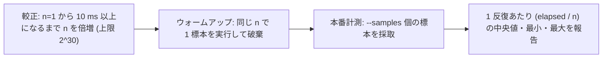

# Bench

`Bench` は、言語組み込みの `bench` 宣言内で反復計測ループと最適化抑止を担う opt-in 標準モジュールです。ソースコード中に `Bench` 識別子が現れたときのみ読み込まれ、`tsuzuri bench` コマンドが反復回数の自動較正・ウォームアップ・標本統計（中央値・最小値・最大値）の算出を行います。

`Bench.of` と `Bench.with_input` は内部で時計を読むためパッケージ権限 `time` を持ちますが、`bench` 宣言内では権限検査の対象外です。

## 要点

- `bench "ベンチマーク名" = 本体式` の本体は `i64 -> i64` 型（反復回数を受け取り、準備と後始末を除いた経過ナノ秒を返す関数）です。
- 通常は `Bench.of (\() -> 計算)` または事前データ構築を計測時間から除外する `Bench.with_input (\() -> 準備) (\input -> 計算)` で記述します。
- 両関数とも各反復の戻り値を自動的に `Bench.consume`（最適化障壁、Rust の `black_box` 相当）へ渡し、`-O3` での死コード除去を防ぎます。
- `tsuzuri bench` はネイティブ `-O3` を既定とし、1 件ずつ独立プロセスで直列実行します。共有 CI での誤検知を防ぐため、速度に対する合否閾値は設けられていません。

## `bench` 宣言と計測ヘルパー

```text
bench "ベンチマーク名" = 本体式
```

`bench` は予約語であり、[`test`](./test.md) 宣言と同様に `.tz` / `.tc` のトップレベルに配置します（`.tt` や標準ライブラリ内は `E1018`、`private bench` は `E1022`、`export bench` は `E0002`）。`tsuzuri check` や `tsuzuri build` でも型検査されますが、通常のバイナリや `tsuzuri test` の成果物には含まれません。

```tsuzuri project=bench_demo file=BenchDemo.tz
def sum_slice :: ref [i64] -> i64
fn sum_slice xs =
    let mut total = 0
    for x in xs do
        total = total + x
    total

bench "10万要素の合計（事前生成を除く）" =
    Bench.with_input (\() -> new [i64](100000, \i -> i)) (\xs -> sum_slice xs)

bench "整数の文字列化" =
    Bench.of (\() -> to_string 123456789)
```

- **`Bench.with_input setup run`**: 標本ごとに `setup ()` を 1 回だけ実行して入力値を構築し、その共有借用 `ref 'a` を `run` に `iterations` 回渡した合計ナノ秒を返します。`setup` の実行時間と入力値の解放（drop）時間は計測区間に入りません。
- **`Bench.of run`**: 事前準備なしで `run ()` を `iterations` 回実行した合計ナノ秒を返します。ミュータブルな破壊的更新など反復ごとに入力を作り直す必要がある場合は `Bench.of` を使います。

## 低レベル組み込み：`Bench.consume` と `Bench.now`

標準ライブラリ関数 2 つのほかに、コンパイラ組み込みとして `Bench.consume` と `Bench.now` が提供されています。

- **`Bench.consume value`（ブラックボックス障壁）**: 値の所有権を受け取り、副作用付きインラインアセンブリ障壁（`asm sideeffect "", "r,~{memory}"`）にアドレスを渡してから通常どおり解放します。LLVM が「結果が使われていない」と判断して計算ループごと削除するのを防ぎます。`Bench.consume` 自体は通常ビルドや `wasm32` でも使用可能です。
- **`Bench.now()`（ベンチマーク専用単調時計）**: 引数 0 個の組み込み関数（`fn() -> i64`）であり、高精度単調時計（macOS `CLOCK_UPTIME_RAW`、Linux `CLOCK_MONOTONIC`、Windows `QueryPerformanceCounter`）のナノ秒を返します。カスタム計測ループを書く場合に使用します。

```tsuzuri project=custom_bench file=CustomBench.tz
def custom_loop :: i64 -> i64
fn custom_loop iterations =
    let start = Bench.now()
    let mut i = 0
    while i < iterations do
        Bench.consume (i * 3 + 1)
        i = i + 1
    Bench.now() - start

bench "カスタム計測ループ" = custom_loop
```

> **`Bench.now` の到達制限（`E1018`）**: `Bench.now` の実体は `tsuzuri bench` 専用ランナーにのみリンクされます。トップレベル（`main`）・`export def`・`tsuzuri test` の実行対象テスト・`Drop` 実装から `Bench.now`（または `Bench.of` / `Bench.with_input`）へ到達すると、`tsuzuri bench` 以外のコマンドでは `E1018` エラーとなります。

## `tsuzuri bench` による統計計測と `--allocs`

```sh
tsuzuri bench .
tsuzuri bench . --filter "BenchDemo.10万"
tsuzuri bench . --samples 21
tsuzuri bench . --allocs
tsuzuri bench . --json
tsuzuri bench . --list
```

| オプション | 意味 |
| --- | --- |
| `--filter TEXT` | `<モジュール名>.<ベンチ名>` の部分文字列一致 |
| `--index N` | 宣言順 0 始まりの指定インデックスのみを実行（複数指定可） |
| `--list` | 型検査のみを行い一覧表示して終了 |
| `--samples N` | 採取する標本数（`1..=1000`、既定は `11`） |
| `--allocs` | 時間計測後に計数アロケータ実行器を別途走らせ、1 反復あたりのヒープ確保回数・バイト数を併記 |
| `--json` | 各ベンチ結果と `summary` を NDJSON で標準出力へ出力 |
| `-O0` 〜 `-O3` | 最適化レベル（既定は `-O3`） |
| `--target native` | ホストのネイティブターゲットのみ対応（WASM やクロスターゲットは `E2000`） |

### 較正・ウォームアップ・統計値の流れ



1 件あたりのタイムアウトは 300 秒です。トラップ・タイムアウト・負の経過時間返却が発生した場合は `E2005` が報告され終了コード `1` となります。

`--allocs` を指定すると、時間計測用の最適化バイナリとは別に計数アロケータ（[`Alloc`](./alloc.md)）を組み込んだ実行器で「1 反復の増分 $A$」と「2 反復の増分 $B$」を測定し、準備と後始末を相殺した差分 $B - A$ を `alloc_calls`（確保＋再確保回数）および `alloc_bytes`（要求バイト数）として報告します。

```text
bench 0 BenchDemo.10万要素の合計（事前生成を除く）: median 28.412 us (min 27.950 us, max 30.104 us; 11 samples of 512 iterations), alloc_calls 0, alloc_bytes 0 per iteration
```

## 引数の順序

`Bench` モジュールはベンチマークハーネスのエントリーポイントとして引数順規則の免除対象であり（[標準ライブラリの規約](../conventions.md)）、`Bench.with_input setup run` のようにセットアップ関数の後に計測本体クロージャを配置します。

## 公開 API

### 標準ライブラリ関数（`std/Bench.tz`、2 関数）

| 関数 | シグネチャ | 説明 |
| --- | --- | --- |
| `Bench.with_input` | `own (unit -> 'a) -> own (ref 'a -> 'b) -> own i64 -> i64` | `setup ()` を 1 回実行し、その借用に対して `run` を反復実行した経過ナノ秒を返す |
| `Bench.of` | `own (unit -> 'b) -> own i64 -> i64` | `run ()` を指定回数反復実行した経過ナノ秒を返す |

### コンパイラ組み込み（2 関数）

| 関数 | シグネチャ | 説明 |
| --- | --- | --- |
| `Bench.now` | `fn() -> i64` | ベンチマーク実行器専用の単調増加時計ナノ秒を取得（`Bench.now()` として呼ぶ） |
| `Bench.consume` | `'a -> unit` | 値と参照先メモリが観測されるものとして最適化除去を抑止し、値を解放する |

## 関連項目

- [Test](./test.md)
- [Alloc](./alloc.md)
- [Time](../sys/time.md)
- [標準ライブラリの規約](../conventions.md)
- [設計思想](../../overview/design-philosophy.md)
- [CLI コマンド](../../compiler/cli.md)
- [コンパイラオプション](../../compiler/options.md)
