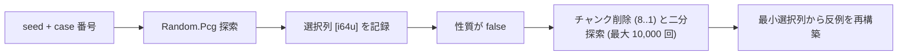

# Gen

`Gen` は、プロパティベーステスト（性質テスト）のための値生成器 `Gen<'a>`・コンビネータ・自動縮小（シュリンク）付き検証ランナー、および組み込み型クラス `Arbitrary` の標準インスタンスを提供する opt-in 標準モジュールです。

ソースコード中に `Gen` または `Arbitrary` 識別子が現れたときのみ読み込まれます。性質が偽となる入力を発見すると、内部の選択列を自動的に縮小して最小に近い反例を探索し、シード値・試行番号・縮小前後の反例を標準エラー出力へ報告してからトラップします（失敗報告を行うランナー関数群は `stdio` 権限を持ちますが、`test` 宣言内では権限検査の対象外です）。

## 要点

- `Gen.for_all generator property` は既定で 100 件の入力を生成して性質関数（`'a -> bool`）を検査し、`false` が返ると反例を自動縮小して報告します。
- 乱数列は [`Random.Pcg`](../sys/random.md) による決定論的生成です。既定シードは固定値 `11400714819323198485` であり、`tsuzuri test --seed N` で変更できます。同じシードならネイティブと WASM、`-O0` と `-O3` で完全に同じ入力列と縮小結果が得られます。
- シュリンクは値そのものではなく「生成器が行った選択列」に対して働くため、`Gen.map` や `Gen.bind` で組み立てた複合型も追加コードなしで自動的に縮小されます。
- レコードと共用体は `deriving (Arbitrary)` で既定の生成器を自動導出できます。

## 基本的なプロパティテストの記述

引数を持たない基本生成器（`Gen.i64`・`Gen.string` など）は関数として定義されているため、`Gen.i64()` のように `()` を付けて呼び出します。

```tsuzuri project=prop_basic file=PropBasic.tz
test "配列を 2 回反転すると元に戻る" =
    Gen.for_all (Gen.array (Gen.i64())) (\xs ->
        let once = Array.rev xs
        let twice = Array.rev once
        Array.equal twice xs)

test "折り返し加算の交換法則" =
    Gen.for_all (Gen.pair (Gen.i64()) (Gen.i64())) (\pair ->
        let (a, b) = pair
        Int.wrapping_add a b == Int.wrapping_add b a)
```

- 性質関数は生成された値の所有権を受け取り（`own 'a -> bool`）、条件を満たせば `true`、反例であれば `false` を返します。性質関数の内部で `assert` 失敗などのトラップを起こすとシュリンクが行われず即座にテスト終了となるため、検証したい条件は必ず `bool` の戻り値として表現してください。
- `tsuzuri test` は通常の `+` や `*` の整数折り返しを失敗として検出するため（[`Test`](./test.md) 参照）、全域の `Gen.i64()` / `Gen.i32()` を使う算術テストでは `Int.wrapping_*` を使うか、`Gen.range` でオーバーフローしない範囲に絞ります。

### 反例発見とシュリンク出力

たとえば `Gen.for_all (Gen.i64()) (\x -> x < 100)` が失敗すると、`tsuzuri test` は失敗理由の下に次の 3 行を表示します。

```text
not ok 1 - Main below 100
  failure: trapped or terminated by signal
  property failed at case 1 of 100 (seed 11400714819323198485)
  counterexample: 100
  shrunk 59 times from 9223372036854775807
```

## 生成器の合成と条件付き検証

`Gen<'a>` は不透明レコード（`E1022`）であり、`Gen.map`・`Gen.bind`・`Gen.pair`・`Gen.one_of`・`Gen.element`・`Gen.constant` をパイプラインで組み合わせて任意のドメイン固有データ生成器を構築できます。

- **`Display` を実装しない型の検証**: `Maybe<'a>` や `Result<'a, 'e>` など `Display` インスタンスを持たない型には、表示関数 `ref 'a -> string` を明示する `Gen.check` / `Gen.check_where` を使用します。
- **事前条件によるフィルタリング**: `Gen.for_all_where` / `Gen.check_where` は、性質関数が `Maybe.None` を返した入力を破棄し、`Maybe.Some` が規定件数に達するまで試行します（破棄数が有効件数の 9 倍を超えると `property gave up` として失敗します。なお、後段の生成範囲自体を前段の値から絞れる場合は `Gen.bind` を使う方が無駄な破棄が発生しません）。

```tsuzuri project=prop_comb file=PropComb.tz
def ordered_pairs :: Gen<(i64 * i64)>
fn ordered_pairs =
    Gen.range 0 50
    |> Gen.bind (\high ->
        Gen.range 0 high |> Gen.map (\low -> (low, high)))

def show_maybe :: ref Maybe<i64> -> string
fn show_maybe item =
    match item with
    | Maybe.None -> "None"
    | Maybe.Some n -> $"Some {n}"

test "bind で生成した組は常に low <= high を満たす" =
    Gen.for_all (ordered_pairs()) (\pair ->
        let (low, high) = pair
        low <= high)

test "Display を持たない Maybe 型を Gen.check で検査する" =
    Gen.check show_maybe 50 (Gen.maybe (Gen.range 1 20)) (\item ->
        Maybe.default_value 0 item >= 0)

test "ゼロを除いた平方の正値性を for_all_where で検査する" =
    Gen.for_all_where (Gen.range (-30) 30) (\n ->
        if n == 0 then Maybe.None else Maybe.Some (n * n > 0))
```

## `Arbitrary` 型クラスと自動導出

組み込み型クラス `Arbitrary<'a>` は型の既定生成器 `Arbitrary.arbitrary :: Gen<'a>` を提供します。標準ライブラリは `i8`〜`i64`・`i8u`〜`i64u`・`bool`・`f64`・`char`・`string`・配列 `['a]`・`Maybe<'a>`・2〜4 要素タプルのインスタンスを備えており、ユーザー定義の非再帰レコード・共用体には `deriving (Arbitrary)` で自動導出できます（再帰型やフィールド 0 個のレコードに対する `deriving (Arbitrary)` は `E1025` となるため、深さ制限付きの生成器を手書きします）。

```tsuzuri project=prop_arbitrary file=PropArbitrary.tz
record Point { x: i32, y: i32 } deriving (Arbitrary, Eq, Display)

union Action =
    | Move of Point
    | Wait
    deriving (Arbitrary, Eq, Display)

test "導出した Arbitrary で自己等価性を検証する" =
    Gen.for_all (Arbitrary.arbitrary()) (\(act: Action) -> act == act)
```

関数の事前・事後契約から自動生成される契約テスト（`tsuzuri test --contracts test`）でも、この `Arbitrary` インスタンスが使用されます（[契約と属性](../../expressions/contracts-and-attributes.md)）。

## シュリンク（最小反例探索）の仕組み



各生成器は乱数ビットをそのまま値にするのではなく、「`0` に近いほど単純な値になる境界付き選択列 `[i64u]`」として記録します。

- `Gen.i64()` / `Gen.i32()` は小さな絶対値を優先しつつ、16 回に 1 回の割合で型の最小値・最大値（オーバーフロー境界）を提案し、縮小時は `0` へ向かいます。
- `Gen.array` / `Gen.string` は要素ごとの継続フラグと要素選択を記録するため、縮小時は不要な要素の削除と各要素の単純化が同時に進みます。
- 反例が見つかると、シュリンカは最大 10,000 回の予算内で「長さ 8〜1 の連続選択の削除」と「各選択値の `0` 試行・二分探索」を収束するまで反復し、より短く辞書順で小さい失敗選択列を確定します。

## 引数の順序

標準ライブラリの設計規約（[標準ライブラリの規約](../conventions.md)）に従い、生成器を変換するコンビネータ（`Gen.map`・`Gen.bind`・`Gen.array_up_to`・`Gen.string_of`・`Gen.maybe` など）はすべて対象の `Gen` を**最後の引数**に取るため、`Gen.range 0 10 |> Gen.map f` のようにパイプラインで記述できます。一方、テストハーネスのエントリーポイントである 5 つの実行関数（`for_all`・`for_all_cases`・`for_all_where`・`check`・`check_where`）はハーネス免除規則により、呼び出し側が複数行ラムダとして最後に書く性質関数 `property` を末尾引数に取ります。

## 公開 API

### 型と組み込み型クラス

```text
record Gen<'a> // 不透明（opaque）

// 組み込み型クラス
Arbitrary<'a> { arbitrary :: Gen<'a> }
```

### 基本・コンテナ生成器（13 関数）

| 関数 | シグネチャ | 説明 |
| --- | --- | --- |
| `Gen.i64` | `Gen<i64>` | 小さい値と最小・最大境界を重視する `i64` 生成器（`0` へ縮小） |
| `Gen.i32` | `Gen<i32>` | 小さい値と最小・最大境界を重視する `i32` 生成器（`0` へ縮小） |
| `Gen.range` | `own i64 -> own i64 -> Gen<i64>` | 閉区間 `[low, high]` のほぼ一様な整数生成器（`low > high` はトラップ、`0` に最も近い値へ縮小） |
| `Gen.bool` | `Gen<bool>` | 真偽値生成器（`false` へ縮小） |
| `Gen.f64` | `Gen<f64>` | 有限の `f64` 生成器（NaN・無限大・`-0.0` を含まず `0.0` や整数へ縮小） |
| `Gen.char` | `Gen<char>` | 印字可能 ASCII 文字 `' '`〜`'~'` の生成器（`'a'` へ縮小） |
| `Gen.unicode_char` | `Gen<char>` | サロゲートを除く全 UTF-16 コード単位の生成器（`'a'` へ縮小） |
| `Gen.string` | `Gen<string>` | 長さ 32 以下の印字可能 ASCII 文字列生成器（`""` へ縮小） |
| `Gen.string_of` | `own Gen<char> -> Gen<string>` | 指定した文字生成器による長さ 32 以下の文字列生成器 |
| `Gen.array` | `own Gen<'a> -> Gen<['a]>` | 長さ 32 以下（平均約 7 要素）の配列生成器（空配列・単純要素へ縮小） |
| `Gen.array_up_to` | `own i64 -> own Gen<'a> -> Gen<['a]>` | 長さ `limit` 以下の配列生成器（`limit < 0` はトラップ） |
| `Gen.maybe` | `own Gen<'a> -> Gen<Maybe<'a>>` | `None` または `Some` の生成器（`None` へ縮小） |
| `Gen.result` | `own Gen<'a> -> own Gen<'e> -> Gen<Result<'a, 'e>>` | `Ok` または `Error` の生成器（`Ok` へ縮小） |

### コンビネータ（6 関数）

| 関数 | シグネチャ | 説明 |
| --- | --- | --- |
| `Gen.constant` | `Copy<'a> => own 'a -> Gen<'a>` | 常に同じ値を返す生成器 |
| `Gen.map` | `own ('a -> 'b) -> own Gen<'a> -> Gen<'b>` | 生成された値に関数を適用して変換（シュリンクを維持） |
| `Gen.bind` | `own ('a -> Gen<'b>) -> own Gen<'a> -> Gen<'b>` | 生成された値から次の生成器を動的に構築 |
| `Gen.pair` | `own Gen<'a> -> own Gen<'b> -> Gen<('a * 'b)>` | 2 つの生成器からタプルを生成 |
| `Gen.one_of` | `own [Gen<'a>] -> Gen<'a>` | 生成器配列から等確率で 1 つを選択（空配列はトラップ、先頭要素へ縮小） |
| `Gen.element` | `Copy<'a> => own ['a] -> Gen<'a>` | 候補値配列から等確率で 1 つを選択（空配列はトラップ、先頭要素へ縮小） |

### プロパティ検証ランナー（5 関数）

| 関数 | シグネチャ | 説明 |
| --- | --- | --- |
| `Gen.for_all` | `Display<'a> => own Gen<'a> -> own ('a -> bool) -> unit` | 100 件の生成値で性質を検証し、失敗時は縮小して報告・トラップ |
| `Gen.for_all_cases` | `Display<'a> => own i64 -> own Gen<'a> -> own ('a -> bool) -> unit` | 指定件数 `cases`（`<= 0` はトラップ）で性質を検証 |
| `Gen.check` | `own (ref 'a -> string) -> own i64 -> own Gen<'a> -> own ('a -> bool) -> unit` | カスタム表示関数 `show` と試行件数を指定して性質を検証 |
| `Gen.for_all_where` | `Display<'a> => own Gen<'a> -> own ('a -> Maybe<bool>) -> unit` | `None` を破棄しつつ有効 100 件で検証（破棄過多時は失敗） |
| `Gen.check_where` | `own (ref 'a -> string) -> own i64 -> own Gen<'a> -> own ('a -> Maybe<bool>) -> unit` | カスタム表示関数 `show` と有効件数を指定して条件付き検証 |

## 関連項目

- [Test](./test.md)
- [Bench](./bench.md)
- [Random](../sys/random.md)
- [標準ライブラリの規約](../conventions.md)
- [型クラス](../../types/type-classes.md)
- [契約と属性](../../expressions/contracts-and-attributes.md)
- [CLI コマンド](../../compiler/cli.md)
