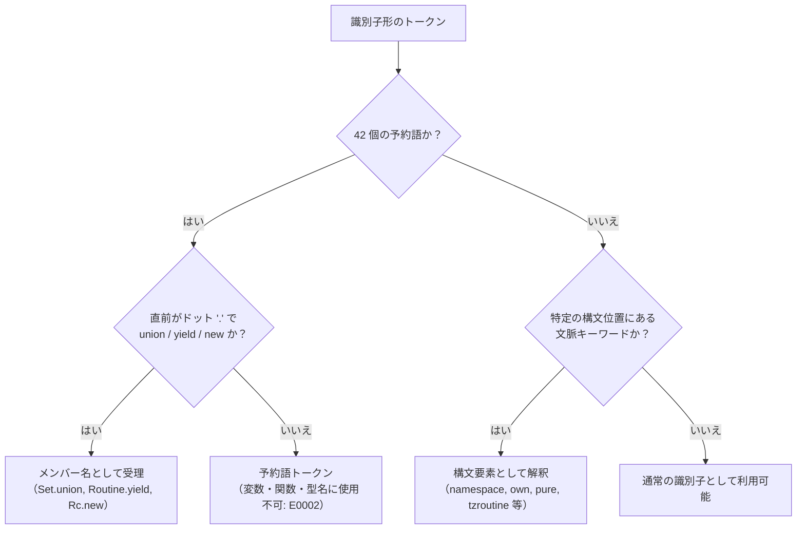

# 字句構造とブロック構文

Tsuzuri のソースコードは UTF-8 で符号化されたテキストファイルであり、字句解析器によってコメントと空白が処理されたのち、識別子・予約語・リテラル・記号トークンへと分割されます。構文解析器はインデントによるレイアウト規則（オフサイドルール）と波括弧 `{ ... }` による明示ブロックの双方を解釈し、すべてを式として組み立てます。

本ページでは、ソースファイルの物理構造、コメント、識別子、全 42 個の予約語と文脈キーワード、区切り記号と演算子トークン、ブロックと文の評価規則、および改行・行継続の規則を体系的に定義します。

## 要点

- **UTF-8 エンコーディングと静的上限**: ソースは UTF-8 で記述します（1 ファイル最大 4 MiB、構文ネスト最大 128 段）。識別子は ASCII 英数字と `_` で構成します。
- **3 種のコメントと shebang**: 行コメント `//`、入れ子可能なブロックコメント `/* ... */`、宣言に紐づくドキュメントコメント `///`、およびファイル先頭の `#!` 行をサポートします。
- **42 個の予約語と文脈キーワード**: 予約語は原則として識別子に使えません（`.` 直後の `union`・`yield`・`new` のみ例外）。`own`・`pure`・`namespace`・`tzroutine`・`select` などは特定構文でのみ働く文脈キーワードです。
- **式指向のブロックと `unit` 検査**: インデントブロックと波括弧 `{ ... }` ブロックのいずれも末尾の式が値になります。途中の式は `unit` 型でなければならず、値の放置によるバグを `E1003` で防ぎます。
- **改行をまたがない関数適用**: 空白並置による関数適用（`f x y`）は改行で終了します。複数行に分ける際は括弧、行頭の継続演算子（`|>` 等）、または行末の二項演算子を用います。

## ソースエンコーディングとファイル制約

すべてのソースファイル（`.tz`・`.tt`・`.tc`）は妥当な UTF-8 でなければなりません。改行コードは LF（`\n`）および CRLF（`\r\n`）の両方を受理します。ファイル先頭（バイト位置 0）の UTF-8 BOM（`U+FEFF`）は無視されます。

コンパイラの健全性と予測可能なメモリ使用量を保つため、以下の静的上限が定められています。

| 項目 | 上限 | 超過時の診断コード |
| --- | --- | --- |
| 1 ファイルあたりのソースサイズ | 4 MiB（4,194,304 バイト） | `E0003` (`source_too_large`) |
| 式・型・パターンの構文ネスト深度 | 128 段 | `E0002` |
| 名前空間パスのセグメント数 | 16 セグメント | `E1017` |

深く入れ子になった関数呼び出し `f (g (h (...)))` が上限に達する場合は、ローカルな `let` 束縛に分割するか、パイプライン演算子 `|>` を用いて平坦に記述します。

## コメントと shebang

Tsuzuri は用途に応じて 3 種類のコメントと、スクリプト実行用の shebang 行を備えています。

### 単一行コメント (`//`) とブロックコメント (`/* ... */`)

- **`//`**: 行末までをコメントとして読み飛ばします（直後が `/` で `///` になる場合を除きます）。
- **`/* ... */`**: 複数行にまたがるブロックコメントです。**入れ子（ネスト）に対応**しているため、内部に既存の `/* ... */` を含むコード片も安全にコメントアウトできます。閉じられていないブロックコメントは字句エラー `E0001`（`unterminated_block_comment`）になります。

```tsuzuri run=42
// 単一行コメント
/* 外側のブロックコメント
   /* 内側のブロックコメントも安全に入れ子にできる */
   ここまでコメント */
let value = 42
value
```

### ドキュメントコメント (`///`)

`///` で始まる行は Markdown 形式のドキュメントコメントトークンとして保持され、`tsuzuri doc` による API ドキュメント生成、LSP のホバー表示、および `tsuzuri test --doc` によるドキュメント内コード例の自動検証に使用されます（`////` のように 4 本以上のスラッシュで始まる行も先頭 3 文字以降を本文とするドキュメントコメントになります）。

- **付与できる宣言**: `def`（`export`・`private`・`extern`・`pure`・`const`・型クラスメソッドを含む）、`record`、`union`、`type`、`const`、`class`
- **付与できない箇所**: 分離された実装行（`fn` / `let`）、`instance`、レコードフィールド定義、関数内のローカル束縛、`test`、`bench`、トップレベル実行式（いずれも構文エラー `E0002` `misplaced_doc_comment`）

詳細は[ドキュメントコメントと doc-test](../modules/doc-comments.md)を参照してください。

### shebang 行 (`#!`)

ファイルの先頭（バイト位置 0）が `#!` で始まる場合、最初の改行までが行コメントと同様に読み飛ばされます。行番号・列番号は shebang 行を 1 行目としてそのまま保持されるため、診断位置がずれることはありません。2 行目以降や UTF-8 BOM の直後に置かれた `#!` は shebang として扱われず、字句エラーになります。

```tsuzuri run=ready
#!/usr/bin/env -S tsuzuri script
"ready"
```

## 識別子と命名規則

識別子は以下の字句規則に従います。

- **構成文字**: 先頭は ASCII 英字（`a`〜`z`、`A`〜`Z`）またはアンダースコア `_`。2 文字目以降は ASCII 英数字（`a`〜`z`、`A`〜`Z`、`0`〜`9`）または `_`。
- **大文字・小文字の区別**: 区別されます（`total` と `Total` は別の識別子です）。
- **非 ASCII 文字**: 日本語などの非 ASCII 文字は識別子に使用できず、`E0001`（`unexpected_character`）になります（文字列・文字リテラルおよびコメント内では自由に使用できます）。

構文上、先頭文字の大文字・小文字が意味を持つ箇所があります。

| 対象 | 規則・慣習 | 例 |
| --- | --- | --- |
| モジュール名（ファイル名） | ASCII 英大文字で開始（必須） | `Point.tz`、`OrderItem.tz` |
| `union` のケース名・アクティブパターン名 | ASCII 英大文字で開始 | `Some`、`Circle`、`(\|Even\|Odd\|)` |
| レコード・共用体・型エイリアス・型クラス名 | `PascalCase`（慣習。小文字開始の型名も構文上は許容） | `Position`、`OrderStatus` |
| 関数名・ローカル変数・フィールド名 | `snake_case`（推奨） | `unit_price`、`calculate_total` |
| 型変数 | アポストロフィ `'` + ASCII 英字で開始（`'_` は `E0001` で不可） | `'a`、`'key`、`'value` |
| 未使用束縛 | `_` 単体（ワイルドカード）または `_` 開始の識別子で未使用警告 `W1001` を抑制 | `_`、`_index` |

## 予約語と文脈キーワード

予約語の集合はパッケージまたはソースのエディションによって管理されます。現在サポートされている Edition `2026`・`2027`・`2028` では予約語の追加はなく、全エディション共通で以下の **42 語**が予約されています。



### 予約語一覧（全 42 語）

| 分類 | 予約語 | 主な用途 |
| --- | --- | --- |
| **宣言・型定義**（15 語） | `def`, `fn`, `let`, `const`, `rec`, `and`, `type`, `record`, `union`, `class`, `instance`, `deriving`, `dyn`, `test`, `bench` | 関数シグネチャと実装、ローカル束縛、定数、再帰・相互再帰、型エイリアス、レコード・共用体、型クラス・自動導出・動的ディスパッチ、テスト・ベンチマーク宣言 |
| **可視性・外部連携**（3 語） | `export`, `extern`, `private` | ホスト ABI 公開、外部関数の宣言、モジュール内非公開化 |
| **条件分岐・ループ**（12 語） | `if`, `then`, `elif`, `else`, `for`, `in`, `to`, `downto`, `while`, `do`, `break`, `continue` | 条件式、コレクション・範囲反復、昇順・降順カウントループ、条件ループ、脱出と継続 |
| **パターンマッチ**（3 語） | `match`, `with`, `when` | パターン分岐、`match` / `try` 節の導入およびレコード更新 `{ r with ... }`、ガード条件 |
| **所有権・参照・型変換**（5 語） | `mut`, `ref`, `deref`, `new`, `as` | 可変束縛・可変引数、共有・排他借用、参照外し、ヒープ確保、数値キャストおよびパターン束縛 |
| **コンピュテーション式**（2 語） | `return`, `yield` | ビルダー内の結果構築（`return`）および要素生成（`yield`） |
| **論理値リテラル**（2 語） | `true`, `false` | `bool` 型の真偽値リテラル |

予約語を変数名、関数名、型名、レコードのフィールド名に使用すると構文エラー `E0002` になります。

#### 予約語のメンバー名例外 (`union`, `yield`, `new`)

予約語のうち `union`・`yield`・`new` の 3 語に限り、ドット `.` の直後に置かれるメンバー名（およびモジュール関数名）として使用できます。これにより、`Set.union`、`Routine.yield`、`Rc.new`、`Arc.new` のような標準ライブラリ API を自然な名前で呼び出せます。

```tsuzuri run=3
let left = Set.insert 2 (Set.singleton 1)
let right = Set.insert 3 (Set.singleton 2)
let merged = Set.union left right
Routine.yield ()
Set.length merged
```

### 文脈キーワード一覧

以下の語は予約語ではなく、特定の構文位置に現れたときのみキーワードとして解釈されます。それ以外の位置では通常の変数名・関数名・型名として使用できます。

| 文脈キーワード | キーワードになる構文位置 | 役割 |
| --- | --- | --- |
| `namespace` | ファイル先頭（行頭） | モジュールが属する名前空間の宣言 |
| `using` | ファイル先頭（`namespace` 直後の行頭） | 他名前空間のモジュール短縮参照宣言 |
| `of` | `union` のケース宣言内 | ケースが保持するペイロード型の導入（`Value of i64`） |
| `pure` | `def`・`instance` 内 `fn`・関数型の直前 | 副作用を持たない純粋関数・純粋関数型 `pure (T -> U)` の契約 |
| `own` | `def` シグネチャの各引数型の先頭 | 所有権を値渡しで受け取る引数修飾（Edition 2027 以降の明示ムーブ） |
| `where` | 関数ガード節の末尾 | ガード条件・本体から参照する補助束縛の導入 |
| `use` | ブロック内またはコンピュテーション式内（`use!`） | スコープ終了時に `Drop.drop` を自動実行する束縛 |
| `try`, `finally`, `is` | 同一括弧深度に `with` を伴う `try ... with ... finally` 式 | `@checked` 演算の例外捕捉、後始末節、例外型判定 |
| `otherwise` | パターン位置および関数ガード節 | `_` と同義のワイルドカード（変数としては束縛されない） |
| `tzroutine` | 同一行の `{` の直前（`tzroutine { ... }`） | 軽量並行実行単位の起動式 |
| `select`, `recv`, `send`, `default`, `from` | `select` の直後に `\|` と `recv` / `send` / `default` が続く式 | 複数チャネルの同時待機分岐（送信先は予約語 `to` を使用） |
| `copy`, `local` | `extern type` 宣言の修飾位置 | `Copy` 可能な外部識別子、またはスレッド固定外部ハンドルの指定 |

たとえば `own` は引数型の先頭では所有権修飾子として解釈され、それ以外の型位置では型名として解釈されます。また `try`・`finally`・`where` なども通常のローカル変数名に束縛できます（可読性の観点からは別名を推奨します）。

```tsuzuri run=52
record own { amount: i64 }

def unwrap_own :: own own -> i64 = \item -> item.amount

let where = 10
unwrap_own (own { amount: 42 }) + where
```

### 予約語ではない組み込み識別子と廃止構文

- **`not`・`ignore`・`assert`・`to_string`・`clone_string`**: 予約語ではなく組み込み関数です。`Array.map not flags` のように第一級関数として渡せます。
- **廃止された `task` / `async` ブロック**: 旧版の `task { ... }` および `Async { ... }` / `async { ... }` は削除されており、`task` や `async` は通常の識別子として使用できます。`@alias` ビルダー定義なしに `task { ... }` や `async { ... }` と記述した場合は移行案内付きの `E1040` が報告されます。

## 区切り記号と演算子トークン

字句解析器は最長一致規則（maximal munch）で記号列を切り出します。ただし、ネストしたジェネリック型の閉じ括弧 `Maybe<Maybe<i64>>` や制約矢印が続く `Box<'a>=> ...`（`>=>`）は、型構文の中で個別の `>` として正しく分割されます。

### 括弧とコレクション区切り

| トークン | 用途 | 例 |
| --- | --- | --- |
| `( )` | 式のグループ化、タプル `(a, b)`、`unit` リテラル `()`、引数なし呼び出し `f()` | `(1 + 2) * 3` |
| `{ }` | 明示ブロック `{ a; b }`、レコード定義・構築 `Point { x: 1 }`、更新 `{ p with x = 2 }`、リージョン注釈 `ref {r} T`、コンピュテーション式 | `Maybe { return 1 }` |
| `[ ]` | 配列リテラル `[1, 2]`、配列型 `[T]`、固定長配列型 `[T; N]`、単一・多次元添字とスライス `xs[i]`・`ref m[0..<2, ..]` | `prices[^0]` |
| `[\| \|]` | 不変連結リストリテラル `[\| 1, 2 \|]`、空リスト `[\|\|]`、リスト型 `[\|T\|]` | `[\| 10, 20 \|]` |
| `< >` | ジェネリック型引数・型パラメータ、型クラス制約 | `Result<i64, string>` |

### コロン・矢印・範囲・特殊記号

| トークン | 用途と文脈ごとの規則 |
| --- | --- |
| `:` | `let` / `const` / パターンの型注釈、レコード定義・構築の `field: value`、制約行 `@'a : Ord`、補間文字列の書式開始 `{x:.2f}` |
| `::` | ① `def name :: Type` の型シグネチャ導入、② リストの右結合コンスパターン `head :: tail`、③ 空白を挟まず大文字開始のモジュール名で終わる（または行頭の `namespace` / `using` に続く）名前空間区切り `App::Domain::Order` |
| `->` | 関数型 `A -> B`、ラムダ式 `\x -> body`、`match` / `select` / `try` アームの本体導入 |
| `=>` | 型クラス制約の区切り `Ord<'a> => 'a -> 'a -> bool` |
| `\` | ラムダ式（無名関数）のパラメータ導入 `\x y -> x + y` |
| `..` | 全範囲セレクタ `..`、`for` の閉区間 `a .. b`（Edition 2028 で正準、Edition 2027 では `E0004`）、刻み導入 `start .. step ..= end`、閉区間スライス `ref xs[a..b]`（Edition 2028 では閉区間、Edition 2026/2027 では半開区間で `W1013`） |
| `..=` / `..<` | 全エディション共通の閉区間（終端を含む `a ..= b`）および半開区間（終端を含まない `a ..< b`） |
| `<..` / `<..<` | Edition 2028 の始端開放範囲（`a <.. b` は始端を除き終端を含む、`a <..< b` は両端を除く） |
| `^` | ① 中置のビット排他的論理和（`^^^` と同義）、② Edition 2028 の角括弧内における末尾相対位置前置記号 `^k`（`^0` が末尾要素 `len - 1`。式を渡す場合は `^(k + 1)` と括弧で囲む） |
| `\|>` / `>>` / `<<` | パイプライン `x \|> f`、順方向関数合成 `f >> g`、逆方向関数合成 `f << g` |
| `&&&`, `\|\|\|`, `^^^`, `~~~`, `<<<`, `>>>` | ビット論理積・論理和・排他的論理和・ビット反転・左シフト・右シフト（`&`, `\|`, `^`, `~` もビット演算子として受理） |
| `**` | 右結合の累乗演算子（`2 ** 3 ** 2` は `2 ** (3 ** 2)`） |
| `@` / `#` | コンパイラ属性（`@checked`, `@requires`, `@ensures`, `@cpu`, `@no_alloc`, `@trusted`, `@json`, `@alias` 等）、制約行 `@'T : #distance` のモジュール関数制約 |
| `?` / `:?` | 式の位置の型つき穴 `?`・`?name`（期待型と候補を `E1030` で提示）、および匿名共用体の型テストパターン `:? i64 as n`（空白を挟まない 2 文字） |
| `!` | 前置の論理否定 `!flag`、およびコンピュテーション文の接尾辞（`let!`, `do!`, `use!`, `and!`, `match!`, `return!`, `yield!`） |
| `;` / `,` | 波括弧ブロック内の文区切り・値破棄 `;`（固定長配列型 `[T; N]` でも使用）、タプル・配列・多次元添字・型引数リストの要素区切り `,` |

> [!NOTE]
> Edition 2027 以降では、意味が重複していた旧表記のうち記号による借用・参照外し・参照型（`&x`, `&mut x`, `*r`, `&T`）、バックスラッシュなしのラムダ（`x -> e`）、および短縮数値サフィックス（`86uy`, `1.0f` 等）は正準形統一のため `E0004` で拒否されます。すべてのエディションで通用する `ref x`、`ref mut x`、`deref r`、`ref T`、`\x -> e`、`86i8u`、`1.0f32` を使用してください。

## ブロック構造と文の評価規則

Tsuzuri ではブロックも 1 つの式であり、内部に並べた束縛（`let` / `let mut` / `use`）や途中式を上から順に評価したあと、**最後の式の評価値**をブロック全体の値として返します。

### インデントブロック（オフサイドルール）

関数の `=`、`if` の `then` / `else`、`match` アームの `->`、ループの `do` の直後で改行すると、次の行の開始列（インデント幅、標準 4 スペース）がそのブロックの基準列になります。同じ基準列に並ぶ行が同一ブロックの文として順に連なり、基準列より浅いインデントが現れた時点でブロックが閉じます。

```tsuzuri run=42
def compute :: i64 -> i64 = \base ->
    let shifted = base + 2
    let doubled = shifted * 2
    doubled

compute 19
```

### 波括弧による明示ブロック (`{ ... }`)

インデントに依存せず `{ ... }` で明示的にブロックを囲むこともできます。波括弧内では各文をセミコロン `;`（または改行）で区切ります。

- 最後の式に `;` を付けなければ、その式の値がブロックの戻り値になります。
- 最後の式に `;` を付けた場合、または空ブロック `{}` を書いた場合、ブロック全体の値は `unit`（`()`）になります。

```tsuzuri run=42%20true
let total = { let a = 40; let b = 2; a + b }
let discarded: unit = { let temp = 99; temp + 1; }
$"{total} {discarded == ()}"
```

### ブロック途中の `unit` 型強制と値の破棄

ブロックの途中（最後の式より前）に置かれた式は、型が `unit` でなければなりません。非 `unit` の値を返したまま放置すると、意図しない計算結果の無視を防ぐため型エラー `E1003`（`expected unit`）が報告されます。

途中式の戻り値を意図的に破棄するには、以下の 3 通りのいずれかを使用します。

1. 式の末尾にセミコロン `;` を付ける。
2. `let _ = 式` でワイルドカードに束縛する。
3. `式 |> ignore` で組み込み関数 `ignore :: 'a -> unit` に渡す。

```tsuzuri run=40
def run_steps :: i64 -> i64 = \x ->
    x + 10;
    let _ = x + 20
    (x + 30) |> ignore
    x * 2

run_steps 20
```

## 改行と行継続の規則

空白並置による関数適用（`f arg1 arg2`）は**同一行内でのみ継続し、改行をまたぎません**。もし改行越えの並置適用を許すと、連続する 2 つの関数呼び出し文が前の行の戻り値に対する関数適用として誤解釈されてしまうためです。同様に、後置の丸括弧呼び出し `f(...)` や角括弧添字 `xs[...]` は直前のトークンと空白なしで隣接している必要があります。

長い式を複数行に分割する場合は、以下の 3 つの行継続規則のいずれかを用います。

1. **括弧で囲む**: `( ... )`、`[ ... ]`、`[| ... |]`、`{ ... }` の内部では自由に改行できます。
2. **行頭に継続演算子を置く**: 新しい行の先頭が `|>`、`>>`、`<<`、`||`、`&&` のいずれかで始まる場合、直前の行の式の続きとして解析されます。
3. **二項演算子の直後で改行する**: `+`、`-`、`*`、`=` などの二項演算子を行末に置いた場合、右辺を次の行に記述できます。

```tsuzuri run=30%2030%2030
def add :: i64 -> i64 -> i64 = \x y -> x + y

let by_paren = add 10 (
    20
)

let by_pipe = 10
    |> add 20

let by_trailing_op = 10 +
    20

$"{by_paren} {by_pipe} {by_trailing_op}"
```

## 関連項目

- [リテラル](./literals.md)
- [文字列](./strings.md)
- [文字列補間と書式指定](./string-interpolation.md)
- [束縛と値](../expressions/bindings-and-values.md)
- [演算子と優先順位](../expressions/operators.md)
- [関数と純粋関数](../expressions/functions.md)
- [コンピュテーション式](../expressions/computation-expressions.md)
- [ドキュメントコメントと doc-test](../modules/doc-comments.md)
- [安定性とエディション互換性](../compiler/stability.md)
