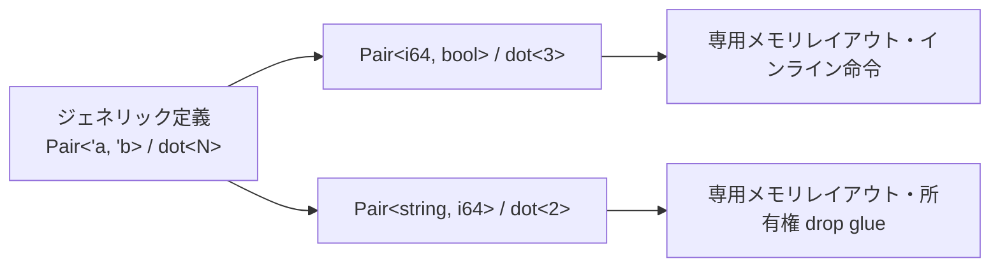

# ジェネリクス

ジェネリクス（総称型・多相関数）は、具体的な要素型や固定長配列のサイズを後から差し替えられるデータ構造とアルゴリズムを定義する機能です。Tsuzuri は型変数 `'a` による値型の抽象化に加えて、型クラス制約・モジュール関数制約、固定長配列 `[T; N]` の定数長さパラメータ `const N: i64`、および型コンストラクタを抽象化する高階カインド型（HKT）をサポートします。すべてのジェネリック定義はコンパイル時の単相化（monomorphization）によって具体型ごとの専用機械語へ展開され、実行時の辞書引きやボックス化のオーバーヘッドを一切伴いません。

## 要点

- **山括弧構文とランク1多相**: 型引数は空白を空けずに `Pair<i64, string>` と記述します。トップレベル `def` の型変数 `'a` は全称量化されますが、ローカル `let` は単相です。
- **柔軟な制約指定と推論**: 単一制約 `Eq<'a> =>`、複数制約 `(Eq<'a>, Display<'a>) =>`、およびインデントした `@'a : ...` 制約行（`#関数名` を含む）を使用でき、関数本体の演算からも制約が自動推論されます。
- **定数長さパラメータ `const N: i64`**: 固定長配列 `[T; N]` の長さを型・関数の双方で多相化でき、要素数不一致をコンパイル時に防止します。
- **高階カインド型 `'f<'a>`**: `* -> *` などのカインド注釈を持つ型クラスにより、`Maybe`・`Result<E>`・`Array` などのコンテナを横断する抽象化（`Functor` / `Foldable` 等）を記述できます。
- **ゼロオーバーヘッド単相化と具体化後検査**: 具体化ごとに専用の LLVM IR を生成し、64 KiB のインラインレイアウト上限や借用・`Send` 条件も具体化後の型に対して検証します。

## ジェネリック関数とジェネリック型の構文

### ジェネリック関数と Edition 2027+ の引数規約

シングルクォートで始まる識別子（`'a`、`'key`、`'value` など）は型変数を表します（無名の `'_` は字句エラー `E0001`）。トップレベル関数 `def` のシグネチャに現れる型変数は暗黙に全称量化され、呼び出し位置ごとに独立した具象型へと具体化されます。

Edition 2027 以降（既定の Edition 2028 を含む）の通常の `def` では、無印の型変数 `'a` は既定で共有借用（読み取りビュー）として渡されます。所有権を受け取ってそのまま返却・移動する関数では **`own 'a`** を明記します（読み取り引数 `'a` を値として返す関数には `Copy<'a>` 制約が推論されます）。

```tsuzuri run=42:hello
def identity :: own 'a -> 'a = \value -> value

let num = identity 42
let word = identity "hello"
$"{num}:{word}"
```

ジェネリック関数の本体は、一度も呼び出されていなくても抽象型のまま厳密に型検査されます。また、ローカルな `let` 束縛は単相（1 つの具象型のみ）であるため、複数の型に適用する関数は必ずトップレベルの `def` として宣言します（未確定のまま残るローカル多相値は `E1015` になります）。

### ジェネリックなレコード・共用体・型エイリアス

型名の直後に空白を空けずに `<...>` を続けて型パラメータを宣言します。

```text
record Pair<'a, 'b> { first: 'a, second: 'b }
union Reply<'a> = Pending | Ready of 'a
type Handler<'a, 'b> = ('a -> Result<'b, string>)
```

- **構文規則**: `Pair <i64, string>`（空白あり）、`Box<>`（空の括弧）、および ML 風の `Pair 'a 'b` はすべて構文エラー `E0002` です。ネストした `Box<Pair<i64, i64>>` の `>>` は型引数の終端として認識され、末尾カンマ `Box<i64,>` も許容されます。
- **パラメータ検査**: 宣言したすべての型パラメータは、少なくとも 1 つのフィールド・ペイロード・エイリアス右辺で使用しなければなりません（未使用・重複・未宣言の型変数は `E1024`）。非ジェネリック型への型引数付与や個数不一致は `E1004` です。

```tsuzuri run=20:answer
record Pair<'a, 'b> { first: 'a, second: 'b }

def swap_pair :: own Pair<'a, 'b> -> Pair<'b, 'a> = \pair ->
    Pair { first: pair.second, second: pair.first }

let swapped = swap_pair (Pair { first: "answer", second: 20 })
$"{swapped.first}:{swapped.second}"
```

## 型クラス制約とモジュール関数制約

### 型クラス制約の 3 つの記法

型パラメータに[型クラス](type-classes.md)の実装を要求する制約は、以下のいずれの構文でも記述でき、関数本体から自動推論された制約集合と統合されます。

```text
// 1. 単一制約の前置（=> 記法、またはインラインの Eq<'a> -> ...）
def same :: Eq<'a> => 'a -> 'a -> bool

// 2. 複数制約のタプル前置
def show_if_eq :: (Eq<'a>, Display<'a>) => 'a -> 'a -> string

// 3. インデントした @ 制約行（シグネチャの次行以降）
def clamp_add :: 'a -> 'a -> 'a
    @'a : Add, Ord, Copy
```

シグネチャに出現しない型変数への制約指定は `E1015`、未定義の型クラス名は `E1016`、制約を満たさない型での呼び出しは `E1005` となります。

```tsuzuri run=equal%3A%2042%20%7C%20diff
def show_match :: (Eq<'a>, Display<'a>) => 'a -> 'a -> string = \left right ->
    if left == right then
        $"equal: {left}"
    else
        "diff"

$"{show_match 42 42} | {show_match "a" "b"}"
```

### モジュール関数制約（`@'T : #name`）

型クラスを別途宣言しなくても、`@` 制約行に `#関数名`（または型付きの `(#関数名: 型)`）を記述することで、「具体化されたレコードまたは共用体 `'T` の定義元モジュールにその名前の公開関数が存在すること」を静的に要求し、本体内で `'T.関数名` として呼び出せます。

```tsuzuri project=mod-constraint file=Metric.tz
record Metric { raw: i64, weight: i64 }

def score :: Metric -> i64 = \m -> m.raw * m.weight
```

```tsuzuri project=mod-constraint file=Main.tz run=50
def combine_scores :: 'T -> 'T -> i64
    @'T : (#score: 'T -> i64) = \a b ->
        ('T.score a) + ('T.score b)

let m1 = Metric { raw: 10, weight: 2 }
let m2 = Metric { raw: 15, weight: 2 }
combine_scores m1 m2
```

`'T.score` は単相化時に `Metric.score` の直接呼び出しへと展開されます。定義元モジュールを持たないプリミティブ型や配列を渡した場合、または対象関数が存在しない場合は `E1005`、他モジュールの `private` 関数を参照した場合は `E1022`、`@` 制約なしで `'T.score` を書いた場合は `E1016` になります。

## 定数長さパラメータ `const N: i64`

固定長配列 `[T; N]` の要素数 `N` をパラメータ化することで、任意の固定長サイズに対して型安全に動作するデータ型や関数を定義できます。

### 型宣言における `const N: i64`

`record`・`union`・`type` の `<...>` 内に `const N: i64` を記述します（長さパラメータの型は必ず `i64` であり、`const N: i32` は構文エラー `E0002` です）。

```text
record Grid<'a, const N: i64> { cells: ['a; N], id: i64 }
union Polygon<const N: i64> = Empty | Vertices of [f64; N]
type Vector<const N: i64> = [f64; N]
```

- 宣言した長さパラメータ `N` がどのフィールド・ペイロードでも使われない場合や、未宣言の長さ識別子を使った場合は `E1024` になります。
- 型引数の位置に長さを渡す（`Grid<3, 3>`）または長さ引数の位置に型を渡す（`Grid<f64, f64>`）と `E1004`、具体化時の長さが `1024` を超えると `E1010` になります。

### 関数シグネチャにおける長さ多相

関数の `def` シグネチャ内で `[f64; N]` や `Grid<'a, N>` のように大文字の長さ識別子 `N`（同名の `const` 定数がスコープにないもの）を記述すると、その関数は長さ `N` に関して自動的に多相化されます。

```tsuzuri run=78:4
record VecN<const N: i64> { data: [i64; N] }

def dot :: [i64; N] -> [i64; N] -> i64 = \left right ->
    let mut acc = 0i64
    for i in 0 ..< left.length do
        acc = acc + left[i] * right[i]
    acc

def dimension :: VecN<N> -> i64 = \v -> v.data.length

let d3 = dot [1, 2, 3] [10, 20, 6]
let d2 = dot [3, 4] [2, 1]
let v4 = VecN { data: [5, 6, 7, 8] }
$"{d3 + d2}:{dimension v4}"
```

上の `dot` に長さが異なる `[1, 2]` と `[1, 2, 3]` を渡すと、第 1 引数から `N = 2` が確定した時点で第 2 引数が型不一致エラー `E1003`（`expected 2 elements for '[i64; 2]', found 3`）として静的に検出されます。

## 高階カインド型パラメータ（HKT）

高階カインド型（Higher-Kinded Types）は、`i64` のような完成した値型（カインド `*`）ではなく、`Maybe` や `Array` のように「型引数を受け取って型を作る型コンストラクタ」（カインド `* -> *`、`* -> * -> *` など）をパラメータ化します。Tsuzuri は引数がすべて値型 `*` であるランク 1 の型コンストラクタに対応しています（`(* -> *) -> *` のような高階カインド引数は `E1015`）。

- `.tt` ファイルの型クラス宣言で `class Functor<'f: * -> *>` のようにカインドを明記します（カインドが `*` でないクラス内では、メソッド固有の値型変数 `'a`・`'b` を導入できます）。
- 通常の `def` 関数では、シグネチャの `Functor<'f> =>` 制約から `'f` のカインドが自動的に引き継がれ、`'f<'a>` の形で適用できます。
- 2 引数以上の型コンストラクタをコンストラクタ位置で部分適用すると**末尾の型引数が固定**されます。たとえば `Result<string>` は、`'a` を受け取って `Result<'a, string>` を作る `* -> *` コンストラクタとして機能します（値型の位置に `let x: Result<string> = ...` と書くと引数不足で `E1004` になります）。
- 組込みコレクションのコンストラクタ名には `Array`・`List`・`Vec` を指定できます。

```tsuzuri project=hkt-demo file=Higher.tt
class Functor<'f: * -> *> {
    def map :: ('a -> 'b) -> 'f<'a> -> 'f<'b>
}

class Foldable<'f: * -> *> {
    def fold_sum :: ref 'f<i64> -> i64
}
```

```tsuzuri project=hkt-demo file=Main.tz run=42:60
instance Higher.Functor<Maybe> {
    fn map f v = Maybe.map f v
}

instance Higher.Functor<Result<string>> {
    fn map f v = Result.map f v
}

instance Higher.Foldable<Array> {
    fn fold_sum xs = Array.sum xs
}

def double_all :: Higher.Functor<'f> => own 'f<i64> -> 'f<i64> = \container ->
    Higher.Functor.map (\x -> x * 2) container

let r: Result<i64, string> = Ok 21
let doubled = Result.default_value 0 (double_all r)
let nums = [10, 20, 30]
let total = Higher.Foldable.fold_sum (ref nums)
$"{doubled}:{total}"
```

## コンパイル時単相化と具体化後検査

### ゼロオーバーヘッド単相化（Monomorphization）

ジェネリックな型・関数・高階カインド型・定数長さパラメータは、すべてコンパイル時に実際に使用された具象型と長さの組み合わせごとに専用の型レイアウトと機械語関数へ展開されます。



実行時の型辞書（dictionary passing）やオブジェクトのボックス化、RTTI は一切生成されません（実行時の動的ディスパッチが必要な場面でのみ、明示的な [`dyn C`](type-classes.md) を選択します）。なお、`export def` にはジェネリック関数を直接指定できないため（`E1008`）、具象型に特殊化した公開ラッパー関数を定義します。

### 具体化後の安全性・サイズ検査とリソース上限

抽象定義の段階だけでなく、単相化で型引数が具象型に置き換わった後の各インスタンスに対しても以下の検査が実施されます。

- **所有権・借用・並行安全性**: `Copy`・`Drop`・`Send`・`Sync` の可否は具体化後のフィールド構成から決定されます。たとえば `Holder<ref mut i64>` のように排他借用を許容されない位置へ具体化した場合は `E1013`、`Rc` を含む型で `Send` 要求関数を具体化した場合は呼び出し位置で `E1013` が報告されます。
- **インラインレイアウト上限の検査**: 具体化された型のインラインサイズが **64 KiB** を超える場合（例: `Grid<[f64; 1024], 16>`）は **`E1010`** として拒否されます（プログラム中で一度も具体化されない組み合わせはエラーになりません）。
- **特殊化のリソース上限（`E1017`）**:
  - プログラム全体のジェネリック関数特殊化数: 最大 **65,536 件**
  - 再帰呼び出しのたびに型が際限なく肥大化する非正則な多相再帰（`fn rec f x = f [x]` など）: 直接の自己包摂は最初の特殊化時点で、間接連鎖は深さ **32 回**を超えた時点で即座に停止して `E1017` を報告
  - 型の最大ネスト深度: **128**、単一型の最大構成ノード数: **4,096**、1 関数あたりの最大伝播制約数: **128 件**

## 関連項目

- [型システムの概要](overview.md)
- [型推論](type-inference.md)
- [型クラス](type-classes.md)
- [レコード](records.md)
- [判別共用体](unions.md)
- [関数](../expressions/functions.md)
- [Array](../stdlib/collections/array.md)
