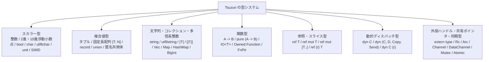

# 型システムの概要

Tsuzuri はコンパイル時にすべての式と束縛の型を検査する静的型付き関数型言語です。数値の暗黙拡大変換や実行時の動的型付けを行わず、所有権・借用・型クラス制約・メモリレイアウト上限まで単一の型検査パスで静的に検証します。境界となるトップレベル宣言には明示的な型シグネチャを記述し、関数本体のローカル束縛やラムダ引数は双方向型推論によって簡潔に記述できます。

## 要点

- **暗黙の型変換を行わない**: 異なる数値型間の変換や文字列化はすべて明示します。唯一の例外は、[匿名共用体](anonymous-unions.md)が期待される位置での要素型の自動注入と部分共用体の拡大です。
- **名目的型付けと構造的型付けの併用**: `record` と `union` は宣言名で区別され（名目的型付け）、タプル・配列・リスト・匿名共用体は構成要素の型で同一性が決まります（構造的型付け）。
- **第一級の Unit 型**: 情報を持たない型 `unit` は唯一の値 `()` を持ち、引数なし関数 `unit -> T` や副作用操作の戻り値型 `T -> unit` として一貫して扱われます。
- **透過的な型エイリアス**: `type Name<'a> = ...` は既存の型に対する別名を定義し、実行時表現や ABI を一切変えません。
- **値インラインの固定長配列**: `[T; N]` は要素数 `N`（最大 1,024）を型の一部として持ち、ヒープ確保を伴わずに値そのものの内部へ要素を格納します。

## 型の全体分類

Tsuzuri の型は、値としての性質とメモリ表現に応じて以下の 7 カテゴリに分類されます。



表中の「Copy」列は、値を移動（ムーブ）せずに複製して元の束縛も継続使用できるかを示します。「条件付き」は、構成要素や型引数がすべて `Copy`（かつ利用者定義の `Drop` を持たない非再帰型）であるときに自動的に `Copy` となることを意味します。

| 分類 | 型表記の例 | Copy | メモリ表現と主な用途 | 参照先 |
| --- | --- | --- | --- | --- |
| 固定幅整数 | `i8`〜`i128`, `i8u`〜`i128u` | ○ | 8〜128 bit の符号付き・符号なし整数（モジュロ折り返し算術） | [プリミティブ型](primitive-types.md) |
| 多倍長整数 | `BigInt`（局所注釈では `bigint` 可） | ○ | ヒープ上に任意桁を保持する符号付き整数 | [BigInt](../stdlib/numeric/bigint.md) |
| 2進浮動小数点 | `f16`, `f32`, `f64`, `f128` | ○ | IEEE 754-2008 準拠の binary16〜binary128 | [プリミティブ型](primitive-types.md) |
| 10進浮動小数点 | `d32`, `d64`, `d128` | ○ | IEEE 754-2008 準拠の decimal32〜decimal128（BID 表現） | [プリミティブ型](primitive-types.md) |
| 論理型 | `bool` | ○ | 1 バイトの真偽値（`true` / `false`） | [プリミティブ型](primitive-types.md) |
| 文字型 | `char`, `utf8char` | ○ | 16 bit UTF-16 コード単位 / 32 bit Unicode スカラー値 | [プリミティブ型](primitive-types.md) |
| Unit 型 | `unit` | ○ | 唯一の値 `()` を持つ 1 バイトの空型 | 本ページ内「[Unit 型 unit と値 ()](#unit-型-unit-と値-)」 |
| SIMD ベクトル | `i32x4`, `f64x4`, `mask32x4` など | ○ | 128 bit / 256 bit の固定レーン並列数値・マスク値 | [Simd](../stdlib/numeric/simd.md) |
| タプル | `i64 * string` | 条件付き | 2 要素以上を順序で組にした構造的積型 | [タプル](tuples.md) |
| 固定長配列 | `[f64; 3]` | 条件付き | 長さ `N` を型に含み、要素を値内にインライン格納する配列 | 本ページ内「[固定長配列型](#固定長配列型-t-n-の概要)」 |
| レコード | `record Point { x: f64, y: f64 }` | 条件付き | 名前付きフィールドを持つ名目的積型 | [レコード](records.md) |
| 判別共用体 | `union Shape = Circle of f64 \| ...` | 条件付き | 名前付きケースのいずれか 1 つを保持する名目的直和型 | [判別共用体](unions.md) |
| 匿名共用体 | `(i64 \| string)` | 条件付き | 宣言不要で要素型そのものをケースとする構造的直和型 | [匿名共用体](anonymous-unions.md) |
| 文字列 | `string`, `utf8string` | × | 不変の UTF-16 コード単位列 / UTF-8 バイト列（16 B 記述子） | [文字列](../syntax/strings.md) |
| 動的長配列 | `[i32]`（または `Array<i32>`） | 条件付き | 連続領域を指す不変長配列（16 B 記述子） | [Array](../stdlib/collections/array.md) |
| 連結リスト | `[|i32|]`（または `List<i32>`） | 条件付き | チャンク連結による不変リスト（16 B 記述子） | [List](../stdlib/collections/list.md) |
| 可変長バッファ | `Vec<T>` | × | ヒープ確保された伸縮可能な単一所有バッファ | [Vec](../stdlib/collections/vec.md) |
| 連想配列・集合 | `Map<K, V>`, `HashMap<K, V>` など | 条件付き / × | 順序付きチャンク列（`Map` / `Set`）およびハッシュ表 | [Map](../stdlib/collections/map.md), [HashMap](../stdlib/collections/hashmap.md) |
| 関数型 | `i64 -> string`, `pure (i64 -> i64)` | ○ | カリー化された第一級関数値（捕捉環境も複製可能） | [関数](../expressions/functions.md) |
| 所有関数・関数ポインタ | `Owned.Function<A, B>`, `FnPtr<F>` | × / ○ | `Drop` 型を保持できる非 Copy クロージャ / C ABI 関数ポインタ | [Owned](../stdlib/memory/owned.md), [FnPtr](../stdlib/memory/fnptr.md) |
| 共有借用・排他借用 | `ref T`, `ref mut T` | ○ / × | 所有権を移動しない読み取り参照 / 別名を排した書き込み参照 | [借用と参照](../ownership/borrowing.md) |
| 排他スライス | `ref mut [T..]` | × | 配列の部分範囲をその場で書き換える固定長スライス参照 | [Array](../stdlib/collections/array.md) |
| 動的ディスパッチ | `dyn C`, `dyn (C, Copy, Send)` | 条件付き | 値ポインタと vtable ポインタの組（16 B ファットポインタ） | [型クラス](type-classes.md) |
| 共有ポインタ | `Rc<T>`, `Arc<T>` | × | 明示的な `share` で所有者を増やす参照カウントポインタ | [Rc と Arc](../stdlib/memory/rc.md) |
| 外部ハンドル・同期型 | `extern type H`, `Mutex<T>`, `Channel<T>` | `copy` 指定による / × | C ABI の不透明ハンドルおよび並行同期プリミティブ | [ネイティブ連携](../compiler/native-interop.md), [Mutex](../stdlib/sync/mutex.md) |

### 名目的型付けと構造的型付け

レコード（`record`）と判別共用体（`union`）は**名目的型付け（nominal typing）**を採用しています。フィールド名と型が完全に一致していても、異なる宣言から作られた型は別の型として区別されます。

```tsuzuri run=42
record Point { x: i64, y: i64 }
record Vector2 { x: i64, y: i64 }

def read_x :: Point -> i64 = \p -> p.x

let origin = Point { x: 42, y: 10 }
read_x origin
```

`Point` の値を `Vector2` 型の束縛や引数に渡すと、コンパイル時に型不一致エラー `E1003`（`expected Main.Vector2, found Main.Point`）として拒否されます。

一方、タプル（`i64 * string`）、配列（`[i64]`、`[f64; 3]`）、連結リスト（`[|string|]`）、関数型（`i64 -> bool`）、および匿名共用体（`(i64 | string)`）は**構造的型付け（structural typing）**に従い、構成要素の型が一致すれば宣言モジュールを問わず同一の型として扱われます。

### 型名の解決順序

無修飾の型名（`Maybe` や `Point` など）は以下の優先順位で解決されます。

1. 現在のソースファイル（自モジュール）で宣言された `record`、`union`、`type`、`extern type`
2. `using` 宣言で導入された名前空間の型、または同一プロジェクト内の公開型（同名候補が複数ある場合は `E1004`）
3. 標準ライブラリの公開型（`Maybe`、`Result`、`Vec` など。ただし `Json.Value` や `Regex.ErrorKind` などの opt-in モジュール内サブ型はモジュール修飾が必須）

自モジュールで `union Maybe = Some of i64 | None` を宣言した場合、無修飾の `Maybe` は自モジュールの型を指します。標準ライブラリの型を明示する場合は `std::Maybe<i64>` と記述します。

## 暗黙変換を行わない設計原則と型の記法

Tsuzuri は `i32` から `i64` への暗黙拡大、整数と浮動小数点の混在演算、数値や文字列から `bool` への真偽値変換、およびサブタイプ継承を一切持ちません。数値間の変換には [`as` キャスト](casts.md)または `to_float` / `to_int` を使用します。

唯一の暗黙操作は、期待型が匿名共用体 `(A | B)` に確定している位置で要素型 `A` の値にタグを付与する**注入**と、部分集合となる匿名共用体のタグを付け替える**拡大**です（値そのもののビット表現は変換しません）。

### ジェネリック型引数の記法（`<...>`）

型引数は型名の直後に空白を空けずに `<...>` で記述し、カンマで区切ります。

```text
Pair<i64, string>
Maybe<[f64; 3]>
Result<Vec<i32>, string>
Box<i64,>
```

- 型名と `<` の間に空白を置いた `Box <i64>` は比較演算子として解釈され、構文エラー `E0002` になります。
- 空の山括弧 `Box<>` も `E0002` です。型引数の個数は宣言時のパラメータ数と一致させます（不一致は `E1004`）。
- ネストした `Maybe<Maybe<i64>>` の連続する `>>` はシフト演算子や関数合成ではなく、型引数リストの終端として正しく解析されます。

### 関数型の右結合と引数規約

関数型の矢印 `->` は右結合であり、`A -> B -> C` は `A -> (B -> C)` と等価です。すべての関数はカリー化されているため、関数を引数として受け取る高階関数では `(i64 -> i64) -> i64 -> i64` のように左辺を丸括弧で囲みます。

```tsuzuri run=30
def apply_twice :: (i64 -> i64) -> i64 -> i64 = \f x -> f (f x)
def add5 :: i64 -> i64 = \x -> x + 5

apply_twice add5 20
```

Edition 2027 以降（既定の Edition 2028 を含む）では、通常の `def` シグネチャにおける無印の非 Copy 引数・裸の型変数 `'a`・関数型引数は既定で共有借用渡し（呼び出し元の所有権を消費しない読み取り規約）となります。所有権を受け取って移動・返却する場合は `own T`、呼び出し元の可変変数を排他借用して更新する場合は `mut T`（または `ref mut T`）を明記します。純粋な関数値の型は `pure (A -> B)` と記述します。

### 境界明示とローカル推論の原則

モジュール境界やデータ構造定義には型を明記し、関数内部の局所計算は型推論に委ねます。

| 型注釈の要否 | 対象となる構文要素 |
| --- | --- |
| **明示が必須** | トップレベル関数 `def` の引数型と戻り値型、`record` の各フィールド型、`union` ケースのペイロード型、`type` エイリアスの右辺、`const` 定数の型（省略時は `E0002`） |
| **推論が可能** | 関数・ブロック内の `let` / `use` 束縛、レコード構築や関数呼び出し時の型引数、期待型が定まるラムダ式の引数 |

## 固定長配列型 `[T; N]` の概要

固定長配列 `[T; N]` は、要素型 `T` とコンパイル時定数の要素数 `N` を型情報に含む値型です。通常の動的長配列 `[T]` が要素バッファへのポインタと長さからなる 16 バイトの記述子であるのに対し、`[T; N]` はタプルやレコードと同様に要素そのものを値の記憶域内にインラインで連続配置し、ヒープ確保を行いません。

- **長さ `N` の指定**: `N` には `0` 以上 `1024` 以下の接尾辞なし 10 進整数リテラル、整数リテラルを値とする `i64` 定数（`const SIZE: i64 = 4`）、または[長さパラメータ](generics.md)（`const N: i64`）を指定します。`1025` 以上は `E1010`、計算式を持つ定数は `E1005`、負数や接尾辞付きリテラルは `E0002` です。
- **インラインサイズ上限**: 値単体の保守的なインラインレイアウト上限は **64 KiB** です。超過する具体型は `E1010` として拒否されます（大きな配列には `[T]` を使用します）。
- **構築方法**: 期待型が `[T; N]` に決まっている位置での配列リテラル `[a, b, c]`（要素数不一致は `E1003`）、または `FixedArray.init (\i -> ...)`（期待型がない場合は `E1015`）で構築します。`new` キーワードは適用できません（`E1005`）。
- **`Array` 関数への共有スライス渡し**: ローカル束縛やフィールドなどの名前付き場所にある `[T; N]` は、`Array.sum values` のように `ref [T]` を受け取る標準ライブラリ関数へそのまま渡せます（配列全体の共有スライスへ自動変換されます。`ref values` と書くと `ref [T; N]` 型になるため `ref` は付けません）。

```tsuzuri run=160
const QuadSize: i64 = 4

let triple: [i64; 3] = [10, 20, 30]
let squares: [i64; QuadSize] = FixedArray.init (\i -> (i + 1) * 10)
Array.sum triple + Array.sum squares
```

固定長配列には以下の制約があります。

- `for x in triple` による直接列挙は行えません（`E1005`）。添字ループ `for i in 0 ..< triple.length do ...` を使用します。
- 排他スライス `ref mut triple[..]`（`E1005`）、パターン分解（`E1020`）、組み込みの `==` 比較（`E1005`）はサポートされません。`let mut` で束縛した固定長配列に対する `triple[0] = 99` の添字代入は Edition 2027 以降で使用できます。

## Unit 型 `unit` と値 `()`

`unit` は「意味のある値を持たない」ことを表す組み込みスカラー型であり、取り得る値はリテラル `()` ただ 1 つです（空ブロック `{}` も `()` と評価されます）。C 言語の `void` とは異なり、`unit` は 1 バイトの記憶域を持つ第一級の `Copy` 値であるため、変数への束縛、タプルや `Result<unit, E>` の型引数、関数の入出力として統一的に扱えます。

```tsuzuri run=100
def default_port :: unit -> i64 = \() -> 8080

let u: unit = ()
let empty: unit = {}
assert (u == empty)
default_port () - 7980
```

- **実装される型クラス**: `unit` は `Copy`、`Eq`（`() == ()` は常に `true`）、`Display`（文字列化すると `"()"`）、`Hash`、`Default` を満たします。`Ord` は実装していないため `() < ()` は `E1005` です。なお、エントリー式の評価結果が `unit` 型の場合は標準出力へ何も表示されません。
- **引数なし関数と定数関数**: Tsuzuri の関数は数学的に 1 入力 1 出力のカリー化関数であるため、呼び出しのたびに処理を実行する「引数なし関数」は `unit -> T` として定義し、`f ()` で呼び出します（ラムダ引数は `\() -> ...`）。これに対し、`def answer :: i64 = 42` のような 0 引数定義は `answer()` で参照します。
- **`ignore` による戻り値の明示破棄**: 戻り値を持つ関数の結果を使わずに破棄する場合は、組み込み関数 `ignore :: 'a -> unit`（またはパイプライン `expr |> ignore`）を使用します。

```tsuzuri run=15
def step_metric :: i64 -> i64 = \x -> x * 2

let mut total = 0
step_metric 10 |> ignore

for x in [1, 2, 3, 4, 5] do
    total = total + x

if total == 10 then
    total = total + 5

total + 5 - 5
```

- **制御式と `unit`**: Tsuzuri では代入式、`assert` 式、`for` ループ、`while` ループはすべて `unit` 型の式です。また、`else` 節を省略した `if cond then expr` は省略された `else` 側が `()` として検査されるため、`then` 節も `unit` 型でなければなりません（整数などを返すと `E1003` になります）。
- **C ABI との対応**: `export def` の戻り値型としての `unit`、および引数を持たない `export def reset :: unit` は C ヘッダー上で `void` に対応します（`void tz_reset(void);`）。一方、`export def take :: unit -> i32` のように**引数型として `unit` を公開 ABI に含めることはできず**、`E1008` エラーになります（エントリーポイント `def main :: unit -> i32` のみランタイムが特別に処理します）。

## 型エイリアス `type Name<'a> = ...`

型エイリアスは、既存の型に透過的な別名を与えるトップレベル宣言です。新しい名目的型を生成せず、コンパイル時の型展開後は右辺の型と完全に同一視されます。メモリレイアウト・所有権・型クラス解決・C ABI のいずれにも実行時コストや差異は生じません。

```text
[private] type 別名 = 対象の型
[private] type 別名<'a, 'b, const N: i64> = 対象の型
```

別名は必ず ASCII 英大文字で始めます（小文字始まりは `E1024`）。

```tsuzuri run=30
type Pair<'a> = ('a * 'a)
type Transform<'a, 'b> = ('a -> 'b)

def map_pair :: Transform<'a, 'b> -> Pair<'a> -> Pair<'b> = \f pair ->
    let (left, right) = pair
    (f left, f right)

let (_, second) = map_pair (\n -> n * 2) (10, 15)
second
```

### 型エイリアスの検査規則と制約

- **パラメータの網羅使用と非循環性**: 宣言した型パラメータ `'a` や長さパラメータ `const N: i64` はすべて右辺で使用しなければなりません。未使用パラメータ、重複宣言、型引数個数の不一致、および直接・間接の自己循環参照（`type Loop = Loop`）はすべて `E1024` エラーになります。エイリアス展開のネスト深度が 128 または走査ノード数が 4,096 を超えると `E1017` になります。
- **可視性と漏洩防止**: `private type` でモジュール内部限定の別名を宣言できます。公開（`private` なし）の型エイリアスの右辺に `private record` や `private union` を含めると、非公開型の漏洩として `E1022` エラーになります。
- **レコード構築・パターンでの使用不可**: レコード型に対する別名（`type Pt = Point`）を定義しても、リテラル構築 `Pt { x: 1, y: 2 }` やパターンマッチ `Pt { x = a }` には使用できません（`E1004`）。構築と分解には常に元の宣言名 `Point` を使用します。
- **インスタンスの一意性と制約エイリアス**: `instance` 宣言の重複判定はエイリアス展開後の具象型で行われるため、`type Meters = i64` と `i64` の双方に同一クラスのインスタンスを定義すると重複エラー `E1016` になります。また、`type Addable<'a> = Add<'a>` のように右辺を型クラス制約とした別名は関数シグネチャのインライン制約位置（`def twice :: own Addable<'a> -> 'a`）に記述できます（レコードのフィールド型など値型の位置には置けず `E1016` になります）。

### 型の取り違えを防ぐ Newtype パターン

型エイリアスは透過的であるため、`type Meters = f64` と `type Seconds = f64` を混同して加算してもコンパイルエラーにはなりません。単位や ID の取り違えを型検査で静的に防止したい場合は、単一ケースの[判別共用体](unions.md)を定義します。

```tsuzuri run=1609
type Meters = f64
union Miles = MilesVal of f64

def to_meters :: Miles -> Meters = \d ->
    let MilesVal m = d
    m * 1609.344

(to_meters (MilesVal 1.0)) as i64
```

## 関連項目

- [プリミティブ型](primitive-types.md)
- [明示的型キャスト](casts.md)
- [型推論](type-inference.md)
- [タプル](tuples.md)
- [レコード](records.md)
- [判別共用体](unions.md)
- [匿名共用体](anonymous-unions.md)
- [ジェネリクス](generics.md)
- [型クラス](type-classes.md)
- [所有権とムーブ](../ownership/ownership-and-move.md)
- [借用と参照](../ownership/borrowing.md)
- [ネイティブ連携](../compiler/native-interop.md)
