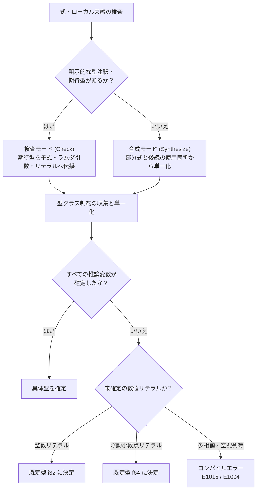

# 型推論

Tsuzuri は Hindley-Milner 型推論を基盤としつつ、周囲の期待型（expected type）を上から下へ伝播させる双方向型検査（bidirectional type checking）を組み合わせています。モジュールの公開境界となるトップレベル関数や型宣言には明示的な型注釈を要求し、関数内部のローカル束縛・ジェネリック型引数・ラムダ引数は文脈から静的に推論することで、高い可読性と迅速なエラー局所化を両立しています。

## 要点

- **境界明示・局所推論**: トップレベルの `def`・`record`・`union`・`type`・`const` には型注釈が必須であり、関数内の `let` や呼び出し時の型引数・ラムダ引数は推論されます。
- **遅延ラムダ検査と双方向推論**: 関数呼び出しではラムダ以外の実引数を先に検査して型パラメータを確定させてから、ラムダ本体を検査します。
- **ランク1多相とローカル単相規則**: トップレベル `def` は呼び出しごとに異なる型へ具体化できますが、ローカル `let` は単一の具象型に固定されます（未確定のまま残ると `E1015`、空コレクションは `E1004`）。
- **型主導のレコードフィールド解決**: `r.field` は受け手 `r` の確定した型から解決されるため、複数レコード間で同一フィールド名が衝突・シャドーイングしません。
- **演算子拡張インスタンスと匿名共用体の推論**: 異種型間の演算子ではリテラルへの型ヒントが一意な場合に限り自動適用され（曖昧なら `E1043`）、匿名共用体は期待型がある位置でのみ注入・拡大を行います。

## Hindley-Milner ベースの型推論と双方向検査

型チェッカーは単一化（unification）によって推論変数を解きながら、式の出現位置から決まる「期待される型」と、リテラルや後続の使用箇所から得られる制約の双方を統合します。



### 型注釈が必須な箇所と推論される箇所

| 区分 | 対象 | 省略時の挙動 |
| --- | --- | --- |
| **型注釈が必須** | トップレベル `def` の引数・戻り値、`record` のフィールド、`union` のペイロード、`type` エイリアス右辺、`const` 定数 | 構文エラー `E0002` |
| **自動推論** | ローカル `let` / `use` 束縛、関数呼び出し・レコード構築の型引数、ラムダ式の引数と戻り値、ジェネリック関数本体の型クラス制約 | 型が一意に定まらない場合のみ `E1015` / `E1004` |

### 後続の使用からの推論とラムダ引数の遅延検査

接尾辞のない数値リテラルや配列リテラルは、宣言時点だけでなく同一関数内の後続の使用箇所からも型が推論されます。また、関数呼び出しやパイプライン `|>` の実引数にラムダ式が含まれる場合、コンパイラは**ラムダ以外の実引数を先に検査**してジェネリック型パラメータを確定させてからラムダ本体を検査します（実行時の評価順序自体は常に左から右のまま変わりません）。

```tsuzuri run=42:11
def accept_i64 :: i64 -> i64 = \n -> n + 2

let base = 40
let words = ["apple", "banana"]
let total_len = Array.map (\w -> w.length) words |> Array.sum

$"{accept_i64 base}:{total_len}"
```

上の `Array.map (\w -> w.length) words` では、第 2 引数 `words`（`[string]`）が先に検査されて要素型が `string` と確定するため、第 1 引数のラムダで `\w` に型注釈を書かなくても `w.length` が正しく解決されます。

### 型クラス制約の自動推論

ジェネリック関数のシグネチャに型クラス制約を明記しなくても、関数本体で使用された演算子・所有権操作・呼び出し先関数の制約がコールグラフ全体（相互再帰を含む）を通じて自動推論されます。

```tsuzuri run=42:5.5
def add_twice :: 'a -> 'a -> 'a
    @'a : Copy = \x y -> x + y + y

$"{add_twice 10 16}:{add_twice 1.5 2.0}"
```

本体で `+` を使用しているため `Add<'a>` が自動的に推論され、`Add` を持たない型を渡した呼び出し側で `E1005` が報告されます。公開 API として契約を明示したい場合は `Add<'a> =>` や `@'a : Add` を併記できます。

## 多相値の具体化・単相規則・未確定型エラー

### トップレベル多相とローカル `let` の単相性

Tsuzuri はランク 1 多相（Rank-1 polymorphism）を採用しています。型変数を全称量化できるのはトップレベルの `def` シグネチャのみであり、関数内部のローカル `let` 束縛は**単相（monomorphic）**です。

```text
def bad :: unit -> i64 = \() ->
    let id = \x -> x
    let a = id 42        // ここで id の型が i32 -> i32 に確定
    let b = id "hello"   // E1003: expected i32, found string
    0
```

複数の型に対して呼び分けたい補助関数は、トップレベルの `def`（または `private def`）として定義します。

### 未確定型エラー（`E1015`・`E1004`）と注釈の付け方

式の型が関数の末尾まで推論変数のまま残った場合、数値リテラル以外は既定型へフォールバックせずコンパイルエラーになります。

| 状況 | エラーコード | 注釈による解決方法 |
| --- | --- | --- |
| 空の配列リテラル `let xs = []` | `E1004` | `let xs: [i64] = []` または `[i64]` を期待する関数へ直接渡す |
| 空の連結リストリテラル `let xs = [\|\|]` | `E1004` | `let xs: [\|string\|] = [\|\|]` のように要素型を注釈する |
| ペイロードなしの多相ケース `let m = None` | `E1015` | `let m: Maybe<i64> = None` のように型引数付きの型を注釈する |
| 戻り値のみで型が決まる多相呼び出し `Default.default()` / `Parse.parse s` / `FixedArray.init f` | `E1015` | 束縛側 `let v: i64 = Default.default()` または戻り値型で期待型を与える |
| 一度も具象型で呼ばれないローカルラムダ `let f = \x -> x` | `E1015` | `let f: i64 -> i64 = \x -> x` と注釈するか不要な束縛を削除する |
| 期待型のない `Dyn.of value` | `E1015` | `let d: dyn Display = Dyn.of value` のように対象の `dyn` 型を明示する |
| シグネチャに存在しない型変数を関数内注釈に記述 | `E1015` | 関数の `def` シグネチャの型変数と一致させる |

```tsuzuri run=0:true:3
let empty_nums: [i64] = []
let nothing: Maybe<string> = None
let fixed: [i64; 3] = FixedArray.init (\i -> i)

$"{empty_nums.length}:{Maybe.is_none (ref nothing)}:{fixed.length}"
```

## レコードフィールド解決とパターン推論

OCaml や旧来の ML 系言語ではレコードのフィールド名がモジュール全体のグローバルな名前空間に属し、同名フィールドを持つレコードが後から定義されると前の定義を隠す問題がありました。Tsuzuri では**型主導（type-directed）のフィールド解決**を行うため、同じモジュール内の複数のレコードが `id` や `x` といった同一のフィールド名を自由に共有できます。

1. **リテラル構築**: 常にレコード名を指定して `User { id: 1, name: "A" }` のように構築するため、フィールド名からの逆引きは不要です。
2. **フィールドアクセスと更新**: `value.id` や `{ value with id = 2 }` は、先に `value` の型を解決し（`ref` / `ref mut` は自動参照外し）、確定したレコード定義からフィールドを検索します。なお、配列・リスト・`Vec`・固定長配列・文字列に対する `.length` も同様に受け手の型から解決されます。
3. **未注釈ラムダでの注意点**: `\r -> r.x` のように呼び出し文脈からも引数注釈からも `r` のレコード型がまだ決まっていない状態で `r.x` にアクセスすると、フィールド名だけからレコード型を推測することはせず `E1005`（`field access requires a record, or '.length' ...`）となります。この場合は `\(r: Point) -> r.x` と引数に型注釈を付けるか、パターンでレコード名を指定します。
4. **レコードパターン**: `Point { x = a, y = b }` のように型名を明示したパターンは未知の検査対象を `Point` 型と単一化して型を確定させます。一方、型名を省略した `{ x = a }` パターンは検査対象のレコード型がすでに確定している文脈でのみ使用できます（未確定なら `E1004`）。

```tsuzuri run=110
record User { id: i64, name: string }
record Order { id: i64, total: i64 }

let read_order_id = \(Order { id = order_id, total = amount }) -> order_id + amount

let user = User { id: 1, name: "Alice" }
let order = Order { id: 9, total: 100 }
user.id + read_order_id order
```

## 演算子拡張インスタンスと匿名共用体における推論規則

### 演算子拡張インスタンス（OEI）の解決順序

スカラーと行列・テンソル・独自レコードの積（`price * 3`、`2.0 * tensor`）のような異種型間算術を扱う[演算子拡張インスタンス](type-classes.md)では、既存の同型演算との互換性を壊さないよう以下の厳密な順序で型推論が行われます。

1. **接尾辞なし数値リテラルへの型ヒント**: 一方のオペランドが接尾辞のない数値リテラルであり、他方のオペランドの先頭が名前付き型（`Money`、`Tensor<f64>` など）である場合、演算子テーブルからそのリテラルが取り得る数値型を検索します。候補がちょうど 1 つならリテラルの期待型として採用し、2 つ以上（例: `Mul<Money, i32, Money>` と `Mul<Money, i64, Money>` の両方が存在するときの `price * 3`）なら既定型 `i32` へ勝手にフォールバックせず曖昧エラー **`E1043`**（`ambiguous_instance_candidates`）を報告します。
2. **同型インスタンスの優先判定**: 両辺の型が単一化可能であり、通常の 1 型引数インスタンス（組み込みの数値算術や `Add<Point>` など）に一致する場合は通常の同型演算として確定します。そのため、両辺とも型未確定のラムダ `\a b -> a * b` は常に同型演算として推論されます。
3. **異種型テーブルの検索**: 両辺が単一化できず、少なくとも一方の先頭が名前付き型で、かつ両辺とも未解決の推論変数でない場合（ジェネリック関数の型パラメータ `'a` は既知の型として扱います）に拡張インスタンスを検索します。一致する候補が 1 つならその出力型 `Output` に確定し、複数残れば `E1043`、0 件なら `E1003` / `E1005` となります。

なお、`let k = 2` のように一度ローカル変数へ束縛した値はリテラルではないため、後で `price * k` に渡された際もステップ 1 のリテラル型ヒントの対象にはならず、必要に応じて接尾辞や型注釈を付けます。

```tsuzuri run=750
record Money { cents: i64 }

instance Mul<Money, i64, Money> {
    fn mul m scale = Money { cents: m.cents * deref scale }
}

let item = Money { cents: 250 }
(item * 3).cents
```

### 匿名共用体への注入と拡大の境界

期待型が[匿名共用体](anonymous-unions.md) `(A | B)` に定まっている位置では、要素型の値を自動的に包み（注入）、より要素の少ない匿名共用体のタグを付け替えます（拡大）。

- 接尾辞のない数値リテラルは匿名共用体の要素型から候補を選び、複数の数値型候補がある場合は `E1041`（例: `(i32 | i64)` に対する `10`）として明示接尾辞を要求します。
- 期待型が存在しない位置では、型推論が勝手に匿名共用体を合成することはありません（`let xs = [1, "a"]` は `E1003` になり、`let xs: [(i64 | string)] = [1, "a"]` と期待型を明示します）。

## 型つき穴 `?` による対話的型確認

実装途中の式の位置に `?`（または識別子を添えた `?todo`）を置くと、コンパイラはその位置を**型つき穴（typed hole）**として扱い、診断コード **`E1030`**（`typed_hole`）によって以下を報告します。

- その位置で期待されている型（未確定部分は `_`）
- スコープ内で参照可能なローカル変数とその型（最大 32 件、期待型に合致するものを優先表示）
- スコープ内の値・フィールド・関数呼び出しでその型を構築できる候補式（関数内の先頭 16 個の穴まで最大 10 件）

```text
def next_index :: i64 -> i64 = \current -> current + ?
```

上記に対する `tsuzuri check` の診断出力は次のとおりです（終了コード `1`）。

```text
./Main.tz:1:54: error[E1030]: typed hole '?' of type 'i64'; replace it with an expression of that type
  1 | def next_index :: i64 -> i64 = \current -> current + ?
    |                                                      ^
  help: fill the hole with a value of type 'i64'
  fix (maybe): Replace '?' with 'current'
```

穴は連鎖的な型エラーを抑制しつつバイナリ生成を確実に停止するため、複雑なジェネリック呼び出しやコンピュテーション式の中で期待型を確認する手段として活用できます。なお、`?` はエラー伝播演算子ではありません。

## 関連項目

- [型システムの概要](overview.md)
- [プリミティブ型](primitive-types.md)
- [レコード](records.md)
- [匿名共用体](anonymous-unions.md)
- [ジェネリクス](generics.md)
- [型クラス](type-classes.md)
- [ラムダ式](../expressions/lambdas.md)
- [診断メッセージとエラーコード](../compiler/diagnostics.md)
